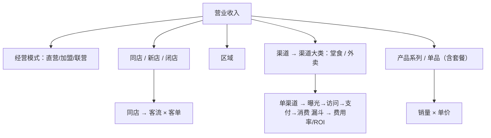

# 需求分析

> 文档编号：CBA-REQ-001 ｜ 版本：v2.0 ｜ 日期：2026-11-08 ｜ 适用基线：git tag **v0.3.4**
> 关联：[README（文档集索引）](README.md)、[07-维护与版本记录](07-维护与版本记录.md)、`openspec/changes/build-catering-analysis-platform/{proposal,design,tasks}.md`、`docs/domain/data-caliber-notes.md`、`backend/seed/README.md`

## 1. 文档信息与修订记录

### 1.1 文档信息

| 项 | 内容 |
|---|---|
| 文档编号 | CBA-REQ-001 |
| 文档名称 | 需求分析（餐饮经营分析系统） |
| 当前版本 | v2.0 |
| 适用基线 | `v0.3.4`（2026-11-08，安全补丁版） |
| 编写日期 | 2026-11-08 |
| 作者 | 产品经理（PM） |
| 文档状态 | 一期需求已实现并验收；二期需求仅规划，未实现 |
| 需求唯一真相 | `openspec/changes/build-catering-analysis-platform/`（proposal → 10 个 specs → design → tasks） |
| 口径唯一真相 | `docs/domain/data-caliber-notes.md`（差异与默认取数规则）、`backend/seed/README.md`（示例数据来源与 16 条口径差异） |
| 读者 | 业务方、产品、开发、测试、实施讲师、接任维护者 |

### 1.2 修订记录

| 版本 | 日期 | 变更说明 | 作者 | 对应基线 |
|---|---|---|---|---|
| v1.0 | 2026-11-08 | 首次编写：一期背景/目标/干系人/范围/FR-01~FR-12/NFR/数据口径/追溯矩阵/风险，并如实标注二期未实现与已知限制 | 产品 | `v0.3.1` |
| v2.0 | 2026-11-08 | 同步 v0.3.3 修复；文档集扩为 01–18 | 产品 | `v0.3.3` |
| v2.1 | 2026-11-08 | 同步 v0.3.4 安全修复与 63 测试 | 产品 | `v0.3.4` |

### 1.3 本文档与 OpenSpec 的关系

| 本文档章节 | 派生自 | 说明 |
|---|---|---|
| §2 背景 | `proposal.md` §Why | 原文痛点 + 仓库内 Excel/PPT 提取报告佐证 |
| §5 方法 | `proposal.md` §What Changes、`CLAUDE.md`「核心分析方法」 | 连环替代法、利润桥、拆解维度 |
| §6 范围 | `proposal.md` §交付节奏、`design.md` §13 页面矩阵 | 一期可用 / 半可用 / 骨架的判定以 design §13 为准 |
| §7 功能需求 | 10 个 `specs/*/spec.md` 的 Requirement | 每条 FR 标注对应 spec 与实现/测试证据 |
| §9 数据需求 | `design.md` §10/§11/§14、`data-caliber-notes.md`、`backend/seed/README.md` | 数字以 design §14 为验收基准 |
| §10 验收 | `tasks.md` 阶段一 + `design.md` §17 | 可执行验证方式，不写无法落地的标准 |

## 2. 项目背景与问题陈述

### 2.1 现状：Excel + PPT 手工月度分析

目标客户是连锁餐饮总部/区域运营。当前月度经营分析的做法是：用一份 16 张工作表的 Excel 模型（`docs/利润桥及毛利率分析-高维第二期261003.xlsx`）算数，再把结果手工贴到 80 页 PPT 模版（`docs/高维学堂经营分析与科学决策月度分析模版20261002.pptx`）里讲课/汇报。

### 2.2 痛点（可举证）

| # | 痛点 | 具体表现 | 证据 |
|---|---|---|---|
| 1 | 数据靠复制粘贴 | 每月从 POS/外卖/点评后台导出，人工对齐到宽表；科目为行、月份为列 | `proposal.md` §Why |
| 2 | 公式靠 OFFSET 跨表引用 | 跨表取当月/累计；「第三步」大量 `#REF!` 外部链接，只有缓存值 | `data-caliber-notes.md` §9 |
| 3 | 换月/换店就重做 | 换期间要重拉列、换门店要重做透视，无参数化 | `proposal.md` §Why |
| 4 | 无法推演 | 「客单价提高 5 元利润会怎样」只能手工试算，无实时结果 | `proposal.md` §Why、`specs/sandbox-simulation/spec.md` |
| 5 | 口径混乱且不可追溯 | 收入有 760/759.56/759.95/760 四套合计；同店渠道分摊两套口径；PPT 与 Excel 数字不一致 | `data-caliber-notes.md` §2/§3/§8 |
| 6 | 结论靠人 | 分析结论与整改建议依赖分析师个人经验，不能沉淀为规则 | `specs/summary-plan/spec.md`、`design.md` §15 |
| 7 | 上下游不对齐 | Excel 自身的序列号期间、`lastCol` 声明不可信、图表对象不可读，导致每月返工 | `data-caliber-notes.md` §9 |

### 2.3 机会

把「比差异 → 找问题 → 定计划 → 达目标」这套已经被验证的分析方法产品化：数据导入后自动出结果，每个数字都能按因素下钻到门店/渠道/菜品，结论与动作由规则生成，二期再加沙盘推演与结果方案。一期先做**收入分析**单点验证（15 分钟演讲 Demo）。

## 3. 目标与成功标准

### 3.1 一期目标（2026-11-15 培训课 Demo）

| 目标 | 说明 | 对应计划 |
|---|---|---|
| 一周内交付可演示系统 | 2026-11-08 方案定稿 → 2026-11-15 演示（D0–D7） | `docs/sprint-7d.md` 里程碑表 |
| 数字与 Excel 一致 | 关键数字逐项复现 design §14，pytest 与 `shared/fixtures` 断言 | `design.md` §14/§17、`tasks.md` 9.1/9.2 |
| 15 分钟能讲完 | 6 段固定动线，断网可讲（前端 mock 同套数字） | `docs/demo/演示脚本.md` |

### 3.2 成功标准（可判定）

| # | 标准 | 判定方式 | 当前结果 |
|---|---|---|---|
| S-1 | design §14 全部关键数字可复现 | `pytest`（63 项）+ `shared/fixtures/*.json` | 通过（`backend/tests/test_api.py`、`test_engine.py`） |
| S-2 | 真实后端下页面无白屏、无 console error | 13 张走查截图 `docs/demo/screenshots/real-*.png` | 通过（`docQA/20261108_0615_*.md` §三） |
| S-3 | 一键加载示例数据即可演示 | `python -m app.seeds.load_seed` | 通过（`scripts/smoke.sh` 临时库灌数） |
| S-4 | 15 分钟动线走完不出错 | 按 `docs/demo/演示脚本.md` 彩排 | 通过（`docQA/20261108_0615_*.md` §三） |
| S-5 | 断网可讲 | `VITE_API_MODE=mock` | 支持（`frontend/src/api/mock/`） |
| S-6 | 前端构建可被 FastAPI 托管 | `VITE_API_MODE=real npm run build` | 通过（`docQA` §三） |

### 3.3 二期目标（未实现，仅规划）

商用完整版：补齐毛利、费用、顾客 & 竞争、总结 & 计划、沙盘预演与结果方案、报告导出，并预留多租户与权限（`tasks.md` 阶段二，18 项全部未勾选）。

## 4. 干系人与用户角色

| 角色 | 关注问题 | 使用频次 | 主用页面 | 成功度量 |
|---|---|---|---|---|
| 老板 / 总经理 | 收入利润为什么变、能否复制、下月怎么定目标 | 月度 | 数据看板、营业利润分析、结论与计划 | 5 分钟内看懂「+240 万从哪来」 |
| 区域运营 / 店长 | 我的门店为什么掉、哪个时段/渠道掉 | 周度 | 同店异动、门店详情、渠道下钻 | 能定位到门店 + 时段/渠道 |
| 财务 | 科目金额、费率、口径是否对得上账 | 月度 | 营业利润分析（利润表对比）、数据导入 | 数字与源表一致、差异有说明 |
| 数据分析 / 经营分析岗 | 拆解是否闭合、口径是否可追溯、能否复用 | 月度 | 收入结构、产品下钻、全部脚注 | 因素影响之和闭合、口径可查 |
| 授课讲师（高维学堂） | 能否用真实数据讲透方法论 | 课次 | 收入链路全部页面 + 骨架页说明 | 15 分钟内讲完 6 段动线 |
| 开发 / 维护（含多 Agent 协作） | 规格是否唯一、验收是否可自动化 | 持续 | `openspec/changes/*`、`docs/engineering/*` | 改一处口径能定位到 doc/测试/接口 |

### 4.1 职责与关注点（RACI 简表）

| 活动 | 业务方 | 产品/PM | 开发 | 测试/评审 | 讲师 |
|---|---|---|---|---|---|
| 确认口径 | A | R | C | C | I |
| 定范围/优先级 | A | R | C | I | I |
| 实现与自测 | I | I | R | C | I |
| 验收（数字/页面） | C | A | C | R | C |
| 演示与话术 | C | C | I | I | R |

> R=负责、A=审批、C=咨询、I=知会。

## 5. 业务流程与分析方法

### 5.1 分析闭环

一期落地情况：**比差异 / 找问题** 已实现到收入链路；**定计划** 做到「规则化结论 + 3 条建议动作」；**达目标**（下月目标、沙盘推演、计划导出）为二期骨架页。

来源：`specs/revenue-analysis/spec.md` Purpose、`docs/demo/演示脚本.md` 主线。

### 5.2 对比基准

| 基准 | 含义 | 一期状态 | 证据 |
|---|---|---|---|
| 同期（yoy，默认） | 2025-09 vs 2024-09；累计为 2025-01~09 vs 2024-01~09 | 可用 | `frontend/src/config/filters.ts`、`backend/app/services/analysis.py` |
| 预算（budget） | 实际 vs 预算 | 仅空态（「预算未导入」） | `api-contract.md` §通用约定、`ProfitPage.tsx` 「预算未导入」Tag |
| 上期（mom） | 实际 vs 上月 | 仅空态 | 同上 |
| 模型值 / 竞对 | 效率指标对比模型值、本店 vs 竞对 | 二期 | `specs/expense-analysis`、`specs/customer-competition-analysis` |

### 5.3 连环替代法（因素分析）

规则：按**固定顺序**逐项把基期值替换为本期值，每一步影响 = 替换后结果 − 替换前结果；所有因素影响之和必须等于总变动（误差 ≤ 0.01）。

| 场景 | 公式 | 顺序 | 一期实现 |
|---|---|---|---|
| 收入二因素 | 收入 = 客流 × 客单 | 客流 → 客单 | `backend/app/engine/chain_substitution.py`，pytest 覆盖 |
| 毛利额三因素 | 毛利额 = 销量 ×（单价 − 单位成本） | 销量 → 单价 → 单位成本 | 引擎已实现，毛利页二期 |
| 利润桥 | 见 §5.4 | 9 项固定 | `backend/app/engine/profit_bridge.py` |
| 产品量价 | 收入 = 销量 × 单价 | 销量 → 单价 | `backend/app/engine/revenue.py` |

示例（同店）：客流影响 =（本期客流 66,566.29 − 59,344.75）× 基期客单 128.08 = **+92.07 万**；客单影响 = 66,566.29 ×（128.78 − 128.08）= **+5.08 万**；合计 97.16，与同店收入变动 97.28 差 0.12 万为源表取整尾差（`backend/seed/README.md` §3-2）。

### 5.4 利润桥

| 因素类型 | 计算规则 | 示例（2025-09） |
|---|---|---|
| 收入规模 | （本期收入 − 基期收入）× 基期边际贡献率 41.87% | +100.48 |
| 变动成本（按费率） | （基期费率 − 本期费率）× 本期收入 | 食材 −10.42、优惠及手续费 +12.93、水电气 +2.17、宣传 +7.39 |
| 固定费用（按绝对额） | 基期金额 − 本期金额 | 工资 −12.03、宿舍 −1.66、店铺 −13.76、其它 −37.00 |

合计 +48.10，基期 64.60 → 本期 112.70（`design.md` §14、`backend/app/engine/profit_bridge.py`）。科目分类存 `account.cost_behavior`，默认与 Excel 一致（`design.md` §5）。

### 5.5 收入拆解维度树

来源：`design.md` §10 数据模型、`CLAUDE.md`「核心分析方法」、`specs/revenue-analysis/spec.md`。

## 6. 范围

### 6.1 一期范围（已实现）

| 能力 | 一期状态 | 页面/接口证据 |
|---|---|---|
| 登录、应用框架（深色导航、顶栏、数据就绪状态） | 可用 | `frontend/src/layouts/AppLayout.tsx`、`backend/app/api/auth.py` |
| 全局筛选（品牌/门店/期间/当月累计/对比基准，写 URL） | 可用 | `frontend/src/components/FilterBar.tsx`、`filters/FilterContext.tsx` |
| 数据导入（8 类数据集、模板下载、校验、预览、确认、覆盖、回滚、就绪状态、示例数据） | 可用 | `frontend/src/pages/data/DataPage.tsx`、`backend/app/importers/`、`backend/app/api/imports.py` |
| 经营总览（4 KPI + 利润桥 + 一句话结论） | 可用 | `pages/dashboard/DashboardPage.tsx`、`GET /api/analysis/overview` |
| 营业利润对比（利润表对比 + 利润桥；预算达成/评分/板块汇总占位） | 半可用 | `pages/profit/ProfitPage.tsx`、`GET /api/analysis/profit` |
| 收入分析（导航 5 项 + 门店详情/渠道详情 2 个下钻页，共 7 条路由） | 可用 | `frontend/src/pages/revenue/*`、`GET /api/analysis/revenue/*` |
| 规则化洞察（`insights[]`，按影响绝对值前 3） | 可用 | `backend/app/engine/insights.py`、`components/InsightPopover.tsx` |
| 二期骨架页 6 个（毛利/费用/顾客&竞争/总结&计划/沙盘/报告） | 骨架（可见、可导航、标注二期） | `pages/skeleton/SkeletonPages.tsx`、`components/SkeletonPage.tsx` |

### 6.2 二期范围（未实现，仅规划）

毛利分析、费用分析、顾客 & 竞争分析、总结 & 计划、沙盘预演与结果方案、报告导出（HTML/PDF/PPT）、多租户与权限。对应 `tasks.md` 阶段二 §10–§15（18 项全部 `[ ]`）。

### 6.3 明确不做（一期决策）

| 不做项 | 原因/替代 | 证据 |
|---|---|---|
| 接大模型生成洞察 | 按规则生成，来源 PPT 知识库页 67–79 | `proposal.md` 一期决策 6、`design.md` §7 |
| 第三方平台 API 自动拉数 | 一期只做 Excel/CSV 导入，importer 抽象层已留 | `proposal.md` §Impact、`答疑清单.md` Q12 |
| 多租户与细粒度权限 | 一期单管理员账号 | `design.md` Non-Goals、§9 |
| 移动端适配 | 桌面 1440 宽演示 | `design.md` Non-Goals |
| Docker / CI | 本机 uvicorn + Vite 构建，冒烟靠 `scripts/smoke.sh` | `README.md`、`scripts/smoke.sh` |
| 实时流式数据 / 电商/中央厨房板块细化 | 数据格式待真实数据到位 | `design.md` Open Questions |
| 预算/上期真实基准计算 | 一期只显示空态（不伪造 0） | `docQA/20261108_0615_*.md` §五-2 |

## 7. 功能需求清单

### 7.1 FR 总览

| FR | 名称 | 优先级 | 一期状态 | 对应 spec |
|---|---|---|---|---|
| FR-01 | 登录与访问控制 | P0 | 可用 | `app-workspace`（登录访问控制） |
| FR-02 | 应用框架、导航与全局筛选 | P0 | 可用 | `app-workspace`（导航 / 全局筛选 / KPI 规范） |
| FR-03 | 数据导入与数据就绪 | P0 | 可用 | `data-import`（8 条 Requirement） |
| FR-04 | 经营总览与利润桥 | P0 | 可用 | `profit-analysis`、`factor-analysis-engine` |
| FR-05 | 利润表对比（当月/累计） | P1 | 半可用 | `profit-analysis`（利润表对比） |
| FR-06 | 收入结构（6 维度） | P0 | 可用 | `revenue-analysis`（收入结构拆解） |
| FR-07 | 同店异动与门店/时段下钻 | P0 | 可用 | `revenue-analysis`（客流客单 / 时段下钻） |
| FR-08 | 渠道下钻、漏斗与平台 ROI | P0 | 可用 | `revenue-analysis`（渠道 / 漏斗 / ROI） |
| FR-09 | 产品量价与套餐 | P0 | 可用 | `revenue-analysis`（量价 / 套餐） |
| FR-10 | 结论与建议 | P0 | 可用 | `revenue-analysis`（异动汇总）、`summary-plan`（二期） |
| FR-11 | 规则化洞察 | P1 | 可用 | `app-workspace`（规则化洞察）、`design.md` §15 |
| FR-12 | 二期骨架页 | P1 | 骨架 | 6 个模块 spec（gross/expense/customer/summary/sandbox） |

### FR-01 登录与访问控制

| 项 | 内容 |
|---|---|
| 描述 | 单管理员账号登录；未登录访问任何页面/接口被拒；JWT 存 httpOnly cookie |
| 输入 | 用户名、密码（默认 `admin/admin123`，环境变量 `CBA_ADMIN_USERNAME`/`CBA_ADMIN_PASSWORD` 可覆盖） |
| 处理 | bcrypt 校验 → 签发 JWT（12h）→ Set-Cookie `cba_session`（httpOnly、SameSite=Lax） |
| 输出 | 登录成功进入数据看板；未登录接口 401、页面跳 `/login`；登出清 cookie |
| 优先级 | P0 |
| 对应 spec | `specs/app-workspace/spec.md`「登录访问控制」 |
| 实现证据 | `backend/app/api/auth.py`、`backend/app/services/auth.py`、`frontend/src/auth/RequireAuth.tsx`、`pages/login/LoginPage.tsx`、`backend/tests/test_api.py` |

**验收标准**
- AC-01-1 未登录调用 `/api/analysis/overview` 返回 401；前端跳转登录页（`RequireAuth.tsx`）。
- AC-01-2 正确账号登录后 `GET /auth/me` 返回 200 与用户名（`test_api.py`）。
- AC-01-3 账号密码不写入代码，通过环境变量初始化（`backend/app/config.py`）。

### FR-02 应用框架、导航与全局筛选

| 项 | 内容 |
|---|---|
| 描述 | 深色 Sider + 白色顶栏 + 浅灰内容区；导航按分析步骤组织；顶栏全局筛选作用于所有模块 |
| 输入 | 筛选：品牌、门店（全部/单店）、期间、口径（当月/累计）、对比基准（同期/预算/上期） |
| 处理 | 筛选值写入 URL query（`brand/store/period/mode/baseline`），刷新后保留；切换菜单保持筛选；KPI 卡按指标好坏方向着色 + 箭头 + 分位行 |
| 输出 | 页面标题（顶栏蓝竖线）、导航选中态、底部数据就绪状态（`x/8 类数据集就绪` 或「数据不完整」） |
| 优先级 | P0 |
| 对应 spec | `specs/app-workspace/spec.md`「侧边导航按分析步骤组织」「全局筛选」「KPI 卡片展示规范」 |
| 实现证据 | `frontend/src/layouts/AppLayout.tsx`（NAV_ITEMS）、`components/FilterBar.tsx`、`filters/FilterContext.tsx`、`utils/routes.ts`、`theme.ts`、`components/KpiCard.tsx`、`backend/app/api/data_status.py` |

**验收标准**
- AC-02-1 菜单顺序与 `AppLayout.tsx` 一致：数据看板、营业利润分析、收入分析（5 子项）、毛利分析、费用分析、顾客 & 竞争分析、总结 & 计划、沙盘预演、结果方案报告、数据导入。
- AC-02-2 刷新页面后筛选值保留（URL 参数）；预算/上期基准显示「未导入」空态而非 0。
- AC-02-3 成本率上升显示负向色 + `+1.04pp`（`components/KpiCard.test.tsx`、`utils/metrics.test.ts`）。
- AC-02-4 门店少于 3 家不显示分位行，改为提示文案（`KpiCard.tsx`）。

### FR-03 数据导入与数据就绪

| 项 | 内容 |
|---|---|
| 描述 | 8 类数据集（月度利润表、门店收入、渠道收入、产品系列销售、单品销售、线上漏斗、时段客流、预算与目标）的模板、校验、预览、两阶段提交、覆盖、批次回滚、数据就绪状态、示例数据一键加载 |
| 输入 | xlsx/csv（≤10MB）；数据集 key；可选科目映射 |
| 处理 | 解析 → 逐行校验（期间 YYYY-MM、金额非负、门店存在、科目在标准表内、渠道在清单内）→ draft 批次 → 预览前 50 行 → 确认 commit；同数据集+门店+期间命中旧行则给出覆盖提示并整体替换（`superseded_by`） |
| 输出 | 错误表（行号+列名+原因）、预览、批次记录（数据集/文件名/期间/行数/操作人/时间/状态）、回滚后恢复旧数据 |
| 优先级 | P0 |
| 对应 spec | `specs/data-import/spec.md`（标准模板 / 导入前校验 / 预览确认 / 重复覆盖 / 批次回滚 / 数据就绪 / 示例数据） |
| 实现证据 | `backend/app/importers/registry.py`（8 个 DatasetSpec）、`backend/app/importers/service.py`（校验/提交/回滚/模板）、`backend/app/api/imports.py`、`frontend/src/pages/data/DataPage.tsx`、`backend/tests/test_importers.py`、`backend/app/seeds/load_seed.py` |

**验收标准**
- AC-03-1 合法文件校验通过可入库；非法文件给出行号+列名+原因且「确认导入」禁用（`test_importers.py`、`pages.smoke.test.tsx` 数据导入用例）。
- AC-03-2 draft 批次不写事实表，commit 后才写入；重复导入同期间同门店为覆盖而非累加；回滚恢复旧数据（`test_importers.py`）。
- AC-03-3 模板表头与 Excel 原始中文列名一致（`registry.py` 列定义）。
- AC-03-4 缺 2024-09 利润表时 `/api/data-status` 返回缺失项，页面提示「缺少 2024-09 月度利润表」（`test_api.py`、`test_importers.py`）。
- AC-03-5 空库加载示例数据后能复现 design §14 全部数字（`app/seeds/load_seed.py`、`scripts/smoke.sh`）。
- AC-03-6 「下载模板」可用：页面按钮 `fetch /api/imports/templates/{key}.xlsx`（带登录 cookie）→ blob 下载对应数据集 xlsx；上传 accept 收敛为 `.xlsx/.xlsm/.csv/.txt`（v0.3.3 修复）。

### FR-04 经营总览与利润桥

| 项 | 内容 |
|---|---|
| 描述 | 首页四张 KPI 卡（营业收入、营业利润、综合毛利率、同店增速 + 门店分位）、利润桥瀑布图（9 因素）、一句话结论、口径/来源脚注 |
| 输入 | period=2025-09、baseline=yoy、brand/store 筛选 |
| 处理 | 后端按长表聚合 → `compare` / `profit_bridge` / `percentiles` → 组装 `data + meta + insights` |
| 输出 | KPI（值/对比/差异/差异率/pp）、瀑布图（起点 64.60 → 终点 112.70）、因素表、结论文本 |
| 优先级 | P0 |
| 对应 spec | `specs/profit-analysis/spec.md`「利润桥瀑布图」、`specs/factor-analysis-engine/spec.md`「营业利润桥」「门店分位数」 |
| 实现证据 | `pages/dashboard/DashboardPage.tsx`、`components/{KpiCard,Waterfall,FactorTable}.tsx`、`backend/app/engine/{profit_bridge,percentiles}.py`、`GET /api/analysis/overview`、`shared/fixtures/profit_bridge_2509.json` |

**验收标准**
- AC-04-1 收入 1000.00 / 760.00（+240.00，+31.58%）；营业利润 112.70 / 64.60（+48.10，+74.46%）；综合毛利率 73.30% / 74.34%（−1.04pp）（`test_api.py`）。
- AC-04-2 利润桥 9 项与 design §14 完全一致，合计 +48.10（`test_engine.py`、`shared/fixtures/profit_bridge_2509.json`）。
- AC-04-3 基期利润 + 各因素影响 = 本期利润（误差 ≤ 0.01）。
- AC-04-4 分位行显示 P25/P50/P75 与本店值；门店级利润缺失时给 `percentile_hints` 说明而非伪造分位（`api-contract.md` §3）。

### FR-05 利润表对比（当月 / 累计）

| 项 | 内容 |
|---|---|
| 描述 | 按标准科目展示本期实际、占收入比、对比值、对比占比、增减额、增减率、占比变动（pp）；支持当月与累计 |
| 输入 | mode=month/ytd、baseline |
| 处理 | 按科目聚合（品牌口径优先 store 为空的行）；累计求和区间；营业利润 = 收入 − 全部成本费用 |
| 输出 | 利润表行 + 营业利润合计 + 利润桥（同 FR-04 引擎） |
| 优先级 | P1 |
| 对应 spec | `specs/profit-analysis/spec.md`「利润表对比」 |
| 实现证据 | `pages/profit/ProfitPage.tsx`、`GET /api/analysis/profit?mode=`、`backend/app/services/analysis.py`、`backend/tests/test_api.py` |

**验收标准**
- AC-05-1 当月：营业收入 1000 / 760、增减 +240、增减率 +31.6%；营业利润 112.70 / 64.60。
- AC-05-2 累计：2025-01~09 vs 2024-01~09 合计（示例数据 24 个月全量导入，`backend/seed/README.md` §3-10）。
- AC-05-3 预算达成、经营综合评分、板块汇总显示「二期」占位（`ProfitPage.tsx`、`design.md` §13「半可用」）。
- AC-05-4 累计口径下门店收入只有单月数据时，同店累计值为 `null`（显示「—」），不拿单月冒充累计（`backend/app/services/analysis.py` 注释与逻辑）。

### FR-06 收入结构（6 维度）

| 项 | 内容 |
|---|---|
| 描述 | 按经营模式、同店/新店/闭店、区域、渠道、渠道大类、产品系列 6 个维度展示本期/占比/对比值/对比占比/差额/增减率，并可切换柱图 |
| 输入 | `dimension=business_model\|store_type\|region\|channel\|channel_category\|series` |
| 处理 | 分项聚合 + 占比计算 + 差异计算；分项之和 = 该维度口径总收入 |
| 输出 | 结构表 + 柱状对比图 + 口径说明（门店口径 1000.23/759.95、渠道口径 1000.00/759.56、品类口径 1000.16/760） |
| 优先级 | P0 |
| 对应 spec | `specs/revenue-analysis/spec.md`「收入结构拆解」 |
| 实现证据 | `pages/revenue/StructurePage.tsx`、`components/BarChart.tsx`、`GET /api/analysis/revenue/structure`、`backend/app/engine/revenue.py`、`shared/fixtures/revenue_structure_2509.json` |

**验收标准**
- AC-06-1 同店 857.23 / 759.95、新店 143.00 / 0、合计 1000.23 / 759.95，新店占比 14.3%（`test_api.py` 维度断言）。
- AC-06-2 渠道维度：美团大众 460.00 / 336.00 / +124.00 / +36.9%，渠道合计 1000.00。
- AC-06-3 6 个维度均可切换，分项之和等于该维度合计（`test_api.py` 遍历 6 维度）。

### FR-07 同店异动与门店/时段下钻

| 项 | 内容 |
|---|---|
| 描述 | 同店汇总卡 + 客流×客单拆解条 + 13 家门店明细表 + 点击行下钻门店详情（三项对比 + 同店横向比较 + 时段客流表） |
| 输入 | 门店筛选（全部或单店）、期间、对比基准 |
| 处理 | 逐店计算客流影响/客单影响再汇总（不是汇总客流×汇总客单）；时段按日类型×时段聚合，标出下降主因 |
| 输出 | 同店 857.23/759.95、客流 66,566.29/59,344.75、客单 128.78/128.08、影响 92.07/5.08 + 0.12 尾差说明；门店 12：客流 4,556→4,276（−280）、工作日 −465 / 节假日 +185 |
| 优先级 | P0 |
| 对应 spec | `specs/revenue-analysis/spec.md`「同店收入客流客单拆解」「时段客流下钻」「图文口径与尾差说明」 |
| 实现证据 | `pages/revenue/SameStorePage.tsx`、`StoreDetailPage.tsx`、`GET /api/analysis/revenue/same-store`、`GET /api/analysis/revenue/store/{id}`、`backend/app/engine/revenue.py`、`shared/fixtures/same_store_2509.json` |

**验收标准**
- AC-07-1 同店 857.23 / 759.95、+97.28（+12.80%）；客流/客单影响 92.07 / 5.08，页面显示尾差说明。
- AC-07-2 13 家同店明细可点击进门店详情（`SameStorePage.tsx` 行点击 → `/revenue/store/:storeId`）。
- AC-07-3 门店 12 时段下钻：工作日 2,850→2,385（−465）、节假日 1,706→1,891（+185），并点名工作日 9:00-14:00 / 14:00-24:00 为下降主因（`pages.smoke.test.tsx` 门店详情用例）。
- AC-07-4 其他门店无时段数据时显示说明，不显示 0（`backend/app/services/analysis.py` `dayparts_note`）。

### FR-08 渠道下钻、漏斗与平台 ROI

| 项 | 内容 |
|---|---|
| 描述 | 渠道结构表 + 同店渠道异动（同店/新店分摊）+ 渠道洞察卡；单渠道详情含曝光→访问→支付→消费漏斗、两级转化率、平台费用率、毛利 ROI、销售 ROI、阈值对比与异常标记 |
| 输入 | 渠道 id；渠道分摊采用**本期渠道占比** |
| 处理 | 新店分摊 = 渠道本期收入 ×（新店收入 ÷ 收入合计）；同店 = 渠道本期 − 新店分摊；漏斗逐级转化；毛利 ROI = 平台毛利额 ÷ 平台费用（一期毛利额 = 平台收入 × 60%），销售 ROI = 平台销售额 ÷ 平台费用 |
| 输出 | 美团大众同店 394.23 / 新店 65.77 / 差额 +58.24（+17.3%）；漏斗 4,367,174 → 639,025（14.63%）→ 73,113（11.44%）→ 64,468（88.18%）；费用率 30%、毛利 ROI 2.00、销售 ROI 3.33 |
| 优先级 | P0 |
| 对应 spec | `specs/revenue-analysis/spec.md`「同店渠道异动」「点评曝光转化漏斗」「线上平台费用效率」 |
| 实现证据 | `pages/revenue/ChannelPage.tsx`、`ChannelDetailPage.tsx`、`components/ThresholdBar.tsx`、`GET /api/analysis/revenue/channel`、`/channel/{id}`、`backend/app/engine/revenue.py`、`shared/fixtures/{channel_split,funnel,roi}_2509.json` |

**验收标准**
- AC-08-1 渠道页美团大众 460/336/+124/+36.9%；同店 394.23、新店 65.77（`test_api.py`）。
- AC-08-2 单渠道漏斗与两级转化率、曝光-支付 1.67% 与 design §14 一致。
- AC-08-3 阈值：费用率 ≤15%、毛利 ROI ≥1、销售 ROI ≥4 可配置（`backend/app/config.py`、`GET /api/analysis/thresholds`）；费用率 30% 标 risk、销售 ROI 3.33 标 warning。
- AC-08-4 页面注明采用「本期渠道占比」分摊，并说明 Excel 另有一版同期占比口径（`ChannelPage.tsx` 口径说明）。

### FR-09 产品量价与套餐

| 项 | 内容 |
|---|---|
| 描述 | 系列/单品按「销量 → 单价」做连环替代，展示销量、占比、销售额、平均单价、菜品收入/优惠；套餐与单品分开统计；影响额排序 |
| 输入 | `scope=all\|same_store` |
| 处理 | 量价拆解 + 影响额排序 + 单品/套餐排行 |
| 输出 | 同店系列量价：销量 +91.50、单价 +5.67、合计 97.17；套餐 5,472 单 / 444,217.54 元 / 81.18 元 vs 432 / 66,080 / 152.96；量差 +770,933.33、价差 −392,795.79、合计 +378,137.54 |
| 优先级 | P0 |
| 对应 spec | `specs/revenue-analysis/spec.md`「套餐收入量价拆解」「系列与单品销量单价拆解」 |
| 实现证据 | `pages/revenue/ProductPage.tsx`、`GET /api/analysis/revenue/product`、`backend/app/engine/revenue.py`、`shared/fixtures/product_volume_price_2509.json` |

**验收标准**
- AC-09-1 同店系列量价 91.50 / 5.67 与合计 97.17 一致（`test_api.py`）。
- AC-09-2 套餐量价三项与 design §14 一致（`test_api.py`、`pages.smoke.test.tsx` 产品页用例）。
- AC-09-3 「降价换量」类系列（如主食类）在洞察中单独提示（`engine/insights.py` `product_insights`）。
- AC-09-4 单品明细与 Excel 表 4 非同一快照，页面注明；套餐量价只用表 4 汇总行（`ProductPage.tsx` 口径说明、`backend/seed/README.md` §3-6）。

### FR-10 结论与建议

| 项 | 内容 |
|---|---|
| 描述 | 收入异动汇总（新店/同店客流/同店客单/闭店）+ 规则化自动结论 + 三条建议动作（带责任部门） |
| 输入 | 期间/门店/基准 |
| 处理 | 四项汇总校验与总收入变动闭合（差异给尾差说明）→ 规则生成结论与动作 |
| 输出 | 新店 +143、同店客流 +92.07、同店客单 +5.08、闭店 0、合计 240.28；三条动作：巩固线上放量 / 主食类定价复盘 / 门店 12 客流下滑专项 |
| 优先级 | P0 |
| 对应 spec | `specs/revenue-analysis/spec.md`「收入异动汇总」；计划落地为二期 `summary-plan` |
| 实现证据 | `pages/revenue/ConclusionPage.tsx`、`GET /api/analysis/revenue/conclusion`、`backend/app/services/analysis.py`（ACTIONS）、`backend/app/engine/insights.py` `conclusion_insights` |

**验收标准**
- AC-10-1 四项汇总 = 总收入变动（示例 240.28），差额给尾差说明（`api-contract.md` §4 conclusion）。
- AC-10-2 页面显示 3 条动作，含责任部门（`ConclusionPage.tsx`、`analysis.py` ACTIONS）。
- AC-10-3 「待办整改清单 / 目标设定 / 导出」属二期，页面不提供（`ConclusionPage.tsx` 说明）。

### FR-11 规则化洞察

| 项 | 内容 |
|---|---|
| 描述 | 每个分析接口返回 `insights[]`，统一结构 `{level,title,text,evidence}`，按影响绝对值排序取前 3，不接大模型 |
| 输入 | 各分析结果（利润桥/结构/同店/门店/渠道/漏斗/ROI/产品/结论） |
| 处理 | 规则函数生成；阈值可配置（费用率 15%、毛利 ROI 1、销售 ROI 4、漏斗环比降 1pp、TOP_N=3） |
| 输出 | 卡片「洞察」Popover 文本（带数字与证据）+ 右下角 AI 洞察抽屉（规则版） |
| 优先级 | P1 |
| 对应 spec | `specs/app-workspace/spec.md`「规则化洞察结论」、`design.md` §15 |
| 实现证据 | `backend/app/engine/insights.py`、`backend/app/config.py`（阈值）、`components/InsightPopover.tsx`、`components/AiAssistantFab.tsx`、`api-contract.md` §5 |

**验收标准**
- AC-11-1 利润桥洞察按影响绝对值取前 3，文本含金额与证据（`test_api.py` 洞察断言）。
- AC-11-2 漏斗任一层转化率环比下降 >1pp 标异常（`insights.py` `funnel_insights`；页面显示「转化率异常」Alert）。
- AC-11-3 同店洞察按占比 ≥80% 判定客流或客单主导（`insights.py` `same_store_insights`，示例：客流主导）。
- AC-11-4 界面明确标注「规则版，不接大模型」（`AiAssistantFab.tsx` 标题）。

### FR-12 二期骨架页

| 项 | 内容 |
|---|---|
| 描述 | 毛利分析、费用分析、顾客 & 竞争分析、总结 & 计划、沙盘预演、结果方案报告 6 页可导航骨架 |
| 输入 | 无（不计算） |
| 处理 | 统一 `SkeletonPage` 组件渲染：标题 +「一期为框架展示，二期开放」Tag + 已规划能力清单 + 布局示意 + 返回收入分析入口 |
| 输出 | 6 条路由可见、可导航、不报错；沙盘页含布局示意与不可用控件 |
| 优先级 | P1 |
| 对应 spec | `specs/{gross-margin-analysis,expense-analysis,customer-competition-analysis,summary-plan,sandbox-simulation}/spec.md`（规划需求，未实现） |
| 实现证据 | `frontend/src/pages/skeleton/SkeletonPages.tsx`、`components/SkeletonPage.tsx`、`App.tsx` 路由、`design.md` §13 骨架页要求 |

**验收标准**
- AC-12-1 6 个骨架页均显示页面标题、「二期开放」标注、规划能力清单、返回收入分析入口（`design.md` §13）。
- AC-12-2 骨架页不得显示任何伪造业务数字（`pages.smoke.test.tsx` 骨架页用例）。
- AC-12-3 导航可达且不产生 console error（`docQA/20261108_0615_*.md` §三）。

## 8. 非功能需求（NFR）

| 编号 | 类别 | 要求 | 实现/证据 | 验证方式 | 状态 |
|---|---|---|---|---|---|
| NFR-01 | 性能 | 沙盘因子调整 1 秒内出结果（二期）；一期页面加载目标 ≤1s | 前端路由懒加载（`App.tsx` lazy）、`@tanstack/react-query` 缓存、SQLite 本地聚合 | 一期未做正式压测，无量化数据（待确认基线） | 目标，未验证 |
| NFR-02 | 性能 | 分析接口一次性返回 `data+meta+insights`，避免前端多次拼装 | `shared/api-contract.md` 统一响应；`frontend/src/api/hooks.ts` 每个页面一次查询 | 接口走查 | 已实现 |
| NFR-03 | 可用性 | 断网可演示 | `VITE_API_MODE=mock` 内置同套数字（`frontend/src/api/mock/`） | 断网走演示动线 | 已实现 |
| NFR-04 | 可用性 | 缺数据不得用 0 冒充，必须空态/「—」 | 接口返回 `null`；`EmptyState`、`PageState`、KpiCard `—` | vitest + 浏览器 | 已实现 |
| NFR-05 | 安全 | 密码 bcrypt（rounds=12）哈希，JWT 放 httpOnly cookie，除登录外全部要求登录 | `backend/app/services/auth.py`、`api/auth.py`、`api/__init__.py` protected_router | `test_api.py` 401/200 | 已实现 |
| NFR-06 | 安全 | CORS 白名单仅本机开发端口 | `backend/app/main.py`（5173） | 代码审查 | 已实现 |
| NFR-07 | 安全 | 账号/密钥走环境变量，不写死 | `backend/app/config.py`（`CBA_ADMIN_*`、`CBA_SESSION_SECRET`） | 代码审查 | 已实现 |
| NFR-08 | 兼容 | Chrome / Safari，1440 宽优先（演示 1440×900） | `docs/demo/演示脚本.md` 检查项；栅格 `xs/sm/xl` 断点 | 浏览器走查 | 已实现（仅桌面） |
| NFR-09 | 可维护 | 计算逻辑只实现一份（engine 纯函数），与页面解耦 | `backend/app/engine/*`（compare / chain_substitution / profit_bridge / mix_rate_split / percentiles / revenue / insights） | `test_engine.py`、`shared/fixtures` | 已实现 |
| NFR-10 | 可维护 | 前后端共用同一组验收用例 | `shared/fixtures/*.json`（8 组用例 + index.json） | pytest + vitest 读取 | 已实现 |
| NFR-11 | 可移植 | 不依赖 SQLite 专有语法，后续可换 PostgreSQL | SQLAlchemy 2.1 + Alembic 1.20（`backend/app/models/`、`backend/alembic/`） | 代码审查（未实际迁移 PG） | 已实现（未验证 PG） |
| NFR-12 | 可回滚 | 导入批次可回滚，覆盖不物理删除（`superseded_by`） | `backend/app/models/`、导入服务、`api/imports.py` | `test_importers.py` | 已实现 |
| NFR-13 | 可观测 | 导入批次记录操作人与时间；错误信息含行号/列名/原因 | `import_batch` 表、`imports.py` 错误结构 | `test_importers.py` | 已实现 |
| NFR-14 | 依赖边界 | 不依赖大模型、第三方平台 API；离线可跑 | `design.md` §7、`答疑清单.md` Q11/Q12 | 代码审查 | 已实现 |

## 9. 数据需求与口径

### 9.1 单位与精度

| 数据 | 单位 | 展示精度 | 说明 |
|---|---|---|---|
| 利润表/费用/利润/利润桥 | 万元 | 2 位小数 | 中间计算不取整 |
| 产品销售额、菜品收入、优惠、套餐金额 | 元 | 2 位小数 | |
| 客流 | 人次 | 整数 | 示例数据含 2 位小数的合计值（如 66,566.29） |
| 客单价 | 元/人次 | 2 位小数 | 收入 ÷ 客流；申报值优先 |
| 比率 | % | 1 位小数 | |
| 百分点变动 | pp | 2 位小数 | |

来源：`data-caliber-notes.md` §1、`design.md` §10、`components/format` 规则（`frontend/src/utils/format.ts`）。

### 9.2 期间与基线

- 默认期间 `2025-09`（`frontend/src/config/filters.ts`），对比基准 `yoy` → `2024-09`。
- 累计口径：`2025-01~09` vs `2024-01~09`（示例数据导入 24 个月，`backend/seed/README.md` §1）。
- 期间格式统一 `YYYY-MM`；Excel 序列号期间（45658、坏文本 `20245/1`）在导入层转换（`data-caliber-notes.md` §9）。

### 9.3 四套收入合计与尾差（页面必须分别标注）

| 口径 | 2024-09 | 2025-09 | 使用页面 |
|---|---|---|---|
| 利润表 | 760.00 | 1000.00 | 总览、利润桥、毛利率 |
| 渠道 | 759.56 | 1000.00 | 收入结构（渠道/渠道大类维度）、渠道下钻 |
| 门店 | 759.95 | 1000.23 | 同店异动、门店排行、结构页经营模式/同店新店/区域维度 |
| 品类 | 760.00 | 1000.16 | 产品量价、套餐 |

- 差异 0.05–0.23 万来自源表取整与汇总范围，**不强行对齐、不改写源数字**，页面脚注说明（`data-caliber-notes.md` §2、`backend/app/services/analysis.py` `dataset_note`）。
- 已知尾差 3 处：同店客流+客单影响 97.16 vs 同店收入变动 97.28（0.12）；同店渠道 394.23 − 336.00 = 58.23 vs 页面差额 58.24（0.01）；结论四项 240.15 vs 总收入变动 240.28（0.13）。均页面注明「尾差由四舍五入导致」（`backend/seed/README.md` §3）。

### 9.4 8 类数据集字段与来源

| # | 数据集（key） | 粒度 | 关键字段 | 单位 | 示例数据来源 |
|---|---|---|---|---|---|
| 1 | 月度利润表（`pl_monthly`） | 品牌/期间/科目 | 期间、门店、营业收入、8 个成本费用科目（必填）、税金及附加（可选） | 万元 | 「2025年月利润表数据」D2:AC11 |
| 2 | 门店收入（`store_revenue`） | 门店/期间 | 区域、经营模式、店型、营业收入、客流、客单价、同店/新店/闭店标识 | 万元/人次/元 | 「第二步-餐饮收入结构分析」E18:F32、收入异动分析 B80:N98 |
| 3 | 渠道收入（`channel_revenue`） | 门店/期间/渠道 | 渠道、渠道大类、收入 | 万元 | 「第二步」B4:H13、AA2:AG15 |
| 4 | 产品系列销售（`product_series`） | 门店/期间/系列 | 销量、销售额、菜品收入、优惠、实际成本、理论单位成本 | 元/份 | 「第二步」C29:H36、第三步、第四步 |
| 5 | 单品销售（`product_item`） | 门店/期间/单品 | 产品系列、产品名称、销量、金额、是否套餐 | 元/单 | 「第二步」B53:M57（表 4 汇总）、套餐明细块 |
| 6 | 线上漏斗（`funnel`） | 门店/期间/渠道 | 曝光、访问、支付、消费、平台费用、品牌/新老客 | 人次/元 | 「标杆品牌点评曝光转化数据」25 店合计 |
| 7 | 时段客流（`daypart`） | 门店/期间/日类型/时段 | 日类型、时段、客流 | 人次 | 收入异动分析 B103:H114（仅门店 12） |
| 8 | 预算与目标（`budget_target`） | 品牌/期间/科目；期间/渠道 | 预算值；新客量、曝光转化率、客单价、毛利率、新客成本、目标 ROI | 万元；比率 | 示例预算 1500 万（占位）+ 表 8 目标 |

来源：`design.md` §11、`backend/app/importers/registry.py`、`backend/seed/README.md` §1。产品/套餐金额为元，其余金额为万元——这是本系统最容易串的边界。

### 9.5 Excel / PPT 差异处理原则

| # | 差异 | 处理 |
|---|---|---|
| 1 | PPT p19 说同店「比上期少 97 万」 | 实际同比 **增** 97.28 万，以 Excel 为准 |
| 2 | PPT p14 食材成本率「2.3%」 | Excel 1.04pp，按 1.04pp |
| 3 | PPT p27 套餐 529/82,486/156 | 与 Excel 表 4 不同源，按表 4；课件数字只用于讲解 |
| 4 | PPT p28 漏斗 4,567,196 / 673,686 | Excel 合计 4,367,174 / 639,025 为准（用户已确认） |
| 5 | PPT p18/p24 示意 850+200+50=1100、907+73=980 | 与总收入不闭合，以 Excel 为准 |
| 6 | Excel「第二步」同店渠道两套分摊口径 | 一期采用本期渠道占比（394.23/65.77），页面注明另一版 |

完整清单见 `data-caliber-notes.md` §8（12 条）、`backend/seed/README.md` §3（16 条）。

### 9.6 待确认口径（不阻塞一期，先按默认）

1. 收入合计取数（默认四套并存、页面分别标注）；2. 同店渠道分摊结构（默认本期）；3. 「折扣率」定义（默认优惠 ÷ 收入）；4. 变动费用是否含食材（默认不含，边际贡献率 41.87%）；5. 收入含税/佣金扣除（默认不二次换算）；6. 客流「人次」口径（默认按导入值）；7. 会员储值是否与其它渠道重复（默认原样计入）；8. 新店/同店判定门槛（默认对比期有收入为同店）；9. 门店经营模式/店型/面积/座位（演示设定）；10. 预算 1500 万是否为真实预算。

来源：`data-caliber-notes.md` §10、`backend/seed/README.md` §5。

## 10. 验收标准与需求追溯矩阵

### 10.1 验收方式

| 层 | 方式 | 证据 | 结果 |
|---|---|---|---|
| 单元 | 引擎纯函数 + fixtures | `backend/tests/test_engine.py`、`shared/fixtures/` | 通过 |
| 接口 | API 场景断言 | `backend/tests/test_api.py`（34 项） | 通过 |
| 导入 | 合法/非法文件、覆盖/回滚/就绪 | `backend/tests/test_importers.py`（11 项） | 通过 |
| 前端 | 格式化/语义色/组件/页面冒烟 | 6 个 vitest 文件（45 项） | 通过 |
| 端到端 | 后端 + 构建 + 灌数 + 接口数字 | `scripts/smoke.sh` | PASS |
| 人工 | 演示动线走查 + 截图 | `docs/demo/演示脚本.md`、`docs/demo/screenshots/` | 通过 |
| 规格 | `openspec validate --strict` | `tasks.md` 9.3 | 通过 |

### 10.2 关键数字验收表（2025-09 vs 2024-09）

| 指标 | 本期 | 对比 | 差异 |
|---|---|---|---|
| 营业收入 | 1000.00 | 760.00 | +240.00（+31.58%） |
| 营业利润 | 112.70 | 64.60 | +48.10（+74.46%） |
| 综合毛利率 | 73.30% | 74.34% | −1.04pp |
| 同店收入 | 857.23 | 759.95 | +97.28（+12.80%） |
| 新店收入 | 143.00 | 0 | +143.00 |
| 同店客流 | 66,566.29 | 59,344.75 | +7,221.54（+12.17%） |
| 同店客单 | 128.78 | 128.08 | +0.70（+0.55%） |
| 客流影响 / 客单影响 | +92.07 / +5.08 | — | 合计 97.16（差 0.12 尾差） |
| 美团大众渠道 | 460.00 | 336.00 | +124.00（+36.9%） |
| 同店渠道·美团大众 / 新店分摊 | 394.23 / 65.77 | 336.00 | +58.24（+17.3%） |
| 堂食 / 外卖 | 906.58 / 93.42 | 685.00 / 74.56 | +221.58 / +18.86 |
| 系列量价（同店） | 销量 +91.50、单价 +5.67 | — | 合计 97.17 |
| 套餐量价 | 5,472 单 / 444,217.54 元 / 81.18 元 | 432 / 66,080 / 152.96 | 量差 +770,933.33、价差 −392,795.79、合计 +378,137.54 |
| 漏斗 | 4,367,174 → 639,025（14.63%）→ 73,113（11.44%）→ 64,468（88.18%） | — | 曝光-支付 1.67% |
| 平台效率 | 费用率 30%、毛利 ROI 2.00、销售 ROI 3.33 | 目标 ROI 2 | 毛利 ROI 达标（≥2）；销售 ROI 3.33 < 4；费用率 30% > 15% 红线 |

利润桥 9 项：收入规模 +100.48、食材成本率 −10.42、优惠及手续费 +12.93、水电气低值 +2.17、宣传费用 +7.39、工资奖金 −12.03、宿舍房租 −1.66、店铺房租 −13.76、其它费用 −37.00，合计 +48.10。

### 10.3 需求追溯矩阵

| FR | spec Requirement | tasks | 测试/接口证据 |
|---|---|---|---|
| FR-01 | app-workspace · 登录访问控制 | 3.3 | `test_api.py`（401/200）、`/api/auth/*` |
| FR-02 | app-workspace · 导航 / 全局筛选 / KPI 规范 | 5.1–5.4 | `KpiCard.test.tsx`、`FilterContext.tsx`、`/api/data-status` |
| FR-03 | data-import · 8 条 Requirement | 4.1–4.6 | `test_importers.py`、`/api/imports*`、`scripts/smoke.sh` |
| FR-04 | profit-analysis · 利润桥瀑布图；engine · 对比/利润桥/分位 | 2.1–2.4、6.1–6.2 | `test_engine.py`、`/api/analysis/overview`、`profit_bridge_2509.json` |
| FR-05 | profit-analysis · 利润表对比 | 6.1、6.3 | `test_api.py`、`/api/analysis/profit` |
| FR-06 | revenue-analysis · 收入结构拆解 | 2.5、7.1、7.7 | `test_api.py`（6 维度）、`/revenue/structure` |
| FR-07 | revenue-analysis · 客流客单 / 时段下钻 / 尾差 | 7.2–7.3、7.8 | `same_store_2509.json`、`/revenue/same-store`、`/store/{id}` |
| FR-08 | revenue-analysis · 同店渠道 / 漏斗 / ROI | 7.4、7.9 | `channel_split_2509.json`、`funnel_2509.json`、`roi_2509.json` |
| FR-09 | revenue-analysis · 套餐 / 系列量价 | 7.5、7.10 | `product_volume_price_2509.json`、`/revenue/product` |
| FR-10 | revenue-analysis · 收入异动汇总 | 7.6、7.11 | `test_api.py`、`/revenue/conclusion` |
| FR-11 | app-workspace · 规则化洞察 | 5.4、7.12 | `test_api.py` 洞察断言、`engine/insights.py` |
| FR-12 | 6 模块 spec（未实现） | 8.1 | `pages.smoke.test.tsx` 骨架页用例、`SkeletonPage.tsx` |

## 11. 假设、约束、依赖、风险

### 11.1 假设

1. 示例数据（来自 Excel 2024-01~2025-12 与 2025-09 各分析表）能代表真实客户的表结构；8 类模板可覆盖一期所需数据。
2. 单品牌（杨博鸡公煲）、13 家同店 + 2 家新店的规模足够演示；真实客户规模变化由二期验证。
3. 演示环境为本地单机（后端 8000 + 静态前端），不具备并发/高可用要求。
4. 对比基准一期只需要「同期」，预算/上期在二期补齐。
5. 中文表头可覆盖客户 Excel 现状，不需要多语言。

### 11.2 约束

1. 时间：一周（D0 2026-11-08 方案定稿 → D7 2026-11-15 演示），`docs/sprint-7d.md`。
2. 人力：一人指挥多 Agent 协作（`docs/architecture.md`、`docs/agents/roles.md`），同文件范围只允许一个写入者。
3. 技术栈锁定：后端 Python 3.12 / FastAPI 0.162 / SQLAlchemy 2.1 / Alembic 1.20 / SQLite / openpyxl 3.1；前端 React 19 / TS 7 / Vite 8 / antd 6 / ECharts 6（`backend/requirements.txt`、`frontend/package.json`）。
4. 数字以 Excel 为唯一准绳，PPT 只作讲解案例（`proposal.md` 一期决策 3）。
5. 不接大模型、不做多租户（`design.md` Non-Goals）。
6. `docs/` 原始 xlsx/pptx 只读，不得改写。

### 11.3 依赖

| 依赖 | 内容 | 风险 |
|---|---|---|
| Excel 模型与提取报告 | `docs/利润桥及毛利率分析-高维第二期261003.xlsx`、`docs/research/excel-model-extract.md`、`excel-sample-data.json` | 已提取并固化；外部链接 `#REF!` 无法还原 |
| PPT 课件 | `docs/research/ppt-course-extract.md` | 仅作讲解与洞察规则来源 |
| 口径文档 | `docs/domain/data-caliber-notes.md` | 口径变化需先改文档再改代码 |
| 演示环境 | 本机 macOS + Python 3.12 venv + Node（`backend/.venv`、`frontend/node_modules`） | 换机需重建（`README.md` 快速开始） |
| 远程仓库 | `target`（c4thmy）已推；`origin`（cfmypian）凭据未配置 | `origin` 尚未同步（`README.md` 标签清单、`docQA` §五-1） |

### 11.4 风险

| # | 风险 | 影响 | 概率 | 应对 | 现状 |
|---|---|---|---|---|---|
| R1 | 口径争议（四套收入合计、同店渠道分摊） | 数字被质疑 | 高 | 页面分别标注 + 尾差说明 + 差异清单 | 已缓解（脚注齐全） |
| R2 | 演示环境断网/服务未起 | 演示失败 | 中 | mock 模式 + 截图备份 | 已缓解（`VITE_API_MODE=mock`、`docs/demo/screenshots/`） |
| R3 | 示例数据与真实客户表结构不一致 | 真实导入失败 | 中 | 模板中文表头 + 别名 + 未知科目映射 | 部分缓解（未知科目映射已实现） |
| R4 | 一周做不完（原计划砍到四页的预案） | 范围缩水 | 中 | 砍产品套餐/利润表，保留总览→利润桥→同店→结论 | 未触发（全部完成） |
| R5 | 前后端两套公式不一致 | 页面与接口打架 | 低 | `shared/fixtures` 共用用例 + pytest/vitest | 已缓解（8 组用例共用） |
| R6 | 预算/上期基准被误认为「已支持」 | 演示事故 | 中 | 空态 + 演示纪律（不切基准） | 已缓解（`docQA` §六） |
| R7 | origin 未推送导致备份缺失 | 单点风险 | 中 | 需 cfmypian 凭据后 `git push origin main`（含 tag） | 未解决 |
| R8 | 二期范围膨胀 | 排期失控 | 中 | 二期必须先在 OpenSpec 更新 change 再开发 | 待执行 |

## 12. 变更记录（需求演进）

| 基线 | 日期 | 需求状态 | 内容 | 证据 |
|---|---|---|---|---|
| `v0.2.0` | 2026-11-08 | 规划完成（待审批） | 10 个能力规格 + design + tasks（66 项）；确定一期/二期范围、双远程、规则化洞察、四套口径默认 | `proposal.md`、`design.md`、`tasks.md`、`README.md` 标签清单 |
| `v0.3.0` | 2026-11-08 | 一期实现完成 | 交付 17 条路由（含登录）+ 8 类导入 + 收入全链路 + 6 骨架页；后端测试 57 个 / 前端 45 个 / 冒烟通过（当期）；评审修复预算白屏、时段主因、门店洞察、分位等 14 项问题 | `docQA/20261108_0615_*.md` §三/§四 |
| `v0.3.1` | 2026-11-08 | 一期收口 | 标签清单与实测命令修正，演示环境验证通过；确认已知缺口清单（预算/上期空态、累计同店「—」、模板下载尚未接通（v0.3.3 已修复）、单品与表 4 非同一快照、origin 未推） | `README.md` 标签清单、`docQA` §五 |
| `v0.3.2` | 2026-11-08 | 文档集发布（v1.0） | 软件工程过程文档集 01–07 发布；代码与 v0.3.1 一致 | `docs/engineering/` |
| `v0.3.3` | 2026-11-08 | 维护修复（文档集 v2.0） | 导入接口统一 `{data}`、DataPage 默认数据集取接口首 key、模板下载接通、CSV 支持 GBK 回退、未知 `/api/*` 返回 404 JSON、渠道 `same_rate` 与 `caliber_note`/`note` 补齐、利润桥 `base_marginal_contribution_rate`、去除演示硬编码、移除 pandas；后端 61 项测试（新增 4 项回归） | `9fbaa93`、[05 测试文档](05-测试文档.md) §8.2 |
| `v0.3.4` | 2026-11-08 | 安全修复（文档集 v2.0 修订 v2.1） | 修复静态托管路径穿越（D-19，`_resolve_dist_file` 校验 dist 内路径）与导入预览内部键泄漏（D-20）；FastAPI `version` 升 0.3.4；`baseline=budget` 的 `meta.baseline` 显示「预算」；不支持文件类型文案补 `.xlsm/.txt`；A-07 口径：CSV 编码/类型失败为行级错误（200 + errors[]，仅请求级错误才是 400）；后端 63 项测试（新增 2 项安全回归） | [05 测试文档](05-测试文档.md) §8.2 |
| 二期 | 未开始 | 规划 | 毛利/费用/顾客&竞争/总结&计划/沙盘/报告 + 多租户；18 项任务未勾选 | `tasks.md` 阶段二 |

需求变更控制：先在 `openspec/changes/build-catering-analysis-platform/` 更新 proposal/specs/design/tasks 并经用户审批，再改代码；随后同步本目录 01–07 与 `shared/api-contract.md`（`docs/engineering/README.md` §5）。

## 附录 A 术语表

| 术语 | 含义 |
|---|---|
| 连环替代法 | 按固定顺序逐项替换基期值，各步影响之和等于总变动 |
| 利润桥 | 把营业利润同比变化拆成收入规模、各成本费率、各固定费用 9 项贡献 |
| 同店 / 新店 / 闭店 | 对比期有收入为同店、无收入为新店；一期按门店开业日期推算，导入标识优先 |
| 边际贡献率 | 1 −（食材 + 优惠及手续费 + 水电气低值 + 宣传）费率 = 41.87%（基期） |
| 量价拆解 | 收入/毛利按「销量 → 单价（→ 单位成本）」替代拆解 |
| pp | 百分点（percentage point），比率指标的差值单位 |
| 尾差 | 展示值相加与合计不一致，由源表取整导致，不强行对齐 |
| 口径 | 同一指标的数据范围与取整方式（利润表/渠道/门店/品类四套合计） |
| 骨架页 | 二期模块的占位页面：可见、可导航、标注「二期开放」，不可计算 |
| 规则化洞察 | 按阈值与排序规则生成的文字结论 `{level,title,text,evidence}`，不接大模型 |
