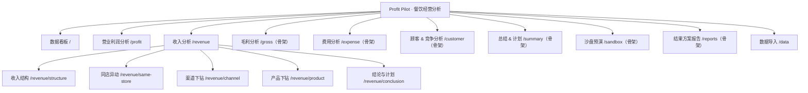
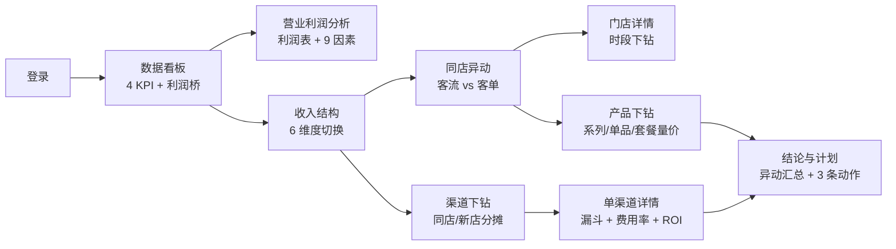
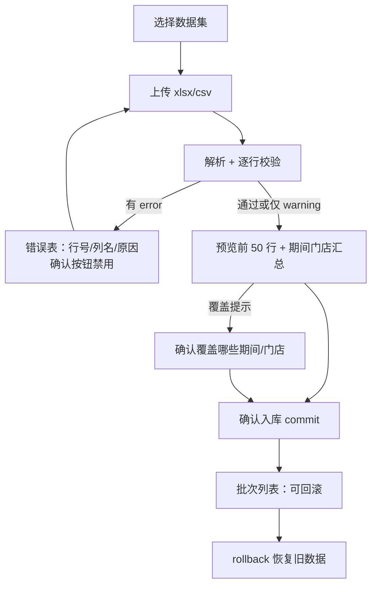
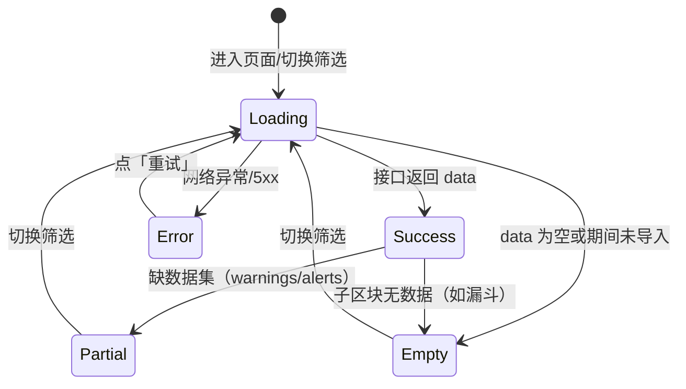

# 产品设计

> 文档编号：CBA-PRD-001 ｜ 版本：v2.0 ｜ 日期：2026-11-08 ｜ 适用基线：git tag **v0.3.4**
> 关联：[README（文档集索引）](README.md)、[01-需求分析](01-需求分析.md)、[07-维护与版本记录](07-维护与版本记录.md)、`openspec/changes/build-catering-analysis-platform/design.md`、`docs/webUI.md`、`docs/demo/演示脚本.md`

## 1. 文档信息与修订记录

### 1.1 文档信息

| 项 | 内容 |
|---|---|
| 文档编号 | CBA-PRD-001 |
| 文档名称 | 产品设计（餐饮经营分析系统） |
| 当前版本 | v2.0 |
| 适用基线 | `v0.3.4`（2026-11-08，安全补丁版） |
| 编写日期 | 2026-11-08 |
| 作者 | 产品经理（PM） |
| 状态 | 一期界面已实现并验收；二期页面仅骨架，标注「未实现」 |
| 设计基准 | `docs/webUI.md`（Profit Pilot 风格）、`design.md` §8/§13、`frontend/src/theme.ts` |
| 事实来源 | 前端代码 `frontend/src/**`、接口契约 `shared/api-contract.md`、验收数字 `design.md` §14 |

### 1.2 修订记录

| 版本 | 日期 | 变更说明 | 作者 | 基线 |
|---|---|---|---|---|
| v1.0 | 2026-11-08 | 首次编写：定位/画像/信息架构/17 条路由/任务流/页面规范/交互状态/展示规则/线框/话术/权限/二期规划/映射表 | 产品 | `v0.3.1` |
| v2.0 | 2026-11-08 | 同步 v0.3.3 修复（模板下载、默认数据集、验收字段）；文档集扩为 01–18 | 产品 | `v0.3.3` |
| v2.1 | 2026-11-08 | 同步 v0.3.4 安全修复与 63 测试 | 产品 | `v0.3.4` |

## 2. 产品定位与价值主张

### 2.1 一句话定位

**不是一张报表，而是一条「差异 → 原因 → 动作」的分析流水线**：打开系统就能看到「哪里变了、为什么变、下一步做什么」，每个数字都能下钻到门店、渠道、菜品与量价。

### 2.2 与现有做法/工具的差别

| 维度 | Excel + PPT 手工分析 | 通用 BI 报表 | 本产品（一期已实现范围） |
|---|---|---|---|
| 输出 | 静态数字与图 | 可配置图表 | 差异 + 因素拆解 + 规则结论 + 行动建议 |
| 下钻 | 手工换表/换透视 | 维度筛选为主 | 结构→门店→时段、渠道→漏斗→ROI、产品→系列→套餐 |
| 口径 | 散落在公式与人脑 | 由使用者自己拼 | 四套合计分别标注 + 尾差说明 + 来源脚注 |
| 复用 | 换月重做 | 需重新搭 | 导入模板 + 一次配置周期复用 |
| 推演 | 手工试算 | 无 | 二期沙盘（一期仅骨架） |

来源：`proposal.md` §Why、`docs/demo/答疑清单.md` Q17。

### 2.3 价值主张（三层）

1. **看得见差异**：KPI 卡带对比值、差异额/率、门店 P25/P50/P75 分位，默认就回答「和谁比、差多少」。
2. **找得到原因**：连环替代法把变动拆成因素，瀑布图/拆解条/量价表让「92.07 万来自客流」一眼可见。
3. **接得上动作**：结论页按规则生成 3 条带责任部门的动作；二期由沙盘把动作转成可执行方案与计划。

### 2.4 产品原则

| # | 原则 | 落地表现 |
|---|---|---|
| P1 | 数字可信优先 | 以 Excel 为唯一准绳；展示不取整、只在展示层四舍五入；尾差显式说明 |
| P2 | 口径显式 | 四套收入合计分页面标注；渠道分摊口径写在卡片旁 |
| P3 | 对比驱动 | 所有指标默认带对比基准，差异带语义色与箭头 |
| P4 | 逐层下钻 | 从品牌到门店、渠道、产品，最多两跳（列表行 → 详情页） |
| P5 | 规则可解释 | 洞察是 `{level,title,text,evidence}`，不接大模型、不编内容 |
| P6 | 缺数据不装懂 | 缺失显示「—」与空态，禁止 0 冒充 |

## 3. 用户画像与典型场景

### 3.1 三类核心用户

| 画像 | 角色/规模 | 目标 | 当前痛点 | 主用页面 |
|---|---|---|---|---|
| 老板（A） | 品牌创始人/总经理，13 店 | 5 分钟判断经营好坏与增长来源 | 只看到 PPT 结论，追不到明细 | 数据看板、营业利润分析、结论与计划 |
| 区域运营（B） | 区域经理/店长，管 3–5 店 | 找出掉店原因并给门店下指令 | 说不清是客流还是客单、哪个时段掉 | 同店异动、门店详情、渠道下钻 |
| 市场/线上（C） | 市场部投放负责人 | 判断线上放量是否划算 | 曝光/转化/费用率/ROI 分散在多个后台 | 渠道下钻、单渠道详情、产品下钻 |

### 3.2 场景一：老板看总览（2 分钟）

- 触发：月度经营会前一天。
- 动线：登录 → 数据看板 → 4 张 KPI（收入 1000 万、+31.6%；利润 112.70 万、+74.5%）→ 利润桥 → 一句话结论。
- 成功标准：能复述「收入 +240 万，其中新店 143、同店 97；利润 +48.10，最大拖累是其它费用 −37」。
- 关键设计：KPI 卡分位行让老板知道门店间差距；利润桥瀑布图 9 根柱一眼看出正负。

### 3.3 场景二：运营查门店（4 分钟）

- 触发：某店连续两周下滑。
- 动线：同店异动 → 找异常门店（收入↓且客流↓）→ 点行下钻门店详情 → 看时段表（工作日 −465 / 节假日 +185）→ 判断为工作日午餐流失。
- 成功标准：给出「门店 12 工作日午餐客流下滑」的可执行判断。
- 关键设计：明细行可点击；时段表标出下降主因；门店详情有同店横向比较。

### 3.4 场景三：市场看渠道 ROI（3 分钟）

- 触发：评估是否继续加大美团大众投放。
- 动线：渠道下钻 → 美团大众（同店 394.23 / 新店 65.77）→ 单渠道详情 → 漏斗（14.63% / 11.44% / 88.18%）→ 费用率 30%（超 15% 红线）/ 毛利 ROI 2.00（达标）/ 销售 ROI 3.33（低于 4）。
- 成功标准：判断「增收但买量偏贵」，产出「优化访问-支付转化」动作。
- 关键设计：阈值条 + 状态色 + 异常 Alert；漏斗旁边就是费用与 ROI，不用跨页。

## 4. 信息架构与导航树

### 4.1 导航树（与 `frontend/src/layouts/AppLayout.tsx` 的 `NAV_ITEMS` 完全一致）



> 说明：`design.md` §13 的导航顺序描述中未列「结果方案报告」，实现里存在该菜单项（`AppLayout.tsx`）；以代码为准。

### 4.2 框架区域

| 区域 | 规格 | 内容 | 代码 |
|---|---|---|---|
| 左 Sider | 深色藏青 `#0F1A3C`，宽 236px | Logo「P + Profit Pilot / 餐饮经营分析」、品牌切换框（一期单品牌）、菜单、底部数据就绪状态、用户与退出 | `AppLayout.tsx`、`theme.ts` |
| 顶栏 Header | 白底，高 64px | 蓝竖线 + 页面标题 + 副标题（`期间 · 当月/累计 · 对比同期`），右侧全局筛选 `FilterBar` | `AppLayout.tsx`、`components/FilterBar.tsx` |
| 内容区 Content | 浅灰 `#F5F6FA`，padding 16，卡片间距 16 | 各页面 `page-stack`：Alert → KPI 行 → 图表/表格卡 → 脚注 | `AppLayout.tsx`、`index.css` |
| 浮层 | 右下角蓝色圆形 AI 按钮 | 打开「AI 洞察（规则版）」抽屉 | `components/AiAssistantFab.tsx` |

### 4.3 导航交互规则

| 规则 | 行为 | 逻辑位置 |
|---|---|---|
| 选中态 | 由路径映射菜单 key；门店详情高亮「同店异动」，渠道详情高亮「渠道下钻」 | `utils/routes.ts` `selectedMenuKey` |
| 子菜单 | 收入分析默认展开 | `AppLayout.tsx` `openKeys=['/revenue']` |
| 页面标题 | 路径 → 中文标题（如「门店详情」「渠道详情」） | `utils/routes.ts` `pageTitle` |
| 未知路径 | 重定向 `/` | `App.tsx` `<Route path="*">` |
| 数据就绪 | 底部显示 `{期间} · {n}/8 类数据集就绪`；不完整时红点 + 缺项名 | `AppLayout.tsx` readiness、`GET /api/data-status` |
| 品牌切换 | 显示「杨博鸡公煲 ⇄」，一期仅一个品牌，tooltip 标注二期开放 | `AppLayout.tsx` |

## 5. 页面清单

### 5.1 全部路由（17 条）

| # | 路径 | 页面 | 一期状态 | 目标用户 | 核心内容 | 数据来源 |
|---|---|---|---|---|---|---|
| 1 | `/login` | 登录 | 可用 | 全部 | 账号密码表单、演示账号提示 | `POST /api/auth/login` |
| 2 | `/` | 数据看板（经营总览） | 可用 | 老板/财务 | 4 KPI 卡 + 利润桥瀑布 + 一句话结论 + 分位 | `GET /api/analysis/overview` |
| 3 | `/profit` | 营业利润分析 | 半可用 | 老板/财务 | 利润表对比 + 利润桥（瀑布/因素表）；预算达成/评分/板块汇总占位 | `GET /api/analysis/profit` |
| 4 | `/revenue/structure` | 收入结构 | 可用 | 分析岗/老板 | 6 维度切换 + 结构表 + 柱图 + 增量贡献 | `GET /api/analysis/revenue/structure` |
| 5 | `/revenue/same-store` | 同店异动 | 可用 | 运营 | 3 汇总卡 + 客流×客单拆解条 + 13 店明细 + 新店卡 | `GET /api/analysis/revenue/same-store` |
| 6 | `/revenue/store/:storeId` | 门店详情 | 可用 | 运营/店长 | 三项对比 + 同店横向比较 + 时段客流表与主因 | `GET /api/analysis/revenue/store/{id}` |
| 7 | `/revenue/channel` | 渠道下钻 | 可用 | 市场/老板 | 渠道结构表 + 同店渠道异动表 + 渠道洞察（规则生成） | `GET /api/analysis/revenue/channel` |
| 8 | `/revenue/channel/:channelId` | 单渠道详情 | 可用 | 市场 | 漏斗 4 阶段卡 + 漏斗图/表 + 费用率/ROI 阈值 + 洞察 | `GET /api/analysis/revenue/channel/{id}` |
| 9 | `/revenue/product` | 产品下钻 | 可用 | 产品/运营 | 系列量价图/表 + 单品排行 + 套餐量价 + 影响额排序 | `GET /api/analysis/revenue/product` |
| 10 | `/revenue/conclusion` | 结论与计划 | 可用 | 老板/运营 | 异动汇总 + 自动结论 + 3 条建议动作 | `GET /api/analysis/revenue/conclusion` |
| 11 | `/gross` | 毛利分析 | 骨架 | 财务 | 标题 + 规划能力清单 +「二期开放」 | 不请求数据 |
| 12 | `/expense` | 费用分析 | 骨架 | 财务 | 同上 | 不请求数据 |
| 13 | `/customer` | 顾客 & 竞争分析 | 骨架 | 运营 | 同上 | 不请求数据 |
| 14 | `/summary` | 总结 & 计划 | 骨架 | 老板 | 同上 | 不请求数据 |
| 15 | `/sandbox` | 沙盘预演 | 骨架 | 老板/分析 | 因子面板与结果区布局示意（不可计算） | 不请求数据 |
| 16 | `/reports` | 结果方案报告 | 骨架 | 老板 | 报告模板与导出按钮占位 | 不请求数据 |
| 17 | `/data` | 数据导入 | 可用 | 财务/实施 | 8 类数据集、上传校验、预览确认、批次回滚、加载示例数据 | `/api/imports*`、`/api/data-status` |

### 5.2 骨架页单列

| 路由 | 页面 | 规划能力（页面上的清单） | 未实现声明 |
|---|---|---|---|
| `/gross` | 毛利分析 | 毛利额/毛利率对比；结构影响 + 单品毛利率影响拆分；毛利额三因素替代；实际 vs 理论成本损益；折扣率影响；门店分位与达标率 | 「一期为框架展示，二期开放」 |
| `/expense` | 费用分析 | 费用科目对比与变动/固定小计；人效/人工成本率/坪效/租售比/上座次数/营销投产比；模型值对比；门店达标率与排行 | 同上 |
| `/customer` | 顾客 & 竞争分析 | 多渠道加权满意度；分项评分；好评差评词频与原文；会员与储值；竞对监测；分位与达标率 | 同上 |
| `/summary` | 总结 & 计划 | 月度总结草稿；下月目标；待办整改清单 CRUD；时段营业额预估；xlsx 导出；权限预留 | 同上 |
| `/sandbox` | 沙盘预演 | 因子滑块布局示意、实时利润表/利润桥示意、方案保存与对比、目标反推、结果方案 | 同上（控件不可用） |
| `/reports` | 结果方案报告 | 报告模板选择、结论/图表/行动计划、导出占位 | 同上 |

骨架页统一要求（`design.md` §13）：显示页面标题、说明「一期为框架展示，二期开放」、列出已规划核心分析项、给「回到收入分析」入口（`components/SkeletonPage.tsx`）。

## 6. 核心任务流

### 6.1 分析主链路



### 6.2 数据导入流（两阶段提交）



来源：`specs/data-import/spec.md`、`pages/data/DataPage.tsx`（Steps：上传 → 预览确认 → 入库/可回滚）。

### 6.3 演示 15 分钟动线

| 段 | 时长 | 页面 | 动作 | 主角数字 | 话术落点 |
|---|---|---|---|---|---|
| 1 开场 | 2 分 | 数据看板 | 指 4 KPI + 分位 | 收入 1000（+240）、利润 112.70 | 240 万从哪来、能不能复制 |
| 2 利润桥 | 3 分 | 营业利润分析 | 瀑布图 | +100.48 / −10.42 / … / +48.10 | 连环替代法，影响之和闭合 |
| 3 收入结构 | 2 分 | 收入结构 | 切维度 同店/新店 → 渠道 | 新店 143 + 同店 97.28；美团大众 +124 | 开店红利 vs 真本事 |
| 4 同店下钻 | 3 分 | 同店异动 → 门店详情 | 点门店 12 → 时段表 | 客流 +92.07 / 客单 +5.08；工作日 −465 | 增长靠人多了，不是卖贵了 |
| 5 渠道与产品 | 3 分 | 渠道下钻 → 单渠道详情 → 产品下钻 | 点美团大众 → 漏斗；再看产品 | 394.23/65.77；14.63%/11.44%；+91.50/+5.67 | 增收但买量贵；套餐量增价降 |
| 6 结论 | 2 分 | 结论与计划 | 读结论与三条动作 | 143 + 92.07 + 5.08 | 比差异→找问题→定计划→达目标 |

删减顺序（时间不够时）：先砍产品套餐，再砍利润表只留瀑布图，保留「总览 → 利润桥 → 同店 → 结论」（`docs/demo/演示脚本.md`）。

## 7. 页面设计规范

### 7.1 视觉基准

Profit Pilot 风格：深色藏青侧边导航 + 白色顶栏 + 浅灰内容区 + 白卡片栅格；圆角小、边框细、阴影轻；信息密度中等偏高；无渐变与装饰元素，偏理性工具型（`docs/webUI.md`）。

> 与参考稿的差异：`webUI.md` 描述侧边宽约 320px，实现取 **236px** 以给 1440 宽下的表格留空间（`theme.ts` `layout.siderWidth`）。

### 7.2 设计 Token（唯一来源 `frontend/src/theme.ts`）

| 类别 | Token | 值 | 用途 |
|---|---|---|---|
| 主色 | `color.primary` | `#2F54EB` | 选中态、链接、主按钮、AI 按钮 |
| 主色深 | `color.primaryHover` | `#1D39C4` | hover |
| Sider | `color.siderBg` | `#0F1A3C` | 侧边导航 |
| Sider 深 | `color.siderBgDeep` | `#0B1430` | 子菜单背景 |
| 顶栏 | `color.headerBg` | `#FFFFFF` | Header |
| 页面底 | `color.pageBg` | `#F5F6FA` | 内容区 |
| 卡片 | `color.cardBg` | `#FFFFFF` | 所有卡片 |
| 边框/分隔 | `color.border` / `divider` | `#EDEFF5` / `#F0F2F7` | 卡片、表格 |
| 文字 | `color.text` / `textSecondary` / `textTertiary` | `#1F2430` / `#6B7280` / `#9CA3AF` | 标题/说明/脚注 |
| 语义正向 | `color.positive` / `positiveBar` | `#389E0D` / `#52C41A` | 增长、健康 |
| 语义负向 | `color.negative` / `negativeBar` | `#CF1322` / `#FF4D4F` | 下降、风险 |
| 图表 | `chartBlue` / `chartLightBlue` / `chartComparison` | `#2F54EB` / `#7C93F5` / `#BFC8E8` | 本期/辅助/同期对比 |
| 圆角 | `radius.card` / `control` | `6` / `6` | 卡片/控件 |
| 字号 | `kpiValue` / `cardTitle` / `body` / `small` | `30` / `15` / `14` / `12` px | 层级 |
| 间距 | `space.xs…xl` | 4/8/12/16/24 px | 栅格与卡片内距 |
| 布局 | sider 236 / header 64 / padding 16 / gap 16 | px | 框架 |

### 7.3 语义色与好坏方向（不能只看数值正负）

| 指标 | 好坏方向 | 上升时颜色 | 证据 |
|---|---|---|---|
| 营业收入 | 越高越好 | 正向（绿）+ ↑ | `utils/metrics.ts` `goodDirection:'up'` |
| 营业利润 | 越高越好 | 正向 | 同上 |
| 综合毛利率 | 越高越好 | 正向 | 同上 |
| 同店增速 | 越高越好 | 正向 | 同上 |
| 食材成本率 | 越低越好 | 负向（红）+ ↑ | `goodDirection:'down'`，`KpiCard.test.tsx` |
| 平台费用率 | 越低越好 | 负向 | `utils/metrics.ts` `fee_rate: down`、`components/ThresholdBar.tsx` |
| 毛利/销售 ROI | 越高越好 | 未达标示警 | `utils/metrics.ts` `gross_roi/sales_roi: up`、`ThresholdBar.tsx` |

规则：颜色之外必须同时给箭头（↑/↓）与正负号，满足色弱用户；门店对比图不用红绿区分门店（`design.md` §8）。

### 7.4 KPI 卡片规格（`components/KpiCard.tsx`）

| 行 | 内容 |
|---|---|
| 1 | 指标名 + 洞察入口（右侧「洞察」） |
| 2 | 大号数值（30px）+ 单位 |
| 3 | 对比值标签（同期/去年同期）+ 对比值 |
| 4 | 差异（箭头 + 语义色 + 差异额/差异率/pp） |
| 5 | 门店分位行：P25 / P50 / P75 / 本店值 |
| 6 | 脚注（如「同比 +31.6% · 利润表口径」） |
| 兜底 | 门店数 < 3：隐藏分位行，显示「门店数不足，无法计算分位」；无分位数据：显示 `percentile_hints` 说明 |

### 7.5 图表规范

| 图表 | 组件/实现 | 用途 | 使用页面 |
|---|---|---|---|
| 瀑布图 | `components/Waterfall.tsx`（ECharts 堆叠柱：透明底座 + 可见柱） | 利润桥 9 因素 | 数据看板、营业利润 |
| 分组/堆叠柱 | `components/BarChart.tsx` | 结构本期 vs 同期、量价影响拆解 | 收入结构、产品 |
| 漏斗图 | 单渠道页内 ECharts funnel option + 4 阶段卡 + 明细表 | 曝光→访问→支付→消费 | 单渠道详情 |
| 柱线（双轴趋势） | 一期末实现（无折线组件） | design §13 的单渠道「趋势」区块 | —（见 §15-9） |
| 阈值条 | `components/ThresholdBar.tsx` | 费用率/ROI 对比阈值 | 单渠道详情 |
| 影响条 | `components/ImpactBar.tsx` | 客流/客单影响、异动四项汇总 | 同店异动、结论与计划 |
| 明细表 | `components/DataTable.tsx`（antd Table 封装） | 结构/门店/产品/批次 | 全部数据页 |
| 差异标签 | `components/ChangeTag.tsx` | 环比/同比小标签（带箭头） | 漏斗、表格内 |

图表颜色只来自 `theme.ts`；柱顶标签带 ↑/↓ 与正负号；单位与口径写在卡片副标题或脚注。

### 7.6 与其他约定的关系

AI 入口嵌在指标/图表旁（卡片「洞察」按钮 + 右下角 FAB），不是只放全局聊天框；每个指标带同行分位；菜单按分析任务组织（`docs/webUI.md`「设计亮点」、`components/InsightPopover.tsx`、`AiAssistantFab.tsx`）。

## 8. 关键交互与状态

### 8.1 全局筛选写 URL

| 参数 | 取值 | 默认 | 说明 |
|---|---|---|---|
| `brand` | `all` / `yangbo` | `all` | 一期单品牌 |
| `store` | `all` / `1`…`15`（1–13 同店，14/15 新店） | `all` | 单店视角受示例数据限制（总览给出提示） |
| `period` | `2025-09`、`2025-08`（未导入） | `2025-09` | |
| `mode` | `month` / `ytd` | `month` | 累计口径提示条 |
| `baseline` | `yoy` / `budget` / `mom` | `yoy` | 非 yoy 显示「未导入」提示 |

- 写入方式：`useSearchParams` + `replace: true`，刷新保留（`filters/FilterContext.tsx`）。
- 切菜单不丢筛选（顶栏筛选在 `AppLayout` 层，不随页面卸载）。
- 刷新按钮：`FilterBar` 内刷新（invalidate react-query 缓存）。

### 8.2 下钻

| 起点 | 动作 | 终点 | 实现 |
|---|---|---|---|
| 同店异动 13 店明细 | 点击表格行 | `/revenue/store/:storeId` | `SameStorePage.tsx` row onClick |
| 渠道下钻表格行 | 点击 | `/revenue/channel/:channelId` | `ChannelPage.tsx` `goDetail` |
| 利润桥「收入规模」 | 期望跳收入分析（spec 场景） | — | 一期未接线，待确认（见 §15） |

### 8.3 洞察

- 卡片级：`InsightPopover` 按钮 → Popover 显示 `insights[]`（level 标签 + 标题 + 文本 + 证据）。
- 全局级：右下角 FAB → Drawer「AI 洞察（规则版）」，展示当前筛选下的洞察清单。
- 文案要求：必须带数字与证据字段；不出现「AI 认为」这类不可解释表述。

### 8.4 页面状态机



### 8.5 状态与空态清单

| 状态 | 表现 | 代码 |
|---|---|---|
| 加载 | 卡片骨架屏（保持布局不跳动） | `components/PageState.tsx` `PageLoading` |
| 错误 | `EmptyState` 风格「暂时无法加载数据」+ 原因 + 重试按钮；全局 `ErrorBoundary` 兜底渲染异常 | `PageState.tsx` `PageError`、`components/ErrorBoundary.tsx`（`main.tsx` 包裹） |
| 空态（缺数据） | 「暂无数据」+ 说明缺哪个数据集，禁止 0 | `components/EmptyState.tsx` |
| 预算未导入 | 「预算未导入」Tag + 达成卡片空态 | `ProfitPage.tsx` |
| 非同期基准 | Alert「当前仅同期基准可用」，筛选值保留 URL | `DashboardPage.tsx`、`ProfitPage.tsx` |
| 单店视角不可用 | Alert「单店视角暂不可用」+ 切回全部门店指引 | `DashboardPage.tsx` |
| 累计口径 | Alert 说明累计区间 | `DashboardPage.tsx` |
| 无时段数据 | 门店详情时段表显示说明（示例仅门店 12 有） | `StoreDetailPage.tsx`、后端 `dayparts_note` |
| 渠道无漏斗 | 卡片空态「该渠道暂无线上漏斗数据」 | `ChannelDetailPage.tsx` |
| 转化率异常 | 黄色 Alert + 明细表 flag 列 | `ChannelDetailPage.tsx` |
| 骨架页 | 统一 `SkeletonPage`：标题 + 二期 Tag + 规划清单 + 返回入口 | `components/SkeletonPage.tsx` |

### 8.6 刷新与缓存

- `@tanstack/react-query` 按 `['资源名', ...筛选]` 作 queryKey；切筛选自动重新请求。
- 导入 commit/rollback 后 invalidate `import-batches` 与 `data-status`（`api/hooks.ts`）。
- 顶栏刷新按钮执行 `queryClient.invalidateQueries()`（失效全部查询后重新拉取）。

## 9. 数据展示规则

### 9.1 单位与精度

| 数据类型 | 单位 | 精度 | 格式化函数 |
|---|---|---|---|
| 总览/结构/渠道/利润/费用 | 万元 | 2 位小数（`1,000.00`） | `formatWan` |
| 产品/套餐金额 | 元 | 2 位小数 | `formatYuan` |
| 客流 | 人次 | 整数（合计可含 2 位小数） | `formatTraffic` / `formatInteger` |
| 客单 | 元 | 2 位小数 | `formatTicket` |
| 百分比 | % | 1 位小数 | `formatPercent` / `formatSignedPercent` |
| 百分点 | pp | 2 位小数 | `formatPp` |
| 差异 | 万元/元 | 带正负号 | `formatSignedNumber`、`formatDelta` |
| 占比 | % | 1 位小数 | `formatShare` |

来源：`frontend/src/utils/format.ts`、`shared/api-contract.md`、`data-caliber-notes.md` §1。

### 9.2 缺失与尾差

| 场景 | 展示 | 依据 |
|---|---|---|
| 无法计算（除零/缺数据） | 「—」，不显示 0 | 接口返回 `null`；`format.ts` `isNil` |
| 展示值相加 ≠ 合计 | 脚注「尾差由四舍五入导致」+ 具体差额 | 同店 97.16 vs 97.28（0.12）；结论四项 240.15 vs 240.28（0.13）；同店渠道 394.23−336.00=58.23 vs 差额 58.24（0.01） |
| 四套收入合计 | 页面标注当前页所用口径与合计值 | 总览/利润桥=利润表 1000/760；结构（渠道维度）/渠道=渠道 1000.00/759.56；结构（门店维度）/同店=门店 1000.23/759.95；产品=品类 1000.16/760 |
| 分摊口径 | 渠道页注明「新店分摊按本期渠道占比」，并说明 Excel 另有一版同期占比 | `ChannelPage.tsx`、`backend/app/services/analysis.py` |
| 数据来源 | 每页底部 `Footnote`：工作表/期间/单位 | `components/Notes.tsx` `Footnote` |

### 9.3 文案写法

- 数字必须带单位：`+240.00 万元`、`−1.04pp`、`14.63%`。
- 方向词与符号同时出现：`↑ +31.6%` / `↓ −6.1%`。
- 不使用「大概」「约」修饰验收数字；不确定写「—」或「待确认」。
- 口径与差异放在 `CaliberNote`（浅灰条）里，不混进正文结论。

## 10. 关键页面线框描述

### 10.1 数据看板 `/`

```
┌ 顶栏：数据看板 2025-09·当月·对比同期      [品牌▾][门店▾][期间▾][当月|累计][对比▾] ↻ ┐
├ Content（浅灰）──────────────────────────────────────────────────────────────┤
│ ┌ 营业收入 ────────┐ ┌ 营业利润 ────────┐ ┌ 综合毛利率 ──────┐ ┌ 同店增速 ───────┐ │
│ │ 1,000.00 万元     │ │ 112.70 万元       │ │ 73.30%            │ │ 12.80%           │ │
│ │ 同期 760.00       │ │ 同期 64.60        │ │ 同期 74.34%       │ │ 同期 —           │ │
│ │ ↑ +240.00 (+31.6%)│ │ ↑ +48.10 (+74.5%) │ │ ↓ −1.04pp         │ │ ↑ +12.80%        │ │
│ │ P25/P50/P75 本店  │ │ 分位缺（提示）    │ │ 分位缺（提示）    │ │ P25/P50/P75 本店 │ │
│ └───────────────────┘ └───────────────────┘ └───────────────────┘ └──────────────────┘ │
│ ┌ 利润桥：2024-09 → 2025-09    [瀑布图|因素表]  [洞察] ─────────────────────────┐ │
│ │  64.60 ▁▂▃ +100.48 ▃▂▁ −10.42 … 9 项 … 112.70                                  │ │
│ └───────────────────────────────────────────────────────────────────────────────┘ │
│ 一句话结论（规则生成）                                                             │
│ 脚注：数据来源 = Excel「第一步-2509餐饮利润桥」；单位万元；口径=利润表              │
└───────────────────────────────────────────────────────────────────────────────────┘
```

### 10.2 同店异动 `/revenue/same-store`

```
┌ [同店收入 857.23 万] [同店客流 66,566.29 人次] [同店客单 128.78 元]  （各带同期与差异） ┐
│ ┌ 同店收入拆解：客流 × 客单 ──────────────────────────────── [洞察] ┐                 │
│ │ 客流影响 +92.07 万  ████████████████████ 94.8%                      │                 │
│ │ 客单影响 +5.08 万   █ 5.2%                                          │                 │
│ │ 尾差：两项合计 97.16，与同店收入变动 97.28 相差 0.12 万             │                 │
│ └─────────────────────────────────────────────────────────────────────┘                 │
│ ┌ 13 家同店明细 ──────────────────────────────────────────────────────┐                 │
│ │ 门店 | 区域 | 客流 | 客单 | 收入 | 客流影响 | 客单影响 | 差异  → 点击行下钻 │                 │
│ └─────────────────────────────────────────────────────────────────────┘                 │
│ ┌ 新店收入（同期为 0）：新店1 80.00 / 新店2 63.00 ─────────────────────┐                 │
│ 脚注：门店口径 1000.23/759.95；同店客流/客单逐店计算再汇总              │
└────────────────────────────────────────────────────────────────────────────────────────┘
```

### 10.3 单渠道详情 `/revenue/channel/:channelId`

```
面包屑/标题：渠道下钻 / 美团大众
┌ [曝光人数 4,367,174] [访问 639,025 · 14.63%] [支付 73,113 · 11.44%] [消费 64,468 · 88.18%] ┐
│ ⚠ 转化率异常：访问-支付转化率环比下降 1.2pp（阈值 >1pp）                                    │
│ ┌ 漏斗图（ECharts funnel） ────────┐ ┌ 漏斗明细与转化率（表：阶段/人数/转化/环比/标记）┐ │
│ │ 曝光 ▇▇▇▇▇▇▇▇▇▇▇▇▇▇            │ │ 曝光人数 4,367,174  —   —   —                    │ │
│ │ 访问 ▇▇▇▇▇                       │ │ 访问人数   639,025  14.63% …                     │ │
│ │ 支付 ▇▇                           │ │ 支付人数    73,113  11.44% … 访问-支付转化异常   │ │
│ └───────────────────────────────────┘ └───────────────────────────────────────────────────┘ │
│ ┌ 平台费用率与 ROI（阈值对比）──────────────────────────────────────────────┐ │
│ │ 费用率 30%（阈值 ≤15%）risk ｜ 毛利 ROI 2.00（≥1）ok ｜ 销售 ROI 3.33（≥4）warning │ │
│ └───────────────────────────────────────────────────────────────────────────┘ │
│ 渠道洞察（规则生成三条）                                                          │
│ 脚注：渠道口径 1000.00/759.56；漏斗以 Excel 标杆品牌 25 店合计为准；平台毛利率 60%   │
└──────────────────────────────────────────────────────────────────────────────────────┘
```

### 10.4 产品下钻 `/revenue/product`

```
┌ [同店口径 | 全店口径] ─ 系列量价拆解（柱图：销量影响 / 单价影响）  [洞察] ┐
│ ┌ 系列量价表（8 系列）──────────────────────────────────────────────┐
│ │ 系列 | 销量 | 销量占比 | 销售额 | 平均单价 | 销量影响 | 单价影响 | 差异
│ └──────────────────────────────────────────────────────────────────┘
│ ┌ 单品 / 套餐影响额排行（Top 12）┐ ┌ 套餐量价（套餐与单品分开）──────────┐
│ │ 产品名 | 系列 | 销量 | 单价 | 影响额 │ │ 5,472 单 / 444,217.54 元 / 81.18 元 │
│ │ …                                   │ │ 432 单 / 66,080 元 / 152.96 元      │
│ │                                     │ │ 量差 +770,933.33、价差 −392,795.79  │
│ └─────────────────────────────────────┘ └────────────────────────────────────┘
│ 脚注：品类口径 1000.16/760.00；单品明细与 Excel 表 4 非同一快照，套餐量价取表 4 汇总行
└────────────────────────────────────────────────────────────────────────────┘
```

### 10.5 数据导入 `/data`

```
┌ 数据就绪：8 类中 n 类已就绪；未导入的页面显示「—」             [加载示例数据] ┐
│ Steps：①上传 → ②预览确认 → ③入库/可回滚                                   │
│ ┌ 上传与校验（两阶段提交）─────────────────────────────────────┐          │
│ │ [数据集▾] [下载模板]  必填列：期间、门店…                    │          │
│ │ ┌ 拖拽/点击上传 .xlsx/.xlsm/.csv/.txt（≤10MB）┐              │          │
│ │ │ 演示提示：文件名含 error/错误 模拟校验失败 │                │          │
│ │ └──────────────────────────────────────────┘                │          │
│ │ 错误表：行号 | 列名 | 原因 | 级别    → 有 error 时「确认导入」禁用 │          │
│ │ 或 校验通过 Alert + 预览表（前 50 行）                        │          │
│ │ [确认导入] [清除本次上传] [回滚该批次]                        │          │
│ └───────────────────────────────────────────────────────────────┘          │
│ ┌ 导入规则与口径 ┐ ┌ 导入批次（支持回滚）──────────────────────────────┐
│ │ 期间YYYY-MM…    │ │ 数据集 | 文件 | 期间 | 行数 | 操作人 | 时间 | 状态 | 回滚
│ └─────────────────┘ └──────────────────────────────────────────────────────┘
│ 脚注：示例数据经与正式导入完全相同的 draft→commit 链路写入                │
└────────────────────────────────────────────────────────────────────────────┘
```

## 11. 文案与演示话术要点

| 段 | 页面 | 必说数字 | 话术要点 | 禁止 |
|---|---|---|---|---|
| 开场 | 数据看板 | 1000（+240）、112.70（+48.10） | 老板只问：240 万从哪来、能不能复制 | 不说「AI 自动分析」 |
| 利润桥 | 营业利润 | 9 项合计 +48.10 | 每次只换一个因素，影响之和必须闭合；变动看费率、固定看绝对额 | 不把 PPT 的 2.3% 说成成本率涨幅 |
| 收入结构 | 收入结构 | 新店 143、同店 97.28 | 新店是开店红利，同店 97 万才是真本事 | 不说「同店下降 97 万」（PPT p19 有误） |
| 同店 | 同店异动/门店详情 | 92.07 / 5.08；门店 12 工作日 −465 | 增长靠人多了；门店 12 是工作日午餐被分流 | 不把 97.16 说成与 97.28 完全一致 |
| 渠道 | 渠道下钻/详情 | 394.23/65.77；14.63%/11.44%；ROI 2.00/3.33 | 增收但买量贵，优化访问-支付转化 | 不引用 PPT p28 的旧漏斗快照 |
| 结论 | 结论与计划 | 143 + 92.07 + 5.08 | 比差异→找问题→定计划→达目标；三条动作带责任部门 | 不承诺二期功能已可用 |

演示纪律（`docQA/20261108_0615_*.md` §六）：固定「当月 + 同期」，不要切预算/上期（会显示未导入空态，不是崩溃）；骨架页只说「二期开放」。

## 12. 权限与安全设计

| 项 | 一期实现 | 证据 |
|---|---|---|
| 账号模型 | 单管理员账号，无角色/权限矩阵 | `backend/app/config.py`（`CBA_ADMIN_USERNAME/PASSWORD`） |
| 登录 | bcrypt（rounds=12）校验 → JWT（12h）→ `Set-Cookie: cba_session`（httpOnly、SameSite=Lax） | `backend/app/services/auth.py`、`api/auth.py` |
| 未登录 | 接口 401；前端 `RequireAuth` 重定向 `/login` 并记录来源路径 | `frontend/src/auth/RequireAuth.tsx`、`pages/login/LoginPage.tsx` |
| 登出 | 清 cookie + 跳登录页 | `AuthContext.tsx`、`AppLayout.tsx` |
| 接口保护 | `protected_router` 统一依赖 `get_current_user`，仅 `/api/auth/login` 公开 | `backend/app/api/__init__.py` |
| CORS | 仅白名单 `http://127.0.0.1:5173`、`http://localhost:5173` | `backend/app/main.py` |
| 敏感信息 | 账号/密钥走环境变量；`.env` 已忽略 | `config.py`、`.gitignore` |
| 演示提示 | 登录页提示演示账号，仅用于 Demo | `LoginPage.tsx` |
| 二期 | 多租户与角色权限（brand/company 字段预留） | `tasks.md` 15.3（未实现） |

## 13. 二期产品规划（未实现）

| 页面 | 规划能力 | 依赖 | 状态 |
|---|---|---|---|
| 毛利分析 `/gross` | 毛利额/毛利率对比；结构影响 + 单品毛利率影响；三因素替代；理论成本损益；折扣率影响；分位与达标率 | `gross-margin-analysis` spec、`mix_rate_split`/`chain_substitution` 引擎 | 未实现（骨架） |
| 费用分析 `/expense` | 费用科目与变动/固定小计；人效/人工成本率/坪效/租售比/上座次数/营销投产比；模型值对比；门店排行与达标率 | `expense-analysis` spec、效率基础数据（人数/面积/天数） | 未实现（骨架） |
| 顾客 & 竞争 `/customer` | 加权满意度、分项评分、评价词频与原文、会员储值、竞对监测、权重校验 | `customer-competition-analysis` spec、jieba 分词 | 未实现（骨架） |
| 总结 & 计划 `/summary` | 总结草稿与保存、下月目标、待办整改清单 CRUD、时段营业额预估、xlsx 导出 | `summary-plan` spec、各模块 insights | 未实现（骨架） |
| 沙盘预演 `/sandbox` | 基期快照、因子调整实时推演（1s）、目标反推、2–4 方案对比、结果方案与转计划 | `sandbox-simulation` spec、前后端双引擎 + 新 fixtures | 未实现（骨架） |
| 结果方案报告 `/reports` | 报告模板（老板版/运营版）、结论 + 图表 + 行动计划、HTML/PDF/PPT 导出 | 报告导出任务 15.1 | 未实现（骨架） |
| 平台能力 | Docker 化部署、多租户与权限预留 | tasks 15.2/15.3 | 未实现 |

二期页面必须沿用本期框架与组件（`KpiCard`/`ChartCard`/`DataTable`/`InsightPopover`）与同一套口径脚注，避免出现第二套视觉与数字语言。

## 14. 页面—组件—接口映射表

| 路由 | 页面文件（`frontend/src/`） | 主要组件 | 接口（`/api/...`） |
|---|---|---|---|
| `/login` | `pages/login/LoginPage.tsx` | antd Form/Input/Alert | `POST /auth/login`、`GET /auth/me` |
| `/` | `pages/dashboard/DashboardPage.tsx` | KpiCard ×4、ChartCard（瀑布/因素表分段）、Waterfall、FactorTable、Notes | `GET /analysis/overview` |
| `/profit` | `pages/profit/ProfitPage.tsx` | ChartCard、Waterfall、FactorTable、DataTable、ChangeTag | `GET /analysis/profit?mode=` |
| `/revenue/structure` | `pages/revenue/StructurePage.tsx` | ChartCard（6 维度分段器）、BarChart、DataTable、ChangeTag | `GET /analysis/revenue/structure?dimension=` |
| `/revenue/same-store` | `pages/revenue/SameStorePage.tsx` | KpiCard ×3、ImpactBar、DataTable（行点击下钻）、Notes | `GET /analysis/revenue/same-store` |
| `/revenue/store/:storeId` | `pages/revenue/StoreDetailPage.tsx` | KpiCard ×3、DataTable（时段）、ChangeTag、Alert（主因） | `GET /analysis/revenue/store/{id}` |
| `/revenue/channel` | `pages/revenue/ChannelPage.tsx` | DataTable ×2、ChangeTag、渠道洞察卡（原生渲染 insights） | `GET /analysis/revenue/channel` |
| `/revenue/channel/:channelId` | `pages/revenue/ChannelDetailPage.tsx` | ECharts 漏斗、阶段卡 ×4、DataTable（漏斗明细）、ThresholdBar ×3、Alert | `GET /analysis/revenue/channel/{id}` |
| `/revenue/product` | `pages/revenue/ProductPage.tsx` | ChartCard（scope 分段器）、BarChart、DataTable ×3、ChangeTag | `GET /analysis/revenue/product?scope=` |
| `/revenue/conclusion` | `pages/revenue/ConclusionPage.tsx` | ImpactBar、ChangeTag、结论卡/动作卡、Notes | `GET /analysis/revenue/conclusion` |
| `/gross` | `pages/skeleton/SkeletonPages.tsx`（GrossSkeletonPage） | SkeletonPage | — |
| `/expense` | 同上（ExpenseSkeletonPage） | SkeletonPage | — |
| `/customer` | 同上（CustomerSkeletonPage） | SkeletonPage | — |
| `/summary` | 同上（SummarySkeletonPage） | SkeletonPage | — |
| `/sandbox` | 同上（SandboxSkeletonPage） | SkeletonPage + 布局示意 | — |
| `/reports` | 同上（ReportsSkeletonPage） | SkeletonPage | — |
| `/data` | `pages/data/DataPage.tsx` | Steps、Upload.Dragger、Select、DataTable ×3、Popconfirm、Alert | `GET /imports/templates`、`POST /imports`、`POST /imports/{id}/commit`、`POST /imports/{id}/rollback`、`GET /imports`、`POST /seeds/load`、`GET /data-status` |

### 14.1 通用组件清单（`components/`）

| 组件 | 职责 | 使用方 |
|---|---|---|
| `KpiCard` | KPI 值/对比/差异/分位/洞察 | 总览、同店、门店详情 |
| `ChartCard` | 图表卡容器（标题、副标题、分段器、洞察） | 结构、产品 |
| `Waterfall` | 利润桥瀑布（ECharts 堆叠柱） | 总览、营业利润 |
| `FactorTable` | 利润桥因素表 | 总览、营业利润 |
| `BarChart` | 分组/堆叠柱 | 结构、产品 |
| `DataTable` | 表格封装（金额右对齐、空态） | 几乎所有数据页 |
| `FilterBar` | 全局筛选 + 刷新 | 框架 |
| `InsightPopover` | 卡片洞察入口 | 各分析卡 |
| `AiAssistantFab` | 右下角 AI 洞察抽屉（规则版） | 框架 |
| `EmptyState` / `PageState` | 空态/加载/错误 | 全站 |
| `ErrorBoundary` | 渲染异常兜底 | `main.tsx` |
| `SkeletonPage` | 二期骨架页模板 | 6 个骨架页 |
| `Notes`（Footnote/CaliberNote） | 来源与口径脚注 | 各分析页 |
| `ChangeTag` / `ImpactBar` / `ThresholdBar` | 差异标签 / 影响条 / 阈值条 | 漏斗、同店、渠道详情 |

## 15. 待确认与已知不一致（产品视角）

| # | 项 | 现状 | 建议 |
|---|---|---|---|
| 1 | `design.md` §13 导航未列「结果方案报告」 | 代码有该菜单（`AppLayout.tsx`） | 以代码为准，后续回填 design |
| 2 | `docs/webUI.md` 侧边宽约 320px | 实现 236px | 参考稿与实现差异，保留实现值 |
| 3 | 利润桥「收入规模」柱点击跳收入分析（spec 场景） | 一期未接线 | 二期或收口迭代补 |
| 4 | 前端模板下载按钮为占位（**v0.3.3 已修复**） | 页面已接通 `fetch /api/imports/templates/{key}.xlsx`（带 cookie → blob 下载），上传 accept 收敛为 `.xlsx/.xlsm/.csv/.txt` | 已修复，无遗留 |
| 5 | mock 模板 key（`pl`/`store`/`channel`/`product`/`budget`）与后端 key（`pl_monthly`/`store_revenue`/`channel_revenue`/`product_item`/`budget_target`）不一致（**用户侧已修复**） | `DataPage` 默认值改为取接口返回的首个 key，real 模式不再默认 `pl` 而返回「未知数据集」；mock 内部短 key 仍保留 | 用户侧以接口返回为准；长期由契约生成 mock |
| 6 | 单品明细与 Excel 表 4 非同一快照 | 页面已分别标注 | 若客户要求统一，需先确认取哪一套 |
| 7 | 累计口径同店增速为「—」 | 门店收入只有单月数据 | 待补多月门店数据后开放 |
| 8 | 预算/上期基准 | 仅空态 | 二期随真实预算导入开放 |
| 9 | `design.md` §13 单渠道详情含「趋势」区块 | 一期只有漏斗 + 阈值条，无趋势/柱线图 | 待确认：收口迭代补趋势图，或回填 design 说明一期不做 |
