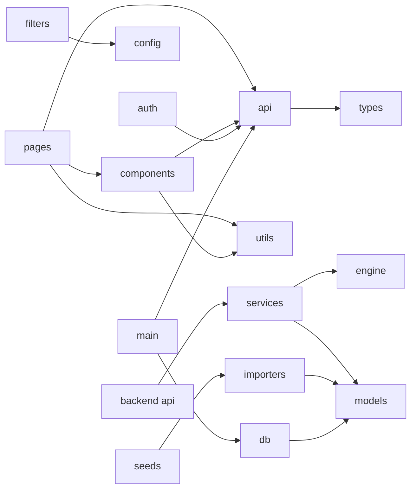
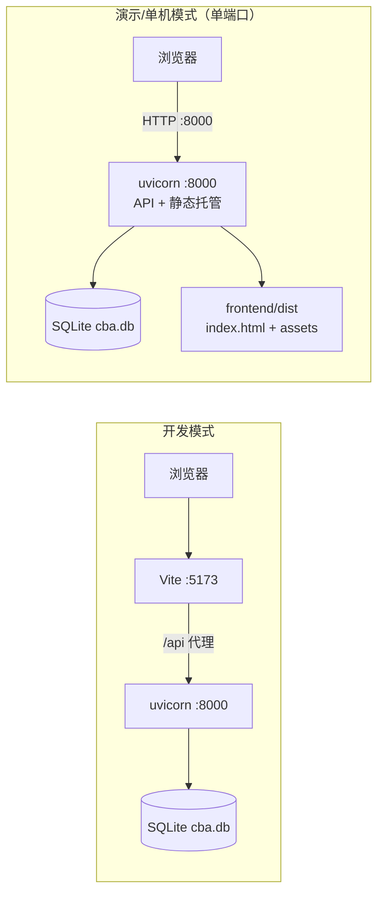
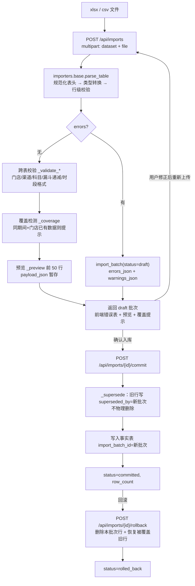
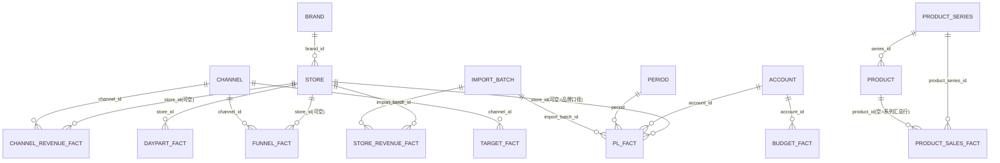

# 概要设计 · 餐饮经营分析系统

> 文档编号：**CBA-HLD-001** ｜ 版本：**v1.0** ｜ 日期：**2026-11-08** ｜ 适用基线：git tag **v0.3.1**
> 文档定位：面向架构师、后端、前端、运维，说明系统怎么分层、模块怎么划分、数据怎么流、为什么这样选。
> 关联文档：[README（文档集索引）](README.md)、[01-需求分析](01-需求分析.md)、[02-产品设计](02-产品设计.md)、[04-详细设计](04-详细设计.md)、[07-维护与版本记录](07-维护与版本记录.md)、`CLAUDE.md`、`openspec/changes/build-catering-analysis-platform/design.md`、`shared/api-contract.md`。

## 1. 文档信息与修订记录

### 1.1 文档信息

| 项 | 内容 |
|---|---|
| 系统名称 | 餐饮经营分析系统（Catering Business Analysis） |
| 文档编号 / 名称 | CBA-HLD-001 / 概要设计 |
| 版本 / 状态 | v1.0 / 已评审（随一期 Demo 收口） |
| 编写日期 | 2026-11-08 |
| 适用基线 | `v0.3.1`（2026-11-08，一期 Demo 验收后） |
| 主要读者 | 架构师、后端开发、前端开发、运维/实施 |
| 事实来源 | 仓库代码（`backend/app/**`、`frontend/src/**`）、`shared/`、OpenSpec change、示例数据与测试；文中「已实现」均可回溯到代码 |
| 二期内容约定 | 凡未落地的能力一律标注「**未实现（二期）**」，不写成现状 |

### 1.2 修订记录

| 版本 | 日期 | 修订人 | 变更摘要 | 对应基线 |
|---|---|---|---|---|
| v1.0 | 2026-11-08 | 架构组 | 首次编写概要设计：分层架构、模块划分、部署拓扑、数据流、数据模型、接口与引擎总览、安全与非功能、决策与限制 | v0.3.1 |

### 1.3 范围与事实基准

- 本文只描述**一期已交付并验收的代码**：登录、应用框架、全局筛选、8 类数据导入、经营总览（利润桥）、营业利润对比、收入分析全链路、6 个二期骨架页。
- 计算口径以 `docs/domain/data-caliber-notes.md` 与 `backend/seed/README.md` 为准；接口形状以 `shared/api-contract.md` 为准；验收数字以 `openspec/.../design.md` §14 与 `shared/fixtures/*.json` 为准。
- 本文核对过的关键代码事实：16 张业务表、23 条 OpenAPI 路径、57 项 pytest、45 项 vitest、引擎 7 个模块、导入器 8 个数据集、前端 17 条路由。与早期口径不一致处已在 [04 详细设计 §11](04-详细设计.md) 登记。

## 2. 设计目标与约束

### 2.1 设计目标

| 编号 | 目标 | 落地判据（当前状态） |
|---|---|---|
| G1 | 一期做一个**能讲、能演、能验**的商用骨架 | 2026-11-15 培训课 Demo 动线可走完；收入分析全链路可用 |
| G2 | 计算逻辑只实现**一份**，页面与后续沙盘共用 | `backend/app/engine/` 纯函数；`shared/fixtures/*.json` 回归 |
| G3 | 数字与 Excel 模型**逐项对齐** | design §14 验收数字在 pytest 与页面同时复现 |
| G4 | 单机即可部署，演示不依赖外部服务 | 一个 uvicorn 进程 + 静态前端；SQLite 单文件；无外网调用 |
| G5 | 前后端分离但**契约先行** | `shared/api-contract.md` → mock/real 同形状；`data/meta/insights` 统一包装 |
| G6 | 数据可追溯、可回滚 | 导入批次 + `superseded_by` 覆盖机制 + 批次回滚 |
| G7 | 可维护、可换库、可扩模块 | SQLAlchemy 写法与数据库无关；二期 6 模块留骨架页与规格 |
| G8 | 口径争议不隐藏 | 四套收入合计、尾差、缺失值「—」在页面脚注显式标注 |

### 2.2 设计约束

| 编号 | 约束 | 说明 |
|---|---|---|
| C1 | 单机部署、单管理员 | 不做多租户/角色权限；仅一个 admin 账号，账号来自环境变量 |
| C2 | 数据库 SQLite | 文件 `backend/data/cba.db`；写法保持与数据库无关，后续可换 PostgreSQL |
| C3 | 无 Docker、无 CI/CD、无监控体系 | 仓库无 Dockerfile / 流水线 / APM；发布靠本地命令 + tag |
| C4 | 不接大模型 | 洞察全部由规则函数生成；界面「AI 洞察」为规则版 |
| C5 | 数据只来自 Excel/CSV 手工导入 | 不对接第三方平台 API，不做实时流 |
| C6 | 桌面端优先 | 目标宽度 ≥ 1440；未做移动端适配 |
| C7 | 业务口径以 Excel 为准 | PPT 只作讲解案例；两者冲突按 Excel |
| C8 | 四套收入合计并存 | 利润表 / 渠道 / 门店 / 品类口径，不强行对齐（差异 0.05–0.23 万） |
| C9 | 后端 Python 3.12 | 依赖锁版本（`backend/requirements.txt`） |
| C10 | 前端构建产物由 FastAPI 托管 | 演示为单端口 8000；开发为 Vite 5173 反代 `/api` |

### 2.3 非目标（明确不做）

多租户与细粒度权限、第三方平台自动取数、大模型自由文本洞察、移动端/小程序、实时流式分析、复杂报表设计器、Docker/K8s 部署、CI/CD 与线上监控。以上均不属于一期范围。

## 3. 总体架构

### 3.1 分层架构图

```mermaid
flowchart TB
    subgraph SRC["外部数据源（只读）"]
        XLSX["Excel 模型<br/>利润桥/收入结构/产品/预算"]
        PPT["PPT 课件<br/>讲解案例，不作口径"]
        CSV["backend/seed/*.csv<br/>8 类示例数据"]
    end

    subgraph ACCESS["接入层"]
        VITE["Vite dev server :5173<br/>/api 反向代理"]
        STATIC["FastAPI 静态托管<br/>frontend/dist + SPA fallback"]
    end

    subgraph FE["前端（React 19 + TS 7 + antd 6 + ECharts 6）"]
        PAGES["pages/<br/>看板/利润/收入 5 页/导入/骨架"]
        COMP["components/<br/>KpiCard/ChartCard/Waterfall/DataTable…"]
        HOOKS["api/hooks + client<br/>react-query + fetch/mock"]
        CTX["filters/FilterContext<br/>auth/AuthContext"]
    end

    subgraph API["API 层（FastAPI /api）"]
        AUTH["auth"]
        ANALYSIS["analysis"]
        IMPORTS["imports + seeds"]
        STATUS["data-status"]
    end

    subgraph SVC["服务层 services/"]
        ASVC["analysis.py<br/>聚合 → 调引擎 → 组装响应"]
        ASESS["auth.py<br/>bcrypt + JWT"]
    end

    subgraph ENG["计算引擎 engine/（纯函数）"]
        E1["compare / chain_substitution"]
        E2["profit_bridge / mix_rate_split"]
        E3["percentiles / revenue / insights"]
    end

    subgraph IMP["导入器 importers/"]
        SPEC["registry.py<br/>8 类 DatasetSpec"]
        PARSE["base.py<br/>解析 + 类型 + 行级校验"]
        ISVC["service.py<br/>两阶段提交/覆盖/回滚/模板"]
    end

    subgraph DATA["数据层"]
        MODELS["SQLAlchemy 2.1 models"]
        DB[("SQLite<br/>backend/data/cba.db")]
        ALEMBIC["Alembic 迁移"]
    end

    XLSX --> CSV
    CSV --> ISVC
    VITE --> HOOKS
    STATIC --> PAGES
    HOOKS --> PAGES
    COMP --> PAGES
    CTX --> PAGES
    PAGES -->|"HTTP JSON /api/*"| API
    HOOKS -->|"VITE_API_MODE=mock"| HOOKS
    API --> SVC
    AUTH --> ASESS
    ANALYSIS --> ASVC
    ASVC --> ENG
    IMPORTS --> IMP
    IMPORTS --> SVC
    ASVC --> MODELS
    ISVC --> MODELS
    MODELS --> DB
    ALEMBIC -.-> DB
    PPT -.->|"仅讲解"| PAGES
```



### 3.2 分层职责

| 层 | 目录 | 职责 | 不做什么 |
|---|---|---|---|
| 接入层 | `frontend/vite.config.ts`、`backend/app/main.py` | 开发期 `/api` 代理；演示期静态托管 + SPA 回退 | 不承载业务逻辑 |
| 前端表现层 | `frontend/src/{pages,components,layouts}` | 页面编排、图表/表格、空态与脚注 | 不直接算核心指标（只做展示格式化与少量派生） |
| 前端状态/数据层 | `frontend/src/{api,filters,auth,config,utils}` | 请求封装、react-query 缓存、筛选写 URL、登录态、格式化 | 不写数据库、不决定口径 |
| API 层 | `backend/app/api` | 路由、参数校验、异常转 HTTP、鉴权依赖 | 不做聚合计算 |
| 服务层 | `backend/app/services` | 按筛选条件聚合 SQLAlchemy 结果 → 调引擎 → 组装 `data/meta/insights` | 不实现公式、不拼 SQL 以外逻辑 |
| 引擎层 | `backend/app/engine` | 对比、连环替代、利润桥、结构拆分、分位、收入系列公式、洞察规则 | **不 import 数据库/FastAPI**，只吃 dict/list |
| 导入层 | `backend/app/importers` | 列定义、解析、校验、预览、两阶段提交、覆盖、回滚、模板生成 | 不直接算分析指标 |
| 数据访问层 | `backend/app/models`、`db.py`、`alembic/` | ORM 模型、会话、迁移 | 不写业务规则 |
| 种子层 | `backend/app/seeds` | 维度种子 + 走导入链路加载示例 CSV | 不绕过导入器直接写事实表 |

### 3.3 进程与运行组件

| 组件 | 开发模式 | 演示/单机模式 |
|---|---|---|
| 后端进程 | `uvicorn app.main:app --reload --port 8000` | `uvicorn app.main:app --port 8000` |
| 前端进程 | Vite dev server :5173（`/api` → 8000） | 无独立进程，`frontend/dist` 由 FastAPI 托管 |
| 数据库 | `backend/data/cba.db`（SQLite 文件） | 同左 |
| 外部依赖 | 无 | 无（可完全断网） |
| 静态资源 | Vite 内存编译 | `/assets` 挂载 + `GET /{full_path}` 回退 `index.html` |

### 3.4 依赖方向原则

1. 前端 `pages → components/api/utils`；`components` 不反向依赖 `pages`。
2. 后端 `api → services → engine/models`；`engine` 是最底层，**不依赖任何上层**。
3. `importers` 可依赖 `models`，但**不被** `services` 依赖；`seeds` 只依赖 `importers`。
4. 任何跨层捷径（如 API 直接查库、页面内自己算公式）都视为架构违规，二期扩展沿用此约束。

## 4. 技术选型与版本

### 4.1 后端（`backend/requirements.txt`，版本已锁定）

| 组件 | 版本 | 用途 |
|---|---|---|
| Python | 3.12.13 | 运行时 |
| FastAPI | 0.162.2 | HTTP API、依赖注入、OpenAPI 文档 |
| Uvicorn | 0.54.0 | ASGI 服务器 |
| SQLAlchemy | 2.1.8 | ORM / 查询 |
| Alembic | 1.20.1 | 数据库迁移（初始迁移 `7ff48b1131c0`） |
| SQLite | 内置（stdlib） | 单文件数据库 |
| openpyxl | 3.1.5 | xlsx 模板生成与读取 |
| bcrypt | 5.0.0 | 密码哈希（rounds=12） |
| PyJWT | 2.15.1 | HS256 会话令牌 |
| python-multipart | 0.0.33 | 文件上传表单 |
| pytest | 9.2.0 | 测试（57 项） |
| httpx | 0.28.1 | TestClient 依赖 |
| pandas | 3.1.1 | **已声明但当前代码未使用**（解析走 csv/openpyxl；见 §16 技术债） |

### 4.2 前端（`frontend/package.json`，实际安装版本）

| 组件 | 版本 | 用途 |
|---|---|---|
| React / React DOM | 19.3.1 | UI |
| TypeScript | 7.0.2 | 类型（`tsc -b`） |
| Vite | 8.3.6 | 开发服务器与构建 |
| Ant Design | 6.7.0 | 布局、表格、表单、筛选 |
| ECharts / echarts-for-react | 6.1.0 / 3.0.6 | 瀑布图、柱图、漏斗 |
| react-router-dom | 7.18.5 | 路由（含懒加载） |
| @tanstack/react-query | 5.107.1 | 服务端状态与缓存 |
| vitest / jsdom | 5.1.0 / 31.0.0 | 前端单测（45 项） |
| oxlint | 1.92.0 | Lint（`npm run lint`） |

### 4.3 选型理由与备选方案取舍

| 决策点 | 选择 | 理由 | 备选方案与不选原因 |
|---|---|---|---|
| 前后端分离 | React + FastAPI | 图表交互与 Excel 解析各自用最合适生态；计算放后端一份 | 纯前端 + IndexedDB：无批次/回滚/共享，数据只在浏览器 |
| 后端语言 | Python | pandas/openpyxl 处理 Excel 最省事；因素分析纯函数易测 | Node/NestJS：Excel 与数值计算不如 Python 顺手 |
| 数据库 | SQLite | 单机演示零运维；文件可备份 | PostgreSQL：一期无需并发，但写法已保持可换 |
| 图表 | ECharts | 原生支持瀑布图（堆叠柱）、双轴、漏斗；中文文档好 | 纯 antd 图表能力不足；D3 成本过高 |
| 状态管理 | react-query + Context + URL | 服务端数据缓存交给 react-query；筛选进 URL 可刷新保留；不引入 Redux | Redux：一期状态简单，过度设计 |
| UI 库 | Ant Design 6 | 表格/表单/布局最接近 Profit Pilot 风格；主题 token 统一 | 自建组件库：成本高、周期不允许 |
| 洞察 | 规则函数 | 可控、可解释、可测试、无外网 | 大模型：一期不接，二期评估（见 §16） |
| 部署 | uvicorn + 静态托管 | 单进程单端口，演示最稳 | Docker/Nginx：一期不引入（明确无 Docker） |
| 认证 | bcrypt + httpOnly JWT cookie | 前端不接触令牌，XSS 风险低；实现简单 | Session 表：多一张表；OAuth：一期无需求 |

### 4.4 版本锁定与升级约束

- 后端依赖由 `requirements.txt` 精确锁定；前端 `package-lock.json` 锁定。
- 升级需同时跑 `pytest`、`npm test`、`VITE_API_MODE=real npm run build`、`scripts/smoke.sh`，并核对 §9/§10 契约不受影响。
- 已知构建坑：`tsc -b` 使用 `node_modules/.tmp/*.tsbuildinfo`，版本升级或分支切换后需清理（见 04 §11）。

## 5. 模块划分与职责

### 5.1 后端模块

| 模块 | 关键文件 | 职责 | 对外边界 |
|---|---|---|---|
| 入口/配置 | `main.py`、`config.py`、`db.py` | FastAPI 实例、CORS、路由挂载、静态托管、lifespan 建表；环境变量与默认值；Engine/Session/Base | 只被进程启动使用 |
| 模型 | `models/{dimensions,facts,common,__init__}.py` | 8 张维度/元数据表 + 8 张事实表；`import_batch_id`/`superseded_by` 覆盖语义 | 被 services/importers/seeds 使用 |
| 引擎 | `engine/{compare,chain_substitution,profit_bridge,mix_rate_split,percentiles,revenue,insights}.py` | 全部计算公式与洞察规则；纯函数 | 只依赖标准库 |
| 导入器 | `importers/{base,registry,service}.py` | 列定义、解析类型、逐行/跨表校验、预览、覆盖提示、两阶段提交、回滚、模板 | 被 api/imports 与 seeds 使用 |
| 服务 | `services/{analysis,auth}.py` | 筛选解析、SQL 聚合、调引擎、`data/meta/insights` 组装；登录与 JWT | 被 api 使用 |
| API | `api/{__init__,auth,analysis,imports,data_status}.py` | 路由与参数、异常转 400/401/404、公开/受保护路由分组 | 只做协议适配 |
| 种子 | `seeds/{dimensions,load_seed}.py` | 维度种子；按顺序把 8 个 CSV 走导入链路 | CLI / `POST /api/seeds/load` |
| 迁移/测试 | `alembic/`、`tests/` | 初始迁移；engine/importer/API 测试 | 研发期使用 |

### 5.2 前端模块

| 模块 | 关键文件 | 职责 |
|---|---|---|
| 入口 | `main.tsx` | Provider 树：ConfigProvider(主题/中文) → AntApp → QueryClient → BrowserRouter → FilterProvider → AuthProvider → ErrorBoundary → App |
| 路由 | `App.tsx` | 17 条路由 + `*` 重定向；页面全部 `React.lazy` 懒加载 |
| 主题 | `theme.ts` | 颜色/字号/间距/圆角/语义色唯一来源；antd token 与组件覆盖 |
| 框架 | `layouts/AppLayout.tsx` | 深色 Sider + 白色顶栏 + 内容区；菜单顺序、数据就绪状态、用户/退出、右下角 AI 洞察 |
| 页面 | `pages/**` | 看板、营业利润、收入结构/同店/门店/渠道/渠道详情/产品/结论、数据导入、登录、6 个骨架页 |
| 组件 | `components/**` | KpiCard、ChartCard、Waterfall、BarChart、DataTable、FilterBar、ChangeTag、ThresholdBar、ImpactBar、InsightPopover、Notes、PageState、EmptyState、ScopeNotice、SkeletonPage、ErrorBoundary、AiAssistantFab、icons |
| 数据 | `api/{client,hooks,types,errors,mock/*}` | fetch 封装（mock/real、401 跳登录）、react-query hooks、类型、mock 数据与路由 |
| 状态 | `filters/FilterContext.tsx`、`auth/AuthContext.tsx` | 筛选写 URL；登录态与登录/退出 |
| 工具 | `utils/{format,metrics,waterfall,routes}.ts` | 数字格式、指标好坏方向/语义色、瀑布图数据转换、路由标题映射 |
| 配置 | `config/filters.ts` | 品牌/门店/期间/口径/对比基准选项与默认值（2025-09、all、month、yoy） |

### 5.3 模块依赖方向



约束：`components` 不依赖 `pages`；`engine` 不依赖 `services/models/api`；`importers` 不被 `services` 依赖；前端不得绕过 `api/hooks` 直连 fetch。

## 6. 部署与运行拓扑

### 6.1 开发模式（前后端分离）

- 后端：`cd backend && .venv/bin/python -m uvicorn app.main:app --reload --port 8000`（文档 `http://127.0.0.1:8000/docs`）。
- 前端：`cd frontend && VITE_API_MODE=real npm run dev -- --port 5173`（Vite 将 `/api` 代理到 `http://127.0.0.1:8000`）。
- 一键：`bash scripts/dev.sh`（后端 8000 + 前端 5173，前端默认 real，可用 `VITE_API_MODE` 覆盖）。
- mock 模式：`npm run dev` 默认 mock，内置同形状数据，可完全离线演示页面。

### 6.2 演示/单机模式（单端口静态托管）

```bash
cd frontend && VITE_API_MODE=real npm run build   # 产物 frontend/dist
cd ../backend && .venv/bin/python -m uvicorn app.main:app --port 8000
# 浏览器访问 http://127.0.0.1:8000
```

关键事实：`backend/app/main.py` 在**模块导入/启动时**判断 `frontend/dist` 是否存在；存在才挂载 `/assets` 并注册 `GET /{full_path:path}` 回退。因此必须**先构建前端、再启动后端**，否则访问 `/` 无页面。构建模式（mock/real）在 `vite build` 时内嵌进产物，演示必须用 `VITE_API_MODE=real` 构建。

### 6.3 部署拓扑图



### 6.4 端口、路径与关键配置

| 项 | 值 | 说明 |
|---|---|---|
| 后端端口 | 8000 | 开发与演示一致 |
| 前端开发端口 | 5173 | Vite 代理 `/api` |
| API 前缀 | `/api` | 所有接口；`/api/health` 公开 |
| 数据库路径 | `backend/data/cba.db` | 已加入 `.gitignore`；冒烟/测试用临时库 |
| 示例数据目录 | `backend/seed/*.csv` | 8 类 CSV，走导入链路 |
| 前端构建产物 | `frontend/dist` | 已加入 `.gitignore` |
| 静态挂载 | `/assets` + SPA fallback | 仅当 dist 存在 |
| 关键环境变量 | `CBA_DATABASE_URL`、`CBA_ADMIN_USERNAME/PASSWORD`、`CBA_SESSION_SECRET`、5 个洞察阈值、`CBA_PLATFORM_GROSS_MARGIN`；前端 `VITE_API_MODE`、`VITE_API_BASE` | 完整清单见 [04 §9](04-详细设计.md) |

### 6.5 明确不存在的部署能力

无 Docker / docker-compose（仓库无相关文件）、无 CI/CD（无 `.github/workflows`）、无 systemd/launchd 服务脚本、无 Nginx/反向代理配置、无 HTTPS 终结、无监控/告警。发布 = 本地构建 + 手工启动 + 打 tag 推送。

## 7. 核心数据流

### 7.1 导入链（Excel/CSV → 事实表）



要点：示例数据也走同一条链路（`app/seeds/load_seed.py` 读取 CSV → `stage_import` → `commit_import`），因此「加载示例数据」本身即导入器回归。

### 7.2 查询链（API → 页面）


### 7.3 覆盖与回滚数据流

| 阶段 | 对旧数据 | 对新数据 | 可查询性 |
|---|---|---|---|
| 首次导入 | 无 | 写入事实表，`superseded_by=NULL` | 立即可查 |
| 重新导入（commit） | `superseded_by=新批次 id`，行保留 | 写入，`superseded_by=NULL` | 查询统一过滤 `superseded_by IS NULL` |
| 回滚新批次 | 恢复为 `superseded_by=NULL` | 删除该批次写入行 | 恢复导入前结果 |
| 回滚旧批次 | 不允许（只有 committed 可回滚） | — | 400 |

### 7.4 数据流关键约束

1. 事实表查询一律过滤 `superseded_by IS NULL`（全仓库统一）。
2. 缺失/不可计算返回 `null`，前端显示「—」，**禁止用 0 冒充**。
3. 预算基准不完整时，利润桥与利润/毛利率基数整段置 `null`，不按 0 计算。
4. 四个分析口径（利润表/渠道/门店/品类）各自取数与合计均来自数据库真实行，不做跨口径对齐。
5. 中间计算不取整，服务层出口才 `round`；尾差在页面脚注说明。

## 8. 数据模型总览

### 8.1 模型分层

| 层 | 表 | 说明 |
|---|---|---|
| 维度/元数据（8） | `brand`、`store`、`account`、`channel`、`product_series`、`product`、`period`、`import_batch` | 主数据 + 期间字典 + 导入批次 |
| 事实（8） | `pl_fact`、`store_revenue_fact`、`channel_revenue_fact`、`product_sales_fact`、`funnel_fact`、`daypart_fact`、`budget_fact`、`target_fact` | 长表存储，每行带 `import_batch_id`、`superseded_by`、`created_at` |

合计 **16 张业务表**。OpenAPI 迁移中另有 `alembic_version` 表（`alembic upgrade head` 后存在；当前演示库由 `create_all` 建立，故未出现）。早期草稿曾写「17 张 / 9 张事实」，与代码实际不一致；以本文的 16 张业务表 / 8 张事实表为准，差异已登记在 04 §2。

### 8.2 实体关系（逻辑关系，无外键）



事实表**不建数据库外键**：SQLite 单机 Demo，覆盖/回滚逻辑更简单；维度引用用 `*_id` 列 + 服务层/导入器校验。`target_fact` 无 `store_id`（渠道目标为品牌/公司级）。

### 8.3 单位约定

| 表 / 字段 | 单位 | 备注 |
|---|---|---|
| `pl_fact.amount`、`store_revenue_fact.revenue`、`channel_revenue_fact.revenue`、`budget_fact.amount` | 万元 | 展示 2 位小数 |
| `product_sales_fact.amount/dish_revenue/discount/actual_cost` | 元 | 前端换算万元展示 |
| `product_sales_fact.qty` | 份 / 单 | 套餐行是单量 |
| `store_revenue_fact.traffic`、`daypart_fact.traffic`、`funnel_fact.*`（人数） | 人次 | 客流示例数据带 2 位小数 |
| `store_revenue_fact.avg_ticket` | 元/人次 | 可空；空则由收入÷客流×10000 反算 |
| `funnel_fact.platform_fee` | 元 | ROI 计算时 ÷10000 转为万元 |
| `target_fact.exposure_cvr/gross_margin` | 0–1 小数 | 转化率/毛利率 |
| `target_fact.target_roi/cac/new_customers/avg_ticket` | 倍 / 元 / 人 / 元 | 渠道目标 |

### 8.4 覆盖与批次字段

- `import_batch.status`：`draft` → `committed` → `rolled_back`；`draft` 可 commit，`committed` 可 rollback，其余操作 400。
- `import_batch.payload_json` 暂存 draft 解析行（含 `_row` 行号与 `_accounts` 等中间字段），commit 后事实表落库、`row_count` 回填。
- `errors_json`/`warnings_json`/`coverage_json`/`preview_json` 均为 JSON 文本，接口反序列化后返回。

### 8.5 示例数据量（当前演示库实测）

| 表 | 行数 | 说明 |
|---|---|---|
| brand / account / channel / product_series / period | 1 / 10 / 10 / 8 / 24 | 维度种子 |
| store | 15 | 门店1–13 + 新店1/2 |
| product | 31 | 单品/套餐名称集合（含「线上套餐」汇总行） |
| import_batch | 14 | 8 个示例批次 + 5 个测试/覆盖批次 + 1 其他（以当前库为准） |
| pl_fact | 240 | 24 个月 × 10 科目 |
| store_revenue_fact | 30 | 15 店 × 2 期（新店无 2024-09 行） |
| channel_revenue_fact | 20 | 10 渠道 × 2 期 |
| product_sales_fact | 57 | 16 系列行 + 41 单品/套餐行 |
| funnel_fact | 1 | 仅美团大众 2025-09 |
| daypart_fact | 12 | 门店12 × 2 期 × 2 日型 × 3 时段 |
| budget_fact / target_fact | 1 / 2 | 示例预算 + 2 个目标 |

## 9. 接口总览

### 9.1 统一约定

- Base URL：`/api`；认证：登录后 `cba_session` httpOnly cookie（JWT）；未登录 401。
- 分析类统一包装：`{ "data": {...}, "meta": {brand, store, period, baseline, unit}, "insights": [{level,title,text,evidence}] }`。
- 空值：无法计算（除零、缺数据）一律 `null`，前端显示「—」；禁止返回 0 冒充。
- 对比基准：`yoy`（默认）/ `budget` / `mom`；口径：`month`（默认）/ `ytd`。
- 错误：业务错误 400/401/404 + `{"detail": "..."}`；FastAPI 参数错误 422（默认结构）。

### 9.2 路径清单（OpenAPI 23 条路径）

| # | 方法 | 路径 | 分组 | 说明 |
|---|---|---|---|---|
| 1 | POST | `/api/auth/login` | 认证 | 登录，Set-Cookie |
| 2 | POST | `/api/auth/logout` | 认证 | 退出，删除 cookie |
| 3 | GET | `/api/auth/me` | 认证 | 当前用户，未登录 401 |
| 4 | GET | `/api/analysis/overview` | 分析 | 总览 KPI + 利润桥 + 分位 + 结论 |
| 5 | GET | `/api/analysis/profit` | 分析 | 利润表对比 + 利润桥 + 预算块 |
| 6 | GET | `/api/analysis/revenue/structure` | 分析 | 6 维度结构表 |
| 7 | GET | `/api/analysis/revenue/same-store` | 分析 | 同店汇总 + 13 店拆解 |
| 8 | GET | `/api/analysis/revenue/store/{store_id}` | 分析 | 单店对比 + 时段下钻 |
| 9 | GET | `/api/analysis/revenue/channel` | 分析 | 渠道结构 + 同店/新店分摊 |
| 10 | GET | `/api/analysis/revenue/channel/{channel_id}` | 分析 | 单渠道漏斗 + 费用率/ROI |
| 11 | GET | `/api/analysis/revenue/product` | 分析 | 系列/单品/套餐量价 |
| 12 | GET | `/api/analysis/revenue/conclusion` | 分析 | 异动汇总 + 结论 + 3 条建议 |
| 13 | GET | `/api/analysis/thresholds` | 分析 | 洞察阈值（前端可读） |
| 14 | GET | `/api/imports/templates` | 导入 | 8 类模板清单（**裸 list**） |
| 15 | GET | `/api/imports/templates/{key}.xlsx` | 导入 | 模板下载（xlsx 二进制） |
| 16 | GET / POST | `/api/imports` | 导入 | GET 批次列表（`{data,total}`）；POST 上传生成 draft（**裸对象**） |
| 17 | POST | `/api/imports/{batch_id}/commit` | 导入 | 确认入库（**裸对象**） |
| 18 | POST | `/api/imports/{batch_id}/rollback` | 导入 | 回滚批次（**裸对象**） |
| 19 | POST | `/api/seeds/load` | 导入 | 加载示例数据（`{data}`，`?force=true`） |
| 20 | GET | `/api/data-status` | 状态 | 数据就绪状态（`{data}`） |
| 21 | GET | `/api/ping` | 运维 | 登录后存活探测 `{"pong":"pong"}` |
| 22 | GET | `/api/health` | 运维 | 公开健康检查 `{"status":"ok"}` |
| 23 | GET | `/{full_path:path}` | 静态 | SPA fallback：文件存在返回文件，否则 `index.html` |

### 9.3 路径计数与分组口径（重要）

- OpenAPI 实际输出 **23 条 path**（含 `/api/analysis/thresholds`、SPA fallback `/ {full_path}`；不含 `/assets` 静态挂载与 `/docs` 等框架路由）。
- 若按「路由操作（operation）」计，`/api/imports` 同时有 GET 与 POST，共 **24 个操作**。
- 早期接口清单的分组（analysis 9 + imports 6 + seeds 1 + …）与代码实际略有出入：代码中 analysis 为 **10 条路径**（9 个业务接口 + `thresholds`），imports 相关为 **5 条路径 / 6 个操作 + seeds 1 条**。详细端点见 [04 §5](04-详细设计.md)。

### 9.4 错误与空值摘要

| 场景 | HTTP | 前端表现 |
|---|---|---|
| 未登录 / 会话过期 | 401 `{"detail":"未登录"}` | 统一跳 `/login`（`client.ts` 拦截 401） |
| 期间格式错误、维度非法、门店/渠道不存在、批次状态非法、预算不完整导致的业务拒绝 | 400 + detail | `PageError` 空态 + 重试；导入页 `message.error` |
| 模板 key 未知 / 静态资源不存在 | 404 | 模板下载报错；前端路由 `*` 回 `/` |
| 参数类型错误（如 `store_id=abc`、`limit=0`） | 422 | 页面错误态（一般由内部链接保证不触发） |
| 分析入口缺数据（无利润表 / 无门店收入 / 期间格式错误） | 400（服务层 `AnalysisError`） | 空态说明缺哪类数据，不显示 0；其它维度数据缺失时返回空行/None |

## 10. 计算引擎总览

### 10.1 模块与函数清单

| 模块 | 函数 | 输入 → 输出 | 关键规则 |
|---|---|---|---|
| `compare.py` | `diff`、`pct_rate`、`pp_change`、`compare_rate`、`compare` | 数值（可 None）→ 差异/差异率/pp | 对比值为 0 或缺失 → `None` |
| `chain_substitution.py` | `chain_substitution(factors, base, cur, formula)`、`revenue_qty_price`、`gross_profit_volume_price_cost` | 因素顺序 + 两期值 + 目标公式 → 逐项影响 | 每步影响=替换后−替换前；影响和=总变动（容差 0.01） |
| `profit_bridge.py` | `profit_bridge(pl_base, pl_cur, accounts=DEFAULT_ACCOUNTS)` | 两期利润表 `{科目:万元}` → 9 项影响（税金及附加两期均为 0 时跳过，非 0 则为第 10 项） | 收入规模×基期边际贡献率；变动成本按费率差×本期收入；固定费用按基期−本期 |
| `mix_rate_split.py` | `mix_rate_split(share_base, rate_base, share_cur, rate_cur)` | 占比/率字典 → 结构影响 + 单项率影响 | 两者之和=综合率变动（容差 0.01） |
| `percentiles.py` | `percentiles(values)`、`bucket_of(value, pct)` | 数值序列 → P25/P50/P75 + 分位区间 | 线性插值；少于 3 个不输出 |
| `revenue.py` | `structure`、`same_store`、`channel_split`、`product_volume_price`、`funnel`、`roi`、`daypart_table` | 已聚合的行/字典 → 收入分析各表 | 先量后价；缺失保持 None；同店渠道按本期占比分摊 |
| `insights.py` | 8 组规则 + `finalize` | 各分析结果 dict → `{level,title,text,evidence}[]` | 按 \|影响\| 排序取前 `TOP_N=3`，文本必带数字与证据 |

### 10.2 纯函数约束

1. 引擎层不 import `sqlalchemy`、`fastapi`、`app.models`；只吃普通 `dict/list`、返回普通 `dict/list`。
2. 输入是**服务层已按筛选条件聚合好的数据**，引擎不知道数据库与筛选。
3. 引擎内部不取整（除输出用于比较的 note 文本），取整在服务层 `r2/r4/ri` 完成。
4. 每个函数可用 `shared/fixtures/*.json` 的 `input/expected` 直接断言，前端未来 TypeScript 复算可复用同一用例。
5. 因素顺序固定（收入：客流→客单；量价：销量→单价；毛利额：销量→单价→单位成本），界面标注、用户不可改。

### 10.3 回归 fixtures

| 用例文件 | 引擎 | 关键断言 |
|---|---|---|
| `profit_bridge_2509.json` | `profit_bridge` | 64.60→112.70；9 项 +100.48/−10.42/+12.93/+2.17/+7.39/−12.03/−1.66/−13.76/−37.00 |
| `revenue_structure_2509.json` | `structure` | 渠道 1000/759.56；同店 857.23/759.95；新店 143/0 |
| `same_store_2509.json` | `same_store` | 66,566.29/59,344.75；128.78/128.08；92.07/5.08；尾差 0.12 |
| `channel_split_2509.json` | `channel_split` | 美团大众同店 394.23 / 新店 65.77 / 差额 +58.24 |
| `product_volume_price_2509.json` | `product_volume_price` | 同店 +91.50/+5.67；套餐 +770,933.33/−392,795.79 |
| `funnel_2509.json` | `funnel` | 14.63% / 11.44% / 88.18% |
| `roi_2509.json` | `roi` | 费用率 30%、毛利 ROI 2.00、销售 ROI 3.33 |
| `compare_chain_2509.json` | `compare`/`chain_substitution` | 差异率 +31.58%、新店差异率 null、闭合 |

### 10.4 前后端同构现状

- 设计意图：沙盘二期在前端用 TypeScript 复算同一套公式，后端 Python 重算作权威结果，共用 fixtures 防漂移。
- **一期现状**：`frontend/src/utils/waterfall.ts` 只做瀑布图数据转换，**没有**实现引擎复算；沙盘页为骨架（未实现）。`frontend/src/api/mock/data.ts` 内置与 design §14 一致的静态数字，用于离线演示。
- 因此一期「计算只实现一份」指**分析指标只有后端 Python 一份**；前端 mock 是数据快照，不参与生产计算。

## 11. 安全设计

### 11.1 认证与会话

| 项 | 实现 |
|---|---|
| 密码存储 | bcrypt 哈希（`bcrypt.gensalt(rounds=12)`）；可显式提供 `CBA_ADMIN_PASSWORD_HASH`，否则启动时对 `CBA_ADMIN_PASSWORD` 现算 |
| 账号来源 | `CBA_ADMIN_USERNAME` / `CBA_ADMIN_PASSWORD`（默认 `admin/admin123`，仅演示） |
| 令牌 | PyJWT HS256；payload `{sub, iat, exp}`；有效期 `CBA_SESSION_MAX_AGE=43200s`（12h） |
| 传输 | 响应 Set-Cookie：`cba_session`，`httpOnly=True`、`SameSite=Lax`、`Path=/`、`Max-Age=43200`；本地 HTTP 未设 `Secure` |
| 校验 | `get_current_user` 依赖读取 cookie 解码；缺失/无效/过期 → 401 |
| 公开范围 | 仅 `/api/auth/login` 公开；其余全部挂在 `protected_router` 下（含 `/api/ping`） |
| 防账号枚举 | 用户名不符时仍执行一次 bcrypt 校验再返回 401 |

### 11.2 授权与多租户

单管理员、无角色/权限模型；接口不做资源级鉴权（所有登录用户等价）。多租户与权限体系为二期规划（**未实现**）。

### 11.3 CORS 与输入校验

- CORS 白名单仅 `http://127.0.0.1:5173`、`http://localhost:5173`，`allow_credentials=True`，方法/头全放开。换端口/域名必须同步修改 `main.py`。
- 请求参数经 FastAPI/Pydantic 校验（Query 类型、Path int、Body 模型、`limit 1–200`），非法 → 422。
- 上传：仅 `.xlsx/.xlsm/.csv/.txt`（解析层判定，旧 `.xls` 不支持并给行级错误）；空文件、>10MB → 400；坏 xlsx 捕获 `BadZipFile/OSError` 转行级错误，不 500。
- 分析参数：`period` 必须 `YYYY-MM`；`store` 必须 `all` 或门店 id；`dimension`/`scope` 枚举校验；非法 → 400。

### 11.4 密钥与部署基线

- `CBA_SESSION_SECRET` 有内置开发默认串，**部署必须替换**；否则可伪造 JWT。
- `CBA_ADMIN_PASSWORD` 默认 `admin123`，**部署必须修改**。
- 数据库含经营数据，按客户要求做文件权限与备份加密；`.env`、`*.db` 已在 `.gitignore`。
- 无速率限制、无审计日志、无 CSRF token（SameSite=Lax 缓解）；公网部署需 HTTPS 并置 `Secure`（二期/运维项）。

## 12. 非功能设计

### 12.1 性能

| 项 | 现状 | 评估 |
|---|---|---|
| 数据规模 | 示例 16 表、合计约 360 行事实 | SQLite 单机毫秒级；分析接口未见性能问题 |
| 查询方式 | 服务层多次 `select` + Python 内存聚合（非 SQL GROUP BY） | 数据量小可接受；大数据量需下推聚合或加索引（现有 36 个显式索引） |
| 前端首屏 | 路由级 `React.lazy`；主入口 chunk 269,995 B（gzip 85,202 B）；ECharts chunk 1,134,207 B（gzip 372,951 B） | 演示可接受；弱网偏大（已知技术债） |
| 缓存 | react-query `staleTime: 30s`、`retry: 1`、`refetchOnWindowFocus:false`、`keepPreviousData`；`data-status` 10s | 切换筛选取数平滑 |
| 沙盘实时性目标 | 设计目标 <1s（二期） | **未实现**，无前端复算 |

### 12.2 可靠性

- 导入覆盖不物理删除，回滚可恢复；事实查询统一过滤 `superseded_by IS NULL`。
- 示例数据加载幂等：已有 committed 的 `pl_monthly` 批次时拒绝，需 `force=true` 重载。
- 前端 `ErrorBoundary` 兜底渲染异常；`PageState` 统一加载/错误态；空态明确缺什么数据。
- 后端启动 `lifespan` 执行 `init_db()`（`create_all`，幂等）；正式迁移路径为 `alembic upgrade head`。
- SQLite `check_same_thread=False`，未启用 WAL/busy_timeout；单进程演示可接受，不支持高并发写。

### 12.3 可维护性

- 公式集中在 `engine/`，服务层只聚合；新增指标先加 fixture 再改代码。
- 前端主题、指标好坏方向、格式化三处唯一来源（`theme.ts`、`utils/metrics.ts`、`utils/format.ts`）。
- 文档体系：OpenSpec（规格）+ `docs/engineering`（工程文档）+ 代码注释；57 pytest / 45 vitest 作为回归网。

### 12.4 可扩展性

- 换 PostgreSQL：改 `CBA_DATABASE_URL` + 依赖驱动 + 处理 SQLite 差异（批量 ALTER 已用 `render_as_batch`）；事实表无外键、无 SQLite 专有 SQL。
- 新增导入数据集：`registry.py` 加 `DatasetSpec` + `_validate_*` + `_commit_rows` 分支 + 模板自动出现。
- 新增分析页面：后端加 service + route + insights，前端加 hook + page + 菜单/路由。
- 二期模块：毛利/费用/顾客&竞争/总结&计划/沙盘/报告，规格已列（`tasks.md` 阶段二），骨架页已就位。

### 12.5 可观测性现状

仅 uvicorn 访问日志与异常堆栈；`/api/health`、`/api/ping` 做存活探测；**无**结构化日志、请求 ID、指标上报、审计、告警、链路追踪。导入批次表可作数据变更审计的雏形。

### 12.6 兼容性

- 目标桌面浏览器（Chrome 验证，Safari 手工）；目标宽度 ≥1440，1024/640 有基础断点但未做移动端适配。
- Node 24 / npm 11、Python 3.12；`npm run build` 需先清可能的陈旧 `tsbuildinfo`。

## 13. 代码目录结构

```
CateringBusinessAnalysis-dshSA/
├── backend/
│   ├── app/
│   │   ├── main.py                 FastAPI 入口：CORS、路由挂载、lifespan 建表、静态托管 + SPA fallback
│   │   ├── config.py               Settings：DB URL、管理员、会话密钥/时长、5 个洞察阈值、平台毛利率、标准科目
│   │   ├── db.py                   Engine/SessionLocal/Base/get_db/init_db（create_all 兜底）
│   │   ├── models/
│   │   │   ├── dimensions.py       brand/store/account/channel/product_series/product/period/import_batch
│   │   │   ├── facts.py            8 张事实表 + _FactMixin(import_batch_id/superseded_by/created_at)
│   │   │   ├── common.py           utcnow()
│   │   │   └── __init__.py         统一导出
│   │   ├── engine/                 纯函数计算引擎（compare/chain_substitution/profit_bridge/
│   │   │                           mix_rate_split/percentiles/revenue/insights + __init__ 导出）
│   │   ├── importers/
│   │   │   ├── base.py             Column/DatasetSpec/parse_table/类型转换/表头规范化/错误结构
│   │   │   ├── registry.py         8 类 DatasetSpec、DATASET_ORDER、目标渠道别名
│   │   │   └── service.py          stage/commit/rollback、覆盖检测、模板渲染、批次序列化
│   │   ├── services/
│   │   │   ├── analysis.py         筛选解析/期间计算/SQL 聚合/取整/响应组装/数据状态
│   │   │   └── auth.py             bcrypt 校验、JWT 编解码、get_current_user
│   │   ├── api/
│   │   │   ├── __init__.py         public_router / protected_router + /api/ping
│   │   │   ├── auth.py             login/logout/me
│   │   │   ├── analysis.py         9 个分析端点 + thresholds
│   │   │   ├── imports.py          模板/上传/commit/rollback/批次列表/seeds
│   │   │   └── data_status.py      /data-status
│   │   └── seeds/
│   │       ├── dimensions.py       品牌/15 店/10 科目/10 渠道/8 系列/24 期间
│   │       └── load_seed.py        按依赖顺序把 8 个 CSV 走导入链路
│   ├── alembic/                    初始迁移 7ff48b1131c0 + env.py（render_as_batch）
│   ├── seed/                       8 个 CSV + README（口径差异）+ build_seed_csv.py
│   ├── tests/                      conftest / test_engine(17) / test_api(28) / test_importers(11) / test_health(1)
│   ├── data/cba.db                 运行库（git 忽略）
│   └── requirements.txt            锁定依赖
├── frontend/
│   ├── src/
│   │   ├── main.tsx                Provider 树（antd 主题/中文、QueryClient、Router、Filter、Auth、ErrorBoundary）
│   │   ├── App.tsx                 17 条懒加载路由 + 守卫 + * 重定向
│   │   ├── theme.ts                颜色/字号/间距/圆角/语义色唯一来源 + antd token
│   │   ├── layouts/AppLayout.tsx   深色 Sider + 顶栏（标题/筛选）+ 内容区 + 数据就绪状态 + 用户
│   │   ├── pages/
│   │   │   ├── dashboard/DashboardPage.tsx
│   │   │   ├── profit/ProfitPage.tsx
│   │   │   ├── revenue/{Structure,SameStore,StoreDetail,Channel,ChannelDetail,Product,Conclusion}Page.tsx
│   │   │   ├── data/DataPage.tsx
│   │   │   ├── login/LoginPage.tsx
│   │   │   └── skeleton/SkeletonPages.tsx   6 个二期骨架页
│   │   ├── components/             KpiCard/ChartCard/Waterfall/BarChart/DataTable/FilterBar/ChangeTag/
│   │   │                           ThresholdBar/ImpactBar/FactorTable/InsightPopover/Notes/PageState/
│   │   │                           EmptyState/ScopeNotice/SkeletonPage/ErrorBoundary/AiAssistantFab/icons
│   │   ├── api/                    client(fetch/mock/401)/hooks(react-query)/types/errors/mock/{index,data}
│   │   ├── auth/                   AuthContext（/auth/me、login、logout）、RequireAuth 守卫
│   │   ├── filters/FilterContext.tsx  筛选写 URL（useSearchParams，replace）
│   │   ├── config/filters.ts       筛选选项与默认值
│   │   └── utils/                  format/metrics/waterfall/routes
│   ├── vite.config.ts              端口 5173、`/api` 代理、vitest jsdom
│   └── package.json                依赖与脚本（dev/build/test/typecheck/lint/preview）
├── shared/
│   ├── api-contract.md             前后端接口契约
│   └── fixtures/                   8 组验收用例 + index.json + README
├── scripts/{dev.sh,load_seed.sh,smoke.sh}
├── docs/engineering/               01–07 软件工程文档 + README
└── openspec/changes/build-catering-analysis-platform/   proposal/specs/design/tasks
```

## 14. 构建、配置与发布流程

### 14.1 常用命令（已实测）

| 目的 | 命令 |
|---|---|
| 后端启动 | `cd backend && .venv/bin/python -m uvicorn app.main:app --reload --port 8000` |
| 加载示例数据 | `cd backend && .venv/bin/python -m app.seeds.load_seed`（`--force` 覆盖） |
| 重置数据库 | `cd backend && rm -f data/cba.db && .venv/bin/python -m app.seeds.load_seed` |
| 后端测试 | `cd backend && .venv/bin/python -m pytest`（57 passed） |
| 迁移 | `cd backend && .venv/bin/alembic upgrade head` |
| 前端开发 | `cd frontend && npm run dev -- --port 5173`（mock） |
| 前端 real 开发 | `cd frontend && VITE_API_MODE=real npm run dev -- --port 5173` |
| 前端测试 | `cd frontend && npm test`（45 passed / 6 文件） |
| 前端构建 | `cd frontend && VITE_API_MODE=real npm run build`（`tsc -b && vite build` → `dist/`） |
| 一键开发 | `bash scripts/dev.sh` |
| 冒烟 | `bash scripts/smoke.sh`（pytest + build + 临时库灌数 + 登录 + 关键数字断言） |

### 14.2 构建产物

| 产物 | 位置 | 说明 |
|---|---|---|
| 前端静态资源 | `frontend/dist/{index.html,assets/*}` | 约 2.5MB（gzip 后更小）；chunk 按路由/依赖拆分 |
| 数据库 | `backend/data/cba.db` | 运行期生成，不提交 |
| OpenAPI 文档 | `http://127.0.0.1:8000/docs` | 由 FastAPI 自动生成，路径与本文 §9 一致 |
| 迁移脚本 | `backend/alembic/versions/7ff48b1131c0_initial_schema.py` | 16 张表初始结构 |

### 14.3 版本、标签与发布

- 版本规则：`v0.x.0` 功能里程碑，`v0.x.y` 收口/修复；当前 `v0.3.1`。
- 提交规范：中文 `type: 说明`（feat/fix/docs/chore/test/refactor）；只 `git add` 本次文件。
- 双远程：`origin`（cfmypian/…-dshSA，因凭据未恢复暂未同步）与 `target`（c4thmy/CateringBusinessAnalysis，已同步）。
- 发布步骤：测试全绿 → 构建 real → `scripts/smoke.sh` PASS → 更新文档 → 打附注 tag → `git push target main` + `git push target --tags`（origin 凭据恢复后补推）。
- 无 CI：以上步骤全部手工执行，冒烟脚本是事实上的发布门禁。

## 15. 关键设计决策与权衡

| # | 决策 | 背景/动机 | 代价与限制 | 二期影响 |
|---|---|---|---|---|
| D1 | 长表 + 维度建模，替代 Excel 宽表 | 宽表跨月 OFFSET 难做累计/分组/切基准 | 导入需要规范化与校验；查询需要聚合代码 | 新指标主要加聚合与引擎函数，不改表结构 |
| D2 | 两阶段导入（draft→commit）+ 批次 | 演示数据反复重导，必须可预览、可回滚 | 批次表存 payload，draft 期间占空间；commit 非幂等需状态保护 | 审批流/多人导入可挂在批次上 |
| D3 | 覆盖不物理删除，`superseded_by` 标记 | 保留历史、回滚简单、可追溯 | 表会累积历史行；查询必须统一过滤 | 需归档策略或迁移 PG 后分区 |
| D4 | 计算在后端，前端复算预留 | 公式一份可测；沙盘要 <1s 实时 | 一期前端无复算，沙盘未实现；mock 是静态快照 | 二期做 TS 引擎 + fixtures 双端回归 |
| D5 | 规则化洞察，不接大模型 | 可控、可解释、无外网、演示稳定 | 文本模板化、灵活性有限 | 二期可在大模型上叠加，但保留规则证据链 |
| D6 | FastAPI 静态托管单端口 | 演示只需一个进程、无 Nginx | dist 必须构建在启动前；构建模式内嵌 | 商用可拆 Nginx/CDN |
| D7 | SQLite 单文件 | 零运维、易备份、演示环境简单 | 并发写弱、无 WAL；大数据量需迁移 | 换 PG：URL + 驱动 + 迁移批处理（已 `render_as_batch`） |
| D8 | 事实表不建外键 | 简化覆盖/回滚与 SQLite 迁移 | 引用完整性靠代码校验；脏数据风险 | PG 化时可补 FK 或保留软引用 |
| D9 | 单管理员 + httpOnly JWT cookie | 一期无权限需求；前端不碰令牌 | 无角色、无审计、无 CSRF token | 二期多租户需重做鉴权与数据隔离 |
| D10 | mock/real 双模式 | 断网可演示、前后端可并行开发 | 两份数据形状可能漂移（一期已出现） | 需契约测试或统一生成 mock |
| D11 | 四套收入合计不强行对齐 | 尊重源表取整与汇总范围，避免改数 | 页面需多处脚注，用户需理解口径 | 口径治理应进数据治理而非页面补丁 |
| D12 | 主题/语义色/格式三处唯一来源 | 多页面一致性、色弱友好 | 新增指标需同步三处元数据 | 新增模块沿用同一套 token |

## 16. 已知限制与二期演进点

### 16.1 一期已知限制（均已在代码/文档中确认）

| # | 限制 | 影响 | 证据 |
|---|---|---|---|
| L1 | 数据导入页「模板下载」为前端占位 | 用户需手工按列名填表 | `DataPage.tsx` 按钮只 `message.info`；后端 `GET /api/imports/templates/{key}.xlsx` 已可用 |
| L2 | 预算/上期基准仅空态 | 无法做预算达成；利润桥在预算基准置空 | 后端预算不完整返回 null；前端 Alert「仅同期基准可用」 |
| L3 | 累计口径门店仅单月数据 | 同店累计增速返回 null（显示「—」） | `overview` 检测 `covered < len(periods)` 置空 |
| L4 | 收入分析页 mock/real 字段漂移 | real 模式下部分说明/字段显示缺失 | 后端 structure/same-store/conclusion 无 `caliber_note`；channel 行无 `same_rate`；channel-detail 用 `funnel_note`；product `sets` 可为 null；DataPage 未接 real 的 imports/templates 形状 |
| L5 | 门店级利润/毛利缺失 | 利润/毛利率门店分位返回 null，仅收入/增速分位可用 | `overview.percentiles` 中 `profit/gross_margin` 恒 null + hints |
| L6 | 单品/套餐双口径 | 明细与 Excel 表 4 汇总非同一快照 | 产品页分别标注；套餐量价只用「线上套餐」汇总行 |
| L7 | ECharts chunk 1.13MB | 弱网首屏偏大 | dist 实测 gzip 372,951 B |
| L8 | 无 Docker / CI / 监控 / 结构化日志 / 审计 | 部署与排障靠手工 | 仓库无相关文件；仅 uvicorn 日志 + `/api/health` |
| L9 | `origin` 远程未同步 | 备份不完整 | cfmypian 凭据缺失（07 §2） |
| L10 | 移动端未适配 | 手机体验差 | 目标桌面 ≥1440；断点仅基础 |
| L11 | pandas 依赖未使用 | 增加安装体积/升级面 | `grep pandas backend/app` 无引用 |
| L12 | SPA fallback 会吞掉未知 `/api` GET 路径 | 请求不存在的接口返回 200 HTML 而非 404 | `main.py` 兜底 `GET /{full_path:path}` |
| L13 | 沙盘、报告导出、毛利/费用/顾客/总结为骨架 | 二期能力未实现 | 6 个 `SkeletonPage`；`tasks.md` 阶段二未勾 |

### 16.2 二期演进点（**未实现**）

| 模块 | 主要新增 | 依赖/前置 | 状态 |
|---|---|---|---|
| 毛利分析 | 毛利率结构拆分、毛利额三因素、理论成本损益、折扣率影响 | `mix_rate_split` 已就绪；需门店/单品成本明细 | 未实现 |
| 费用分析 | 费用科目 + 人效/坪效/租售比/上座/营销投产比、模型值对比 | 需人数、面积、天数、营销费用等基础数据 | 未实现 |
| 顾客 & 竞争 | 加权满意度、词频/原文、会员储值、竞对监测 | 需新数据集与 `jieba`；满意度/竞对表尚未建 | 未实现 |
| 总结 & 计划 | 总结草稿、下月目标、待办 CRUD、时段预估、xlsx 导出 | 依赖各模块 insights 与新增计划表 | 未实现 |
| 沙盘预演 | 基期快照、因子滑块、前端实时复算、方案 CRUD/对比、结果方案、转计划 | 需前端 TS 引擎 + `sandbox_*` fixtures + 方案表 | 未实现 |
| 报告导出 | HTML/PDF/PPT 模板导出 | 需渲染/导出依赖与模板 | 未实现 |
| 平台化 | 多租户/权限、Docker、CI、结构化日志与监控、PostgreSQL | 架构预留（SQLAlchemy 与配置已解耦） | 未实现 |

演进原则：先改 `openspec`（proposal/specs/design）→ 加 fixtures → 改代码 → 补测试与文档；不绕过导入器写数据，不在页面内新写公式。
