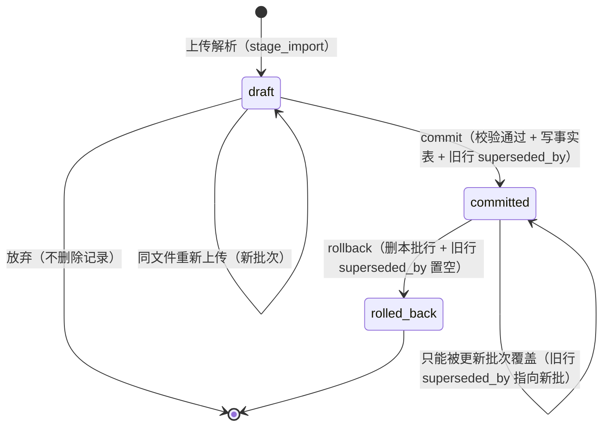
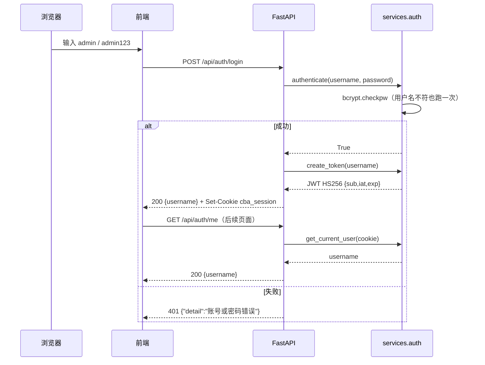
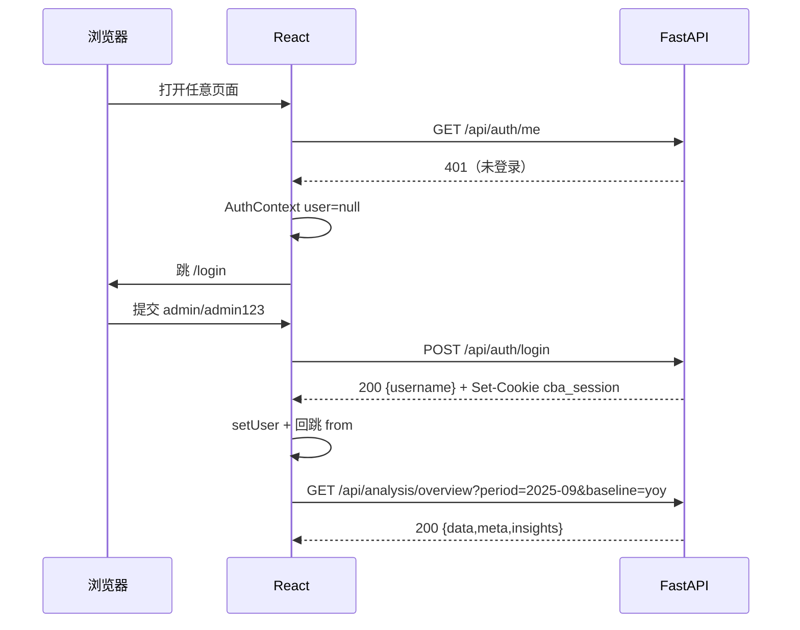
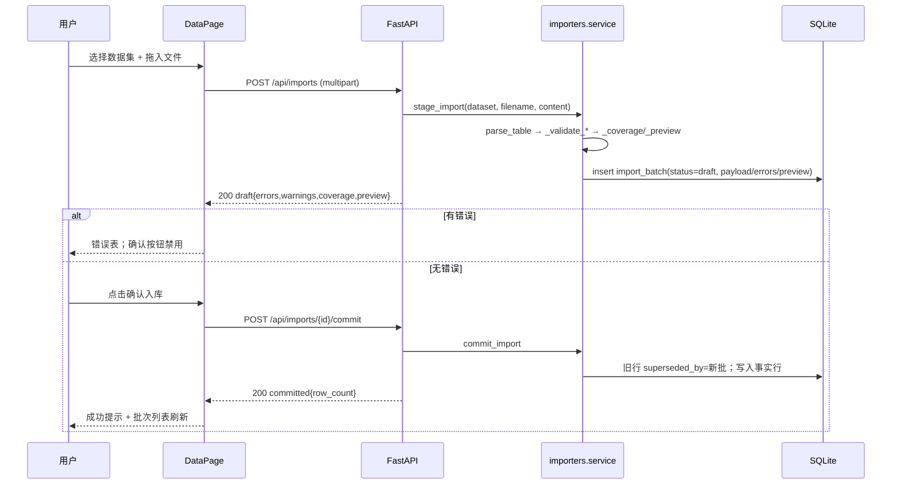
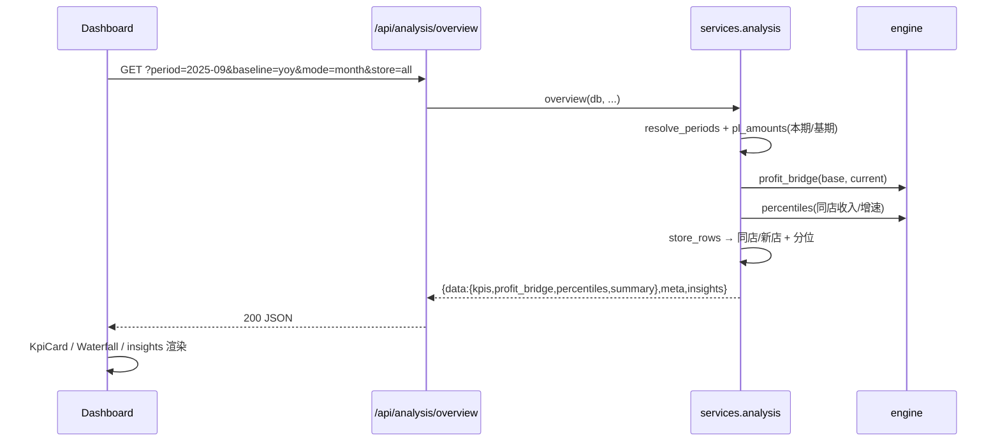
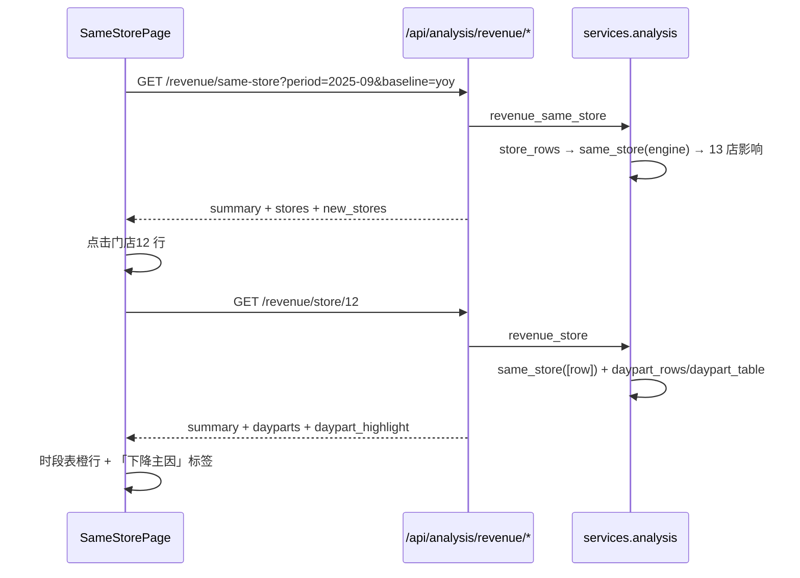

# 详细设计 · 餐饮经营分析系统

> 文档编号：**CBA-LLD-001** ｜ 版本：**v1.0** ｜ 日期：**2026-11-08** ｜ 适用基线：git tag **v0.3.1**
> 文档定位：面向开发、维护、测试，写到**表/字段、公式、接口、组件、边界条件**一级，可直接据此改代码或排障。
> 关联文档：[README](README.md)、[03-概要设计](03-概要设计.md)、[05-测试文档](05-测试文档.md)、[07-维护与版本记录](07-维护与版本记录.md)、`shared/api-contract.md`、`shared/fixtures/README.md`、`docs/domain/data-caliber-notes.md`、`backend/seed/README.md`。

## 1. 文档信息与修订记录

| 项 | 内容 |
|---|---|
| 文档编号 / 名称 | CBA-LLD-001 / 详细设计 |
| 版本 / 状态 | v1.0 / 已评审（随一期 Demo 收口） |
| 编写日期 | 2026-11-08 |
| 适用基线 | `v0.3.1`（2026-11-08） |
| 事实来源 | `backend/app/**`、`frontend/src/**`、`backend/alembic/**`、`shared/fixtures/*`、`backend/tests/*`；所有公式与字段均与代码逐项核对 |
| 阅读前提 | 先读 03 概要设计的 §3/§8/§9/§10；本文不重复架构论证，只写实现细节 |

**修订记录**

| 版本 | 日期 | 修订人 | 变更摘要 |
|---|---|---|---|
| v1.0 | 2026-11-08 | 架构组 | 首次编写：16 表字段、8 类导入规则、引擎全部公式、23 条路径、鉴权、前端与扩展点 |

## 2. 数据库详细设计

### 2.1 总览

- 实现 **16 张业务表**：8 张维度/元数据 + 8 张事实表。OpenAPI 迁移（`alembic upgrade head`）另有 `alembic_version`；当前演示库由 `init_db()` 的 `create_all` 建立，因此文件里没有该表。
- 唯一初始迁移：`backend/alembic/versions/7ff48b1131c0_initial_schema.py`；`env.py` 启用 `render_as_batch=True`（SQLite 改表兼容）。
- 事实表统一混入 `_FactMixin`：`id`(PK)、`import_batch_id`(int, null, idx)、`superseded_by`(int, null, idx)、`created_at`(datetime, 默认 `utcnow()`)。
- **不建外键**：引用完整性由导入器/服务层校验；查询过滤 `superseded_by IS NULL`。
- 当前演示库行数：brand 1、store 15、account 10、channel 10、product_series 8、product 31、period 24、import_batch 14、pl_fact 240、store_revenue_fact 30、channel_revenue_fact 20、product_sales_fact 57、funnel_fact 1、daypart_fact 12、budget_fact 1、target_fact 2。

### 2.2 维度 / 元数据表

**brand**

| 字段 | 类型 | 约束/索引 | 说明 |
|---|---|---|---|
| id | Integer | PK | 品牌 id |
| name | String(64) | UNIQUE, NOT NULL | 示例「示例餐饮品牌」 |

**store**（15 家：门店1–13 + 新店1/2）

| 字段 | 类型 | 约束/索引 | 说明 |
|---|---|---|---|
| id | Integer | PK | 门店 id（前端筛选与路由用） |
| code | String(32) | UNIQUE, NOT NULL | S01…S15 |
| name | String(64) | UNIQUE, NOT NULL | 门店1…门店13、新店1、新店2 |
| brand_id | Integer | NULL | 品牌引用（不建 FK） |
| region | String(32) | NOT NULL | 区域一/二/三（演示设定） |
| business_model | String(16) | NOT NULL | 直营/加盟/联营 |
| store_type | String(16) | NOT NULL | MALL/社区街边/写字楼/交通枢纽 |
| opened_on | Date | NULL | 同店/新店判定依据 |
| closed_on | Date | NULL | 闭店判定依据 |
| area_m2 | Float | NULL | 面积（二期坪效用） |
| seats | Integer | NULL | 座位（二期上座用） |

**account**（10 个利润表科目）

| 字段 | 类型 | 约束/索引 | 说明 |
|---|---|---|---|
| id | Integer | PK | 科目 id |
| name | String(64) | UNIQUE, NOT NULL | 营业收入/食材成本/…/税金及附加 |
| cost_behavior | String(16) | 默认 `fixed` | `revenue` / `variable` / `fixed`，利润桥分类 |
| sort_order | Integer | 默认 0 | 展示与利润表顺序 |

**channel**（10 个渠道）

| 字段 | 类型 | 约束/索引 | 说明 |
|---|---|---|---|
| id | Integer | PK | 渠道 id |
| name | String(64) | UNIQUE, NOT NULL | 美团大众/扫码支付/线上活动优惠/抖音/会员储值消费/堂食现金/招商银行/京东外卖/美团外卖/饿了外卖 |
| category | String(16) | NOT NULL | 堂食 / 外卖 |
| sort_order | Integer | 默认 0 | 渠道表顺序 |

**product_series / product / period**

| 表 | 字段 | 类型 | 约束 | 说明 |
|---|---|---|---|---|
| product_series | id / name / sort_order | Integer / String(64) / Integer | PK / UNIQUE / 默认 0 | 8 个系列：肉类、锅底类、涮品类、主食类、凉菜类、小料类、饮品、其它 |
| product | id / series_id / name / is_set | Integer / Integer / String(128) / Boolean | PK / NULL / UNIQUE / 默认 false | 名称为业务主键（导入按名称匹配）；套餐标记 |
| period | id / year / month | String(7) / Integer / Integer | PK(YYYY-MM) / NOT NULL / NOT NULL | 期间字典，种子 2024-01…2025-12 |

**import_batch**（批次）

| 字段 | 类型 | 约束/索引 | 说明 |
|---|---|---|---|
| id | Integer | PK | 批次 id |
| dataset | String(32) | NOT NULL, idx | 8 类 key |
| dataset_name | String(64) | 默认 "" | 中文名冗余 |
| filename | String(255) | 默认 "" | 上传文件名 |
| period_from / period_to | String(7) | NULL | 数据期间范围（min/max） |
| row_count | Integer | 默认 0 | commit 时写入实际行数 |
| operator | String(64) | 默认 admin | 操作人 |
| status | String(16) | 默认 draft, idx | draft / committed / rolled_back |
| created_at / committed_at / rolled_back_at | DateTime | 默认 utcnow / NULL / NULL | 三个时间戳 |
| errors_json / warnings_json | Text | 默认 "[]" | `[{row,column,message}]` |
| preview_json | Text | 默认 "[]" | 前 50 行预览 |
| payload_json | Text | 默认 "[]" | draft 的解析行（commit 用） |
| coverage_json | Text | 默认 "[]" | 覆盖提示列表 |

### 2.3 事实表

| 表 | 字段（含公共 mixin） | 单位 | 说明 |
|---|---|---|---|
| pl_fact | id, import_batch_id, superseded_by, created_at, brand_id(null), store_id(null), period(idx), scenario(默认 actual, idx: actual/budget), account_id(idx), amount | 万元 | 品牌口径行 `store_id IS NULL`；服务层优先取品牌行 |
| store_revenue_fact | mixin + store_id(idx, NOT NULL), period(idx), revenue, traffic, avg_ticket(null), store_flag(null: 同店/新店/闭店，导入优先) | 万元 / 人次 / 元 | 每店每期 1 行 |
| channel_revenue_fact | mixin + store_id(null), period(idx), channel_id(idx), revenue | 万元 | 公司口径 `store_id IS NULL` |
| product_sales_fact | mixin + store_id(null), period(idx), product_series_id(null,idx), product_id(null,idx), qty, amount, dish_revenue, discount, actual_cost(null), std_unit_cost(null), is_set(默认 false) | 元（成本万元例外） | `product_id IS NULL` = 系列汇总行；有值 = 单品/套餐行 |
| funnel_fact | mixin + store_id(null), period(idx), channel_id(idx), exposure/visits/payers/consumers/brand_customers/new_customers/old_customers(null), platform_fee(null) | 人次 / 元 | 缺失存 NULL，不补 0 |
| daypart_fact | mixin + store_id(idx, NOT NULL), period(idx), day_type(工作日/节假日), daypart(文本如 9:00-14:00), traffic | 人次 | 门店 12 有数据 |
| budget_fact | mixin + brand_id(null), store_id(null), period(idx), account_id(idx), amount | 万元 | 预算不完整时业务层置空 |
| target_fact | mixin + period(idx), channel_id(idx), new_customers/exposure_cvr/avg_ticket/gross_margin/cac/target_roi(null) | 人/小数/元/元/元/倍 | **无 store_id**，渠道级目标 |

### 2.4 索引清单（36 个显式索引）

| 表 | 索引 |
|---|---|
| import_batch | `ix_import_batch_dataset`、`ix_import_batch_status` |
| pl_fact | `ix_pl_fact_account_id`、`import_batch_id`、`period`、`scenario`、`superseded_by` |
| store_revenue_fact | `store_id`、`period`、`import_batch_id`、`superseded_by` |
| channel_revenue_fact | `channel_id`、`period`、`import_batch_id`、`superseded_by` |
| product_sales_fact | `product_series_id`、`product_id`、`period`、`import_batch_id`、`superseded_by` |
| funnel_fact | `channel_id`、`period`、`import_batch_id`、`superseded_by` |
| daypart_fact | `store_id`、`period`、`import_batch_id`、`superseded_by` |
| budget_fact | `account_id`、`period`、`import_batch_id`、`superseded_by` |
| target_fact | `channel_id`、`period`、`import_batch_id`、`superseded_by` |

另有 8 个 SQLite 唯一约束自动索引（brand.name、store.code、store.name、account.name、channel.name、product_series.name、product.name、period.id），演示库 `sqlite_master` 共 44 条索引记录。

### 2.5 关系与引用规则

| 引用 | 关系 | 说明 |
|---|---|---|
| store.brand_id → brand.id | 多对一 | 一期单品牌 |
| pl_fact.store_id → store.id | 多对一（可空） | 空 = 品牌/全部门店口径；查询时品牌行优先 |
| pl_fact.account_id / budget_fact.account_id → account.id | 多对一 | 按科目名聚合 |
| channel_revenue_fact/funnel_fact.channel_id → channel.id | 多对一 | 导入按渠道名匹配 |
| product_sales_fact.product_series_id/product_id → product_series/product | 多对一（可空） | 系列汇总行 product_id 空 |
| target_fact.channel_id → channel.id | 多对一 | 无 store_id |
| 任意事实.import_batch_id → import_batch.id | 逻辑引用（不建 FK） | 覆盖/回滚依据 |

### 2.6 覆盖与回滚字段语义

| 字段/状态 | 含义 | 约束 |
|---|---|---|
| `import_batch_id` | 该行由哪个批次写入 | 历史行保留，不置空 |
| `superseded_by` | 该行被哪个**新批次**覆盖 | `NULL` = 当前生效；查询必须过滤 |
| `import_batch.status=draft` | 已解析未入库 | 可 commit；可重新上传生成新 draft；不可 rollback |
| `status=committed` | 已入库 | 可 rollback；不可再次 commit |
| `status=rolled_back` | 已回滚 | 仅记录；不可再操作 |

回滚实现（`rollback_import`）：对 `FACT_MODELS`（8 张事实表）执行两次 UPDATE/DELETE——`delete where import_batch_id = batch.id`，`update set superseded_by=NULL where superseded_by = batch.id`，然后置批次 `rolled_back` 并提交。因 supersede 按「同数据集 + 同期间 + 同门店作用域」整段标记，回滚可完整恢复上一次生效版本。

### 2.7 单位与精度

- 万元表：`pl_fact`、`store_revenue_fact.revenue`、`channel_revenue_fact`、`budget_fact`；元表：`product_sales_fact` 金额、`funnel_fact.platform_fee`；人次：traffic/漏斗人数；客单：元/人次。
- 数据库 Float 不取整；服务层出口 `r2`（2 位）、`r4`（4 位）、`ri`（整数化）；比率 0–1 小数。
- 中间计算不取整，展示值相加与合计不一致时页面脚注「尾差由四舍五入导致」。

## 3. 导入器详细设计

### 3.1 框架（`importers/base.py`）

| 类/函数 | 关键属性/行为 |
|---|---|
| `Column` | `name`、`kind`(text/float/int/period/bool)、`required`、`enum`、`min_value`、`max_value`、`aliases`、`note`；`matches(header)` 规范化后匹配 |
| `DatasetSpec` | `key`、`name`、`columns`、`example`、`description`、`allow_dynamic_accounts`、`column_names`、`find_column`、`find_by_name` |
| `normalize_header` | 去首尾空格 → 去单位后缀（万元、元、人次、元/人次、份、人、%）→ 去 `&`/`＆` → 去所有空白 |
| `_read_matrix` | `.xlsx/.xlsm`：openpyxl `read_only=True, data_only=True`，取第一个工作表；`.csv/.txt`：`utf-8-sig`；坏 zip → `ValueError` 行级错误；旧 `.xls` 不支持 |
| `convert_value` | period 必须 `YYYY-MM`；float 允许千分位/百分号（`50%` → 0.5）；int 必须整数；bool 识别 是/否/true/false/1/0/套餐/单品/√/×；text 校验 enum |
| `parse_table` | 返回 `(rows, errors, warnings)`；`rows` 每行带 `_row`（真实文件行号，表头=1）；表头前空行自动跳过；首格以「说明：」开头的行跳过 |
| 错误结构 | `{row:int, column:str, message:str}`；同一行可多条；有错误的行**不进入** payload |

严格性：文件头只要出现「列名不在模板内」即错误（除非是 `pl_monthly` 的动态科目或有 `account_mapping`）；必填列缺失在表头行报一次；每行必填为空、类型错误、枚举越界、负数（`min_value=0` 时 message 为「不能为负数」）都逐条报错。

### 3.2 8 类数据集逐列规则（`importers/registry.py`）

**字段规则**

> 表头规范化后按 `Column.name` / `aliases` 匹配；`kind` 取值 text/float/int/period/bool；金额列 `min_value=0`。

| 数据集 | 必填列（类型）与别名 | 可选列（类型 / 枚举 / 别名） |
|---|---|---|
| `pl_monthly` 月度利润表 | 期间(period；别名 月份/期间(YYYY-MM))；营业收入、食材成本、优惠及手续费、水电气低值、宣传费用、工资奖金、宿舍房租、店铺房租、其它费用(float) | 门店(text，「全部」=品牌；别名 在营门店/门店名称)；税金及附加(float)；`allow_dynamic_accounts`：额外科目需映射到 `account` |
| `store_revenue` 门店收入 | 期间(period)；门店(text，必须具体)；营业收入（万元）(float；别名 营业收入)；客流（人次）(float；别名 客流) | 区域(text)；经营模式(直营/加盟/联营)；店型(MALL/社区街边/写字楼/交通枢纽)；客单价（元）(float，空则反算)；同店/新店/闭店(枚举，优先于日期推算) |
| `channel_revenue` 渠道收入 | 期间(period)；渠道(text，必须在清单)；收入（万元）(float；别名 收入) | 门店(text，「全部」=公司口径)；渠道大类(堂食/外卖；不符按清单纠正) |
| `product_series` 产品系列销售 | 期间(period)；产品系列(text；别名 系列产品/产品系列名称)；销售数量(float；别名 销量)；销售额（元）(float)；菜品收入（元）(float)；菜品优惠（元）(float；别名 菜品优惠) | 门店(text)；实际成本（万元）(float；别名 实际成本/实际总成本（万元）)；理论单位成本（元）(float；别名 单品理论成本（元）/理论成本（元）) |
| `product_item` 单品销售 | 期间(period)；产品名称(text；别名 菜品名称/单品名称)；销售数量(float)；销售额（元）(float)；菜品收入（元）(float)；菜品优惠（元）(float) | 门店(text)；产品系列(text，套餐可空/单品必填已存在)；是否套餐(bool；别名 是否套餐（是/否）/套餐标识) |
| `funnel` 线上漏斗 | 期间(period)；渠道(text，必须在清单) | 门店(text，「全部」=品牌)；曝光/访问/支付/消费人数(float；别名 曝光/曝光量/访问/支付/消费)；品牌顾客/新客/老客(float；别名 品牌顾客数/品牌新客/品牌老客)；平台费用（元）(float；别名 平台费用/投入成本（元）) |
| `daypart` 时段客流 | 期间(period)；门店(text，必须具体)；日类型(工作日/节假日)；时段(text，正则 `HH:MM-HH:MM`；别名 时段文本)；客流(int；别名 客流（人次）) | — |
| `budget_target` 预算与目标 | 期间(period)；每行二选一：①科目(text)+预算值（万元）(float；别名 预算值)；②渠道(text)+目标ROI(float；别名 目标 ROI/目标ROI（倍）) | 门店(text)；新客量(int)/曝光转化率(0–1)/客单价/毛利率(0–1)/新客成本（元）；渠道别名 大众点评、点评→美团大众，外卖→美团外卖 |

**跨表校验与警告阈值**

| 数据集 | 错误（拒绝入库） | 警告（可入库） |
|---|---|---|
| pl_monthly | 动态科目不在标准科目表或未映射；同期间同门店同科目重复；负金额 | 同期间同门店缺标准科目（除税金）→「利润桥可能不完整」 |
| store_revenue | 同期间同门店重复；门店填「全部」或不存在 | 区域/经营模式/店型与档案不一致；申报客单与反算差 >1% |
| channel_revenue | 同期间同门店同渠道重复；渠道不在清单 | 渠道大类与清单不符（按清单纠正）；渠道合计与门店收入差 >1% |
| product_series | 同期间同门店同系列重复；负数量/金额 | 系列不存在（导入时自动新增）；菜品收入+优惠与销售额差 >1% |
| product_item | 同期间同门店同产品名重复；非套餐缺系列或系列不存在 | 菜品收入+优惠与销售额差 >1% |
| funnel | 同期间同门店同渠道重复；渠道不在清单；四层全空；逐级递增 | — |
| daypart | 同期间同门店同日类型同时段重复；门店非具体；时段格式非法 | 全部日类型时段合计与门店客流差 >1% |
| budget_target | 预算科目不在标准表/缺预算值/重复；目标渠道无法映射/缺目标ROI；行不满足二选一 | — |

### 3.3 模板生成（`render_template`）

- openpyxl 新建工作簿，sheet 标题 = 数据集中文名；第 1 行中文表头（加粗），第 2 行为 `example` 示例行，第 3 行以「说明：」开头的填写提示；按列名长度设置列宽（最小 12）。
- `template_list()` 返回 `[{key,name,description,columns}]`（**裸 list**，前端 useTemplates 期望 `{data}`，见 §11）。
- 下载端点 `GET /api/imports/templates/{key}.xlsx`，媒体类型 xlsx，文件名 `{key}.xlsx`；key 不在 `DATASET_ORDER` → 404。

### 3.4 两阶段提交

| 阶段 | 函数 | 关键行为 |
|---|---|---|
| 上传/校验 | `stage_import(session, dataset, filename, content, operator, account_mapping)` | 解析 → 有错则不跑跨表校验；生成 `ImportBatch(draft)`；`period_from/to` 取 rows 期间 min/max；无错时算 coverage 与 preview，payload 存 rows；有错 payload 存 `[]`；提交后返回 |
| 确认入库 | `commit_import(session, batch_id)` | 批次必须存在且 `draft`；errors 非空拒绝；payload 为空拒绝；调 `_commit_rows`；回填 `row_count`、`status=committed`、`committed_at` |
| 回滚 | `rollback_import(session, batch_id)` | 批次必须 `committed`；删本批行 + 恢复被覆盖行；`status=rolled_back`、`rolled_back_at` |

`_commit_rows` 按数据集把 payload 行转事实对象（`pl_monthly` 一行拆多科目行；`budget_target` 按 `_row_type` 拆 `BudgetFact`/`TargetFact`），先 `_supersede` 再 `add_all`，`flush` 后返回行数。

### 3.5 覆盖检测

`_coverage` 按 `(期间, 门店作用域)` 分组，若 `_has_existing` 判定已有生效行，则输出 `{period, store, rows, message:"将覆盖 门店1 2025-09 的 月度利润表 数据"}`。

| 数据集 | 覆盖判定键 |
|---|---|
| pl_monthly | period + store + `scenario=actual` |
| store_revenue | period + store |
| channel_revenue | period + store 作用域 |
| product_series | period + store + `product_id IS NULL` |
| product_item | period + store + `product_id IS NOT NULL` |
| funnel | period + store 作用域 |
| daypart | period + store |
| budget_target | period（预算）/ period + channel（目标）任一存在即提示 |

supersede 的 UPDATE 范围与上表一致（product_item 额外按本批 product_id 集合限定），统一 `superseded_by IS NULL` 条件。

### 3.6 错误与警告目录（message 为准；编号为本文件为便于引用而加）

| 编号 | 级别 | 触发 | 典型 message |
|---|---|---|---|
| E-IMP-01 | 错误 | 文件类型不支持/损坏 | 不支持的文件类型：.xls（仅支持 .xlsx / .csv） |
| E-IMP-02 | 错误 | 空文件/无表头 | 文件为空，请上传带表头的 Excel / CSV |
| E-IMP-03 | 错误 | 表头缺必填列 | 缺少必填列「期间」 |
| E-IMP-04 | 错误 | 未知列名 | 列名不在模板内，最接近的标准字段：「营业收入」 |
| E-IMP-05 | 错误 | 期间格式 | 期间格式必须为 YYYY-MM（如 2025-09） |
| E-IMP-06 | 错误 | 数值类型/负数/越界 | 不能为负数 / 必须是整数 / 不能大于 1 |
| E-IMP-07 | 错误 | 必填为空 | 「门店」为必填项 |
| E-IMP-08 | 错误 | 门店不存在/未指定 | 门店「XX」不存在 / 门店收入必须指定具体门店 |
| E-IMP-09 | 错误 | 渠道不在清单 | 渠道「XX」不在渠道清单内，最接近的是「美团大众」 |
| E-IMP-10 | 错误 | 未知科目/预算科目 | 科目「装修费」不在标准科目表内…可通过科目映射指定 |
| E-IMP-11 | 错误 | 漏斗非递减 | 漏斗必须逐级递减：支付人数 800 大于 访问人数 700 |
| E-IMP-12 | 错误 | 时段格式 | 时段格式应为 9:00-14:00 |
| E-IMP-13 | 错误 | 重复行 | 与第 5 行重复（同期间同门店同科目） |
| E-IMP-14 | 错误 | 预算/目标行不完整 | 每行必须填写「科目+预算值」或「渠道+目标字段」 |
| W-IMP-01 | 警告 | 缺标准科目 | 期间 2025-09（全部门店）缺少科目：…，利润桥可能不完整 |
| W-IMP-02 | 警告 | 申报客单与反算差 >1% | 申报客单价 120.00 与收入/客流反算 123.45 差异 2.8%，超过 1% |
| W-IMP-03 | 警告 | 渠道合计与门店收入差 >1% | 渠道合计 990.00 万与门店收入 1000.00 万相差 1.0%，超过 1% |
| W-IMP-04 | 警告 | 菜品收入+优惠 ≠ 销售额 >1% | 相差 X%，超过 1% |
| W-IMP-05 | 警告 | 产品系列不存在（自动新增） | 产品系列「XX」不存在，导入时自动新增 |
| W-IMP-06 | 警告 | 时段合计与门店客流差 >1% | 时段客流合计 … 与门店客流 … 相差超过 1% |
| W-IMP-07 | 警告 | 门店属性与档案不一致 | 区域「XX」与门店档案「区域一」不一致，以门店档案为准 |

## 4. 计算引擎详细设计

### 4.1 约定

- 纯函数：入参/出参均为普通 dict/list；不 import 数据库/框架；不取整（除 note 文本格式化）。
- 单位：结构/同店/渠道为万元；产品量价金额为元、影响换算万元；客单为元/人次；比率为 0–1。
- 容差：闭环类 `TOLERANCE=0.01`（`compare` 无关）；`revenue.TOLERANCE=0.02` 预留。

### 4.2 `compare.py`

| 函数 | 签名 | 公式/边界 |
|---|---|---|
| `diff` | `(current, base) -> float \| None` | `current-base`；任一侧 None → None |
| `pct_rate` | `(current, base) -> float \| None` | `(cur-base)/base`；base 为 0/None → None（前端「—」） |
| `pp_change` | `(current_rate, base_rate) -> float \| None` | 比率差 ×100 |
| `compare_rate` | `(current, base) -> {current,base,diff,pp}` | 比率类对比 |
| `compare` | `(current, base, unit="万元") -> {current,base,diff,rate,unit}` | 通用对比 |

示例：收入 1000 vs 760 → diff +240、rate 0.3158（+31.58%）；新店 143 vs 0 → diff +143、rate None。

### 4.3 `chain_substitution.py`

签名：`chain_substitution(factors, base_values, cur_values, formula) -> {base_result, cur_result, total_change, items:[{factor,impact}], impact_sum, residual, closed}`。

算法：`values=dict(base)`；`prev=formula(values)`；按 `factors` 顺序逐项把 `values[factor]=cur_values[factor]`，`cur=formula(values)`，`impact=cur-prev`，`prev=cur`。闭合判定 `abs(total_change-impact_sum) <= 0.01`。

| 便捷函数 | 因素顺序 | 公式 |
|---|---|---|
| `revenue_qty_price` | qty → price | 收入 = 销量 × 单价 |
| `gross_profit_volume_price_cost` | qty → price → cost | 毛利额 = 销量 ×（单价 − 单位成本） |

### 4.4 `profit_bridge.py`（9 项逐项公式）

输入 `pl_base`、`pl_cur` 为 `{科目名: 万元}`；按 `DEFAULT_ACCOUNTS` 的 `sort_order` 与 `cost_behavior` 分类。`start = 基期收入 − 基期全部费用`，`end = 本期收入 − 本期全部费用`；基期边际贡献率 `base_mcr = 1 − Σ(基期变动成本率)`。

| # | key / 名称 | 公式 | 2024-09→2025-09 影响（万元） |
|---|---|---|---|
| 1 | revenue_scale / 收入规模 | `(本期收入 − 基期收入) × 基期边际贡献率` | +100.48 |
| 2 | food_cost / 食材成本 | `−本期收入 × (本期费率 − 基期费率)` | −10.42 |
| 3 | discount_fee / 优惠及手续费 | 同上 | +12.93 |
| 4 | utilities / 水电气低值 | 同上 | +2.17 |
| 5 | marketing / 宣传费用 | 同上 | +7.39 |
| 6 | salary / 工资奖金 | `基期金额 − 本期金额` | −12.03 |
| 7 | dorm_rent / 宿舍房租 | 同上 | −1.66 |
| 8 | store_rent / 店铺房租 | 同上 | −13.76 |
| 9 | other / 其它费用 | 同上 | −37.00 |

- 基期边际贡献率 = 1 −（25.66% + 24.79% + 4.21% + 3.47%）= **41.87%**；`revenue_scale = 240 × 0.4187 = 100.48`。
- 变动成本示例：食材费率 25.66%→26.70%，`−1000 × 0.0104 = −10.42`；优惠 24.79%→23.50%，`−1000 × (−0.0129) = +12.93`。
- 固定费用示例：工资 135.00→147.03，`135.00 − 147.03 = −12.03`；其它费用 47→84，`−37.00`。
- 合计 +48.10，`start=64.60 → end=112.70`，`residual≈0`、`closed=True`。
- 边界：`税金及附加` 两期均为 0 时**跳过**（保持 9 项）；某科目缺失按 0 参与（导入侧会给缺科目警告）；收入为 0 时费率为 0（`_rate` 防除零）；输出附带 `base_marginal_contribution_rate/cur_.../base_revenue/cur_revenue/base_profit/cur_profit`。

### 4.5 `mix_rate_split.py`

`mix_rate_split(share_base, rate_base, share_cur, rate_cur) -> {structure_impact, rate_impact, total_impact, composite_base, composite_cur, total_diff, residual, closed, rows}`。

- 结构影响 = `Σ((本期占比 − 基期占比) × 基期率)`
- 单项率影响 = `Σ(本期占比 × (本期率 − 基期率))`
- 两者之和 = 综合率变动；`rows[key]` 含 share/rate/两类影响/合计。

### 4.6 `percentiles.py`

- `percentiles(values)`：过滤 None → 排序；`len < 3` 返回 None；否则 P25/P50/P75（线性插值：`pos=(n−1)q`，`lower=floor(pos)`，`frac=pos−lower`，`v=lower*(1−frac)+upper*frac`），返回 `{p25,p50,p75,n}`。
- `bucket_of(value, pct)`：`<P25`、`P25–P50`、`P50–P75`、`>P75`；value/pct 缺失 → None。
- 示例（13 家同店收入）：P25 42.08、P50 62.39、P75 82.19；同店增速分位 P25 0.079、P50 0.102、P75 0.191，当前 0.128 落在 `P50–P75`。

### 4.7 `revenue.py`

| 函数 | 关键公式与边界 |
|---|---|
| `structure(rows, dimension, dimension_name)` | 汇总 current/base/diff/rate；每行 `current_share=current/total_current`（total 为 0 → None）、`base_share`、`rate=diff/base`（base 0 → None） |
| `same_store(stores)` | 客单：`_ticket` 优先申报值，否则 `revenue*10000/traffic`；客流影响 `=(t_cur−t_base)×ticket_base/10000`；客单影响 `=t_cur×(ticket_cur−ticket_base)/10000`；汇总客单按客流加权（Σ客单×客流 ÷ Σ客流）；`variance_note` 当 `\|收入变动−影响和\| ≥ 0.005` 时生成尾差说明 |
| `channel_split(channels, same_rev, new_rev, total_rev)` | `same_ratio=same/total`、`new_ratio=new/total`；`same=current×same_ratio`、`new=current×new_ratio`；`diff=same−base`；总额同口径 |
| `product_volume_price(...)` | `price=amount/qty`；同店口径 `qty_eff=qty×same_store_ratio`（基期不缩放）；销量影响 `=(qty_eff−qty_base)×price_base/10000`；单价影响 `=qty_eff×(price_cur−price_base)/10000`；按 `\|diff\|` 降序；`sets` 由 `_sets_effects` 算（单位元，量差 `=(qty_cur−qty_base)×price_base`、价差 `=qty_cur×(price_cur−price_base)`） |
| `funnel(counts, baseline=None)` | 5 个率：曝光→访问、访问→支付、支付→消费、曝光→支付、新客占比（分子/分母 None 或 0 → None）；有 baseline 时 `mom_change` 为对应率差，否则全 None；缺失人数保持 None |
| `roi(revenue, platform_fee, gross_margin, thresholds)` | `fee_rate=fee/revenue`；`gross_profit=revenue×gross_margin`；`gross_roi=gross_profit/fee`；`sales_roi=revenue/fee`；状态：费用率 > max → risk，毛利 ROI < min → risk，销售 ROI < min → warning |
| `daypart_table(rows)` | 明细按「工作日优先、时段起始小时」排序；日类型小计；总计；`biggest` = `\|diff\|` 最大项并给 `highlight=True`；整数化在服务层 |

验收锚点：同店 857.23/759.95、客流 66,566.29/59,344.75、客单 128.78/128.08、客流影响 92.07、客单影响 5.08、尾差 0.12；渠道美团大众同店 394.23/新店 65.77/差额 58.24；系列同店 91.50/5.67；套餐量差 770,933.33/价差 −392,795.79；漏斗 14.63%/11.44%/88.18%；ROI 2.00/3.33/30%。

### 4.8 洞察规则（8 组）

| 组 | 函数 | 触发与输出 |
|---|---|---|
| 1 利润桥 | `profit_bridge_insights(bridge)` | 取 `revenue_scale` + 最大负向变动成本 + 最大负向固定费用（税率 0 已跳过）；level 按影响正负；文本「X影响营业利润 ±N.NN 万元（note）」；不截断（保留 3 条） |
| 2 收入结构 | `structure_insights(structure, dimension_name)` | 增长最大的 3 项 + 下降最大的 2 项（diff>0/<0 才输出）；文本带差额与增减率 |
| 3 同店 | `same_store_insights(summary, dominance=0.8)` | 客流/客单 \|影响\| 占比 ≥80% 判「由客流/客单价主导」，否则「两者共同作用」 |
| 4 门店异动 | `store_anomaly_insights(stores)` | 收入与客流同时下降的门店点名（如门店12） |
| 5 渠道 | `channel_insights(rows)` | 同店差最大的前 3 个正增长渠道；含同店/新店分摊 |
| 5' 漏斗 | `funnel_insights(funnel, threshold=0.01)` | 任一层转化率环比下降 > 1pp → 负向异常（只看曝光→访问、访问→支付、支付→消费） |
| 6 线上效率 | `online_efficiency_insights(economics)` | 费用率 >15%、毛利 ROI <1 标 risk，销售 ROI <4 标 warning/info |
| 7 产品 | `product_insights(product)` | 销量影响最大系列 + 「降价换量」（量增、价降且 \|价影响\|>1）+ 套餐量价结论 |
| 8 结论 | `conclusion_insights(summary)` | 收入异动汇总、新店占比、同店靠客流还是客单 |

统一结构 `{level: positive|negative|info, title, text, evidence}`；内部 `_impact` 排序后 `finalize(top_n=settings.top_n=3)` 去掉内部字段。文本必须带数字与证据，不做自由生成。

### 4.9 精度与示例计算（利润桥）

以 2025-09 vs 2024-09：收入 760→1000，费用 695.40→871.30，营业利润 64.60→112.70。边际贡献率：`1 − (195/760 + 188.4/760 + 32/760 + 26.4/760) = 1 − 0.5813 = 0.4187`。收入规模 `240×0.4187=100.48`；变动成本四项合计 `−10.42+12.93+2.17+7.39=+12.07`；固定费用四项合计 `−12.03−1.66−13.76−37.00=−64.45`；总计 `100.48+12.07−64.45=+48.10`。中间量保留全精度，出口 `r2`。

## 5. 服务层与 API 详细设计

### 5.1 服务层公共函数（`services/analysis.py`）

| 函数 | 作用 |
|---|---|
| `r2/r4/ri` | 出口取整；`ri` 对整数值返回 int，避免 794.0 |
| `parse_period/period_end/previous_year/previous_month/resolve_periods/resolve_baseline_periods/baseline_label` | 期间解析；`ytd` 返回 1..N 月列表；基准 `budget` 用本期期间、`mom` 用上月、`yoy` 用去年同期（ytd 为去年 1..N 月）；`baseline_label` 单月给「2024-09」、多月给「2024-01~2024-09」、budget 给「budget」 |
| `_meta` | 统一 meta：brand/store/period/baseline/unit |
| `account_map/pl_amounts/budget_amounts` | 按科目名聚合；品牌口径优先取 `store_id IS NULL` 行（若存在） |
| `store_revenue_map/store_rows/classify_store` | 门店收入映射；同店/新店/闭店判定：`closed_on ≤ 本期月初`→闭店，`opened_on > 基期月末`→新店，否则同店；`store_flag`（导入标识）优先 |
| `channel_rows/_channel_totals` | 渠道本期/基期收入 |
| `series_rows/_product_totals/set_totals/product_item_totals` | 系列（product_id 空）、套餐汇总（产品名「线上套餐」）、单品明细（product_id 非空） |
| `funnel_totals` | 按期间/渠道汇总，缺失保持 None |
| `daypart_rows/target_for_channel` | 时段明细；渠道目标 |
| `_budget_complete` | 预算是否包含全部 `settings.standard_accounts`（用于 null 判定） |

### 5.2 端点清单（23 条路径）

| # | 方法 路径 | 主要参数（默认） | 响应 data 字段 | 空值/错误规则 |
|---|---|---|---|---|
| 1 | POST `/api/auth/login` | body `{username,password}` | `{username}` + Set-Cookie | 账号密码错 401 |
| 2 | POST `/api/auth/logout` | — | `{ok:true}` | 删除 cookie |
| 3 | GET `/api/auth/me` | cookie | `{username}` | 未登录 401 |
| 4 | GET `/api/analysis/overview` | period=2025-09, baseline=yoy, store=all, mode=month, brand=all | kpis/revenue,profit,gross_margin,same_store_growth；profit_bridge；percentiles；summary | 无利润表 400；预算不完整 → base/bridge null；ytd 门店数据不足 → 同店增速 null |
| 5 | GET `/api/analysis/profit` | 同上 | rows[科目行]、profit、profit_bridge、budget、mode | 无利润表 400；budget 基准不完整 → profit.base/bridge null，budget.profit.note 说明 |
| 6 | GET `/api/analysis/revenue/structure` | dimension=channel, period, baseline, store, mode, brand | dimension/dimension_name/total/rows/dataset_note | `baseline=budget` 400；缺门店收入 400；维度非法 400 |
| 7 | GET `/api/analysis/revenue/same-store` | period, baseline, brand | summary/stores/new_stores | 缺门店收入 400；无同店门店 → summary 全 0（影响 None） |
| 8 | GET `/api/analysis/revenue/store/{store_id}` | period, baseline, brand | store/summary/dayparts/note/day_types/dayparts_total/daypart_highlight/dayparts_note | 门店不存在/本期无收入 400；无时段数据 → dayparts=[] + note |
| 9 | GET `/api/analysis/revenue/channel` | period, baseline, brand | total/rows/categories/total_note/caliber_note | 预算基准 400；缺门店收入 400 |
| 10 | GET `/api/analysis/revenue/channel/{channel_id}` | period, baseline, brand | channel/funnel/economics/target/funnel_note | 渠道不存在 400；无漏斗 → funnel=null + note |
| 11 | GET `/api/analysis/revenue/product` | scope=all\|same_store, period, baseline, brand | scope/total/series/items/sets/same_store_ratio/conclusion/note | scope 非法 400；无系列数据 400；`sets` 可为 null |
| 12 | GET `/api/analysis/revenue/conclusion` | period, baseline, brand | summary/conclusions/actions | 缺门店收入 400；四项尾差 >0.005 给 variance_note |
| 13 | GET `/api/analysis/thresholds` | — | 5 个阈值 | — |
| 14 | GET `/api/imports/templates` | — | 裸 list | — |
| 15 | GET `/api/imports/templates/{key}.xlsx` | path key | xlsx 二进制 | 未知 key 404 |
| 16a | GET `/api/imports` | limit=20（1–200） | `{data:[batch],total}` | limit 越界 422 |
| 16b | POST `/api/imports` | multipart dataset/file/account_mapping/operator | 裸 batch 对象 | 未知数据集/空文件/>10MB/mapping 非 JSON 400 |
| 17 | POST `/api/imports/{batch_id}/commit` | path id | 裸 batch | 批次不存在/非 draft/有错误/无数据 400 |
| 18 | POST `/api/imports/{batch_id}/rollback` | path id | 裸 batch | 批次不存在/非 committed 400 |
| 19 | POST `/api/seeds/load` | query force=false | `{data:{dimensions,imports}}` | 已加载且未 force 400 |
| 20 | GET `/api/data-status` | period=2025-09, store=all | period/store/baseline/baseline_ready/modules/datasets/baseline_datasets | 期间格式 400 |
| 21 | GET `/api/ping` | 需登录 | `{pong:"pong"}` | 未登录 401 |
| 22 | GET `/api/health` | 公开 | `{status:"ok"}` | — |
| 23 | GET `/{full_path:path}` | — | 命中文件或 `index.html` | 未构建前端时该路由不存在 |

### 5.3 预算 null 逻辑（重点）

1. `baseline=budget` 时取 `budget_amounts`；`_budget_complete` 要求 **10 个标准科目全部存在**，否则视为「预算未导入/不完整」。
2. `overview`：不完整 → `base={}`，`kpis.revenue.base/diff/rate`、`profit.base`、`gross_margin.base/diff` 全部 null，`profit_bridge=null`，summary 改为「预算未导入或科目不完整，暂不计算预算对比」。
3. `profit`：不完整 → `profit_bridge=null`、`profit.base=null`；`budget.revenue` 仍返回（示例导入 1500 万），`budget.profit.budget/achievement=null` 且 `note="示例预算只导入了营业收入，费用预算未导入，营业利润达成率不展示"`。
4. 前端在 `profit_bridge=null` 时渲染空态卡片（标签「预算未导入」），不白屏。

### 5.4 累计（ytd）口径限制

- `resolve_periods(period, "ytd")` = 当年 1..M 月；`resolve_baseline_periods` 同期 = 去年 1..M 月。
- `overview` 先按单月算同店，再检查 `store_revenue_fact` 在 1..M 月覆盖的 distinct period 数；`covered < len(periods)` → `same_growth/same_cur/same_base = None`（不拿单月冒充累计），前端「累计同店口径未提供数据（—）」。
- `profit` 的 ytd 是各科目逐月求和，可直接用（利润表已导入 24 个月）。
- 收入分析聚合实际只取**单月**：`structure` 虽接收 `mode` 参数，但聚合用 `current_periods[-1]` / `baseline_periods[-1]`，`ytd` 下仍等同当月；`same-store`/`channel`/`product`/`conclusion`/`store` 均无 `mode` 参数。前端在收入页选「累计」只显示 `ScopeNotice` 提示「累计口径暂不支持收入分析」，筛选值仍进 URL。

### 5.5 门店时段 highlight

`daypart_rows` 读本期/基期 `(day_type, daypart)`；`daypart_table` 输出 `rows`、`day_types` 小计、`total`、`biggest`（|diff| 最大），并给该行 `highlight=True`。服务层把日类型小计追加为 `daypart="合计"`、`is_total=True`；`daypart_highlight` 原样下发。前端橙色行 + 「下降主因」标签（门店12：工作日 9:00-14:00 −156、14:00-24:00 −305，后者为最大）。

### 5.6 产品 items 与双口径

- 系列行：`_product_totals(product_id IS NULL)` 按系列聚合销量/销售额。
- 套餐量价：`set_totals` 只取产品名「线上套餐」的汇总行（Excel 表 4：432 单/66,080 元 → 5,472 单/444,217.54 元），与套餐菜品明细**不是同一快照**。
- 单品排行：`product_item_totals` 按 `product_id` 聚合，`product_volume_price` 复用同一套量价公式（同店口径乘 `same_store_ratio`）；前端取 |diff| 前 12。
- 系列同店折算：`same_ratio = 同店收入 ÷ (同店+新店)`，本期销量×ratio、基期销量不缩放（Excel 表3 分摊假设）。

## 6. 鉴权详细设计

| 项 | 实现 |
|---|---|
| 密码哈希 | `hash_password`：`bcrypt.hashpw(pw, bcrypt.gensalt(rounds=12))`；`verify_password` 异常返回 False |
| 哈希来源 | `CBA_ADMIN_PASSWORD_HASH` 优先；否则进程内对 `CBA_ADMIN_PASSWORD` 现算并缓存（`_PASSWORD_HASH`） |
| JWT | `jwt.encode({sub,iat,exp}, CBA_SESSION_SECRET, algorithm="HS256")`；`exp = iat + session_max_age(43200)` |
| Cookie | `key=cba_session`、`httponly=True`、`samesite="lax"`、`path="/"`、`max_age=43200`；未设 `secure`（本地 HTTP） |
| 401 处理 | 后端 `HTTPException(401, detail)`；前端 `client.ts` 收到 401 → `window.location.assign('/login')` 并抛 `ApiError(401)`；`RequireAuth` 同时按 `/auth/me` 状态守卫 |
| 路由分组 | `public_router` 仅 auth；`protected_router` 统一 `Depends(get_current_user)`，挂 analysis/imports/data-status 与 `/api/ping` |
| 已知缺口 | 无角色/权限、无限流、无 CSRF token、无审计；`Secure` 未开；公网部署需 HTTPS |

## 7. 前端详细设计

### 7.1 入口与 Provider 树

`main.tsx`：`ConfigProvider(antdTheme, zhCN)` → `AntApp` → `QueryClientProvider`（`retry:1`、`refetchOnWindowFocus:false`、`staleTime:30_000`）→ `BrowserRouter` → `FilterProvider` → `AuthProvider` → `ErrorBoundary` → `App`。页面全部 `React.lazy`，加载态为居中 Spin。

### 7.2 路由表（`App.tsx`）

| 路径 | 页面 | 守卫 | 说明 |
|---|---|---|---|
| `/login` | LoginPage | 公开 | mock 模式校验 admin/admin123；real 走接口 |
| `/`（index） | DashboardPage | 需登录 | 4 KPI + 利润桥 + 一句话结论 + 脚注 |
| `/profit` | ProfitPage | 需登录 | 利润表对比 + 利润桥 + 3 个「二期」占位卡 |
| `/revenue/structure` | StructurePage | 需登录 | 6 维度切换 + 柱图 + 结构表 |
| `/revenue/same-store` | SameStorePage | 需登录 | 汇总卡 + 影响条 + 13 店明细（行点击下钻） |
| `/revenue/store/:storeId` | StoreDetailPage | 需登录 | 三项对比 + 横向排名 + 时段下钻 |
| `/revenue/channel` | ChannelPage | 需登录 | 大类卡 + 渠道结构表 + 同店渠道异动 |
| `/revenue/channel/:channelId` | ChannelDetailPage | 需登录 | 漏斗图 + 阶段表 + 费用率/ROI 阈值条 |
| `/revenue/product` | ProductPage | 需登录 | 同店/全店切换 + 系列量价 + 单品 Top12 + 套餐表 |
| `/revenue/conclusion` | ConclusionPage | 需登录 | 异动汇总 + 自动结论 + 3 条行动建议 |
| `/gross` `/expense` `/customer` `/summary` `/sandbox` `/reports` | SkeletonPages | 需登录 | 6 个二期骨架页（未实现） |
| `/data` | DataPage | 需登录 | 数据就绪、上传校验、预览、批次、回滚、加载示例 |
| `*` | `<Navigate to="/" replace>` | — | 未知路径回首页 |

### 7.3 页面结构（关键页）

| 页面 | 使用的 hook | 主要区块与空态 |
|---|---|---|
| Dashboard | `useOverview(filters)` | 单店/累计/非同期 Alert → 4 KpiCard → 利润桥 ChartCard（瀑布/因素表 Segmented）或「预算未导入」空态 → 一句话结论 + insights 列表 → 四套口径脚注 |
| Profit | `useProfit` | 利润表 DataTable（科目/本期/占比/同期/占比/差额/增减率/pp，成本类 goodDirection=down）→ 利润桥 → 预算达成/评分/板块「二期」卡 → 脚注 |
| Structure | `useStructure` | 维度 Segmented → BarChart（本期 vs 同期）→ 结构表 + 合计 footer + 增量贡献 + 脚注 |
| SameStore | `useSameStore` | 3 KpiCard → ImpactBar（客流/客单 + 尾差 note）→ 13 店 DataTable（点击 `/revenue/store/:id`）→ 新店卡 → 脚注 |
| StoreDetail | `useStoreDetail` + `useSameStore` | 头部返回/标签 → 3 KpiCard → 横向排名（同店收入/客流/客单）→ 时段表（`highlight` 橙行 + 「下降主因」）→ 脚注 |
| Channel | `useChannel` | 堂食/外卖/最大渠道卡 → 渠道结构表 → 同店渠道异动表 → 洞察列表 → 脚注 |
| ChannelDetail | `useChannelDetail` | 头部 → 漏斗 ECharts → 阶段表（转化率/环比/异常标记）→ 费用率/毛利 ROI/销售 ROI 阈值条（`ThresholdBar`）→ 洞察 |
| Product | `useProduct(filters, scope)` | 同店/全店 Segmented → 系列量价表 → 影响额排行 → 单品 Top12 → 套餐对比表（单量/销售额/单价/菜品收入/优惠/优惠率）→ 结论 |
| Conclusion | `useConclusion` | 4 个来源卡 + ImpactBar → 自动结论列表 → 行动建议（`ACTIONS` 常量 3 条） |
| Data | `useTemplates/useBatches/useDataStatus + 3 个 mutation` | 就绪标签、Steps、上传 Dragger、错误表、预览表、确认按钮（错误时禁用）、批次表 + 回滚、加载示例 |
| Login | `useAuth` | 品牌区 + 表单（默认 admin/admin123）+ 错误 Alert + 登录后回跳 `state.from` |

### 7.4 组件职责

| 组件 | 职责 |
|---|---|
| `KpiCard` | 指标名、值+单位、对比值、差异（箭头/符号/语义色）、P25/P50/P75 分位行、门店数不足提示、洞察入口、footer |
| `ChartCard` | 标题/副标题、右上角洞察、分段器、加载骨架、脚注容器 |
| `Waterfall` | 瀑布图：透明底座 + 可见柱，柱顶 `↑/↓ + 金额`，起点/终点、图例、尾差提示 |
| `BarChart` | 通用横向/纵向柱图（本期 vs 同期） |
| `DataTable` | antd Table 封装：排序、行点击下钻、合计 footer、横向滚动、空文案 |
| `FilterBar` | 品牌/门店/期间/当月·累计/对比基准 + 刷新（invalidateQueries） |
| `ChangeTag` | 差异标签：颜色 + 箭头 + 正负号 + `data-semantic` |
| `ThresholdBar` | 阈值进度条（≤ 费用率 / ≥ ROI），达标/未达标/风险标签 |
| `ImpactBar` | 异动占比条 + 图例文字（不只靠颜色） |
| `InsightPopover` | 卡片「洞察」气泡：level 标签 + 文本 + 证据 |
| `FactorTable` | 利润桥因素表（瀑布图的分段视图） |
| `Notes` | `Footnote` 数据来源/口径脚注、`CaliberNote` 口径说明条 |
| `PageState` / `EmptyState` / `ErrorBoundary` | 加载骨架、错误+重试、空态、渲染异常兜底 |
| `ScopeNotice` | 全局筛选范围提示（预算/累计/单店） |
| `SkeletonPage` | 6 个二期骨架页统一模板（标题、二期标签、规划项、返回收入分析） |
| `AiAssistantFab` | 右下角 AI 洞察抽屉（汇总 overview insights，标注「规则版，暂不接大模型」） |
| `icons` | 内联 SVG 图标集 |

### 7.5 状态管理

| 状态 | 实现 | key/参数 |
|---|---|---|
| 服务端数据 | @tanstack/react-query | `['overview'\|'profit'\|'structure', dimension, ...filterQueryKey]` 等；`keepPreviousData` |
| 全局筛选 | `FilterContext` + `useSearchParams` | URL 参数 `brand/store/period/mode/baseline`；默认 `all/all/2025-09/month/yoy`；`setFilters` 用 `replace:true` |
| 登录态 | `AuthContext` | 挂载时 `GET /auth/me`；`login/logout`；`RequireAuth` 跳 `/login` 并带 `state.from` |
| 页面局部 | `useState` | 维度、scope、瀑布/表视图、draft 批次等 |

### 7.6 API hooks（`api/hooks.ts`）

`useOverview`、`useProfit`、`useStructure`、`useSameStore`、`useStoreDetail`、`useChannel`、`useChannelDetail`、`useProduct`、`useConclusion`、`useDataStatus`、`useTemplates`、`useBatches`、`useUploadImport`、`useCommitImport`、`useRollbackImport`、`useLoadSeeds`。响应类型为 `ApiEnvelope<T>`（导入类按 mock 形状写成 `{data}`）。

### 7.7 mock / real 切换

- `apiMode = import.meta.env.VITE_API_MODE === 'real' ? 'real' : 'mock'`，**构建时内嵌**；`request()` mock 走 `mockRequest`，real 走 `fetch(API_BASE + path, {credentials:'include'})`。
- `VITE_API_BASE` 默认 `/api`；开发时 Vite 代理到 `127.0.0.1:8000`。
- mock 行为：延迟 120ms（测试模式 0）；登录仅 `admin/admin123`，用户存 `localStorage['cba.mock.user']`；仅 2025-09 有数据，其它期间抛 `ApiError(404)`；上传/commit/rollback 只改内存批次数组，文件名含「error/错误」模拟校验失败；数字来自 `mock/data.ts`（design §14 + Excel 明细），禁止自造。
- real 行为：401 统一跳登录；网络异常提示后端未启动；`detail` 直接展示。

### 7.8 格式化与语义色

| 函数 | 输出 |
|---|---|
| `formatNumber(v, digits=2)` | 千分位 + 固定小数；null/undefined/NaN → `—` |
| `formatWan/formatYuan` | 金额 2 位 |
| `formatTraffic` / `formatInteger` | 客流 2 位 / 整数 0 位 |
| `formatPercent(v,1)` / `formatSignedPercent` | 0–1 → 百分比，1 位 |
| `formatPp(v,2)` / `formatDelta(v, kind)` | 比率差 ×100 → `+1.04pp`；带 `→/↑/↓` 与正负号 |
| `METRICS` | 17 个指标元数据：`goodDirection`（up/down）、format、deltaFormat、unit |
| `semanticFromDiff(diff, goodDirection)` | 按好坏方向给 positive/negative/flat，不只看正负 |
| `semanticColor/semanticClass` | `#389E0D` / `#CF1322` / 中性灰；CSS 类 `.semantic-*` |

色弱与可访问性：涨跌同时用颜色 + 箭头 + 正负号；门店对比图不用红绿区分门店；`aria-label`（筛选控件、AI 按钮）、`title`（分位、阈值、差异语义）、`aria-hidden`（装饰元素）、`focus-visible` 有可见边框；时段下降主因用「橙色行 + 文字标签」双重标识。

### 7.9 错误边界与空态

- 全局 `ErrorBoundary`：渲染异常显示「页面加载异常 + 返回首页」，不白屏。
- 页面级：`PageLoading` 骨架、`PageError`（错误文案 + 重试）、`EmptyState`（缺数据/预算未导入）、`ScopeNotice`（筛选范围）。
- 导入页：错误/警告分表、`canCommit` 在有 error 时为 false（按钮禁用 + Tooltip 原因）。

## 8. 关键时序图

**① 登录**

**② 导入 draft → commit**

**③ 总览加载**

**④ 同店下钻**

## 9. 配置项清单

| 变量 | 默认值 | 影响 | 部署必改 |
|---|---|---|---|
| `CBA_DATABASE_URL` | `sqlite:///<backend>/data/cba.db` | 数据库连接；测试/冒烟改临时库 | 视部署 |
| `CBA_ADMIN_USERNAME` | `admin` | 单管理员账号 | 建议改 |
| `CBA_ADMIN_PASSWORD` | `admin123` | 密码（启动时 bcrypt） | **必须改** |
| `CBA_ADMIN_PASSWORD_HASH` | 无 | 直接提供 bcrypt 哈希，优先于明文 | 可选 |
| `CBA_SESSION_SECRET` | `dev-only-change-me-32bytes-minimum-key` | JWT 签名密钥 | **必须改** |
| `CBA_PLATFORM_FEE_RATE_MAX` | `0.15` | 平台费用率红线（洞察/ROI 状态） | 按业务 |
| `CBA_GROSS_ROI_MIN` | `1.0` | 毛利 ROI 下限 | 按业务 |
| `CBA_SALES_ROI_MIN` | `4.0` | 销售 ROI 下限 | 按业务 |
| `CBA_FUNNEL_CVR_DROP` | `0.01` | 漏斗单层转化环比告警阈值 | 按业务 |
| `CBA_TOP_N` | `3` | 洞察取前 N 项 | 按业务 |
| `CBA_PLATFORM_GROSS_MARGIN` | `0.6` | 渠道毛利 ROI 用的平台毛利率（target_fact 有值时优先） | 按业务 |
| `VITE_API_MODE` | `mock` | 前端数据源；`real` 才调后端（构建时内嵌） | 演示必须 `real` |
| `VITE_API_BASE` | `/api` | real 模式接口基地址 | 跨域部署时改 |

端口/路径：后端 8000；前端 dev 5173；DB `backend/data/cba.db`；构建产物 `frontend/dist`；seed `backend/seed/*.csv`；迁移 `backend/alembic`。

## 10. 错误与异常处理

| HTTP | 触发 | 前端表现 |
|---|---|---|
| 200 | 正常 | 正常渲染 |
| 400 | `AnalysisError`（期间格式/维度/门店不存在/缺数据/预算基准不支持）、`ImportError_`（批次状态/文件/校验）、`seeds` 已加载 | `PageError` + 重试；导入页 `message.error(detail)` |
| 401 | 未登录/会话过期/密码错 | `client.ts` 跳 `/login`；登录页 Alert |
| 404 | 模板 key 未知、mock 未实现路径、渠道/门店不存在（mock） | 提示「未知数据集」等 |
| 422 | 参数类型错误（path int、limit 范围、body 缺字段） | 一般由前端约束避免；出现则页面错误态 |
| 0（前端自定义） | 网络异常 | 「无法连接后端服务（默认 8000）」 |

边界条件清单：

| 场景 | 行为 |
|---|---|
| 对比值为 0 | 差异率 null → 「—」，不报错 |
| 预算不完整 | 利润桥/利润基数/毛利率基数 null，不按 0 计算 |
| 缺门店收入 | 收入分析接口 400（`_ensure_store_revenue_period`），不返回 0 数据 |
| 累计但门店仅单月 | 同店累计 null + 页面说明 |
| 时段无数据 | `dayparts=[]` + `note`，不报错 |
| 漏斗缺层 | 缺失人数 null、对应转化率 null；导入时仍需曝光有值 |
| 套餐无数据 | `sets=null`（前端类型假设非空，见 §11） |
| 导入文件损坏/旧 xls | 行级错误，不 500 |
| 批次状态非法 | 400（重复 commit/非 committed 回滚） |

## 11. 实现细节与坑

1. **陈旧 tsbuildinfo**：`tsc -b` 使用 `frontend/node_modules/.tmp/tsconfig.*.tsbuildinfo`，出现「找不到刚加的导出」时执行 `rm -rf frontend/node_modules/.tmp` 再 build。
2. **mock/real 字段漂移（一期已知）**：后端 `structure`/`same-store`/`conclusion` 无 `caliber_note`（分别给 `dataset_note`/`total_note`）；`channel` 行无 `same_rate`（前端同店增减率列因此 real 下可能显示「—」）；`channel-detail` 用 `funnel_note` 而前端读 `note`；`product.sets` 可为 null 而 `ProductData` 类型假设非空；真实后端 `/api/imports/templates` 返回**裸 list**、`POST /api/imports` 与 commit/rollback 返回**裸对象**，mock 统一返回 `{data}`。数据导入页 real 模式尚未接线（`tasks.md` 4.6 未勾选），前端模板下载仍是占位按钮。
3. **SPA fallback 吞路径**：`GET /{full_path:path}` 注册在最后，未匹配的 `/api/*` GET 会返回 `index.html` 200 而不是 404；排查接口拼写时注意响应是 HTML。
4. **dist 必须在启动前存在**：`main.py` 在导入时判断 `frontend/dist`；先启动后端再 build，`/` 仍不可用，需重启。
5. **构建模式内嵌**：`VITE_API_MODE` 在 `vite build` 时打进产物，mock 构建不能连真后端；演示构建固定用 `real`。
6. **预算/ytd 空态**：属预期行为，不是 bug；演示动线保持「同期 + 当月」。
7. **模板下载占位**：前端按钮只弹提示，后端接口已可用；二期接线时注意返回 xlsx 二进制（`Response`）而非 JSON。
8. **单品/套餐双口径**：套餐量价用「线上套餐」汇总行（432/5,472 单），单品排行用明细（41 行，明细合计 492/9,591 单），两者不是同一快照，页面已分别标注。
9. **演示硬编码**：`DashboardPage` 脚注写死「41.87%」与 Excel 单元格；`SameStorePage` 卡片标题字面量 `"{data.stores.length} 家同店明细"`、footer 写死「13 店合计」；`ChannelPage` footer 写死同店 857.03/新店 142.97；`StoreDetailPage` Alert 写死「工作日 9:00-14:00 与 14:00-24:00 为下降主因」。示例数据下正确，换数需同步。
10. **SQLite 并发**：`check_same_thread=False`、无 WAL/busy_timeout，单进程演示可用；避免多个 uvicorn 指向同一库。
11. **seed 幂等**：`already_seeded` 依据「存在 committed 的 pl_monthly 批次」；`--force` 会再导一轮（旧行被 supersede），不会重复累加，但批次表会增长。
12. **覆盖键粒度**：pl 按期间+门店+scenario 整段覆盖（不是按科目）；product_item 按本批 product_id 集合覆盖；budget_target 预算与目标分别按期间/渠道覆盖。
13. **时段数据只有门店12**：其它门店 `dayparts=[]` + 说明；时段合计与门店客流差 15 倍是源表口径问题，页面不强行对齐。
14. **四套收入合计**：利润表 1000/760、渠道 1000.00/759.56、门店 1000.23/759.95、品类 1000.16/760；各页面脚注必须保留，禁止互相「修正」。
15. **`pandas` 未使用**：解析实际走 `csv`/`openpyxl`；依赖体积与升级面是技术债。
16. **ECharts 体积**：`esm` chunk 1,134,207 B（gzip 372,951 B）；如需优化按需引入图表类型。

## 12. 扩展点

### 12.1 新增一个分析指标

1. 在 `shared/fixtures/` 新增/扩展用例（先写 expected，来源必须能定位到 Excel 工作表/单元格）。
2. 引擎加纯函数（或扩展现有函数），pytest 消费 fixture。
3. 服务层聚合 + 组装字段（出口 `r2/r4/ri`），必要时加洞察规则。
4. 接口参数/响应更新 `shared/api-contract.md` 与本文 §5。
5. 前端 `api/types.ts`、`hooks.ts`、页面/组件、`utils/metrics.ts`（好坏方向）、格式化；mock 数字同步。
6. 补 vitest/页面冒烟，更新 03/04/05 文档。

### 12.2 新增一个导入数据集

1. `importers/registry.py` 增加 `DatasetSpec`（列/枚举/别名/示例/说明），加入 `DATASETS`（模板自动出现）。
2. `importers/service.py` 增加 `_validate_xxx`（跨表校验/警告）与 `_commit_rows` 分支；必要时加 `_has_existing`/`_supersede` 键。
3. 新增/扩展事实表 → Alembic 迁移（`render_as_batch`）。
4. `services/analysis.py` 的 `DATASET_LABELS`、`MODULE_REQUIREMENTS`、`_dataset_present` 加映射（数据状态页）。
5. `seeds/` 加 CSV 与顺序；`backend/seed/README.md` 记录来源与口径。
6. 前端导入页数据集下拉、模板、预览自动适配；补文档与测试。

### 12.3 新增一个页面

1. `frontend/src/pages/...` 新建页面（复用 `ChartCard/KpiCard/DataTable/PageState`）。
2. `App.tsx` 加懒加载路由；`AppLayout.tsx` 菜单项；`utils/routes.ts` 标题/菜单映射。
3. `api/hooks.ts` 加 hook（queryKey 带 filters）、`types.ts` 加类型；mock 加同形状数据。
4. 页面级空态、脚注、洞察入口；vitest 冒烟（`pages.smoke.test.tsx`）。
5. 后端 service + route + insights + 契约文档。

### 12.4 二期模块落地步骤（以毛利分析为例，**未实现**）

1. 读 `tasks.md` 10.1–10.3 与 `specs/gross-margin-analysis/spec.md`，确认数据集（实际成本/理论成本已可导入）。
2. 引擎：复用 `mix_rate_split`、`chain_substitution.gross_profit_volume_price_cost`；新增理论成本损益、折扣率反推函数 + fixtures。
3. 服务/API：`/api/analysis/gross/*`（总览、结构拆分、三因素、成本损益、折扣率）。
4. 前端：替换 `GrossSkeletonPage` 为真实页，接 hook。
5. 文档：更新 01/03/04/05/06 与 OpenSpec；补测试与验收数字。

统一原则：先 OpenSpec、再 fixtures、再代码；不在页面里新写公式；不绕过导入器写数据；所有「未实现」在文档中保持显式标注。
