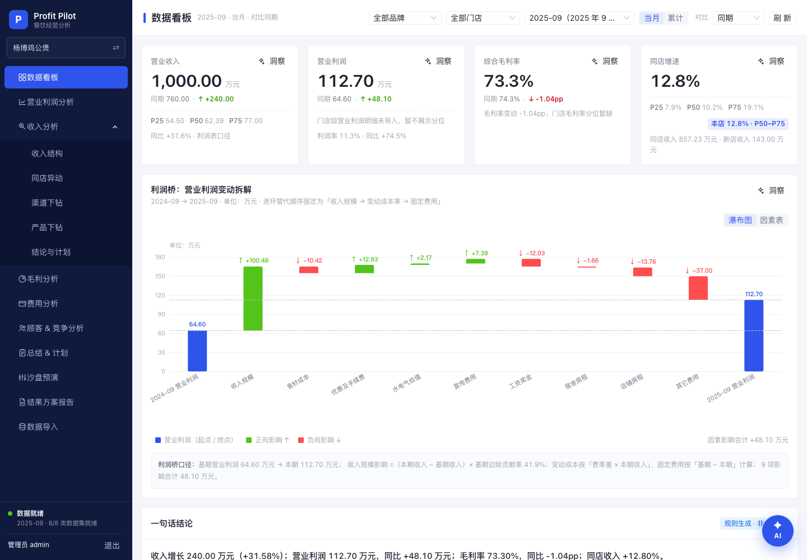

# 用户手册

> 文档编号：CBA-UM-001 ｜ 版本：v2.0 ｜ 日期：2026-11-08 ｜ 适用基线：git tag **v0.3.4**（一期 Demo）
> 关联：[README（文档集索引）](README.md)、[02-产品设计](02-产品设计.md)、[05-测试文档](05-测试文档.md)、[07-维护与版本记录](07-维护与版本记录.md)、`docs/demo/演示脚本.md`、`docs/demo/答疑清单.md`
> 系统地址（本机）：`http://127.0.0.1:5173`（开发模式）或 `http://127.0.0.1:8000`（单端口演示）；演示账号 **admin / admin123**。

## 1. 文档信息与修订记录

### 1.1 文档信息

| 项 | 内容 |
|---|---|
| 文档名称 | 餐饮经营分析系统 · 用户手册 |
| 文档编号 | CBA-UM-001 |
| 版本 | v2.0（文档集版本；本文修订 v2.1） |
| 适用对象 | 业务用户（老板/运营/店长）、培训讲师、实施人员、运维 |
| 适用版本 | v0.3.4（2026-11-08，安全补丁版） |
| 编写目的 | 让非技术用户能独立完成安装、启动、导数据、逐页看数、讲故事 |
| 前置阅读 | 无。只需要会用 Excel、会打开终端粘贴命令 |
| 维护约定 | 页面或口径变化时同步本手册与 [05-测试文档](05-测试文档.md)；不确定事项标注「待确认」 |

### 1.2 修订记录

| 版本 | 日期 | 修订人 | 说明 |
|---|---|---|---|
| v1.0 | 2026-11-08 | 技术文档工程师 | 首次建立：安装/启动/导入/逐页操作/公式/洞察/演示动线/FAQ/安全 |
| v2.0 | 2026-11-08 | 技术文档工程师 | 同步 v0.3.3 修复（模板下载可用、默认数据集、GBK CSV、累计提示）；文档集扩为 01–18 |
| v2.1 | 2026-11-08 | 技术文档工程师 | 同步 v0.3.4 安全修复与 63 测试（路径穿越、预览内部键、公网暴露提醒） |

### 1.3 怎么用本手册

| 读者 | 建议顺序 | 目标 |
|---|---|---|
| 第一次接触系统 | 2 → 3 → 4 → 5 → 6 → 7 | 装好、跑起来、导入数据、看懂页面 |
| 培训讲师/演示者 | 7 → 9 → 10 → 11 | 15 分钟讲完并应对提问 |
| 实施/运维 | 3 → 4 → 6 → 12 → 13 | 部署、备份、排障、交接 |
| 业务负责人 | 2 → 7 → 8 → 9 → 13 | 判断指标是否可用、哪些是二期 |

## 2. 系统简介与适用对象

### 2.1 一句话简介

把「高维学堂 Excel 经营分析模型」做成 Web 系统：导入门店经营数据后，自动生成**利润桥、收入结构、同店异动、渠道漏斗、产品量价**，并按固定规则给出结论与整改动作，帮助连锁餐饮总部完成「**比差异 → 找问题 → 定计划 → 达目标**」的月度经营分析。

### 2.2 适用对象

| 角色 | 系统帮他做什么 |
|---|---|
| 老板/总经理 | 一屏看清收入与利润为什么变，利润被哪些因素吃掉 |
| 区域运营/督导 | 定位哪家店、哪个渠道、哪个时段、哪个菜品出了问题 |
| 店长 | 看本店客流、客单、时段变化（一期门店筛选为二期开放） |
| 培训讲师 | 用真实数字讲分析方法：对比、连环替代、量价拆解、漏斗 |
| 实施/数据分析 | 用 8 类模板把客户数据导入，核对口径与尾差 |
| 开发/维护 | 按本手册与测试文档复跑、排障、升级 |

### 2.3 一期能做什么、不能做什么

| 能做（v0.3.4 可用） | 不能做（二期） |
|---|---|
| 单管理员登录、深色侧边导航、全局筛选 | 多账号/多角色/多租户 |
| 8 类数据导入：上传→校验→预览→确认→批次回滚 | 直接连 POS/外卖平台 API |
| 经营总览：4 张 KPI + 分位 + 利润桥 + 一句话结论 | 预算/上期基准的完整对比链路 |
| 营业利润：利润表对比 + 利润桥 9 因素 | 经营综合评分、业务板块汇总 |
| 收入分析全链路：结构/同店/门店/时段/渠道/漏斗/产品/结论 | 毛利、费用、顾客 & 竞争、总结 & 计划分析 |
| 6 个骨架页（可见、可导航、标注二期） | 沙盘推演、结果方案报告与 PDF/PPT 导出 |
| mock 模式离线演示、截图兜底 | 移动端、多浏览器兼容矩阵、真实大数据量 |

### 2.4 术语表

| 术语 | 说明 |
|---|---|
| 本期/同期 | 本期默认 2025-09；同期默认 2024-09（系统里叫「对比：同期」） |
| 当月/累计 | 当只看单月；累计为 2025-01~09 vs 2024-01~09（利润表口径可用；门店累计暂缺） |
| 同店/新店/闭店 | 对比期有收入=同店；对比期无收入=新店；门店关闭=闭店（示例：13 同店 + 2 新店） |
| 客流 | 人次。Excel 未说明是到店还是下单人数，按导入值展示（待确认） |
| 客单 | 客单价 = 收入 ÷ 客流（元/人次） |
| 利润桥 | 把营业利润同比变化拆成 9 个因素（收入规模、4 个成本率、4 个固定费用） |
| 连环替代法 | 按固定顺序逐个替换因素，每步影响=替换后−替换前；顺序固定不可改 |
| 结构影响/单价影响 | 毛利率变动拆成「卖的结构变了」与「单品自身毛利率变了」 |
| 漏斗 | 曝光→访问→支付→消费的逐级转化 |
| ROI | 平台费用效率：毛利 ROI=毛利额÷平台费用；销售 ROI=收入÷平台费用 |
| 分位 | 门店在 13 家同店中的 P25/P50/P75 位置 |
| 尾差 | 不同源表取整造成的 0.05–0.23 万差异，页面标注、不强行对齐 |

## 3. 运行环境与安装

### 3.1 需要准备什么

| 项 | 要求 | 检查命令 |
|---|---|---|
| 操作系统 | macOS / Linux / Windows 10+ | — |
| Python | 3.12（本期实测 3.12.13） | `python3 --version` |
| Node.js / npm | Node 20+（本期实测 24.22.2 / npm 11.19.1） | `node --version`、`npm --version` |
| 浏览器 | Chrome（推荐）/ Edge / Safari；窗口 ≥1440×900 | — |
| 磁盘 | 约 1GB（依赖 + 构建产物 + 数据库） | — |
| 网络 | 仅首次安装依赖需要；演示可断网 | — |
| 端口 | 8000（后端）、5173（前端） | `lsof -i :8000` |

> 本期**没有 Docker、没有 CI**：本机装 Python/Node 后按下面命令启动即可。数据库是单个 SQLite 文件，无需安装数据库服务。

### 3.2 安装 Python 与 Node

**macOS（推荐 Homebrew）**

```bash
brew install python@3.12 node
python3 --version    # Python 3.12.x
node --version       # v24.x 或 v20+
```

**Ubuntu/Debian**

```bash
sudo apt update
sudo apt install -y python3.12 python3.12-venv nodejs npm
```

**Windows**

1. 从 python.org 安装 Python 3.12，安装时勾选「Add python.exe to PATH」；
2. 从 nodejs.org 安装 LTS 版 Node；
3. 打开 PowerShell 验证：`python --version`、`node --version`。

### 3.3 安装后端（Python 依赖）

```bash
cd backend
# macOS/Linux（仓库已带 .venv 时可直接跳过创建）
python3 -m venv .venv
source .venv/bin/activate
python -m pip install -r requirements.txt
```

```powershell
# Windows PowerShell
cd backend
py -3.12 -m venv .venv
.venv\Scripts\Activate.ps1
python -m pip install -r requirements.txt
```

> Windows 若提示「禁止运行脚本」，先执行 `Set-ExecutionPolicy -Scope Process Bypass` 再激活。
> 仓库自带的 `backend/.venv` 是 macOS 产物，**Windows 必须删掉重建**。

### 3.4 安装前端（npm 依赖）

```bash
cd frontend
npm install
```

- 首次安装需要网络；之后可离线启动。
- 安装慢可切换镜像：`npm config set registry https://registry.npmmirror.com`。

### 3.5 常见安装问题

| 现象 | 原因 | 处理 |
|---|---|---|
| `python: command not found` | 未装或未加 PATH | macOS 用 `python3`；Windows 重装并勾选 PATH |
| `venv` 创建失败 | 缺 `python3-venv` | Ubuntu 执行 `sudo apt install python3.12-venv` |
| `npm install` 报 Node 版本过低 | Vite 8 要求较新 Node | 升级到 Node 20+（推荐 24） |
| 依赖装到系统 Python | 未激活 venv | 确认命令行前缀出现 `(.venv)` |

## 4. 启动与访问

### 4.1 方式 A：一键启动（推荐开发/演示）

```bash
cd /path/to/CateringBusinessAnalysis-dshSA
bash scripts/dev.sh
```

- 后端 8000 带热更新；前端 5173 默认 `VITE_API_MODE=real`（连真后端）。
- 终端会打印：`后端 http://127.0.0.1:8000/docs ｜ 前端 http://127.0.0.1:5173 ｜ Ctrl+C 退出`。
- 浏览器打开 `http://127.0.0.1:5173`，用 **admin / admin123** 登录。
- 按 `Ctrl+C` 同时停止前后端。

### 4.2 方式 B：两个终端分别启动

终端 1（后端）：

```bash
cd backend
.venv/bin/python -m uvicorn app.main:app --reload --port 8000
```

终端 2（前端，联调真后端）：

```bash
cd frontend
VITE_API_MODE=real npm run dev -- --port 5173
```

> `npm run dev` 不加环境变量时是 **mock 模式**：不连后端、内置同一套验收数字，适合断网演示。
> Vite 已把 `/api` 代理到 `http://127.0.0.1:8000`；后端必须先在 8000 启动。

### 4.3 方式 C：单端口静态演示（最稳）

```bash
cd frontend
VITE_API_MODE=real npm run build      # 生成 frontend/dist

cd ../backend
.venv/bin/python -m uvicorn app.main:app --port 8000
```

浏览器打开 **http://127.0.0.1:8000** 即可（FastAPI 托管构建产物）。
> 改了前端代码后必须重新 `npm run build`，否则页面还是旧的；`frontend/dist` 不提交仓库。

### 4.4 登录与账号

| 项 | 值 |
|---|---|
| 登录地址 | `http://127.0.0.1:5173/login` 或单端口 `http://127.0.0.1:8000/login` |
| 演示账号 | `admin` |
| 演示密码 | `admin123` |
| 会话 | httpOnly Cookie，默认 12 小时；关闭浏览器不会立即失效 |
| 登出 | 右上角用户菜单 → 退出登录 |

修改账号/密码（部署环境必须改，改后**重启后端**生效）：

```bash
cd backend
CBA_ADMIN_USERNAME=ops CBA_ADMIN_PASSWORD='请换成强密码' \
CBA_SESSION_SECRET='至少32位的随机字符串' \
.venv/bin/python -m uvicorn app.main:app --port 8000
```

### 4.5 停止与重启

| 场景 | 操作 |
|---|---|
| 前台启动 | 终端按 `Ctrl+C` |
| 一键脚本 | `Ctrl+C`（脚本会同时结束后端与前端） |
| 端口被占用 | `lsof -i :8000` 找 PID → `kill <PID>`；或重启电脑 |
| 后端改了环境变量 | 必须停止后重新启动（配置只在启动时读取） |
| 前端改了代码 | 开发模式自动热更新；静态模式需重新 `npm run build` |

### 4.6 确认启动成功

```bash
curl http://127.0.0.1:8000/api/health
# 预期：{"status":"ok"}
```

浏览器打开 `http://127.0.0.1:8000/docs` 能看到接口文档，说明后端正常。

## 5. 数据准备

### 5.1 一键加载示例数据（最快）

| 方式 | 操作 |
|---|---|
| 页面 | 登录 → 左侧「数据导入」→ 右上「加载示例数据」 |
| 命令行（空库首次） | `cd backend && .venv/bin/python -m app.seeds.load_seed` |
| 命令行（彻底重置） | `cd backend && rm -f data/cba.db && .venv/bin/python -m app.seeds.load_seed` |
| 命令行（保留数据覆盖） | `cd backend && .venv/bin/python -m app.seeds.load_seed --force` |
| 接口 | `curl -b cookie -X POST "http://127.0.0.1:8000/api/seeds/load?force=true"` |

核心分析期为 2024-09 与 2025-09（利润表含 2024-01~2025-12 共 24 个月）、15 家门店、10 个渠道、8 个产品系列、8 类数据集；加载后即可复现第 7–10 章的演示数字。

### 5.2 下载导入模板

- 页面操作（推荐）：登录 → 左侧「数据导入」→ 选好数据集 → 点「下载模板」，浏览器直接保存该数据集的 `.xlsx` 模板（v0.3.3 起可用，real 模式按登录 cookie 下载）。
- 也可登录后直接用浏览器访问
  `http://127.0.0.1:8000/api/imports/templates/pl_monthly.xlsx`（把 `pl_monthly` 换成下表 key）。
- 或用命令：`curl -b cookie -OJ "http://127.0.0.1:8000/api/imports/templates/pl_monthly.xlsx"`。

| 数据集 | key | 模板文件名 |
|---|---|---|
| 月度利润表 | `pl_monthly` | `pl_monthly.xlsx` |
| 门店收入 | `store_revenue` | `store_revenue.xlsx` |
| 渠道收入 | `channel_revenue` | `channel_revenue.xlsx` |
| 产品系列销售 | `product_series` | `product_series.xlsx` |
| 单品销售 | `product_item` | `product_item.xlsx` |
| 线上漏斗 | `funnel` | `funnel.xlsx` |
| 时段客流 | `daypart` | `daypart.xlsx` |
| 预算与目标 | `budget_target` | `budget_target.xlsx` |

### 5.3 八类模板字段说明

> 通用规则：期间格式 **YYYY-MM**（如 `2025-09`）；金额不能为负；表头可用常见别名（如「其他费用/其它费用」「水电气&低值」）；只读第一个工作表；表头下第一行是数据。
> 单位：**万元**（利润表/门店收入/渠道收入/预算）、**元**（产品销售额/菜品收入/优惠/套餐/平台费用）、**人次**（客流）。

**① 月度利润表（pl_monthly）**

| 列 | 必填 | 单位/枚举 | 说明与常见错误 |
|---|---|---|---|
| 期间 | 是 | YYYY-MM | `2025/9` 会报「期间格式必须为 YYYY-MM」 |
| 门店 | 否 | 默认「全部」 | 品牌口径填「全部」；未知门店报错 |
| 营业收入 | 是 | 万元 | ≥0；负数报错 |
| 食材成本、优惠及手续费、水电气低值、宣传费用 | 是 | 万元 | ≥0；9 个科目齐全（缺项给警告） |
| 工资奖金、宿舍房租、店铺房租、其它费用 | 是 | 万元 | ≥0；未知科目需映射（如「装修费」） |
| 税金及附加 | 否 | 万元 | 示例中为 0 |

**② 门店收入（store_revenue）**

| 列 | 必填 | 单位/枚举 | 说明与常见错误 |
|---|---|---|---|
| 期间 | 是 | YYYY-MM | — |
| 门店 | 是 | 文本 | 必须是 15 家已存在门店之一，否则「不存在」 |
| 营业收入（万元） | 是 | 万元 | ≥0 |
| 客流（人次） | 是 | 人次 | ≥0 |
| 区域、经营模式、店型 | 否 | 直营/加盟/联营；MALL/社区街边/写字楼/交通枢纽 | 示例数据为演示设定（待确认） |
| 客单价（元） | 否 | 元 | 与「收入÷客流」差异 >1% 给警告 |
| 同店/新店/闭店 | 否 | 同店/新店/闭店 | 不填则按开业日期推算 |

**③ 渠道收入（channel_revenue）**

| 列 | 必填 | 单位/枚举 | 说明与常见错误 |
|---|---|---|---|
| 期间 | 是 | YYYY-MM | — |
| 门店 | 否 | 默认「全部」 | — |
| 渠道 | 是 | 文本 | 必须是 10 个渠道之一（美团大众、扫码支付、线上活动优惠、抖音、会员储值消费、堂食现金、招商银行、京东外卖、美团外卖、饿了外卖） |
| 渠道大类 | 否 | 堂食/外卖 | 不填由渠道清单推断 |
| 收入（万元） | 是 | 万元 | ≥0；渠道合计与门店收入差 >1% 给警告 |

**④ 产品系列销售（product_series）**

| 列 | 必填 | 单位/枚举 | 说明与常见错误 |
|---|---|---|---|
| 期间、产品系列 | 是 | YYYY-MM / 8 个系列（肉类、锅底类、涮品类、主食类、凉菜类、小料类、饮品、其它） | 系列不存在报错 |
| 销售数量 | 是 | 份 | ≥0 |
| 销售额（元）、菜品收入（元）、菜品优惠（元） | 是 | 元 | ≥0 |
| 门店 | 否 | 默认「全部」 | — |
| 实际成本（万元）、理论单位成本（元） | 否 | 万元/元 | ≥0；用于毛利分析（二期） |

**⑤ 单品销售（product_item）**

| 列 | 必填 | 单位/枚举 | 说明与常见错误 |
|---|---|---|---|
| 期间、产品名称 | 是 | YYYY-MM / 文本 | 同期间同名重复行报「重复」 |
| 销售数量、销售额（元）、菜品收入（元）、菜品优惠（元） | 是 | 份/元 | ≥0 |
| 产品系列 | 否 | 8 个系列 | 套餐可留空（跨系列组合） |
| 是否套餐 | 否 | 是/否 | 套餐与单品分开统计 |

**⑥ 线上漏斗（funnel）**

| 列 | 必填 | 单位 | 说明与常见错误 |
|---|---|---|---|
| 期间、渠道 | 是 | YYYY-MM / 渠道 | 渠道必须在清单内 |
| 曝光人数、访问人数、支付人数、消费人数 | 否（填了必须递减） | 人次 | 曝光≥访问≥支付≥消费，否则报错；缺失留空、不补 0 |
| 品牌顾客、新客、老客 | 否 | 人次 | 缺失留空，**不补 0** |
| 平台费用（元） | 否 | 元 | 用于费用率与 ROI |

**⑦ 时段客流（daypart）**

| 列 | 必填 | 单位/枚举 | 说明与常见错误 |
|---|---|---|---|
| 期间、门店 | 是 | YYYY-MM / 门店 | 门店必须已存在 |
| 日类型 | 是 | 工作日/节假日 | 其他值报错 |
| 时段 | 是 | 文本 | 统一为 `9:00-14:00` 格式；`9点-14点` 报「时段格式」 |
| 客流 | 是 | 人次（整数） | 小数报「必须是整数」 |

**⑧ 预算与目标（budget_target）**

| 列 | 必填 | 单位/枚举 | 说明与常见错误 |
|---|---|---|---|
| 期间、门店 | 是/否 | YYYY-MM / 默认全部 | — |
| 科目、预算值（万元） | 预算行必填 | 10 个标准科目（营业收入+8 费用+税金及附加）/ 万元 | 「装修费」等不在标准科目表报错 |
| 渠道、新客量、曝光转化率、客单价、毛利率、新客成本、目标ROI | 目标行必填 | 渠道 / 0–1 / 元 / 倍 | 转化率/毛利率 0–1；ROI >0；缺目标 ROI 报错 |

### 5.4 文件要求与口径

| 项 | 规则 |
|---|---|
| 文件类型 | 后端支持 `.xlsx`、`.xlsm`、`.csv`、`.txt`；**旧版 `.xls` 不支持**（上传框虽可选 .xls，后端会报「不支持的文件类型」，请另存为 .xlsx） |
| 文件大小 | ≤ **10MB**；空文件直接报错 |
| 编码 | CSV 用 UTF-8（带 BOM 也可）；GBK 会自动回退解码；两者都不支持时给行级错误提示（不 5xx） |
| 工作表 | 只读第一个工作表；公式取 Excel 缓存值，建议先在 Excel 打开并保存 |
| 覆盖规则 | 同数据集 + 同期间 + 同门店/渠道会**整体替换**旧数据，不累加 |
| 尾差 | 四套收入合计差异 0.05–0.23 万、同店拆解尾差 0.12 万，系统按来源分别标注、不强行对齐 |

### 5.5 四套收入合计（必须分别标注，别混用）

| 口径 | 2024-09 | 2025-09 | 使用页面 |
|---|---|---|---|
| 利润表 | 760 | 1000 | 数据看板、营业利润、毛利率 |
| 渠道 | 759.56 | 1000.00 | 收入结构（渠道维度）、渠道下钻 |
| 门店 | 759.95 | 1000.23 | 同店异动、门店排行 |
| 品类 | 760 | 1000.16 | 产品下钻、套餐量价 |

## 6. 数据导入操作

### 6.1 标准流程（5 步）

1. **选择数据集**：左侧「数据导入」→ 下拉选择 8 类之一（real 模式默认取接口返回的首个数据集，可直接用）；需要空白模板时先点「下载模板」；
2. **上传文件**：点击或拖拽 `.xlsx/.xlsm/.csv/.txt` 到上传区（≤10MB）；
3. **看校验结果**：错误表列出行号、列名、问题、级别；**有错误行时「确认入库」按钮禁用**；
4. **预览并确认**：预览前 50 行 + 期间/门店汇总 → 点「确认入库」→ 生成批次；
5. **覆盖提示**：重复期间/门店会提示覆盖（整体替换）；确认后旧数据标记为历史，可在批次列表回滚。

### 6.2 校验结果怎么读

| 级别 | 含义 | 处理 |
|---|---|---|
| 错误 | 阻断导入（如格式错、负值、未知门店/科目、漏斗不递减、重复行） | 按行号列名改原文件，重新上传 |
| 警告 | 不阻断（如客单与收入/客流差异 >1%、渠道合计与门店收入差 >1%、缺科目） | 可先入库，但要人工确认口径 |

### 6.3 覆盖与回滚

| 场景 | 系统行为 |
|---|---|
| 重新导入同期间同门店 | 提示覆盖；旧事实行标记 `superseded_by`，活动数据只有新行，**不会翻倍** |
| 回滚已入库批次 | 删除新行、恢复旧行；批次状态变「已回滚」 |
| 回滚未确认的草稿 | 不允许（400），草稿本就没写库 |
| 加载示例数据 | 空库加载；已加载再点会提示「已加载」，需用 `--force` 或接口 `?force=true` 覆盖 |

### 6.4 导入失败排查

| 报错关键词 | 原因 | 处理 |
|---|---|---|
| 期间格式必须为 YYYY-MM | 写成 `2025/9`、`2025年9月` | 改成 `2025-09` |
| 不能为负数 | 金额/客流为负 | 修正数值 |
| 不在标准科目表内 / 未知科目 | 表头出现「装修费」等 | 改用标准科目，或用映射接口映射到「其它费用」 |
| 门店不存在 / 不在渠道清单内 | 名称有空格、简称、错字 | 与维度清单精确对齐 |
| 逐级递减 | 漏斗后一层大于前一层 | 核对曝光/访问/支付/消费 |
| 时段格式 | `9点-14点` | 改为 `9:00-14:00` |
| 重复 | 同期间同门店出现两行 | 合并或删重复行 |
| 不是有效的 xlsx | 改了扩展名的旧格式或损坏文件 | 用 Excel 另存为 .xlsx |
| 文件超过 10MB | 文件过大 | 拆分文件或压缩行数 |
| 不支持的文件类型 | 上传了 `.xls`/`.xlsb`（页面已限制可选扩展名） | 另存为 `.xlsx` 或 `.csv` |
| CSV 中文乱码 / 编码 | Excel 另存 CSV 默认可能是 GBK | v0.3.3 起 UTF-8 失败会自动回退 GBK；仍失败以行级错误提示（HTTP 200 + errors，不 5xx、不入库） |

### 6.5 导入后怎么验证

- 回到「数据导入」顶部：对应数据集显示「已就绪 · N 行」；
- 打开「数据看板」→ 数字应与文件汇总一致（示例数据为 1000/112.70/857.23）；
- 批次列表核对：数据集、文件名、期间、行数、操作人、状态；
- 若数字不对：先查是否重复导入未覆盖、期间是否选对、单位是否把「元」当「万元」。

## 7. 页面使用说明

### 7.0 导航、筛选与截图索引

**左侧导航（自上而下）**：数据看板、营业利润分析、收入分析（收入结构/同店异动/渠道下钻/产品下钻/结论与计划）、毛利分析、费用分析、顾客 & 竞争分析、总结 & 计划、沙盘预演、结果方案报告、数据导入。

**顶栏全局筛选**（所有页面共用，刷新后保留在 URL）：

| 筛选项 | 默认 | 说明 |
|---|---|---|
| 品牌 | 全部品牌 | 一期单品牌「杨博鸡公煲」 |
| 门店 | 全部门店 | 选单店时看板提示「单店视角暂不可用」（二期开放） |
| 期间 | 2025-09 | 另一选项 2025-08（未导入，可演示空态） |
| 当月/累计 | 当月 | 累计：2025-01~09 vs 2024-01~09 |
| 对比 | 同期 | 预算/上期为二期；选择后显示「仅同期基准可用」提示 |
| 刷新 | — | 重新请求全部数据 |

**真实截图索引**（`docs/demo/screenshots/`）：`login.png`、`real-dashboard.png`、`real-profit.png`、`real-structure.png`、`real-same-store.png`、`real-store12.png`、`real-channel.png`、`real-channel-detail.png`、`real-product.png`、`real-conclusion.png`、`real-data.png`、`real-skeleton-gross.png`、`real-budget-dashboard.png`（预算空态）、`real-ytd-dashboard.png`（累计口径）。



### 7.1 登录页（/login）

- **用途**：单管理员进入系统；未登录访问任何页面自动跳这里。
- **操作**：输入 admin / admin123 → 登录；页面已给出演示账号提示。
- **注意**：连续输错会提示「账号或密码错误」；忘记密码需按第 4.4 节用环境变量重置并重启。

### 7.2 数据看板（/）

- **用途**：一屏回答「收入/利润/毛利率/同店为什么变」。
- **操作**：看 4 张 KPI 卡 → 看利润桥瀑布图（可切「因素表」）→ 读一句话结论与脚注。
- **指标读数（示例）**：营业收入 1000.00 万（同期 760.00，+240.00，+31.58%）；营业利润 112.70 万（64.60，+48.10，+74.46%）；综合毛利率 73.30%（74.34%，-1.04pp）；同店增速 +12.80%。
- **分位行**：收入显示 13 家同店 P25/P50/P75（无本店值）；同店增速显示分位段与本店位置；利润/毛利率分位显示「暂缺」提示（门店级明细未导入）。

### 7.3 营业利润分析（/profit）

- **用途**：看利润表科目对比与利润桥 9 因素。
- **操作**：看利润表（本期/同期/差额/增减率/占比/占比变动）→ 看瀑布图或因素表。
- **读数（示例）**：收入 +100.48、食材成本率 -10.42、优惠及手续费 +12.93、水电气 +2.17、宣传 +7.39、工资 -12.03、宿舍 -1.66、店铺 -13.76、其它 -37.00，合计 +48.10。
- **注意**：预算达成、经营评分、板块汇总显示「二期」占位；切「预算」会显示预算未导入空态。

### 7.4 收入结构（/revenue/structure）

- **用途**：从 6 个维度看收入构成与增长来源。
- **操作**：顶部切维度（经营模式/同店新店/区域/渠道/渠道大类/系列）→ 看结构表与柱图。
- **读数（示例）**：渠道维度下美团大众 460.00 万（同期 336.00，+124.00，+36.9%，占比 46%）；堂食 906.58、外卖 93.42。
- **注意**：不同维度合计口径不同（渠道 1000.00、门店 1000.23、系列 1000.16），页面有口径说明。

### 7.5 同店异动（/revenue/same-store）

- **用途**：回答「同店增长靠人多还是靠卖贵」，并定位异常门店。
- **操作**：看 3 张 KPI（同店收入/客流/客单）→ 看「客流×客单」拆解 → 在 13 店明细表点门店名下钻。
- **读数（示例）**：同店收入 857.23（+97.28，+12.80%）；客流 66,566.29（+7,221.54）；客单 128.78（+0.70）；影响：客流 +92.07、客单 +5.08（合计 97.16，与 97.28 差 0.12 尾差）；新店收入 143.00。
- **注意**：明细表「门店12」收入 -3.13 万、客流 -280，可继续下钻。

### 7.6 门店详情（/revenue/store/12）

- **用途**：单店三项对比 + 同店横向排名 + 时段下钻。
- **操作**：点击同店明细中的门店名进入；看客流/客单/收入 3 张卡 → 同店横向比较 → 时段客流表（橙色行为「下降主因」）。
- **读数（示例，门店12）**：客流 4,276.24（同期 4,556.15，-280）；客单与收入同步对比；时段：工作日 9:00-14:00 794 vs 950（-156）；工作日合计 -465、节假日 +185；总时段 -280。
- **说明**：一期时段数据只有门店12，其他门店该表为空、页面提示。

### 7.7 渠道下钻（/revenue/channel）

- **用途**：看 10 个渠道的结构与同店/新店异动。
- **操作**：看渠道结构表 → 同店渠道异动表 → 渠道卡片/洞察；点渠道进入单渠道详情。
- **读数（示例）**：美团大众 460.00/336.00/+124.00（+36.9%）；其中同店 394.23、新店 65.77、同店差额 +58.24（+17.3%）；堂食 906.58（+221.58）、外卖 93.42（+18.86）。

### 7.8 单渠道详情（/revenue/channel/1）

- **用途**：线上渠道放量效率诊断。
- **操作**：看漏斗图与转化率表 → 看平台费用率与 ROI 阈值表 → 读渠道洞察。
- **读数（示例，美团大众）**：曝光 4,367,174 → 访问 639,025（14.63%）→ 支付 73,113（11.44%）→ 消费 64,468（88.18%）；平台费用 138 万、费用率 30%、毛利 ROI 2.00、销售 ROI 3.33；阈值：费用率 >15% 风险、毛利 ROI<1 风险、销售 ROI<4 提醒。

### 7.9 产品下钻（/revenue/product）

- **用途**：拆「量」和「价」，看系列与套餐的增长质量。
- **操作**：切「同店口径/全店口径」→ 看系列量价表 → 单品/套餐排行 → 套餐量价表。
- **读数（示例）**：同店系列 销量影响 +91.50、单价影响 +5.67（合计 97.17），肉类 +80.00；套餐：5,472 单 vs 432 单、实收单价 81.18 vs 152.96，量差 +770,933.33 元、价差 -392,795.79 元、合计 +378,137.54 元。
- **注意**：单品排行取自套餐明细（≥20 行）；套餐量价只取「线上套餐」汇总行，两者不是同一快照（页面注明）。

### 7.10 结论与计划（/revenue/conclusion）

- **用途**：自动汇总异动并给出行动建议。
- **操作**：看「+240 万从哪来」汇总卡 → 自动结论 → 规则化洞察 → 三条建议动作。
- **读数（示例）**：新店 +143.00、同店客流 +92.07、同店客单 +5.08、闭店 0，合计 +240.28（尾差 0.13）；三条动作：美团/抖音放量分段优化、门店12 工作日午餐竞对反击、主食降价换量设折扣底线。

### 7.11 数据导入（/data）

- **用途**：8 类数据的上传、校验、预览、确认、批次与回滚。
- **操作**：见第 6 章。
- **注意**：mock 模式下文件名含「error/错误」会模拟校验失败（仅演示用）；真实模式按真实校验。

### 7.12 六个骨架页

| 页面 | 路由 | 一期表现 |
|---|---|---|
| 毛利分析 | `/gross` | 标题 + 已规划能力清单 + 「二期开放」+ 返回收入分析 |
| 费用分析 | `/expense` | 同上 |
| 顾客 & 竞争分析 | `/customer` | 同上 |
| 总结 & 计划 | `/summary` | 同上 |
| 沙盘预演 | `/sandbox` | 布局示意，滑块不可计算 |
| 结果方案报告 | `/reports` | 报告模板与导出按钮占位 |

> 骨架页也计入「可见、可导航、标注二期」的验收范围；讲解时如实说明，不要演示计算。

## 8. 指标与公式速查

| 指标 | 公式 | 示例读数 | 在哪看 |
|---|---|---|---|
| 收入同比 | 本期−同期；增幅=差额÷同期（同期为 0 显示「—」） | 1000−760=+240（+31.58%） | 看板/结构 |
| 客单价 | 收入 ÷ 客流 × 10000（万元→元） | 857.23 万 ÷ 66,566.29 ≈ 128.78 元 | 同店/门店 |
| 毛利率 | （收入 − 食材成本）÷ 收入 | (1000−267)÷1000=73.30% | 看板 |
| 边际贡献率 | 1 −（食材+优惠及手续费+水电气低值+宣传）费率 | 基期 41.87% | 利润桥基数 |
| 收入规模影响 |（本期收入−基期收入）× 基期边际贡献率 | 240×41.87%=+100.48 | 利润桥第 1 项 |
| 变动成本率影响 |（基期费率−本期费率）× 本期收入 | 食材 -10.42、优惠 +12.93 等 | 利润桥 2–5 项 |
| 固定费用影响 | 基期绝对额 − 本期绝对额 | 工资 -12.03、其它 -37.00 等 | 利润桥 6–9 项 |
| 连锁替代 | 固定顺序逐项替换；各因素影响之和 = 总变动 | 9 项合计 +48.10 | 利润桥/量价 |
| 客流影响 | 逐店（本期客流−基期客流）× 基期客单，再汇总 | 汇总后 +92.07（若用汇总客流×汇总客单会得 92.49，故必须逐店算） | 同店 |
| 客单影响 | 逐店 本期客流 ×（本期客单−基期客单），再汇总 | 汇总后 +5.08（同一汇总口径会得 4.66） | 同店 |
| 系列量价 | 销量影响=Δ销量×基期单价；单价影响=本期销量×Δ单价 | +91.50 / +5.67 | 产品 |
| 套餐量价 | 同上（按单数 × 实收单价） | +770,933.33 / -392,795.79 元 | 产品 |
| 漏斗转化 | 访问/曝光、支付/访问、消费/支付、支付/曝光 | 14.63% / 11.44% / 88.18% / 1.67% | 单渠道 |
| 平台费用率 | 平台费用 ÷ 渠道收入 | 138÷460=30% | 单渠道 |
| 毛利 ROI | 收入×平台毛利率 ÷ 平台费用 | 460×60%÷138=2.00 | 单渠道 |
| 销售 ROI | 收入 ÷ 平台费用 | 460÷138=3.33 | 单渠道 |
| 分位 | 13 家同店排序后的 P25/P50/P75（线性插值，<3 家不显示） | 分位值由接口/页面返回，示例见看板分位行 | 看板 |

**利润桥 9 项固定顺序（不可改）**：收入规模 → 食材成本率 → 优惠及手续费率 → 水电气低值率 → 宣传费用率 → 工资奖金 → 宿舍房租 → 店铺房租 → 其它费用。

> 量价拆解的同店口径缩放、渠道新店分摊与套餐口径假设，详见 [backend/seed/README.md](../../backend/seed/README.md)；页面可在「同店口径 / 全店口径」间切换，切换后合计口径会变（同店 857.17/760.00，全店品类 1000.16/760.00）。

## 9. 洞察与结论怎么读

- **不是大模型**：一期洞察由规则函数生成，来源是 PPT 知识库（第 67–79 页）与演示阈值；同一份数据结论稳定、可复现。
- **统一结构**：`{level, title, text, evidence}`；level 分 positive / negative / info；按影响绝对值取前 3。
- **八类规则**：利润桥前三因素（收入规模、最大负向成本率、最大负向固定费用）；结构增长贡献最大渠道/门店；同店「客流 vs 客单」谁主导（占比 ≥80%）；收入与客流双降门店点名（如门店12）；渠道同店增长前三；漏斗任一层转化率环比降 >1pp 标异常；线上效率阈值；产品「降价换量」提示。
- **阈值**：平台费用率 ≤15%、毛利 ROI ≥1、销售 ROI ≥4；漏斗单层环比下降 >1pp。
- **阅读顺序**：先看 level（红/绿/灰）→ 再看 evidence 指向哪个数字 → 再决定是否下钻。
- **注意**：洞察是「线索」不是「定论」；涉及口径差异（四套合计、尾差）时以页面脚注与第 5.5 节为准。

## 10. 演示动线（15 分钟 6 段）

> 完整话术见 `docs/demo/演示脚本.md`；本节是可执行清单。主角数字：收入 1000 万（+240 万）、营业利润 112.70 万（+48.10 万）、同店 857.23 万、新店 143 万。

| 时间 | 页面 | 操作 | 关键数字 | 要点 |
|---|---|---|---|---|
| 0–2 分 | 数据看板 | 打开首屏，指 4 张 KPI | 1000 / 112.70 / 73.30% / +12.80% | 老板只问：240 万从哪来、能否复制 |
| 2–5 分 | 营业利润分析 | 看利润桥瀑布图 | 9 项合计 +48.10 | 连环替代：影响之和必须闭合 |
| 5–7 分 | 收入结构 | 切「同店新店」→「渠道」 | 新店 143、同店 97.28；美团 +124 | 开店红利 vs 同店真本事 |
| 7–10 分 | 同店异动 → 门店12 | 点拆解条 → 点门店12 → 时段表 | 客流 +92.07、客单 +5.08；门店12 -280 | 大盘靠人多；门店12 工作日午餐被分流 |
| 10–13 分 | 渠道下钻 → 单渠道 → 产品下钻 | 美团大众漏斗 → 产品量价/套餐 | 漏斗 14.63%/11.44%；套餐 +770,933.33/-392,795.79 | 增收但买流量贵；套餐量增价降 |
| 13–15 分 | 结论与计划 | 读汇总 + 三条动作 | 新店 143 + 客流 92.07 + 客单 5.08 ≈ 240 | 比差异→找问题→定计划→达目标 |

**演示纪律**：

1. 固定「当月 + 同期」，**不要切「预算/上期」**（会进「预算未导入」空态，不是崩溃）；
2. 门店筛选保持「全部门店」（单店视角二期开放）；
3. 累计口径只在被问到时演示，并说明「门店累计暂缺，显示 —」；
4. 断网/异常立即切 mock 模式或直接用 `docs/demo/screenshots/` 截图；
5. 演示前 5 分钟按 [05-测试文档](05-测试文档.md) 第 9 节 13 步检查，并备份数据库。

## 11. 常见问题 FAQ

**Q1：登录失败怎么办？**
确认地址是 5173 或 8000、账号 `admin` / 密码 `admin123`（注意大小写）；若改过环境变量需重启后端；清浏览器 Cookie 再试；仍失败看后端日志是否 401。

**Q2：登录后页面没有数据/全是「—」？**
演示库未加载示例数据。到「数据导入 → 加载示例数据」，或命令行 `cd backend && rm -f data/cba.db && .venv/bin/python -m app.seeds.load_seed`；确认顶栏期间为 2025-09、对比为同期。

**Q3：切「预算」为什么空白？**
一期预算只导入了营业收入 1500 万、缺费用科目，系统判定预算不完整，`profit_bridge` 与利润基期返回空态，避免 0 冒充。演示不切预算；正式使用需补全费用预算。

**Q4：切「累计」为什么有些数字是「—」？**
利润表有 24 个月，可算累计；但门店收入只有单月数据，累计同店无法计算，系统返回空值（「—」）并说明，不拿单月冒充累计。收入分析页切「累计」时会提示「收入分析累计口径二期开放」，数字仍按当月展示，避免误读。

**Q5：导入报错怎么排查？**
按错误表的「行号 + 列名 + 原因」改原文件；常见：期间写成 2025/9、负值、门店名不一致、渠道不在清单、漏斗不递减、时段格式、重复行、10MB 超限。详见 6.4 节。

**Q6：重复导入会翻倍吗？**
不会。同数据集+期间+门店覆盖导入，旧行标记历史、活动行只保留新数据；可在批次列表回滚。

**Q7：端口被占用起不来？**
`lsof -i :8000`（或 5173）找 PID → `kill <PID>`；也可换端口启动后端，但 Vite 代理固定 8000，需同步改 `frontend/vite.config.ts`。

**Q8：改了代码但页面没变？**
静态模式需重新 `VITE_API_MODE=real npm run build`；偶发构建缓存问题先删 `frontend/node_modules/.tmp` 与 `frontend/dist` 再构建。

**Q9：断网还能演示吗？**
可以。前端用 mock 模式 `npm run dev`（内置同一套数字，不需后端与网络），或直接用真实截图讲解；本地依赖已安装时断网可启动。

**Q10：截图在哪？**
`docs/demo/screenshots/`：`real-*.png`（真实后端）与 `login.png`；预算空态/累计口径各有一张证据截图。

**Q11：怎么把数据重置到演示初始状态？**
`cd backend && rm -f data/cba.db && .venv/bin/python -m app.seeds.load_seed`；重置前建议先备份（见第 12 章）。

**Q12：为什么收入有 1000 / 1000.23 / 1000.16 三个数？**
利润表、门店表、品类表各自汇总范围与取整不同，差异 0.05–0.23 万；页面分别标注口径，不强行对齐。答疑话术见 `docs/demo/答疑清单.md`。

**Q13：mock 和 real 有什么区别？**
mock：前端内置数据，断网可用，不上传真实文件入库；real：请求后端，真实导入/回滚、真实登录。演示统一用 real；截图/断网兜底用 mock。

**Q14：支持手机/多人/多品牌吗？**
一期不支持：仅单管理员、单品牌、桌面端 ≥1440 宽。多账号/多租户/移动端为二期。

**Q15：想加一个指标或页面怎么办？**
先在 `openspec/changes/` 提 change（写清场景与验收数字），评审通过后再开发；不要直接改代码或强行改页面数字，口径以 `docs/domain/data-caliber-notes.md` 与 OpenSpec 为准。

**Q16：怎么拿到空白导入模板？**
登录后「数据导入」页选好数据集，点「下载模板」即可下载对应 `.xlsx`（v0.3.3 起可用，real 模式带登录 cookie 下载）；也可用第 5.2 节的 URL 或 curl 方式。模板第 2 行是示例行、第 3 行是填写说明。

**Q17：能直接把系统放到公网访问吗？**
不建议。一期是单管理员、无 HTTPS/WAF，不要把 8000 直接暴露公网；对外必须走反向代理 + HTTPS 并限制访问。静态资源路径穿越已在 v0.3.4 修复（越界请求回退首页、不再能读源码），但这不等于可以「裸奔」。

## 12. 数据安全与备份

| 项 | 说明与操作 |
|---|---|
| 管理员密码 | 默认 `admin123` 仅演示；部署必须用 `CBA_ADMIN_PASSWORD` 覆盖并重启；密码以 bcrypt 哈希校验、不存明文 |
| JWT 密钥 | `CBA_SESSION_SECRET` 默认开发串；部署必须换成 ≥32 位随机串；更换后所有旧会话失效 |
| `.env` | 已加入 `.gitignore`，可放 `backend/.env`；不要把真实密码提交仓库 |
| 传输 | 本机/内网使用；对外网必须走反向代理加 HTTPS，不要直接把 8000 暴露公网 |
| 会话 | httpOnly Cookie（SameSite=Lax）；前端不把 token 写 localStorage |
| CORS | 只放行 5173 开发地址；生产同源部署时无需额外放行 |
| 上传 | 限制 10MB、只解析首个工作表；上传的原文件不落盘，解析结果写导入批次与事实表 |
| 静态资源路径穿越 | v0.3.4 已修复：静态托管经 `_resolve_dist_file()` 校验路径在 `dist` 内，`../` 越界回退 `index.html`；仍不要把 8000 直接暴露公网 |
| 导入预览 | 预览只显示业务列（含「行号」），不含 `_store_id`/`_accounts` 等内部键（v0.3.4 修复） |
| 外部依赖 | 不调用外部大模型/第三方 API，数据留在本机 |
| 备份（冷备） | 停后端 → `cp backend/data/cba.db "backend/data/cba.db.$(date +%Y%m%d-%H%M)"`；若存在 `cba.db-wal/-shm` 一并复制 |
| 恢复 | 停后端 → 备份当前库 → 把备份文件复制回 `backend/data/cba.db` → 启动 |
| 演示机 | 演示前备份、演示中不执行 `smoke.sh`（已隔离临时库）、不删库；演示后核对数据仍在 |

## 13. 版本、限制与支持

### 13.1 当前版本范围（v0.3.4）

| 能力 | 状态 |
|---|---|
| 登录、应用框架、全局筛选 | 可用 |
| 8 类数据导入（含模板下载）、批次与回滚、示例数据 | 可用 |
| 数据看板（4 KPI + 分位 + 利润桥 + 结论） | 可用 |
| 营业利润（利润表 + 利润桥） | 可用（预算达成/评分/板块为占位） |
| 收入结构/同店异动/门店详情/渠道下钻/单渠道/产品/结论 | 可用 |
| 6 个骨架页 | 可见、可导航、标注二期 |
| 毛利/费用/顾客&竞争/总结&计划/沙盘/报告导出 | 未实现（二期） |

### 13.2 二期未实现（不要对客户承诺）

毛利分析、费用分析、顾客 & 竞争分析、总结 & 计划、沙盘推演、结果方案报告、PDF/PPT 导出、POS/外卖平台 API 直连、多账号与权限、多租户、移动端、预算/上期完整对比、真实大数据量性能。

### 13.3 待确认口径（系统已按默认实现，等业务确认）

| # | 待确认项 | 当前默认 |
|---|---|---|
| 1 | 四套收入合计以哪套为准 | 各页面分别标注，不强行对齐 |
| 2 | 同店渠道分摊用本期还是同期结构 | 本期结构（394.23/65.77） |
| 3 | 「折扣率」定义 | 优惠 ÷ 收入（23.50%） |
| 4 | 变动费用是否含食材 | 利润桥默认变动成本 = 食材+优惠及手续费+水电气低值+宣传，边际贡献率 41.87%（含工资等口径不使用） |
| 5 | 收入是否含税、佣金是否已扣 | 按 Excel 导入值，不二次换算 |
| 6 | 客流「人次」= 下单人数还是到店人数 | 按导入值展示为「人次」 |
| 7 | 会员储值是否与其它渠道重复 | 原样计入并页面标注风险 |
| 8 | 新店/同店判定门槛 | 对比期无收入为新店、有收入为同店 |
| 9 | 门店经营模式/店型/面积/座位 | 演示设定值 |
| 10 | 预算 1500 万是否为真实预算 | 示例占位，正式使用需替换 |

### 13.4 获取帮助与提需求

| 事项 | 渠道 |
|---|---|
| 使用问题/报错 | 附截图 + 后端日志 + 数据文件表头，提交仓库 Issue |
| 口径疑问 | 先查 `docs/domain/data-caliber-notes.md` 与 `backend/seed/README.md` |
| 新功能/改口径 | 走 OpenSpec change（proposal → specs → design → tasks），评审通过后开发 |
| 环境/部署 | 参考 [07-维护与版本记录](07-维护与版本记录.md) 与 [05-测试文档](05-测试文档.md) 第 9 节 |
| 演示支持 | `docs/demo/演示脚本.md`、`docs/demo/答疑清单.md`、`docs/demo/screenshots/` |
| 代码仓库 | `target`：c4thmy/CateringBusinessAnalysis；`origin`：cfmypian/CateringBusinessAnalysis-dshSA |

> 本手册描述的是 **v0.3.4 一期 Demo** 的实际行为；标注「待确认」的事项在业务确认后由维护者同步更新。
