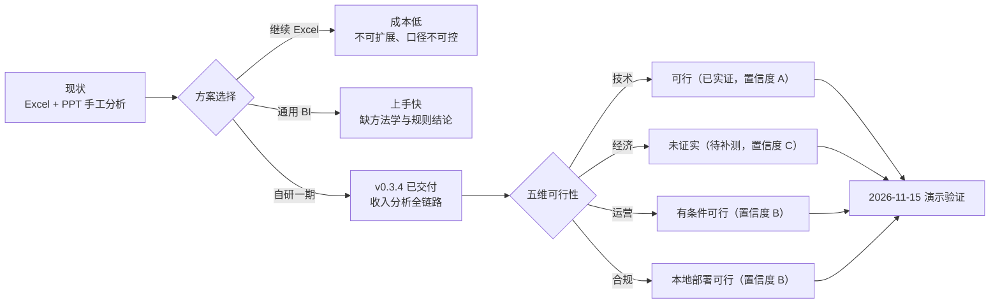

# 可行性研究报告 · 餐饮经营分析系统（一期）

> 文档编号：**CBA-FS-001** ｜ 版本：**v1.1** ｜ 日期：**2026-11-08** ｜ 适用基线：**v0.3.4**（2026-11-08；`main.py` version 0.3.4，tag 随本次统稿发布）
> 所属文档集：软件工程过程文档集 **v2.0**（01–18）｜ 系统状态：一期 Demo 已完成，待 2026-11-15 培训课演示
> 关联文档：[01-需求分析](01-需求分析.md)、[03-概要设计](03-概要设计.md)、[05-测试文档](05-测试文档.md)、[07-维护与版本记录](07-维护与版本记录.md)、`openspec/changes/build-catering-analysis-platform/{proposal,design,tasks}.md`、`docs/sprint-7d.md`、`docs/domain/data-caliber-notes.md`

## 1. 文档信息与评估方法

### 1.1 文档信息

| 项 | 内容 |
|---|---|
| 文档编号 / 名称 | CBA-FS-001 / 可行性研究报告 |
| 当前版本 / 状态 | v1.0 / 已评审（一期收口后回溯论证 + 二期前向评估） |
| 编写日期 | 2026-11-08 |
| 适用基线 | `v0.3.4`（2026-11-08；63 pytest / 45 vitest / real build / smoke PASS） |
| 主要读者 | 项目决策人、业务方、产品、架构、实施与后续接任者 |
| 事实来源 | 仓库代码与测试（`backend/`、`frontend/`）、`docs/engineering/01–07`、OpenSpec change、`backend/seed/README.md`、`docs/research/` 提取报告 |
| 写作边界 | **已发生的事实**引用代码/测试/文档证据；**未发生或未测量**的一律标注「假设 / 待验证 / 待确认」，不编造财务数字 |
| 与 01 的关系 | 01 回答「做什么、给谁做」；本报告回答「值不值得做、做得成不成、能不能落地」 |

### 1.2 修订记录

| 版本 | 日期 | 修订人 | 变更摘要 | 对应基线 |
|---|---|---|---|---|
| v1.0 | 2026-11-08 | 项目组（PM/架构合稿） | 首次编写：背景与机会、五维可行性论证、备选方案评分矩阵、风险与结论；经济测算参数全部标注待验证 | `v0.3.3` |
| v1.1 | 2026-11-08 | 项目组 | 同步 `v0.3.4`：61→63 pytest（test_api 34）、D-19 路径穿越封堵、D-20 预览内部键脱敏、任务 49/66；补剩余安全缺口（HTTPS/默认密钥/限流/审计） | `v0.3.4` |

### 1.3 评估方法与判定规则

本报告按五个维度评估：**技术、经济、运营、合规、进度**。每个维度给出判定结论与置信度，避免用单一「可行」掩盖结构性风险。

| 判定 | 含义 | 本报告使用条件 |
|---|---|---|
| 可行 | 有可复现证据或明确可执行路径 | 技术维度须有代码/测试证据；其它维度须有可落地的步骤 |
| 有条件可行 | 方向成立，但存在未补齐的前置条件 | 必须列出条件、责任人与验证方式 |
| 不可行 / 未证实 | 证据不足或存在硬约束 | 不得用「应该没问题」代替结论 |
| 不适用 | 本期范围不含该维度 | 明示范围外，不参与加权 |

置信度分级：**A** = 有实测/可复现证据；**B** = 有明确文档与部分证据，尚需验证；**C** = 依赖外部输入，当前无法验证。

### 1.4 术语

| 术语 | 说明 |
|---|---|
| 一期 | `v0.3.0`–`v0.3.4` 已交付范围：登录、框架、筛选、8 类导入、总览、利润、收入全链路、6 个骨架页 |
| 二期 | 毛利、费用、顾客 & 竞争、总结 & 计划、沙盘、报告导出、多租户（未实现） |
| 口径 | 数据取数范围与取整方式，详见 `docs/domain/data-caliber-notes.md` |
| 演示验证 | 2026-11-15 培训课现场演示，作为一期需求真伪与经济假设的第一道验证 |
| Demo 即证据 | 一期采用「先交付可演示系统、再验证商业假设」的路径，技术可行性已被交付物证实 |

## 2. 背景与机会

### 2.1 现状：Excel + PPT 手工月度分析

目标客户为连锁餐饮总部/区域运营。当前月度经营分析的做法是：用一份 16 张工作表的 Excel 模型算数，再把结果手工贴进 80 页 PPT 模版讲课/汇报。系统一期要替代的正是这条「算数 → 贴图 → 讲故事」的手工流水线（来源：[01-需求分析](01-需求分析.md) §2、`proposal.md` §Why）。

### 2.2 痛点与可举证证据

| # | 痛点 | 具体表现 | 证据 |
|---|---|---|---|
| P1 | 数据靠复制粘贴 | 每月从 POS/外卖/点评后台导出，人工对齐到宽表 | `proposal.md` §Why |
| P2 | 公式靠跨表引用 | OFFSET 跨表取当月/累计；「第三步」大量 `#REF!` 外部链接只剩缓存值 | `data-caliber-notes.md` §9 |
| P3 | 换月/换店就重做 | 换期间要重拉列、换门店要重做透视，无参数化 | `proposal.md` §Why |
| P4 | 无法推演 | 「客单价提高 5 元利润会怎样」只能手工试算 | `specs/sandbox-simulation/spec.md` |
| P5 | 口径混乱且不可追溯 | 收入存在 760 / 759.56 / 759.95 / 760 四套合计；同店渠道分摊两套口径 | `data-caliber-notes.md` §2/§3/§8 |
| P6 | 结论靠人 | 分析结论与整改建议依赖分析师经验，不能沉淀 | `specs/summary-plan/spec.md`、`design.md` §15 |
| P7 | 上下游不对齐 | Excel 序列号期间、`lastCol` 不可信、图表对象不可读，每月返工 | `data-caliber-notes.md` §9 |

### 2.3 不作为的代价（定性）

| 代价类型 | 表现 | 影响对象 |
|---|---|---|
| 时间成本 | 每月重复导数据、对口径、重做透视与图表 | 财务、数据分析岗 |
| 质量成本 | 同一指标多套数字，汇报时被追问、返工 | 老板、财务、讲师 |
| 机会成本 | 只在月度复盘时发现问题，错过周度纠偏窗口 | 区域运营、店长 |
| 资产成本 | 分析方法停留在个人经验与 Excel 文件里，无法沉淀为组织能力 | 总部运营体系 |

### 2.4 机会窗口

一期不追求「替代 Excel 全部能力」，而是选**收入分析单点**做深：数据导入后自动出利润桥与收入拆解，每个数字可下钻到门店/渠道/菜品，结论与动作由规则生成。这条路径的验证成本最低、演示效果最直接，也最能暴露真实客户的数据与口径问题（详见 §6）。



## 3. 目标与成功标准

### 3.1 一期目标

| 编号 | 目标 | 判定方式 | 当前结果 |
|---|---|---|---|
| O-1 | 2026-11-15 前交付可演示系统 | D0–D7 冲刺（`docs/sprint-7d.md`） | 已提前交付，`v0.3.4` 可演示 |
| O-2 | 关键数字与 Excel 逐项一致 | design §14 + pytest + `shared/fixtures` | 通过（63 pytest） |
| O-3 | 15 分钟能讲完、断网能讲 | `docs/demo/演示脚本.md` 6 段动线 + mock 模式 | 通过（截图与走查留档） |
| O-4 | 为二期留出可扩展骨架 | 6 个骨架页 + 10 个能力规格 + tasks 阶段二 | 已预留（17 项未开始） |

### 3.2 成功标准与达成情况

| # | 标准 | 判定方式 | 结果 | 证据 |
|---|---|---|---|---|
| S-1 | design §14 全部关键数字可复现 | pytest + fixtures | 达成 | 63 pytest；`shared/fixtures/*.json` |
| S-2 | 真实后端下页面无白屏、无 console error | 走查截图 | 达成 | `docs/demo/screenshots/real-*.png` |
| S-3 | 一键加载示例数据即可演示 | `load_seed` | 达成 | `scripts/smoke.sh` 临时库灌数 |
| S-4 | 15 分钟动线走完不出错 | 彩排 | 达成 | `docQA/20261108_0615_*.md` §三 |
| S-5 | 断网可讲 | mock 模式 | 达成 | `frontend/src/api/mock/` |
| S-6 | 前端构建可被 FastAPI 托管 | real build | 达成 | 单端口 8000 静态托管 |

### 3.3 可行性判定口径

本报告不以「一期做完了」直接推出「项目可行」：技术可行只证明**能做成**，不等于**值得做**。因此把判定拆成四张独立的表（§4–§7），最后在 §10 汇总为一条综合结论与三条前置条件。

## 4. 技术可行性

### 4.1 技术栈成熟度

| 层 | 选型（实际版本） | 成熟度判断 | 主要风险 |
|---|---|---|---|
| 后端运行时 | Python 3.12.13 | 成熟，生态完整 | 无 |
| Web 框架 | FastAPI 0.162.2 | 成熟，自带 OpenAPI | 版本较新，需锁版本 |
| ORM / 迁移 | SQLAlchemy 2.1.8 / Alembic 1.20.1 | 成熟 | 换库需回归（已用 `render_as_batch`） |
| 数据库 | SQLite（stdlib） | 成熟，零运维 | 并发写弱、无 WAL（一期单管理员可接受） |
| 前端框架 | React 19.3.1 / TS 7.0.2 | 成熟 | TS 7 较新，构建缓存需清理 |
| 构建 | Vite 8.3.6 | 成熟 | Node 版本要求较高（24.x） |
| UI / 图表 | antd 6.7.0 / ECharts 6.1.0 | 成熟 | ECharts chunk 1.13MB（gzip 372,951B） |
| 测试 | pytest 9.2.0 / vitest 5.1.0 | 成熟 | pytest 1 条 `StarletteDeprecationWarning` |

结论：技术栈全部为社区主流方案，无自研框架、无外部服务依赖；**版本已锁定**（`backend/requirements.txt`、`frontend/package-lock.json`），可复现构建。来源：[03-概要设计](03-概要设计.md) §4。

### 4.2 数据可行性

| 检查项 | 事实 | 判断 |
|---|---|---|
| 业务表规模 | 16 张（8 维/元数据 + 8 事实） | 满足一期分析闭环 |
| 导入数据集 | 8 类（利润表/门店/渠道/系列/单品/漏斗/时段/预算目标） | 覆盖一期全部页面取数 |
| 示例数据量 | 8 类 CSV 共 147 行 → 约 363 行事实 | 演示足够，非性能基准 |
| 口径差异 | 四套收入合计差 0.05–0.23 万；3 处尾差 | 已按页面分别标注，不强行对齐 |
| 缺失值策略 | 不可计算返回 `null`，前端显示「—」 | 已实现，禁止 0 冒充 |
| 数据来源稳定性 | 均为 Excel/CSV 手工导入，无第三方 API | 可控，但依赖客户配合（见 §6） |

数据维度的关键判断：**一期不需要真实客户数据即可完成技术验证，但真实数据决定二期是否成立**。示例数据能证明「表结构与口径可建模」，不能证明「客户愿意每月交数据」。

### 4.3 集成可行性

| 集成对象 | 一期做法 | 可行性 |
|---|---|---|
| Excel/CSV 导入 | 8 类中文表头模板 + 行级校验 + 两阶段提交 | 已实现并测试（11 项导入器用例） |
| 第三方平台 API | **不做**；`importers/` 抽象层预留 | 一期规避了鉴权/限流/稳定性风险 |
| 大模型 | **不接**；洞察按规则生成 | 无外网依赖，断网可演示 |
| 身份系统 | 单管理员账号（环境变量注入） | 一期够用；多租户需重做鉴权 |
| 部署环境 | 本机 uvicorn + 静态前端单端口 | 无 Docker/CI，人工发布 |

### 4.4 团队与生产方式可行性

| 项 | 事实 | 判断 |
|---|---|---|
| 组织方式 | 一人指挥 + PM/架构/数据/前端/评审/文档角色 Agent | 已验证可行（`docs/architecture.md`） |
| 留痕机制 | OpenSpec change（proposal/specs/design/tasks）+ `docQA/` | 需求可追溯 |
| 冲突控制 | 角色写入范围 + 同一文件单一 owner | 有效，但依赖 Lead 分派纪律 |
| 交付证据 | 66 项任务中 48 项已完成，代码/测试/文档同仓 | 可审计 |
| 关键人依赖 | 单机环境、单一维护者经验 | **中度风险**（见 §9 R9） |

### 4.5 可维护性可行性

| 设计约束 | 落地证据 |
|---|---|
| 计算逻辑只实现一份 | `backend/app/engine/` 纯函数，页面不写公式 |
| 前后端共用回归用例 | `shared/fixtures/*.json`（8 组主题 + 索引） |
| 口径集中管理 | `docs/domain/data-caliber-notes.md`、`backend/seed/README.md` |
| 变更留痕 | OpenSpec + 中文提交 + 版本 tag |
| 回归网 | 63 pytest / 45 vitest / smoke / `openspec validate --strict` |

### 4.6 技术可行性结论

**技术可行，置信度 A。** 依据不是方案推演，而是已交付的 `v0.3.4`：16 张表、23 条业务路径（24 个操作）、17 条前端路由、8 类导入、63 pytest 与 45 vitest 全绿、real 构建与冒烟通过。

安全侧：`v0.3.4` 封堵 SPA 静态回退路径穿越（D-19，原 S-01 高危）并对导入预览内部键脱敏（D-20），均带回归用例；HTTPS、默认密钥替换、限流与操作审计仍未做，见 §7.2「剩余安全缺口」与 §9 R12–R14。

需说明两点：① OpenAPI 全量在 `v0.3.3` 为 24 条路径 / 29 个操作，增量来自修复「未知 `/api/*` 被 SPA 回退吞成 200」新增的兜底路由，不计入业务接口；② 「23/24」为 `v0.3.1` 统计口径，两者不矛盾（[03-概要设计](03-概要设计.md) §9.3 已登记）。

## 5. 经济可行性

> **重要声明**：本节所有金额、单价、工时成本均**没有真实财务数据**。仓库内不存在客户合同、报价、人力成本或预算审批记录。因此本节只给**成本结构、收益假设与测算公式**，不给出具体金额与回收期结论；凡涉及金额处一律标注「假设 / 待验证」，待演示后由财务补测。**本报告不构成任何投资回报承诺。**

### 5.1 成本构成

| 类别 | 项目 | 计量口径 | 当前状态 | 数据性质 |
|---|---|---|---|---|
| 一次性 | 一期开发人力 | 7 天冲刺 × 1 名指挥 + 角色 Agent（`docs/sprint-7d.md`） | 已发生，量级可核 | 事实（人日口径） |
| 一次性 | 环境与工具 | 本机 macOS + Python 3.12 venv + Node 24 | 已发生 | 事实 |
| 一次性 | 示例数据整理 | 8 类 CSV + 口径差异清单（16 条） | 已发生 | 事实 |
| 一次性 | 培训与演示材料 | 演示脚本、答疑清单、截图 | 已发生 | 事实 |
| 持续 | 维护人力 | 人日/月（版本修复、口径调整） | 未测量 | **假设** |
| 持续 | 客户实施 | 每客户环境搭建 + 数据对接 + 培训 | 未测量 | **假设** |
| 持续 | 基础设施 | 一期为单机，无云资源费用 | 0（本地） | 事实 |
| 风险 | 二期开发 | 17 项任务（毛利/费用/顾客/总结/沙盘/报告/多租户） | 未估 | **待评估** |

成本侧唯一可量化的结论：**一期边际成本极低**——单机、无外部服务、无大模型调用、无数据库许可费；主要成本是人力与实施，而非基础设施。

### 5.2 收益假设（全部待验证）

| 编号 | 收益来源 | 量化方式（公式） | 假设状态 |
|---|---|---|---|
| B-1 | 减少手工分析工时 | 月节省工时 =（原手工工时 − 系统操作工时）× 月数 | **假设**，原工时需客户实测 |
| B-2 | 减少口径返工 | 返工次数 × 单次返工人时 × 人力成本 | **假设**，返工频次无基线 |
| B-3 | 决策时效提升 | 周度发现问题的比例提升 × 可挽回收入 | **假设**，需 A/B 或前后对比 |
| B-4 | 培训与交付复用 | 课程交付次数 × 单次准备工时节省 | **假设**，取决于课程排期 |
| B-5 | 软件售卖/订阅 | 客户数 × 单客户年费 | **假设**，无定价与合同 |

> 说明：B-3 的「可挽回收入」是咨询叙事中最容易被夸大的部分。本报告不将其计入一期收益，仅作为二期价值验证的观察项。

### 5.3 经济测算模型（参数化，不代入虚构数值）

```text
一次性投入  I = D_dev × C_day + E_env + D_data × C_day
月度成本    C_m = D_maint × C_day + C_infra
月度收益    B_m = T_save × C_hour + R_rework × T_rework × C_hour + N_cust × P_cust
回收期      P_month = I / (B_m − C_m)          （要求 B_m > C_m，否则永不回收）
盈亏平衡客户数 N* = (C_m − B_internal) / (P_cust − C_serve)
```

| 参数 | 含义 | 当前取值 | 来源/状态 |
|---|---|---|---|
| `D_dev` | 一期开发人日 | 7 天冲刺（1 人指挥） | 事实（排期口径） |
| `C_day` | 人日成本 | **待财务提供** | 待验证 |
| `E_env` | 环境/工具成本 | 近似 0（本机） | 事实 |
| `D_data` | 数据整理人日 | 含在冲刺内 | 事实（未单独计量） |
| `D_maint` | 月度维护人日 | **待测量** | 假设 |
| `T_save` | 月节省工时 | **待客户实测** | 假设 |
| `C_hour` | 人力小时成本 | **待财务提供** | 待验证 |
| `B_internal` | 内部工时/返工节省收益（月度） | **待客户实测** | 假设 |
| `N_cust` / `P_cust` | 客户数 / 单客户付费 | **无定价** | 待验证 |
| `C_serve` | 单客户月服务成本（实施/支持） | **未测量** | 假设 |

### 5.4 盈亏平衡与回收期判定规则

由于 `C_day`、`C_hour`、`P_cust` 三项均缺失，**本报告不计算具体回收期**。给出可执行的判定规则，待参数补齐后直接代入：

| 判定项 | 规则（建议阈值，待决策确认） | 当前结论 |
|---|---|---|
| 回收期 | ≤ 12 个月 → 优先推进二期 | 无法计算（参数缺失） |
| 盈亏平衡客户数 | ≤ 现有意向客户数的 30% → 商业模式可成立 | 无客户数据 |
| 单客户实施成本 | ≤ 单客户首年付费的 30% → 可规模化 | 未测量 |
| 一期投入合理性 | 仅以「演示验证需求真伪」为目的，不要求回收 | 成立（见 §5.6） |

### 5.5 情景分析（方向性，非金额）

| 情景 | 关键假设 | 对经济性的影响 | 触发条件 |
|---|---|---|---|
| 保守 | 客户只用于内部月度分析，不付费 | 只能计 B-1/B-2 的工时节省，回收依赖人力成本 | 演示后无采购意向 |
| 基准 | 1–3 家客户试用，按项目收费 | 回收期取决于实施人日与定价 | 演示带来试用意向 |
| 乐观 | 形成课程配套工具 + 订阅 | 边际成本低，规模效应明显 | 培训渠道稳定出货 |

情景分析的意义在于：**一期的经济价值不靠软件售卖证明，而靠「是否值得继续投入二期」判断**。若演示后 3 个月内无客户愿意提供真实数据试用，二期应暂缓。

### 5.6 经济可行性结论

**未证实（置信度 C），但一期投入决策成立。** 一期以极低边际成本换取了可演示系统与真实反馈入口，属于「用小成本买验证」；二期是否立项取决于演示后的客户数据意愿与定价验证，**当前不具备下结论的条件**，不得对外承诺 ROI 或回收期。

## 6. 运营可行性

### 6.1 数据获取

| 数据集 | 客户来源（现状） | 获取频率 | 配合难度 | 备注 |
|---|---|---|---|---|
| 月度利润表 | 财务月结表 | 月 | 中 | 科目名需与标准 10 科目对齐 |
| 门店收入 | POS/门店报表 | 月 | 中 | 同店/新店标识可由开业日期推算 |
| 渠道收入 | 外卖/点评后台导出 | 月 | 中高 | 渠道清单需先确认（10 渠道） |
| 产品系列/单品 | 收银系统明细 | 月 | 高 | 与 Excel 表 4 非同一快照（已知） |
| 线上漏斗 | 平台后台 | 月 | 高 | 仅美团大众有数据 |
| 时段客流 | 门店报表 | 月 | 高 | 示例仅门店 12 有数据 |
| 预算与目标 | 年度预算表 | 年/季 | 中 | 示例预算 1500 万为占位，待确认 |

结论：**8 类数据均可从现有系统导出，无需改造客户系统**，这是一期运营可行性的基础；难点不在技术，而在「谁负责每月按时提供、口径由谁确认」。

### 6.2 客户配合清单（前置条件）

| # | 配合事项 | 责任方 | 不配合的后果 |
|---|---|---|---|
| 1 | 确认 10 项待确认口径（`06-用户手册` §13.3） | 客户财务/运营负责人 | 页面数字与客户认知不一致，演示被质疑 |
| 2 | 指定数据责任人（每月导出 8 类文件） | 客户 | 系统无数据可分析 |
| 3 | 确认渠道清单与科目表 | 客户财务 | 导入报「未知科目/渠道」 |
| 4 | 确认演示/试用范围（单品牌、13 店） | 客户 | 规模变化导致结论外推失真 |
| 5 | 提供真实预算（替换 1500 万占位） | 客户 | 预算基准仍为空态 |

### 6.3 培训可行性

| 项 | 现状 | 判断 |
|---|---|---|
| 演示动线 | 15 分钟 6 段（总览→利润桥→收入结构→同店→渠道/产品→结论） | 已彩排，可复用 |
| 教材 | [06-用户手册](06-用户手册.md) + `docs/demo/演示脚本.md` + 答疑清单 | 齐备 |
| 学习曲线 | 页面按分析步骤组织，默认筛选 2025-09 vs 2024-09 | 业务用户 1 小时内可上手 |
| 培训风险 | 口径解释占时长（四套合计、尾差） | 需固定话术，避免现场争论 |

### 6.4 实施可行性

| 步骤 | 内容 | 预估工作量 | 风险 |
|---|---|---|---|
| 1 | 环境准备（Python/Node/venv） | 0.5 人日 | 换机需重建依赖 |
| 2 | 建库与灌入示例数据 | 0.1 人日 | 低 |
| 3 | 导入客户 8 类数据、修错误行 | 1–3 人日 | 表头/科目/编码不一致 |
| 4 | 口径对齐与数字复核 | 1–2 人日 | **主要风险** |
| 5 | 演示/培训 | 0.5 人日 | 低 |
| 6 | 交接（账号、备份、文档） | 0.5 人日 | 低 |

一期为单机本地部署，**无服务器采购、无网络改造、无安全测评**，实施门槛低；但这也意味着不具备多人协作与远程访问能力。

### 6.5 运营可行性结论

**有条件可行，置信度 B。** 条件：客户指定数据责任人、确认 10 项口径、接受「桌面端 + 单管理员 + 本地部署」的边界。若客户要求多人协作、移动端或远程访问，一期方案不满足，需进入二期/定制。

## 7. 法律与合规

### 7.1 数据分类与处理

| 数据类别 | 是否包含 | 敏感度 | 一期处理方式 |
|---|---|---|---|
| 经营财务数据（收入/成本/利润） | 是 | 商业机密 | 本地 SQLite 文件，不入 Git |
| 门店/渠道经营数据 | 是 | 商业机密 | 同上 |
| 顾客个人信息（姓名/手机号） | **否**（一期不采集个体明细） | — | 无 |
| 会员/储值明细 | 否（二期规划） | 个人敏感信息（可能） | 未实现 |
| 员工个人信息 | 否（仅人工成本科目金额） | — | 无 |
| 评价原文/竞对数据 | 否（二期规划） | 可能含个人信息 | 未实现 |

### 7.2 现有安全与合规措施

| 措施 | 实现 | 证据 |
|---|---|---|
| 密码哈希 | bcrypt（rounds=12），不存明文 | [03-概要设计](03-概要设计.md) §11.1 |
| 会话 | JWT 放 httpOnly cookie，12h 过期 | `services/auth.py` |
| 访问控制 | 除登录外全部接口要求登录 | `api/__init__.py` |
| 数据不外传 | 无大模型、无遥测、无第三方 API | `design.md` §7 |
| 密钥管理 | 环境变量注入，`.env`/`*.db` 已 gitignore | `.gitignore`、`config.py` |
| 可追溯 | 导入批次记录操作人与时间 | `import_batch` 表 |
| SPA 路径校验 | `_resolve_dist_file` 用 `is_relative_to` 限定在 `frontend/dist`，防目录穿越读取仓库文件（D-19，v0.3.4） | `main.py`、`test_spa_path_traversal_is_blocked` |
| 预览脱敏 | 导入预览过滤 `_` 前缀内部键（`_row`/`_accounts`），不向前端回传（D-20，v0.3.4） | `importers/service.py`、`test_import_preview_hides_internal_keys` |

**剩余安全缺口（未做，公网部署前必须处理）**

| 缺口 | 风险 | 现状与建议 |
|---|---|---|
| HTTPS / 传输加密 | 公网明文传输 | 一期仅本机 HTTP；公网需反向代理 TLS，并把会话 cookie 置 `Secure` |
| 默认密钥替换 | 可伪造 JWT | 部署前必须改 `CBA_SESSION_SECRET`、`CBA_ADMIN_PASSWORD` |
| 速率限制 | 暴力破解/接口滥用 | 无；公网前需网关限流 |
| 操作审计 | 无法追溯谁改了什么 | 仅导入批次记录；公网前补审计日志 |
| 多用户/权限 | 单管理员，所有登录用户等价 | 二期多租户与角色权限 |

### 7.3 隐私与个人信息

一期不采集顾客个体信息，**不触发《个人信息保护法》下的告知同意流程**；但客流、客单价属于**聚合后的经营数据**，若客户将其与会员 ID 关联再导入，即可能构成个人信息处理，责任在数据提供方。二期若做会员/储值/评价原文，必须在 OpenSpec 中新增隐私影响评估，明确：采集范围、存储期限、脱敏规则、删除机制。

### 7.4 SaaS 边界

| 形态 | 一期能力 | 合规义务 |
|---|---|---|
| 本地单机部署（当前） | 支持 | 数据在客户机器，主要义务是保密与备份 |
| 托管 SaaS | **不支持**（无多租户/无 HTTPS/无审计） | 需委托处理协议、等保/密评评估、数据出境判断、日志审计 |
| 多租户 | **不支持** | 需租户隔离、权限模型、数据删除与导出机制 |

结论：**当前形态可作为「本地分析工具」交付，不能对外宣称为 SaaS**。对外材料必须写明「单机部署、单管理员、无云端」。

### 7.5 合规待办

| # | 事项 | 触发条件 | 责任 |
|---|---|---|---|
| L-1 | 部署前替换 `CBA_ADMIN_PASSWORD`、`CBA_SESSION_SECRET` | 每次交付 | 实施 |
| L-2 | 数据库文件权限与备份加密 | 客户真实数据导入 | 实施/客户 IT |
| L-3 | 公网部署需 HTTPS + `Secure` cookie | 远程访问需求出现 | 二期 |
| L-4 | 隐私影响评估（会员/评价原文） | 二期启动 | PM + 法务 |
| L-5 | 委托处理协议/数据处理附录 | 托管或 SaaS 化 | 商务 + 法务 |
| L-6 | 开源许可证合规（依赖清单） | 交付前 | 架构 |
| L-7 | 数据删除与导出机制 | 多租户/客户终止 | 二期 |
| L-8 | 速率限制与操作审计 | 公网部署 | 运维/二期 |

## 8. 备选方案对比

### 8.1 方案定义

| 方案 | 说明 | 典型形态 |
|---|---|---|
| A 继续 Excel + PPT | 维持现状，优化模版与公式 | 16 表模型 + 80 页课件 |
| B 通用 BI（采购） | 用 Power BI / Tableau / 帆软等搭看板 | 数据集 + 仪表盘 + 自助分析 |
| C 自研（本方案） | 按分析方法学自建 Web 系统 | `backend/` + `frontend/`，规则化洞察 |

### 8.2 评分矩阵（1–5 分，5 为最优；评分为项目组主观评估）

| 评估维度 | 权重 | A 继续 Excel | B 通用 BI | C 自研 | 说明 |
|---|---|---|---|---|---|
| 需求匹配（利润桥/量价/漏斗） | 25% | 2 | 3 | 5 | 通用 BI 需自行搭公式，方法论不内置 |
| 口径可控与可追溯 | 20% | 2 | 2 | 5 | 自研可把口径写进代码与页面脚注 |
| 实施与维护成本 | 15% | 5 | 3 | 2 | Excel 零开发但人力持续；自研需维护 |
| 交付周期 | 15% | 5 | 3 | 3 | 通用 BI 中等；自研一期已交付 |
| 可扩展性（二期沙盘/多租户） | 10% | 1 | 3 | 5 | Excel 无法扩展；BI 受产品边界限制 |
| 数据安全与合规 | 10% | 4 | 3 | 4 | 本地部署均可控；SaaS BI 有托管风险 |
| 团队能力匹配 | 5% | 5 | 3 | 4 | 团队已具备 Python/React 能力 |
| **加权总分** | **100%** | **3.15** | **2.80** | **4.10** | 计算见下 |

计算（保留两位）：A = 2×.25 + 2×.20 + 5×.15 + 5×.15 + 1×.10 + 4×.10 + 5×.05 = **3.15**；B = 3×.25 + 2×.20 + 3×.15 + 3×.15 + 3×.10 + 3×.10 + 3×.05 = **2.80**；C = 5×.25 + 5×.20 + 2×.15 + 3×.15 + 5×.10 + 4×.10 + 4×.05 = **4.10**。

### 8.3 决策表

| 决策问题 | 选项 | 倾向 | 依据 | 保留意见 |
|---|---|---|---|---|
| 一期用什么方式验证需求 | A / B / C | **C 自研** | 方法论（连环替代/利润桥/漏斗）必须内置，通用 BI 无法一次搭出 | 自研维护成本最高 |
| 是否采购通用 BI 作为过渡 | B | 不采纳 | 口径与结论仍需人工，无法形成差异化 | 若客户已有 BI，可只做数据源 |
| 是否维持 Excel | A | 不采纳（作为兜底保留） | 已证明是痛点来源 | 短期仍是最低成本方案 |

### 8.4 敏感性分析

| 权重变化 | 结论是否改变 |
|---|---|
| 「实施与维护成本」权重升至 30%，其它同比例压缩 | C 仍领先（成本项 C 仅 2 分，但需求/口径权重仍高） |
| 「需求匹配」权重降至 10% | C 与 A 差距缩小，仍高于 B |
| C 的「维护成本」评分降至 1 | C 加权约 3.95，仍第一 |
| 若客户只要求「月度报表」而非「分析流水线」 | B 更划算——**这是自研方案的真实替代边界** |

## 9. 风险与缓解

> R1–R8 沿用 [01-需求分析](01-需求分析.md) §11.4 的编号，便于追溯；R9–R11 为本报告新增（组织/合规/经济类）。

| # | 风险 | 概率 | 影响 | 等级 | 应对 | 现状 / Owner |
|---|---|---|---|---|---|---|
| R1 | 口径争议（四套收入合计、渠道分摊） | 高 | 数字被质疑 | 高 | 页面分别标注 + 尾差说明 + 差异清单 | 已缓解；PM |
| R2 | 演示环境断网/服务未起 | 中 | 演示失败 | 高 | mock 模式 + 截图备份 | 已缓解；文档 |
| R3 | 示例数据与真实客户表结构不一致 | 中 | 导入失败 | 高 | 中文表头模板 + 别名 + 未知科目映射 | 部分缓解；数据 |
| R4 | 一周做不完 | 中 | 范围缩水 | 中 | 预置「砍到四页」预案 | 未触发；Lead |
| R5 | 前后端公式不一致 | 低 | 页面与接口打架 | 中 | 共用 fixtures + 双端测试 | 已缓解；数据 |
| R6 | 预算/上期基准被误认为已支持 | 中 | 演示事故 | 中 | 空态 + 演示纪律 | 已缓解；文档 |
| R7 | `origin` 未推送导致备份缺失 | 中 | 单点风险 | 中 | 凭据恢复后补推（含 tag） | **未解决**；Lead |
| R8 | 二期范围膨胀 | 中 | 排期失控 | 高 | 二期先改 OpenSpec 再开发 | 待执行；PM |
| R9 | 单机 + 单人维护形成关键人依赖 | 中 | 交付中断 | 中 | 文档集 + 交接演练（[07](07-维护与版本记录.md)） | 部分缓解；Lead |
| R10 | 经济假设无法验证就进入二期 | 中 | 投入无法回收 | 高 | 演示后 3 个月客户数据意愿门槛（§5.5） | 待执行；决策人 |
| R11 | 托管/SaaS 化触发合规义务 | 低（一期） | 法律风险 | 高 | 明确「本地工具」定位；SaaS 前做隐私评估 | 已声明边界；PM |
| R12 | SPA 静态回退路径穿越（D-19，原 S-01） | 中 | 读取仓库文件/源码 | 高 | `_resolve_dist_file` 限定 dist 内 + 回归用例 | **已闭环**（v0.3.4）；数据 |
| R13 | 导入预览泄露内部键（D-20） | 低 | 暴露内部字段名 | 低 | 预览过滤 `_` 前缀 + 回归用例 | **已闭环**（v0.3.4）；数据 |
| R14 | 公网部署安全未加固（HTTPS/默认密钥/限流/审计） | 中 | 泄露/滥用/不可追溯 | 高 | 仅本地演示；公网前完成加固清单 | 未缓解；Lead |

## 10. 结论与建议

### 10.1 分维度可行性结论

| 维度 | 结论 | 置信度 | 关键依据 | 未决条件 |
|---|---|---|---|---|
| 技术 | **可行** | A | `v0.3.4` 已交付；63 pytest / 45 vitest / build / smoke PASS | 公网安全加固（非 Demo 必需） |
| 经济 | **未证实** | C | 无真实财务数据与定价 | 补测人日成本、客户付费意愿 |
| 运营 | **有条件可行** | B | 8 类数据可导出、实施步骤清晰 | 客户数据责任人 + 10 项口径确认 |
| 合规 | **本地部署可行** | B | 不采集个体信息、数据不外传 | SaaS 化前需隐私评估与协议 |
| 进度 | **可行** | A | 原计划 D0–D7，实际于 2026-11-08 完成 D1–D6 | 演示彩排（D7） |

### 10.2 综合可行性结论

> **一期：可行，建议按计划进入 2026-11-15 演示验证。**
> 技术可行性已被交付物证实；运营与合规在明确边界后可行；经济可行性尚未证实，不构成阻止一期演示的理由，但构成**二期立项的前置门槛**。

一句话表述：**「这件事做得成」已有证据；「这件事值得长期投入」还没有证据，需要用演示去换。**

### 10.3 决策表

| 时间点 | 决策 | 建议动作 | 判定依据 |
|---|---|---|---|
| 演示前（D7） | 继续演示准备 | 执行 10 步回归清单（[05-测试文档](05-测试文档.md) §9） | 技术已验证 |
| 演示后 2 周 | 收集反馈 | 记录客户对 8 类数据/口径的接受度 | 运营验证 |
| 演示后 1 个月 | 经济复测 | 补 `C_day`、`T_save`、`P_cust` 三项参数，计算回收期 | 经济验证 |
| 演示后 3 个月 | 二期立项评审 | 达到「≥1 家客户愿提供真实数据试用」则立项，否则暂缓 | 综合门槛 |

### 10.4 建议

1. **一期不扩大范围**：演示前只修阻塞缺陷，需求进 OpenSpec backlog（与 `sprint-7d.md` 预案一致）。
2. **演示即调研**：把「客户能否每月提供 8 类数据」作为演示后的必答问题，而不是只问「好不好看」。
3. **经济测算补齐三项参数**：人日成本、月节省工时、单客户付费，三者缺一则无法判断二期。
4. **合规边界写进对外材料**：明确「本地单机、单管理员、无云端、无大模型」。
5. **凭据与备份闭环**：`origin` 推送需在演示前解决（R7），否则单点风险仍在。

### 10.5 明确不承诺

- 不承诺收入提升、利润改善或 ROI 数值（无真实数据支撑）。
- 不承诺二期上线日期与范围（17 项任务未估时）。
- 不承诺 SaaS 能力、多租户、移动端（均未实现）。
- 不承诺与客户现有 POS/外卖平台自动对接（一期仅 Excel/CSV 导入）。

## 11. 附录

### 11.1 调研依据

| 资料 | 用途 | 位置 |
|---|---|---|
| Excel 经营分析模型（16 工作表） | 指标口径、公式与验收数字来源 | `docs/利润桥及毛利率分析-高维第二期261003.xlsx`（只读） |
| PPT 课件（80 页） | 分析框架与洞察规则来源 | `docs/高维学堂经营分析与科学决策月度分析模版20261002.pptx`（只读） |
| Excel/PPT 提取报告 | 结构化事实来源 | `docs/research/excel-model-extract.md`、`ppt-course-extract.md` |
| 口径差异清单 | 四套合计、尾差、待确认项 | `docs/domain/data-caliber-notes.md`、`backend/seed/README.md` |
| 代码与测试 | 技术可行性证据 | `backend/`、`frontend/`、`shared/fixtures/` |
| 过程记录 | 决策与缺陷闭环 | `docQA/20261108_0615_*.md`、`openspec/changes/*` |

### 11.2 引用文档

| 编号 | 文档 | 本报告引用章节 |
|---|---|---|
| CBA-REQ-001 | [01-需求分析](01-需求分析.md) | §2 痛点、§3 目标、§11 风险 R1–R8 |
| CBA-PRD-001 | [02-产品设计](02-产品设计.md) | 页面与骨架页边界 |
| CBA-HLD-001 | [03-概要设计](03-概要设计.md) | §4 技术栈、§11 安全、§16 限制 |
| CBA-LLD-001 | [04-详细设计](04-详细设计.md) | 数据模型、公式与接口细节 |
| CBA-TST-001 | [05-测试文档](05-测试文档.md) | 测试证据与放行条件 |
| CBA-UM-001 | [06-用户手册](06-用户手册.md) | §13 限制与待确认口径 |
| CBA-MNT-001 | [07-维护与版本记录](07-维护与版本记录.md) | §2 版本历史、§12 技术债 |
| CBA-SEC-001 | [17-安全与合规说明](17-安全与合规说明.md) | 安全缺口与公网加固建议 |

### 11.3 评分口径说明

- 评分基于项目组对仓库事实与客户现状的理解，属**主观评估**，不是第三方测评。
- 权重反映一期目标（收入分析单点验证）的优先级；若目标变为「低成本报表交付」，权重需重算，结论可能改变（见 §8.4）。
- 加权总分为线性加权，未做非线性惩罚；低分项（如自研的维护成本）已在 §8.3「保留意见」中显式标注。

### 11.4 待确认清单

| # | 待确认项 | 影响维度 | 默认处理 |
|---|---|---|---|
| 1 | 人日成本、人力小时成本 | 经济 | 无（待财务） |
| 2 | 客户付费意愿与定价 | 经济 | 无（待商务） |
| 3 | 10 项数据口径（四套合计、折扣率、客流口径等） | 运营/技术 | 按 `06` §13.3 默认 |
| 4 | 预算 1500 万是否为真实预算 | 运营 | 视为占位 |
| 5 | 真实客户表结构是否与 8 类模板一致 | 技术/运营 | 按示例数据假设 |
| 6 | 是否要求多人协作/远程访问 | 合规/运营 | 一期不支持 |
| 7 | 二期是否引入大模型 | 合规/技术 | 一期不接，二期评估 |
| 8 | `origin` 远程凭据 | 交付 | 待补推（R7） |
