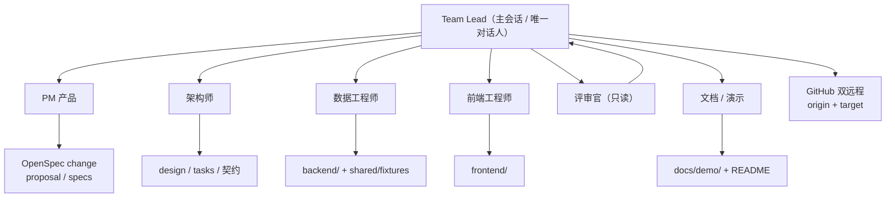
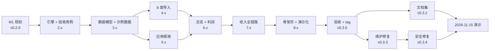
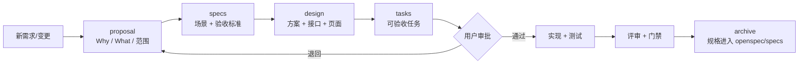

# 项目开发计划 · 餐饮经营分析系统（一期）

> 文档编号：**CBA-PLAN-001** ｜ 版本：**v1.1** ｜ 日期：**2026-11-08** ｜ 适用基线：**v0.3.4**（2026-11-08；`main.py` version 0.3.4，tag 随本次统稿发布）
> 所属文档集：软件工程过程文档集 **v2.0**（01–18）｜ 计划性质：一期已收口后的**计划基线还原 + 执行偏差记录 + 二期滚动规划**
> 关联文档：[01-需求分析](01-需求分析.md)、[02-产品设计](02-产品设计.md)、[03-概要设计](03-概要设计.md)、[05-测试文档](05-测试文档.md)、[07-维护与版本记录](07-维护与版本记录.md)、[08-可行性研究报告](08-可行性研究报告.md)、`openspec/changes/build-catering-analysis-platform/tasks.md`、`docs/sprint-7d.md`、`docs/architecture.md`、`docs/agents/roles.md`

## 1. 文档信息

### 1.1 文档信息

| 项 | 内容 |
|---|---|
| 文档编号 / 名称 | CBA-PLAN-001 / 项目开发计划 |
| 当前版本 / 状态 | v1.0 / 已评审（计划基线成立，执行偏差已登记） |
| 编写日期 | 2026-11-08 |
| 适用基线 | `v0.3.4`（一期 Demo 完成、安全修复轮收口；二期未开始） |
| 项目名称 | 餐饮经营分析系统（Catering Business Analysis） |
| 计划周期 | 一期：D0 2026-11-08 → D7 2026-11-15（演示日）；二期：未排期（滚动规划） |
| 主要读者 | 决策人、Lead、PM、架构、开发、评审、实施与接任者 |
| 计划唯一来源 | `openspec/changes/build-catering-analysis-platform/tasks.md`（66 项任务）与 `docs/sprint-7d.md`（7 天冲刺） |
| 写作边界 | 计划与事实分开表述；实际执行结果以 git 提交、测试输出、tag 为准 |

### 1.2 修订记录

| 版本 | 日期 | 修订人 | 变更摘要 | 对应基线 |
|---|---|---|---|---|
| v1.0 | 2026-11-08 | 项目组（PM 主笔，架构/测试会签） | 首次编写：目标与范围、组织角色、WBS、里程碑、7 天排期、质量计划、沟通、风险、交付物、验收关闭、二期滚动计划 | `v0.3.3` |
| v1.1 | 2026-11-08 | 项目组 | 同步 `v0.3.4`：63 pytest（test_api 34）、任务 49/66、里程碑补安全修复轮；风险登记册补 D-19/D-20 已闭环与公网安全缺口 | `v0.3.4` |

### 1.3 编制依据

| 依据 | 用途 |
|---|---|
| `openspec/changes/build-catering-analysis-platform/proposal.md` | 项目 Why / What / 交付节奏 / 一期关键决策 |
| `openspec/changes/build-catering-analysis-platform/design.md` | 技术方案、接口与页面矩阵、§14 验收数字 |
| `openspec/changes/build-catering-analysis-platform/tasks.md` | WBS 与任务勾选状态（唯一任务来源） |
| `docs/sprint-7d.md` | D0–D7 排期与每日交付物 |
| `docs/agents/roles.md`、`docs/architecture.md` | 组织方式、角色边界、写入范围与闸门 |
| `docs/engineering/05-测试文档.md` | 质量门与回归清单 |
| `CLAUDE.md` | 语言、构建命令、提交与审批约定 |

### 1.4 术语

| 术语 | 含义 |
|---|---|
| WBS | 工作分解结构（Work Breakdown Structure），本计划按「阶段 → 任务组 → 任务」三级分解 |
| 门禁 | 合并/发布前必须全绿的质量检查集合 |
| 冲刺 | 固定周期的集中交付窗口（本项目为 7 天） |
| 基线 | 打 tag 的代码 + 文档状态；当前基线 `v0.3.4` |
| 滚动计划 | 只承诺顺序与前置条件、不承诺日期的新阶段计划方式（二期采用） |
| OpenSpec change | 规格驱动开发的变更单元（proposal → specs → design → tasks） |

## 2. 项目目标与范围

### 2.1 项目目标

| 层级 | 目标 | 验收口径 |
|---|---|---|
| 业务目标 | 把「比差异 → 找问题 → 定计划 → 达目标」的分析方法做成可交互 Web 系统 | 15 分钟能讲完 6 段动线 |
| 一期目标 | 2026-11-15 培训课演示「收入分析模块」 | `docs/demo/演示脚本.md` 可走通 |
| 质量目标 | 关键数字与 Excel 逐项一致 | design §14 全部数字可复现 |
| 工程目标 | 为二期留出可扩展骨架 | 6 个骨架页 + 10 个能力规格 |
| 过程目标 | 需求、方案、任务、验收全程留痕 | OpenSpec + 文档集 + 版本 tag |

### 2.2 一期范围（已交付）

| 模块 | 交付状态 | 证据 |
|---|---|---|
| 登录与访问控制 | 可用 | `api/auth.py`、`RequireAuth.tsx` |
| 应用框架与导航 | 可用 | `layouts/AppLayout.tsx`、17 条路由 |
| 全局筛选（品牌/门店/期间/口径/基准） | 可用（同期；预算/上期为空态） | `FilterBar.tsx`、URL 参数 |
| 数据导入（8 类） | 可用 | `importers/`、`DataPage.tsx` |
| 经营总览（4 KPI + 利润桥 + 结论） | 可用 | `DashboardPage.tsx`、`/api/analysis/overview` |
| 营业利润对比 | 半可用（利润表 + 利润桥；预算/评分/板块占位） | `ProfitPage.tsx` |
| 收入分析全链路（5 导航页 + 2 下钻页） | 可用 | `pages/revenue/*`、8 个收入接口 |
| 6 个二期骨架页 | 骨架（可见、可导航、标注二期） | `SkeletonPage.tsx` |

### 2.3 二期范围（未实现，仅规划）

毛利分析、费用分析、顾客 & 竞争分析、总结 & 计划、沙盘预演与结果方案、报告导出（HTML/PDF/PPT）、多租户与权限、部署与监控。对应 `tasks.md` §10–§15，共 6 组 17 项任务，全部未勾选。

### 2.4 明确不做（一期决策）

| 不做项 | 原因 | 替代/后续 |
|---|---|---|
| 接大模型生成洞察 | 可控、可解释、断网可演示 | 规则化洞察；二期评估 |
| 第三方平台 API 直连 | 鉴权/限流/稳定性成本高 | `importers/` 抽象层预留 |
| 多租户与细粒度权限 | 一期单管理员 | 二期权限模型 |
| 移动端适配 | 桌面 1440 演示 | 二期评估 |
| Docker / CI | 单机演示，人工发布 | 二期补 CI（`tasks.md` 15.2） |
| 预算/上期完整链路 | 数据未就绪 | 空态占位，二期打通 |

### 2.5 计划假设与约束

| # | 假设/约束 | 影响 | 若失效 |
|---|---|---|---|
| A1 | 一人指挥 + 角色 Agent 可完成分工 | 决定人力模型 | 需增加真实人力，排期延长 |
| A2 | 示例数据可代表真实客户表结构 | 决定导入设计 | 二期返工模板与校验 |
| A3 | 一期只需同期基准 | 决定筛选范围 | 预算/上期需提前实现 |
| A4 | 技术栈版本锁定、不升级 | 决定构建稳定性 | 升级需重跑全部门禁 |
| C1 | 时间窗口一周（D0–D7） | 决定范围取舍 | 触发「砍到四页」预案 |
| C2 | 无 Docker/CI/监控 | 发布靠手工 | 需补流水线 |
| C3 | 数字以 Excel 为唯一准绳 | 决定验收口径 | 需重新基线化 |

## 3. 组织与角色

### 3.1 项目组织

### 3.2 角色职责与写入范围

| 角色 | 职责 | 可写范围 | 不做什么 |
|---|---|---|---|
| Lead（主会话） | 拆需求、定优先级、分派、验收、合并、双推、汇报 | 任务单、提交、tag、小改 | 不亲写大段业务代码 |
| PM | proposal、specs 场景、范围与验收标准 | `openspec/*/proposal.md`、`specs/`、`docs/domain/` | 不写 design/代码 |
| 架构师 | design、tasks、数据字典、接口契约 | `design.md`、`tasks.md`、`shared/` 契约说明 | 不写业务实现 |
| 数据工程师 | 导入、引擎、服务、API、单测、fixtures | `backend/`、`shared/fixtures/`、`scripts/` | 不改前端 |
| 前端工程师 | 布局、筛选、组件、图表、下钻、空态 | `frontend/` | 不改后端与契约 |
| 评审官 | 逐条对标准、跑门禁、提阻塞意见 | **只读**（意见交 Lead 落任务单） | 不直接改代码 |
| 文档/演示 | 演示脚本、截图、答疑、README | `docs/demo/`、`README.md`、`docs/engineering/`（受分派） | 不改业务代码 |

来源：`docs/agents/roles.md`。**同一文件范围只允许一个写入者**；并行时使用 Worktree Space 一任务一空间。

### 3.3 三条铁律与审批点

| # | 铁律 | 落地方式 |
|---|---|---|
| 1 | 一个任务一个 owner | `tasks.md` 勾选权归 Lead；角色按分派单执行 |
| 2 | 上游没确认，下游不动手 | proposal 未批 → 不写 design；design 未定 → 不写代码 |
| 3 | 结论回 Lead，不横向私聊 | 角色间协作由 Lead 转达，避免上下文漂移 |

| 审批点 | 是否必须用户审批 | 证据 |
|---|---|---|
| proposal / specs / design / tasks 首次成稿 | 是 | `CLAUDE.md`「代码实现前暂停等审批」 |
| 范围变更（一期加需求） | 是 | 写入 proposal 再实施 |
| 对外演示口径 | 是 | `docs/demo/演示脚本.md` |
| 实现细节、测试补充、文案/样式 | 否 | 角色自主 |

### 3.4 RACI 简表

| 活动 | 用户 | Lead | PM | 架构 | 数据 | 前端 | 评审 | 文档 |
|---|---|---|---|---|---|---|---|---|
| 定范围/优先级 | A | R | R | C | I | I | I | I |
| 方案设计 | I | A | C | R | C | C | C | I |
| 实现 | I | A | I | C | R | R | C | I |
| 质量门禁 | I | A | I | C | R | R | R | I |
| 演示与培训 | A | C | C | I | I | I | I | R |
| 发布/打 tag | I | R | I | I | I | I | C | I |

> R=负责、A=审批、C=咨询、I=知会。

## 4. 工作分解结构（WBS）

### 4.1 分解原则

1. 三级分解：阶段 → 任务组 → 可验收任务；每项任务必须写「验证方式」。
2. 任务粒度控制：单项 ≤ 1 个工作日，可独立验收；跨端任务拆成后端/前端两条。
3. 依赖显式：上游（数据/契约）未完成，下游（页面）不启动。
4. 任务单与代码同仓：`tasks.md` 是唯一任务来源，不另建 Excel 任务表。

### 4.2 阶段一 WBS（9 组 / 49 项任务，已勾选 48 项）

| 组 | 任务组 | 任务数 | 关键交付物 | 验收证据 | 状态 |
|---|---|---|---|---|---|
| 1 | 工程脚手架与仓库准备 | 5（1.1–1.5） | 双远程、`backend/`、`frontend/`、`shared/fixtures/`、CLAUDE.md 命令 | 构建与测试通过 | 全部完成 |
| 2 | 计算引擎 | 6（2.1–2.6） | compare、chain_substitution、profit_bridge、mix_rate_split、percentiles、revenue、fixtures | pytest 引擎 17 项 | 全部完成 |
| 3 | 数据模型、认证与示例数据 | 5（3.1–3.5） | 16 张表、Alembic、登录、8 类 CSV、`load_seed` | pytest 断言 design §14 | 全部完成 |
| 4 | 数据导入 | 6（4.1–4.6） | 导入框架、8 类 importer、两阶段提交、覆盖/回滚、数据状态、导入页 | 导入器 11 项 + 页面冒烟 | 全部勾选（4.6 于 `v0.3.3` 完成、`v0.3.4` 统稿勾选） |
| 5 | 应用框架与通用组件 | 4（5.1–5.4） | 主题/布局、FilterBar、KpiCard/Waterfall、洞察规则 | vitest + 截图 | 全部完成 |
| 6 | 经营总览与营业利润 | 3（6.1–6.3） | overview/profit 接口、总览页、利润页 | pytest + 页面走查 | 全部完成 |
| 7 | 收入分析 | 12（7.1–7.12） | 8 个收入接口 + 7 个前端页面 + 洞察接入 | pytest 接口 32 项 | 全部完成 |
| 8 | 骨架页、演示化与收尾 | 5（8.1–8.5） | 6 骨架页、空态、smoke、演示脚本、tag `v0.3.0` | smoke PASS | 全部完成 |
| 9 | 一期验收 | 3（9.1–9.3） | 全量测试、走查截图、openspec validate | 63/45/build/smoke/validate | 全部完成 |

### 4.3 阶段二 WBS（6 组 / 17 项任务，全部未开始）

| 组 | 任务组 | 任务数 | 主要工作 | 前置依赖 |
|---|---|---|---|---|
| 10 | 毛利分析 | 3（10.1–10.3） | 毛利总览、结构/单品拆分、三因素、理论成本损益、折扣率 | 实际/理论成本数据、fixtures |
| 11 | 费用分析 | 2（11.1–11.2） | 费用科目对比、效率指标、模型值对比、门店排行 | 面积/人数/天数等基础数据 |
| 12 | 顾客 & 竞争 | 2（12.1–12.2） | 加权满意度、词频与原文、会员储值、竞对监测 | 满意度/竞对数据、分词依赖 |
| 13 | 总结 & 计划 | 3（13.1–13.3） | 总结草稿、下月目标、待办 CRUD、时段预估、xlsx 导出 | 各模块 insights 稳定 |
| 14 | 沙盘预演与结果方案 | 4（14.1–14.4） | 方案 CRUD、双端引擎、目标反推、建议规则库、结果方案、转计划 | 前端 TS 引擎 + fixtures |
| 15 | 报告导出与部署 | 3（15.1–15.3） | HTML/PDF/PPT 导出、Docker 化、多租户与权限预留 | 沙盘与模板确定 |

### 4.4 任务统计口径（重要）

`tasks.md` 共 **66 个复选框**：阶段一 **49 项**（全部勾选）、阶段二 **17 项**（全部未勾选）。

- 按「任务单行数」计：阶段一 49 / 阶段二 17 / 合计 66。
- 按「完成情况」计：已完成 **49** / 未完成 **17**（仅阶段二）/ 合计 66。
- 完成率口径 **49/66**；4.6 已于 `v0.3.3` 完成、`v0.3.4` 统稿勾选，不再有阶段一遗留。

## 5. 里程碑与版本计划

### 5.1 版本与标签历史

| 里程碑 | 标签 | 提交 | 日期 | 内容 | 验收 |
|---|---|---|---|---|---|
| M0 初始基线 | `v0.1.0` | `3f4e93c` | 2026-11-07 | 业务资料 + OpenSpec 脚手架 + CLAUDE.md，无源代码 | 仓库可克隆 |
| M1 规划完成 | `v0.2.0` | `dbb6c23` | 2026-11-08 | 10 个能力规格 + design + tasks（66 项） | `openspec validate --strict` |
| M2 一期 Demo | `v0.3.0` | `e30eb1d` | 2026-11-08 | 后端 + 前端全页面 + 示例数据；57 pytest / 45 vitest | 冒烟通过 |
| M3 演示收口 | `v0.3.1` | `25717b1` | 2026-11-08 | 标签清单与实测命令修正，演示环境验证 | 环境可复现 |
| M4 文档集发布 | `v0.3.2` | `dcfeeff` | 2026-11-08 | 软件工程过程文档集 v1.0（01–07） | 文档评审通过 |
| M5 维护修复 | `v0.3.3` | `9fbaa93` | 2026-11-08 | 导入契约、模板下载、GBK、API 404、字段补齐；61 pytest | 全门禁通过 |
| M6 安全修复 | `v0.3.4` | 本次统稿 | 2026-11-08 | D-19 SPA 路径穿越封堵、D-20 导入预览内部键脱敏、FastAPI version 0.3.4、预算 meta、文件类型提示；63 pytest | 全门禁通过 |
| M7 演示验证 | 待定 | — | 2026-11-15（计划） | 培训课现场演示 + 反馈收集 | 演示成功 + 反馈记录 |

### 5.2 版本规则

| 规则 | 说明 |
|---|---|
| 版本格式 | `v0.x.0` 功能里程碑；`v0.x.y` 收口/修复 |
| 打 tag 时机 | 质量门禁全绿 + 文档同步后 |
| tag 类型 | 附注 tag（`git tag -a -m`） |
| 推送 | `git push target main && git push target --tags`；`origin` 凭据恢复后补推 |
| 变更记录 | 每次发布更新 [07-维护与版本记录](07-维护与版本记录.md) §2 与根 `README.md` 标签清单 |

### 5.3 关键路径

关键路径判断：**引擎与示例数据（2.x/3.x）是硬前置**——数字不对，所有页面都不可信；导入（4.x）与框架（5.x）可并行；收入链路（7.x）是演示主体，压缩时优先保留（预案：砍到总览/结构/渠道/结论四页）。

### 5.4 演示里程碑（M6）准备清单

| # | 准备项 | 负责人 | 完成判据 |
|---|---|---|---|
| 1 | 演示机执行 10 步回归 | Lead | pytest 63 / vitest 45 / smoke PASS |
| 2 | real 模式构建 + 单端口托管 | 前端 | `dist/index.html` 存在，可登录 |
| 3 | 示例数据重灌 + 冷备数据库 | 数据 | 首屏 2025-09，KPI 1000.00/112.70 |
| 4 | 断网 mock 兜底 | 前端 | mock 模式可打开 10 个可用页 |
| 5 | 截图归档 | 文档 | `docs/demo/screenshots/` 与当前页面一致 |
| 6 | 答疑话术 | 文档 | `docs/demo/答疑清单.md` 覆盖四套口径/尾差 |

## 6. 7 天冲刺排期

### 6.1 排期基准（D0–D7）

| 天 | 日期 | 主题 | 交付物 | 验收 |
|---|---|---|---|---|
| D0 | 11-08 | 定方案 | proposal / specs / design / tasks + `sprint-7d.md` + 角色定义 + 双远程 | 用户审批通过 |
| D1 | 11-09 | 数据底座与引擎 | `shared/fixtures`；引擎纯函数；pytest 全绿 | 利润桥 64.60→112.70、9 项影响一致 |
| D2 | 11-10 | 导入与示例数据 | 8 类模板 + 校验 + 两阶段提交 + 回滚；示例数据；导入页 | 合法/非法文件分别通过/报错 |
| D3 | 11-11 | 应用框架 | 登录、深色导航、全局筛选、KpiCard/ChartCard/Waterfall、总览 + 利润页 | 筛选切换数字重算 |
| D4 | 11-12 | 收入结构 + 同店 | 结构页、同店客流×客单、门店下钻、时段客流 | 857.23/143/1000.23；92.07/5.08 |
| D5 | 11-13 | 渠道 + 产品 + 洞察 | 渠道下钻、漏斗、ROI、产品量价、规则洞察与结论 | 美团 +124/+36.9%；套餐量价；漏斗 |
| D6 | 11-14 | 骨架页 + 打磨 + 演示化 | 6 骨架页、空态、smoke、演示脚本与截图 | 导航全通、冒烟全绿、15 分钟走完 |
| D7 | 11-15 | 彩排与演示 | 构建产物、演示环境、答疑清单 | 完整讲一遍不出错 |

### 6.2 每日节奏（计划）

| 时段 | 活动 | 输出 |
|---|---|---|
| 上午 | 架构/PM 出当天任务规格与任务卡（30 分钟）→ Lead 确认 → 分派 | 当日任务单 |
| 中午 | 数据/前端并行开发（必要时开 Worktree Space） | 代码 + 单测 |
| 下午 | 评审官验收 → Lead 合并 → 双远程推送 | 合并记录 + 推送 |
| 晚间 | Lead 用一段人话汇报「做完什么/明天做什么/要不要看」 | 用户汇报 |

### 6.3 实际执行记录（偏差）

| 项 | 计划 | 实际 | 偏差 |
|---|---|---|---|
| 排期跨度 | D0–D7（2026-11-08 → 11-15） | D1–D6 于 2026-11-08 当日完成（00:10–10:17） | **压缩约 6 天**；D7 演示仍在 11-15 |
| 交付节奏 | 每天一组任务 | 多 Agent 并行，单日连续交付 | 并行度高于计划 |
| 评审 | 每日下午验收 | 集中一轮独立评审（14 项）+ 维护轮（4 项）+ 安全修复轮（2 项，D-19/D-20） | 验收点合并 |
| 文档集 | 未在 sprint 中单列 | `v0.3.2` 增补 01–07，`v0.3.4` 扩为 01–18 | 计划外增项（正向） |
| 任务勾选 | 每日勾选 | 阶段一 49/49（4.6 于 `v0.3.4` 统稿勾选）；阶段二 0/17 | 勾选滞后已闭环 |

> 偏差不掩盖：**「7 天计划」是排期基线，不是实际耗时**。压缩原因是多 Agent 并行与前期方案充分；代价是评审集中、任务勾选滞后（已在 15 报告 §10 展开）。

### 6.4 演示动线（D7 交付内容）

15 分钟 6 段：总览（2 分钟）→ 利润桥（3 分钟）→ 收入结构（2 分钟）→ 同店/门店 12 下钻（3 分钟）→ 渠道与产品（3 分钟）→ 结论（2 分钟）。详见 `docs/demo/演示脚本.md`。

## 7. 质量计划

### 7.1 质量目标

| 维度 | 目标 | 当前结果 |
|---|---|---|
| 功能正确 | design §14 数字全部复现 | 达成（63 pytest） |
| 回归安全 | 关键路径自动化覆盖 | 63 pytest + 45 vitest + smoke |
| 页面稳定 | 无白屏、无 console error | 17 路由走查通过 |
| 规格合法 | `openspec validate --strict` 通过 | 通过 |
| 缺陷闭环 | 阻塞/高风险 100% 修复 | 14+4+2 项全部闭环（D-01~D-20） |
| 文档同步 | 代码/契约/文档一致 | 文档集 v2.0（本次） |

### 7.2 质量门禁（每次合并/发布前）

| # | 门禁 | 命令/方式 | 通过标准 | 失败处置 |
|---|---|---|---|---|
| G1 | 后端测试 | `cd backend && .venv/bin/python -m pytest` | 63 passed | 按失败用例定位，禁止跳过 |
| G2 | 前端测试 | `cd frontend && npm test` | 45 passed / 6 files | 检查 mock 数字是否被改 |
| G3 | 前端构建 | `VITE_API_MODE=real npm run build` | 构建成功，`dist/index.html` 存在 | 清 `node_modules/.tmp` 重试 |
| G4 | 端到端冒烟 | `bash scripts/smoke.sh` | SMOKE PASS | 检查 8010 端口/临时库权限 |
| G5 | 规格校验 | `openspec validate build-catering-analysis-platform --strict` | valid | 修正 specs 格式 |
| G6 | 评审意见 | 评审官逐条对 specs | 无阻塞意见 | 阻塞项修复后复审 |
| G7 | 数字对照 | design §14 逐项 | 全部一致（尾差有说明） | 回查导入/公式/口径 |

### 7.3 测试分层与责任

| 层 | 责任角色 | 工具 | 覆盖对象 | 数量 |
|---|---|---|---|---|
| 单元（引擎） | 数据 | pytest | 对比、连环替代、利润桥、结构、分位、收入公式 | 17 |
| 单元（前端） | 前端 | vitest | 格式化、语义色、瀑布图、KpiCard | 23 |
| 接口 | 数据 | pytest TestClient | 认证、总览、利润、收入、导入、状态、安全回归 | 34 |
| 导入器 | 数据 | pytest | 校验、覆盖、回滚、模板、坏文件 | 11 |
| 页面冒烟 | 前端 | vitest | 10 可用页 + 2 骨架代表 + 登录 | 13 |
| mock 契约 | 前端 | vitest | 锁定 design §14 数字 | 9 |
| 端到端 | Lead/评审 | smoke.sh | 测试 + 构建 + 灌数 + 接口断言 | 1 脚本 |
| 人工验收 | 评审/文档 | Chrome + 截图 | 17 路由、演示动线 | 全量 |

> 后端合计 63 = 34（接口）+ 17（引擎）+ 11（导入器）+ 1（健康检查）；前端合计 45 = 23（单元）+ 9（mock 契约）+ 13（页面冒烟）。测试的计划与执行证据见 [13-测试计划](13-测试计划.md)（测什么、何时测）与 [14-测试报告](14-测试报告.md)（实际结果、缺陷闭环）；本文只保留项目层门禁与责任划分。

### 7.4 缺陷管理

| 级别 | 定义 | 时限 | 处理 |
|---|---|---|---|
| 阻塞 | 白屏、崩溃、伪造数字、演示数据被破坏 | 演示前必须修复 | 修复 + 回归用例 + 复测 |
| 高 | 关键结论缺失/错误、硬编码、接口 5xx | 演示前必须修复 | 同上 |
| 中低 | 契约不一致、配置遗漏、文案/体验 | 本轮修复 | 回归覆盖或记录 |

流程：发现 → 登记（编号/级别/现象/根因）→ 修复 → 补回归用例 → 复测 → 关闭。一期三轮结果：独立评审 14 项 + 维护轮 4 项 + 安全修复轮 2 项（D-19/D-20），全部闭环（详见 [05-测试文档](05-测试文档.md) §8、[14-测试报告](14-测试报告.md) §5 与 [15-项目验收与总结报告](15-项目验收与总结报告.md) §8）。

### 7.5 演示前回归（10 步）

沿用 [05-测试文档](05-测试文档.md) §9：清缓存构建 → pytest → vitest → smoke → 重灌演示库 → 启动登录 → 17 路由走查 → 预算空态 → 断网 mock → 截图归档。任何一步失败，按表处置后再进入演示。

## 8. 沟通与协作

### 8.1 留痕机制（OpenSpec）

规则：小改在 `tasks.md` 追加并勾选，不新开 change；需求变更改 proposal 并说明原因；已归档规格通过新 change 修改。

### 8.2 每日节奏与汇报

| 机制 | 频率 | 内容 | 产物 |
|---|---|---|---|
| 任务分派 | 每日 | Lead 给角色任务书（上下文 + 规格 + 路径） | 任务单 |
| 进度同步 | 每日 | 完成/受阻/次日计划 | Lead 汇总 |
| 用户汇报 | 每日晚间或里程碑 | 人话汇报，只在需拍板时提问 | 会话记录 |
| 评审 | 里程碑 | 逐条对 specs，提阻塞意见 | 缺陷清单 |
| 归档 | 阶段收口 | `docQA/` 记录决策与遗留 | 过程记录 |

### 8.3 双远程与提交纪律

| 项 | 约定 |
|---|---|
| 远程 | `origin`（cfmypian，历史）+ `target`（c4thmy，主仓库） |
| 提交信息 | 中文 `type: 说明`（feat/fix/docs/chore/test/refactor） |
| 暂存纪律 | 只 `git add` 本次文件，禁止 `git add -A` |
| 推送 | `git push target main && git push target --tags`；origin 待凭据 |
| 冲突 | 推送前 `git pull --rebase`；共享文件（fixtures/README）由 Lead 统一落 |

### 8.4 并行与冲突控制

- **串行**：单文件小改、顺序明确的任务，Lead 直接分派，主仓顺序写。
- **并行**：数据与前端同时动工时启用 Worktree Space，一任务一空间一分支。
- **冲突仲裁**：同一文件范围出现两个 owner 时，Lead 立即停其中一个；跨角色矛盾回 Lead 决策。

### 8.5 升级路径

| 事项 | 升级对象 | 时限 |
|---|---|---|
| 范围变更 | 用户 | 当次会话 |
| 口径争议 | 用户（写入 proposal 待确认） | 当次会话 |
| 阻塞缺陷 | Lead → 对应角色 | 当日 |
| 环境/凭据问题 | Lead → 用户 | 演示前 |

## 9. 风险登记册

| # | 风险 | 概率 | 影响 | 等级 | 应对 | Owner | 状态 |
|---|---|---|---|---|---|---|---|
| R1 | 口径争议（四套收入合计、渠道分摊） | 高 | 数字被质疑 | 高 | 页面分别标注 + 尾差说明 + 差异清单 | PM | 已缓解 |
| R2 | 演示环境断网/服务未起 | 中 | 演示失败 | 高 | mock 模式 + 截图备份 | 文档 | 已缓解 |
| R3 | 示例数据与真实客户表结构不一致 | 中 | 导入失败 | 高 | 中文表头模板 + 别名 + 未知科目映射 | 数据 | 部分缓解 |
| R4 | 一周做不完 | 中 | 范围缩水 | 中 | 「砍到四页」预案 | Lead | 未触发 |
| R5 | 前后端公式不一致 | 低 | 页面与接口打架 | 中 | 共用 fixtures + 双端测试 | 数据 | 已缓解 |
| R6 | 预算/上期被误认为已支持 | 中 | 演示事故 | 中 | 空态 + 演示纪律 | 文档 | 已缓解 |
| R7 | `origin` 未推送 | 中 | 备份单点 | 中 | 凭据恢复后补推（含 tag） | Lead | **未解决** |
| R8 | 二期范围膨胀 | 中 | 排期失控 | 高 | 二期先 OpenSpec 再开发 | PM | 待执行 |
| R9 | 任务单勾选滞后（4.6） | 高 | 完成率口径失真 | 低 | `v0.3.4` 统稿勾选；合并前同步勾选 | Lead | 已闭环 |
| R10 | 单人维护关键人依赖 | 中 | 交付中断 | 中 | 文档集 + 07 故障排查 + 交接演练 | Lead | 部分缓解 |
| R11 | 经济假设未验证即进二期 | 中 | 投入无法回收 | 高 | 演示后 3 个月客户数据意愿门槛 | 决策人 | 待执行 |
| R12 | 技术债累积（mock/real 契约、ECharts 体积、SQLite 并发） | 中 | 维护成本上升 | 中 | 技术债清单（07 §12）+ 二期处理 | 架构 | 已登记 |
| R13 | SPA 静态回退路径穿越（D-19，原 S-01 高危） | 中 | 读取仓库文件/源码 | 高 | `v0.3.4` 修复（`_resolve_dist_file` 限定 dist）+ 回归 | 数据 | **已闭环** |
| R14 | 导入预览泄露内部键（D-20） | 低 | 暴露内部字段名 | 低 | `v0.3.4` 预览过滤 `_` 前缀 + 回归 | 数据 | **已闭环** |
| R15 | 公网部署安全未加固（HTTPS/默认密钥/限流/审计） | 中 | 泄露/滥用/不可追溯 | 高 | 仅本地演示；公网前按 17 §15 加固 | Lead | 未缓解 |

## 10. 配置与交付物清单

### 10.1 环境与配置

| 项 | 值 | 说明 |
|---|---|---|
| Python | 3.12.13 | `backend/.venv`；`requirements.txt` 锁定 |
| Node / npm | 24.22.2 / 11.19.1 | Vite 8 要求较新 Node |
| 数据库 | SQLite `backend/data/cba.db` | git 忽略；测试/冒烟用临时库 |
| 后端端口 | 8000 | 开发与演示一致 |
| 前端端口 | 5173 | Vite 代理 `/api`；演示时无独立进程 |
| 数据模式 | `VITE_API_MODE=mock\|real` | 演示用 `real`；断网用 `mock` |
| 演示账号 | `admin / admin123` | 环境变量可覆盖，交付前必须改 |
| 应用版本 | `main.py` version 0.3.4 | `/docs` 与 OpenAPI info 显示 |
| 关键环境变量 | `CBA_DATABASE_URL`、`CBA_ADMIN_USERNAME/PASSWORD`、`CBA_SESSION_SECRET`、5 个洞察阈值、`CBA_PLATFORM_GROSS_MARGIN` | 完整清单见 [07](07-维护与版本记录.md) §5 |

### 10.2 交付物清单

| 类别 | 交付物 | 位置 | 状态 |
|---|---|---|---|
| 代码 | 后端服务（模型/引擎/导入/服务/API/种子） | `backend/app/` | v0.3.4 |
| 代码 | 前端应用（17 路由/组件/主题/mock） | `frontend/src/` | v0.3.4 |
| 数据 | 8 类示例 CSV + 来源与口径说明 | `backend/seed/` | 已交付 |
| 数据 | 验收用例 fixtures（8 组 + 索引） | `shared/fixtures/` | 已交付 |
| 契约 | 前后端接口契约 | `shared/api-contract.md` | 已同步 v0.3.4 |
| 规格 | OpenSpec change（proposal/specs/design/tasks） | `openspec/changes/build-catering-analysis-platform/` | 生效中 |
| 文档 | 工程文档集 | `docs/engineering/`（01–18） | v2.0（本次新增 08/09/15，其余同批同步） |
| 文档 | 过程与演示 | `docs/architecture.md`、`docs/agents/`、`docs/sprint-7d.md`、`docs/demo/` | 已交付 |
| 脚本 | 开发/灌数/冒烟 | `scripts/{dev,load_seed,smoke}.sh` | 已交付 |
| 标签 | `v0.1.0`–`v0.3.4` | git tag | v0.3.4 已发布（target 已推；origin 待凭据） |
| 远程 | `target` 已同步；`origin` 待凭据 | GitHub | 部分完成 |

### 10.3 项目文件清单（计划/过程类）

| 文件 | 作用 | 维护者 |
|---|---|---|
| `CLAUDE.md` | 项目约定、构建命令、审批规则 | Lead |
| `docs/architecture.md` | 一人多 Agent 生产方式 | Lead |
| `docs/agents/roles.md` | 角色与写入范围 | Lead |
| `docs/sprint-7d.md` | 7 天冲刺基线 | Lead |
| `docs/domain/data-caliber-notes.md` | 口径唯一真相 | PM/数据 |
| `backend/seed/README.md` | 示例数据来源与 16 条差异 | 数据 |
| `docQA/*.md` | 会话决策与缺陷记录 | Lead |
| `docs/engineering/*.md` | 工程过程文档集 | 文档 |

## 11. 验收与项目关闭

### 11.1 一期验收标准

| # | 标准 | 判定方式 | 结果 |
|---|---|---|---|
| 1 | 一期功能范围全部可用或明确标注骨架 | 17 路由走查 | 通过 |
| 2 | design §14 验收数字可复现 | pytest + fixtures | 通过 |
| 3 | 63 pytest / 45 vitest / build / smoke / validate 全绿 | 命令输出 | 通过 |
| 4 | 演示动线 15 分钟可走完 | 彩排 | 通过 |
| 5 | 文档与代码一致（文档集 v2.0） | 交叉核对 | 本次交付后达成 |
| 6 | 遗留问题有清单、有归属 | 15 报告 §9 | 已列 |

### 11.2 项目关闭条件

| # | 关闭条件 | 状态 |
|---|---|---|
| 1 | 质量门禁全绿 | 达成 |
| 2 | 演示完成并记录反馈 | 待 2026-11-15 |
| 3 | 遗留问题清单与责任人 | 达成（15 §9） |
| 4 | 代码/文档/数据同标签 | 达成（v0.3.4） |
| 5 | 双远程推送 | **未完成**（origin 待凭据） |
| 6 | 交接材料（07 + 06 + 本计划） | 达成 |

### 11.3 移交清单

| # | 移交项 | 接收方 | 形式 |
|---|---|---|---|
| 1 | 系统与环境说明 | 维护者 | [07-维护与版本记录](07-维护与版本记录.md) |
| 2 | 使用与导入操作 | 业务/实施 | [06-用户手册](06-用户手册.md) |
| 3 | 测试与回归 | 测试/评审 | [05-测试文档](05-测试文档.md) |
| 4 | 口径与差异 | 财务/数据 | `docs/domain/data-caliber-notes.md` |
| 5 | 演示脚本与答疑 | 讲师 | `docs/demo/` |
| 6 | 二期范围与任务 | PM/架构 | `tasks.md` §10–§15 + 本计划 §12 |

## 12. 二期滚动计划

> **不承诺日期**：二期只确定顺序、前置条件与产出，排期在立项评审后按真实人力与数据就绪度确定。

### 12.1 滚动波次

| 波次 | 内容 | 前置条件 | 主要产出 | 退出判据 |
|---|---|---|---|---|
| W1 数据与毛利 | 毛利分析（10.x）+ 费用分析（11.x） | 实际/理论成本、面积/人数数据可导入 | 毛利/费用页 + 接口 + fixtures | 验收数字复现、页面可用 |
| W2 顾客与计划 | 顾客 & 竞争（12.x）+ 总结 & 计划（13.x） | 满意度/竞对/会员数据、分词依赖锁定 | 满意度、词云、会员、目标与待办 | 数据可导入、导出可用 |
| W3 沙盘与报告 | 沙盘预演（14.x）+ 报告导出（15.1） | 前端 TS 引擎 + 双端 fixtures；报告模板确定 | 沙盘页、结果方案、HTML/PDF/PPT | 沙盘 <1s、方案可转计划 |
| W4 商用化 | Docker/CI（15.2）+ 多租户（15.3） | 客户部署形态确定 | 部署包、流水线、权限模型 | 可交付部署、权限隔离验证 |

### 12.2 二期启动前置条件

| # | 条件 | 验证方式 | 责任 |
|---|---|---|---|
| 1 | 演示完成且收集到真实反馈 | 反馈记录（15 §10） | Lead |
| 2 | ≥1 家客户愿提供真实数据试用 | 数据提供承诺 | 商务 |
| 3 | 经济参数补齐（人日成本、节省工时、定价） | 回收期可计算 | 财务 |
| 4 | 二期范围在 OpenSpec 中重新确认 | 新 change 或原 change 更新 | PM |
| 5 | 一期技术债处理方案确定 | 07 §12 逐项有结论 | 架构 |

### 12.3 估算方式

- **不按天数承诺**：二期采用「任务项 × 验收标准」估算，每波次结束后重估。
- 估算输入：`tasks.md` 任务数（17 项）、依赖新数据集数量、前端页面数、是否引入新依赖（分词/导出/容器）。
- 风险缓冲：沙盘双端引擎与报告导出为高风险项，单独预留缓冲（比例待立项时定）。

## 13. 附录

### 13.1 任务统计（行数与完成情况）

| 口径 | 阶段一 | 阶段二 | 合计 |
|---|---|---|---|
| 任务单行数（复选框） | 49 | 17 | 66 |
| 其中已完成 | 49 | 0 | 49 |
| 其中未完成 | 0 | 17 | 17 |
| 分组数 | 9 | 6 | 15 |

> 结论：`tasks.md` 共 66 项；截至 `v0.3.4` 已完成 **49**、未完成 **17**（仅阶段二），完成率口径 **49/66**。4.6（前端导入页）已随 `v0.3.3` 完成、`v0.3.4` 统稿勾选，阶段一 100% 勾选；此前「48/66、阶段一 49（已勾 48）」的表述作废。

### 13.2 WBS 编号规则

- 阶段一：`1.x`–`9.x`，第一位为任务组，第二位为任务序号。
- 阶段二：`10.x`–`15.x`，规则同上。
- 引用任务时写全编号（如 `7.2`），与 `tasks.md` 一一对应；文档不另造编号。

### 13.3 计划假设与偏差汇总

| # | 假设/偏差 | 影响 | 处理 |
|---|---|---|---|
| 1 | 7 天排期实际压缩为 1 天（D1–D6） | 评审集中；勾选滞后已闭环 | 登记偏差，不美化 |
| 2 | 文档集不在 sprint 计划内 | `v0.3.2` 为计划外增项 | 视为正向增项，纳入交付物 |
| 3 | 4.6 勾选滞后（已闭环） | 完成率曾按 48/66 表述 | `v0.3.4` 统稿勾选，完成率 49/66 |
| 4 | `origin` 未推送 | 项目关闭条件未全满足 | 演示前解决 |
| 5 | 二期无排期 | 无法承诺上线时间 | 滚动计划 + 前置条件 |
| 6 | 安全修复（D-19/D-20）为计划外增项 | 工期小幅增加 | 已闭环并补回归，纳入 `v0.3.4` |

### 13.4 相关文档索引

| 文档 | 用途 |
|---|---|
| [01-需求分析](01-需求分析.md) | 需求与验收标准 |
| [02-产品设计](02-产品设计.md) | 页面与交互 |
| [03-概要设计](03-概要设计.md) | 架构与技术选型 |
| [04-详细设计](04-详细设计.md) | 表/接口/公式 |
| [05-测试文档](05-测试文档.md) | 质量门与回归 |
| [06-用户手册](06-用户手册.md) | 使用与实施 |
| [07-维护与版本记录](07-维护与版本记录.md) | 版本、配置、故障 |
| [08-可行性研究报告](08-可行性研究报告.md) | 五维可行性 |
| [13-测试计划](13-测试计划.md) | 测试策略与排期 |
| [14-测试报告](14-测试报告.md) | 测试执行与缺陷 |
| [15-项目验收与总结报告](15-项目验收与总结报告.md) | 验收结论与经验 |
