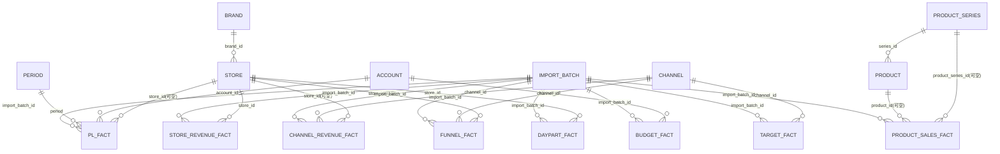
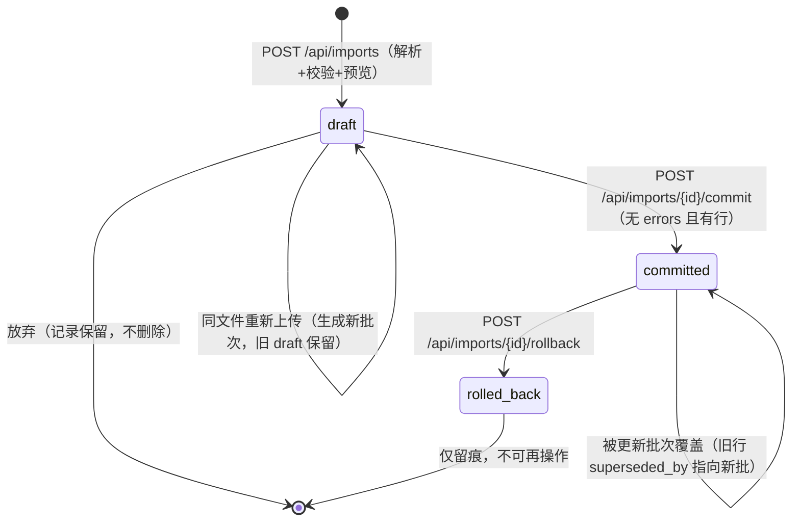

# 数据库设计说明书

> 文档编号：CBA-DBD-001 ｜ 版本：v1.1 ｜ 日期：2026-11-08 ｜ 适用基线：git tag **v0.3.4**（2026-11-08，安全补丁版；上一基线 v0.3.3 = `9fbaa93`）
> 关联文档：[README](README.md)、[03-概要设计](03-概要设计.md) §8、[04-详细设计](04-详细设计.md) §2、[05-测试文档](05-测试文档.md)、[07-维护与版本记录](07-维护与版本记录.md)、[11-接口设计文档](11-接口设计文档.md)、[12-部署与运维手册](12-部署与运维手册.md)
> 关联代码：`backend/app/models/{dimensions,facts,common}.py`、`backend/app/db.py`、`backend/app/importers/{base,registry,service}.py`、`backend/alembic/versions/7ff48b1131c0_initial_schema.py`、`backend/seed/*.csv`

## 1. 文档信息与修订记录

### 1.1 文档信息

| 项 | 内容 |
|---|---|
| 文档编号 / 名称 | CBA-DBD-001 数据库设计说明书（Database Design Description） |
| 版本 / 日期 | v1.0 / 2026-11-08 |
| 适用系统基线 | **v0.3.4**（2026-11-08，安全补丁版）｜文档集版本 v2.0｜质量门 63 pytest / 45 vitest / real build / smoke PASS |
| 数据库 | SQLite 3 单文件 `backend/data/cba.db`；SQLAlchemy 2.1.8 + Alembic 1.20.1 |
| 表规模 | **16 张业务表**（8 维度/元数据 + 8 事实）+ `alembic_version`（仅迁移库，1 张） |
| 索引规模 | 演示库 `sqlite_master` 共 **44 条索引记录**（36 显式 + 8 唯一约束自动索引） |
| 主要读者 | DBA、后端、数据工程、维护者、审计 |

### 1.2 修订记录

| 版本 | 日期 | 修订人 | 变更 | 对应基线 |
|---|---|---|---|---|
| v1.0 | 2026-11-08 | 后端架构/运维 | 首次发布：16 表逐字段、ER、索引/约束、覆盖回滚、迁移差异、容量估算、备份归档、数据字典 | v0.3.3 |
| v1.1 | 2026-11-08 | 后端架构/运维 | 同步 v0.3.4 安全修复与口径：导入预览脱敏（D-20）、SPA 路径穿越修复（D-19，见 11/12）；批次行数 15（14–15 浮动）；质量门 63 测试；tasks 49/66 | v0.3.4 |

### 1.3 事实基准与取证方式

本文字段、类型、可空性、索引均以**运行库实际 schema** 为准逐条核对。取证命令（只读）：

```bash
cd /Users/apple/Projects/CateringBusinessAnalysis-dshSA
sqlite3 backend/data/cba.db '.schema'                                  # 本文第 4/5 章来源
sqlite3 backend/data/cba.db "select count(*) from sqlite_master where type='index';"   # 44
sqlite3 backend/data/cba.db "select name from sqlite_master where type='table' and name not like 'sqlite_%';"
sqlite3 backend/data/cba.db 'pragma integrity_check;'                  # ok
sqlite3 backend/data/cba.db 'pragma journal_mode;'                     # delete
for t in brand store account channel product_series product period import_batch pl_fact \
         store_revenue_fact channel_revenue_fact product_sales_fact funnel_fact \
         daypart_fact budget_fact target_fact; do
  printf "%-22s %s\n" "$t" "$(sqlite3 backend/data/cba.db "select count(*) from $t;")"; done
```

迁移侧取证（临时库，不碰演示库）：

```bash
cd backend && rm -rf /tmp/cba-alembic && mkdir -p /tmp/cba-alembic
CBA_DATABASE_URL="sqlite:////tmp/cba-alembic/a.db" .venv/bin/python -m alembic upgrade head
sqlite3 /tmp/cba-alembic/a.db "select * from alembic_version;"                          # 7ff48b1131c0
sqlite3 /tmp/cba-alembic/a.db "select count(*) from sqlite_master where type='index';"  # 45
```

> 当前演示库由 `create_all` 建表，**没有** `alembic_version`（见第 8 章）。

## 2. 设计目标与原则

### 2.1 设计目标

| # | 目标 | 落地方式 | 验证 |
|---|---|---|---|
| G1 | 同时承载品牌级与门店级数据 | 事实表 `store_id` 可空：`NULL` = 品牌/全部口径 | `pl_fact` 中「全部」行 `store_id is null` |
| G2 | 8 类导入互不干扰、可独立覆盖回滚 | 每类数据集独立事实表 + `import_batch` | 批次 1–8 分别写入 8 张事实表 |
| G3 | 重复导入不丢历史、可恢复上一版本 | `superseded_by` 逻辑覆盖 + 回滚双语句（第 7 章） | 实测 commit/rollback 双向可逆 |
| G4 | 指标可追溯到来源批次 | 事实行 `import_batch_id` | 批次列表 + 事实行批次号 |
| G5 | 单机零运维演示，后续可换 PG | SQLite 文件 + 无外键 + 无专有 SQL + `render_as_batch` | 第 8/11 章 |
| G6 | 表结构可被接口文档直接引用 | 单位/枚举集中写入第 12 章 | 与 11 的单位一致 |

### 2.2 设计原则

| 原则 | 说明 | 体现 |
|---|---|---|
| 长表（窄表 + 维度） | 事实表只存「键 + 度量」，科目/渠道/产品/门店外置维度表 | `pl_fact(account_id, amount)` 而非 10 个金额列 |
| 维度建模星型 | 8 维表包围 8 事实表；事实表不建外键 | 第 3 章；04 §2.5 |
| 粒度显式化 | 每张事实表标注唯一粒度；同粒度重复行由导入器拦截 | 第 5 章 + `_duplicate_keys` |
| 单位就近声明 | 万元 / 元 / 人次 / 元每人次 / 倍 / 0–1 比率写在字段说明 | 第 4/5 章「单位」列；12.3 |
| 批次化覆盖不物理删除 | 覆盖 = 旧行写 `superseded_by`；回滚 = 删本批行 + 旧行置空 | 第 7 章；`importers/service.py` |
| 缺失即 NULL 不补 0 | 无法计算/未导入一律 `NULL`，展示「—」 | `funnel_fact` 度量全可空；预算不完整时 `profit_bridge=null` |
| 软结构硬校验 | 无数据库外键，但导入器/服务层做存在性与枚举校验 | `_resolve_store`、渠道清单校验 |
| SQLite→PG 兼容 | 不用专有语法；批量迁移；时间统一 naive UTC | `models/common.py`、`alembic/env.py` |

### 2.3 非目标（本期明确不做）

不做多租户/多品牌隔离（`brand` 仅 1 行、无 `tenant_id`）；不做行级权限、字段加密、审计触发器；不做分区表、物化视图、读写分离、在线 DDL；Alembic 仅 1 个版本头；不保存原始上传文件（只存元数据 + `payload_json` 解析结果）。

## 3. ER 图

### 3.1 逻辑 ER（无物理外键，连线为逻辑引用）



### 3.2 分组与引用规则

| 分组 | 表 | 角色 |
|---|---|---|
| 维度（6） | `brand`、`store`、`account`、`channel`、`product_series`、`product` | 主数据，`seeds/dimensions.py` 灌入；导入可自动扩充 `product_series`/`product` |
| 字典/批次（2） | `period`（YYYY-MM 字典）、`import_batch`（批次元数据） | 期间由导入回填；批次是审计与覆盖/回滚依据 |
| 事实（8） | `pl_fact`、`store_revenue_fact`、`channel_revenue_fact`、`product_sales_fact`、`funnel_fact`、`daypart_fact`、`budget_fact`、`target_fact` | 只存键与度量，全部带 `import_batch_id`/`superseded_by`/`created_at` |

| 引用 | 基数 | 可空 | 语义 |
|---|---|---|---|
| `store.brand_id → brand.id` | N:1 | 是 | 一期单品牌，实际均指向 id=1 |
| `pl_fact.store_id → store.id` | N:1 | 是 | `NULL` = 品牌/全部门店口径 |
| `channel_revenue_fact.store_id → store.id` | N:1 | 是 | `NULL` = 公司口径（示例即公司口径） |
| `funnel_fact.store_id` / `product_sales_fact.store_id` | N:1 | 是 | 示例为品牌口径 |
| `budget_fact.store_id → store.id` | N:1 | 是 | `NULL` = 品牌预算 |
| `target_fact.channel_id → channel.id` | N:1 | 否 | **无 `store_id`/`brand_id`**：渠道目标为品牌级 |
| 任意事实 `import_batch_id → import_batch.id` | N:1 | 是 | 逻辑引用，历史行可能为空 |

> 事实表不建外键是刻意取舍：SQLite 单机下覆盖/回滚只需 `UPDATE/DELETE`，避免级联与顺序问题；引用完整性由导入器与服务层保证（04 §2.5）。

## 4. 维度 / 元数据表（8 张）

### 4.0 总览

| 表 | 用途 | 主键 | 唯一约束 | 索引 |
|---|---|---|---|---|
| `brand` | 品牌字典（1 行） | `id` | `name` | `sqlite_autoindex_brand_1` |
| `store` | 门店档案（15 行） | `id` | `code`、`name` | `sqlite_autoindex_store_1/2` |
| `account` | 10 个标准科目 | `id` | `name` | `sqlite_autoindex_account_1` |
| `channel` | 10 个渠道 | `id` | `name` | `sqlite_autoindex_channel_1` |
| `product_series` | 8 个系列 | `id` | `name` | `sqlite_autoindex_product_series_1` |
| `product` | 31 个单品/套餐 | `id` | `name` | `sqlite_autoindex_product_1` |
| `period` | 24 个月期间字典 | `id`（`YYYY-MM`） | 主键本身 | `sqlite_autoindex_period_1` |
| `import_batch` | 导入批次/审计 | `id` | — | `ix_import_batch_dataset`、`ix_import_batch_status` |

字段顺序与 `sqlite3 .schema` 物理列顺序一致；「空」列 Y=可空、N=`NOT NULL`。

### 4.1 `brand`（品牌）

| 字段 | 类型 | 空 | 约束 | 说明 | 单位 |
|---|---|---|---|---|---|
| `id` | INTEGER | N | PK | 自增主键 | — |
| `name` | VARCHAR(64) | N | UNIQUE | 品牌名称；接口 `brand=all` 时不过滤 | — |

### 4.2 `store`（门店）

| 字段 | 类型 | 空 | 约束 | 说明 | 单位 |
|---|---|---|---|---|---|
| `id` | INTEGER | N | PK | 自增主键；`/revenue/store/{store_id}` 即此值 | — |
| `code` | VARCHAR(32) | N | UNIQUE | 门店编码 | — |
| `name` | VARCHAR(64) | N | UNIQUE | 门店名称（门店1…门店13、新店1/2）；导入按名称匹配 | — |
| `brand_id` | INTEGER | Y | — | 逻辑引用 `brand.id` | — |
| `region` | VARCHAR(32) | N | — | 区域（区域一/二/三…） | — |
| `business_model` | VARCHAR(16) | N | — | 经营模式：`直营`/`加盟`/`联营` | — |
| `store_type` | VARCHAR(16) | N | — | 店型：`MALL`/`社区街边`/`写字楼`/`交通枢纽` | — |
| `opened_on` | DATE | Y | — | 开业日期；无导入标识时用于推算同店/新店 | — |
| `closed_on` | DATE | Y | — | 闭店日期；用于推算闭店 | — |
| `area_m2` | FLOAT | Y | — | 营业面积（示例数据未用） | m² |
| `seats` | INTEGER | Y | — | 座位数（示例数据未用） | 个 |

### 4.3 `account`（利润表科目）

| 字段 | 类型 | 空 | 约束 | 说明 | 单位 |
|---|---|---|---|---|---|
| `id` | INTEGER | N | PK | 自增主键 | — |
| `name` | VARCHAR(64) | N | UNIQUE | 营业收入、食材成本、优惠及手续费、水电气低值、宣传费用、工资奖金、宿舍房租、店铺房租、其它费用、税金及附加 | — |
| `cost_behavior` | VARCHAR(16) | N | 默认 fixed | 成本性态：`variable`/`fixed`/`revenue` | — |
| `sort_order` | INTEGER | N | 默认 0 | 利润表展示顺序 | — |

### 4.4 `channel`（渠道）

| 字段 | 类型 | 空 | 约束 | 说明 | 单位 |
|---|---|---|---|---|---|
| `id` | INTEGER | N | PK | 自增主键；`/revenue/channel/{channel_id}` 即此值 | — |
| `name` | VARCHAR(64) | N | UNIQUE | 美团大众、抖音、美团外卖、饿了么… | — |
| `category` | VARCHAR(16) | N | — | 大类：`堂食`/`外卖` | — |
| `sort_order` | INTEGER | N | 默认 0 | 展示顺序 | — |

### 4.5 `product_series`（产品系列）

| 字段 | 类型 | 空 | 约束 | 说明 | 单位 |
|---|---|---|---|---|---|
| `id` | INTEGER | N | PK | 自增主键 | — |
| `name` | VARCHAR(64) | N | UNIQUE | 肉类、涮品类、小料类、主食类… | — |
| `sort_order` | INTEGER | N | 默认 0 | 展示顺序；导入自动新增的系列为 100 | — |

### 4.6 `product`（单品/套餐）

| 字段 | 类型 | 空 | 约束 | 说明 | 单位 |
|---|---|---|---|---|---|
| `id` | INTEGER | N | PK | 自增主键；`product_sales_fact.product_id` 来源 | — |
| `series_id` | INTEGER | Y | — | 逻辑引用 `product_series.id`；套餐可空（跨系列） | — |
| `name` | VARCHAR(128) | N | UNIQUE | 产品名称（含「线上套餐」汇总行） | — |
| `is_set` | BOOLEAN | N | 默认 False | 是否套餐（SQLite 存 0/1） | — |

### 4.7 `period`（期间字典）

| 字段 | 类型 | 空 | 约束 | 说明 | 单位 |
|---|---|---|---|---|---|
| `id` | VARCHAR(7) | N | PK | `YYYY-MM`，如 `2025-09` | — |
| `year` | INTEGER | N | — | 年 | 年 |
| `month` | INTEGER | N | — | 月（1–12） | 月 |

> 事实表 `period` 是字符串列，**不是外键**；导入按 `YYYY-MM` 正规化，服务层 `parse_period` 再校验。

### 4.8 `import_batch`（导入批次）

| 字段 | 类型 | 空 | 约束 | 说明 | 单位 |
|---|---|---|---|---|---|
| `id` | INTEGER | N | PK | 批次号（接口 `batch_id`） | — |
| `dataset` | VARCHAR(32) | N | 索引 | `pl_monthly`/`store_revenue`/`channel_revenue`/`product_series`/`product_item`/`funnel`/`daypart`/`budget_target` | — |
| `dataset_name` | VARCHAR(64) | N | 默认 "" | 中文数据集名 | — |
| `filename` | VARCHAR(255) | N | 默认 "" | 上传文件名 | — |
| `period_from` | VARCHAR(7) | Y | — | 本批最小期间 | — |
| `period_to` | VARCHAR(7) | Y | — | 本批最大期间 | — |
| `row_count` | INTEGER | N | 默认 0 | 实际写入事实表行数（commit 回填） | 行 |
| `operator` | VARCHAR(64) | N | 默认 admin | 操作人（命令行灌数为 `seed`） | — |
| `status` | VARCHAR(16) | N | 索引，默认 draft | `draft`/`committed`/`rolled_back` | — |
| `created_at` | DATETIME | N | 默认 UTC now | 上传时间（naive UTC） | — |
| `committed_at` | DATETIME | Y | — | 确认入库时间 | — |
| `rolled_back_at` | DATETIME | Y | — | 回滚时间 | — |
| `errors_json` | TEXT | N | 默认 `[]` | 校验错误数组 JSON `{row,column,message}` | — |
| `warnings_json` | TEXT | N | 默认 `[]` | 警告数组 JSON（同结构） | — |
| `preview_json` | TEXT | N | 默认 `[]` | 前 50 行预览 JSON；v0.3.4（D-20）起已过滤 `_` 前缀内部键 | — |
| `payload_json` | TEXT | N | 默认 `[]` | draft 解析行 JSON；commit 的数据来源 | — |
| `coverage_json` | TEXT | N | 默认 `[]` | 覆盖提示数组 JSON `{period,store,rows,message}` | — |

> `payload_json` 含 `_row`、`_store_id`、`_channel_id`、`_series_id`、`_accounts`、`_row_type` 等内部字段（实现细节，不承诺跨版本稳定）；`preview_json` 自 **v0.3.4（D-20）** 起由 `_preview` 过滤全部 `_` 前缀内部键，接口响应不再泄漏。

## 5. 事实表（8 张）

### 5.0 公共字段与公共约束

| 字段 | 类型 | 空 | 约束 | 说明 | 单位 |
|---|---|---|---|---|---|
| `id` | INTEGER | N | PK | 自增主键 | — |
| `import_batch_id` | INTEGER | Y | 索引 | 写入批次（逻辑引用 `import_batch.id`），永不置空 | — |
| `superseded_by` | INTEGER | Y | 索引 | 被哪个新批次覆盖；`NULL`=当前生效 | — |
| `created_at` | DATETIME | N | 默认 UTC now | 写入时间（naive UTC） | — |

公共查询约束：**任何分析查询必须带 `superseded_by IS NULL`**，否则历史版本会被算进来。以下各表只列业务字段，公共字段见本节。

| 表 | 粒度 | 生效行数实测 | 主要单位 |
|---|---|---|---|
| `pl_fact` | 品牌/门店 × 期间 × 科目 × 场景 | 240 | 万元 |
| `store_revenue_fact` | 门店 × 期间 | 30 | 万元 / 人次 |
| `channel_revenue_fact` | 门店(可空) × 期间 × 渠道 | 20 | 万元 |
| `product_sales_fact` | 门店(可空) × 期间 × 系列/产品 | 57 | 元（成本万元） |
| `funnel_fact` | 门店(可空) × 期间 × 渠道 | 1 | 人次 / 元 |
| `daypart_fact` | 门店 × 期间 × 日型 × 时段 | 12 | 人次 |
| `budget_fact` | 品牌/门店(可空) × 期间 × 科目 | 1 | 万元 |
| `target_fact` | 期间 × 渠道（无门店） | 2 | 人/元/倍/小数 |

### 5.1 `pl_fact`（利润表事实）

粒度：`brand_id` × `store_id`（可空=品牌口径）× `period` × `account_id` × `scenario`；一期 `scenario` 只有 `actual`（预算走 `budget_fact`）。

| 字段 | 类型 | 空 | 约束 | 说明 | 单位 |
|---|---|---|---|---|---|
| `brand_id` | INTEGER | Y | — | 逻辑引用 `brand.id`（示例为空，靠 `store_id` 区分口径） | — |
| `store_id` | INTEGER | Y | — | `NULL` = 品牌/全部门店口径 | — |
| `period` | VARCHAR(7) | N | 索引 | `YYYY-MM` | — |
| `scenario` | VARCHAR(16) | N | 索引，默认 actual | 本期仅 `actual` | — |
| `account_id` | INTEGER | N | 索引 | 逻辑引用 `account.id` | — |
| `amount` | FLOAT | N | 默认 0 | 科目金额 | **万元** |

索引：`ix_pl_fact_account_id`、`_import_batch_id`、`_period`、`_scenario`、`_superseded_by`（5 条）。生效行 240（24 月 × 10 科目）。

### 5.2 `store_revenue_fact`（门店收入与客流）

粒度：`store_id` × `period`（一店一月一行）。

| 字段 | 类型 | 空 | 约束 | 说明 | 单位 |
|---|---|---|---|---|---|
| `store_id` | INTEGER | N | 索引 | 必须具体门店（导入器拒绝「全部」） | — |
| `period` | VARCHAR(7) | N | 索引 | `YYYY-MM` | — |
| `revenue` | FLOAT | N | 默认 0 | 门店营业收入 | **万元** |
| `traffic` | FLOAT | N | 默认 0 | 门店客流（示例带 2 位小数） | **人次** |
| `avg_ticket` | FLOAT | Y | — | 客单价；空则由 `revenue*10000/traffic` 反算 | 元/人次 |
| `store_flag` | VARCHAR(16) | Y | — | 导入提供的同店/新店/闭店标识，**优先于**开业日期推算 | — |

索引：`store_id`、`period`、`import_batch_id`、`superseded_by`（4 条）。生效行 30（15 店 × 2 期；新店无 2024-09 行）。

### 5.3 `channel_revenue_fact`（渠道收入）

粒度：`store_id`（可空=公司口径）× `period` × `channel_id`。

| 字段 | 类型 | 空 | 约束 | 说明 | 单位 |
|---|---|---|---|---|---|
| `store_id` | INTEGER | Y | — | `NULL` = 全部/品牌口径（示例为公司口径） | — |
| `period` | VARCHAR(7) | N | 索引 | `YYYY-MM` | — |
| `channel_id` | INTEGER | N | 索引 | 逻辑引用 `channel.id` | — |
| `revenue` | FLOAT | N | 默认 0 | 渠道收入 | **万元** |

索引：`channel_id`、`period`、`import_batch_id`、`superseded_by`（4 条）。生效行 20（10 渠道 × 2 期）。

### 5.4 `product_sales_fact`（产品系列 + 单品/套餐销售）

粒度：系列汇总行 `product_id IS NULL` = `store_id`(可空) × `period` × `product_series_id`；单品/套餐行 = `store_id`(可空) × `period` × `product_id`。

| 字段 | 类型 | 空 | 约束 | 说明 | 单位 |
|---|---|---|---|---|---|
| `store_id` | INTEGER | Y | — | `NULL` = 品牌口径 | — |
| `period` | VARCHAR(7) | N | 索引 | `YYYY-MM` | — |
| `product_series_id` | INTEGER | Y | 索引 | 系列汇总行必填；单品可空（套餐跨系列） | — |
| `product_id` | INTEGER | Y | 索引 | 空 = 系列汇总行 | — |
| `qty` | FLOAT | N | 默认 0 | 销量（套餐行是单量） | 份/单 |
| `amount` | FLOAT | N | 默认 0 | 销售额 | **元** |
| `dish_revenue` | FLOAT | N | 默认 0 | 菜品收入 | **元** |
| `discount` | FLOAT | N | 默认 0 | 菜品优惠 | **元** |
| `actual_cost` | FLOAT | Y | — | 实际成本（仅系列行导入） | **万元** |
| `std_unit_cost` | FLOAT | Y | — | 理论单位成本（仅系列行导入） | 元 |
| `is_set` | BOOLEAN | N | 默认 False | 是否套餐 | — |

索引：`product_series_id`、`product_id`、`period`、`import_batch_id`、`superseded_by`（5 条）。生效行 57（16 系列 + 41 单品/套餐）。

> 单位混用警示：本表金额为**元**，另外四张金额表为**万元**；跨表比较前必须换算。

### 5.5 `funnel_fact`（线上漏斗）

粒度：`store_id`（可空）× `period` × `channel_id`。

| 字段 | 类型 | 空 | 约束 | 说明 | 单位 |
|---|---|---|---|---|---|
| `store_id` | INTEGER | Y | — | `NULL` = 品牌口径 | — |
| `period` | VARCHAR(7) | N | 索引 | `YYYY-MM` | — |
| `channel_id` | INTEGER | N | 索引 | 逻辑引用 `channel.id` | — |
| `exposure` / `visits` / `payers` / `consumers` | FLOAT | Y | — | 曝光→访问→支付→消费人数；缺失保持 NULL | 人次 |
| `brand_customers` / `new_customers` / `old_customers` | FLOAT | Y | — | 品牌顾客 / 新客 / 老客 | 人次 |
| `platform_fee` | FLOAT | Y | — | 平台费用/投入成本 | **元** |

索引：`channel_id`、`period`、`import_batch_id`、`superseded_by`（4 条）。生效行 1（仅美团大众 2025-09）。
空值语义：**逐级缺失保持 NULL，不补 0**；导入要求「至少填曝光人数」且逐级递减。

### 5.6 `daypart_fact`（时段客流）

粒度：`store_id` × `period` × `day_type` × `daypart`。

| 字段 | 类型 | 空 | 约束 | 说明 | 单位 |
|---|---|---|---|---|---|
| `store_id` | INTEGER | N | 索引 | 必须具体门店 | — |
| `period` | VARCHAR(7) | N | 索引 | `YYYY-MM` | — |
| `day_type` | VARCHAR(16) | N | — | `工作日`/`节假日`（仅两值） | — |
| `daypart` | VARCHAR(32) | N | — | 时段文本，统一 `9:00-14:00` 形式 | — |
| `traffic` | FLOAT | N | 默认 0 | 时段客流 | **人次** |

索引：`store_id`、`period`、`import_batch_id`、`superseded_by`（4 条）。生效行 12（门店12 × 2 期 × 2 日型 × 3 时段）。

### 5.7 `budget_fact`（预算）

粒度：`brand_id`（可空）× `store_id`（可空=品牌预算）× `period` × `account_id`。

| 字段 | 类型 | 空 | 约束 | 说明 | 单位 |
|---|---|---|---|---|---|
| `brand_id` | INTEGER | Y | — | 逻辑引用 `brand.id` | — |
| `store_id` | INTEGER | Y | — | `NULL` = 品牌预算 | — |
| `period` | VARCHAR(7) | N | 索引 | `YYYY-MM` | — |
| `account_id` | INTEGER | N | 索引 | 逻辑引用 `account.id` | — |
| `amount` | FLOAT | N | 默认 0 | 预算金额 | **万元** |

索引：`account_id`、`period`、`import_batch_id`、`superseded_by`（4 条）。生效行 1（仅营业收入 1500 万）。
完整性规则：`_budget_complete` 要求 **10 个标准科目全部存在**才视为预算已导入，否则利润桥与预算 KPI 一律 `null`（04 §5.3）。

### 5.8 `target_fact`（渠道增收提价目标）

粒度：`period` × `channel_id`（**无 `store_id`**，渠道目标为品牌/公司级）。

| 字段 | 类型 | 空 | 约束 | 说明 | 单位 |
|---|---|---|---|---|---|
| `period` | VARCHAR(7) | N | 索引 | `YYYY-MM` | — |
| `channel_id` | INTEGER | N | 索引 | 逻辑引用 `channel.id` | — |
| `new_customers` | FLOAT | Y | — | 目标新客量 | 人 |
| `exposure_cvr` | FLOAT | Y | — | 目标曝光转化率 | 0–1 小数 |
| `avg_ticket` | FLOAT | Y | — | 目标客单价 | 元 |
| `gross_margin` | FLOAT | Y | — | 目标毛利率 | 0–1 小数 |
| `cac` | FLOAT | Y | — | 目标新客成本 | 元 |
| `target_roi` | FLOAT | Y | — | 目标 ROI | 倍 |

索引：`channel_id`、`period`、`import_batch_id`、`superseded_by`（4 条）。生效行 2。
导入约定：目标行渠道经 `TARGET_CHANNEL_ALIASES` 映射（大众点评/点评→美团大众，外卖→美团外卖）。

## 6. 索引与约束清单（44）

### 6.1 显式索引（36 条 `CREATE INDEX`）

| 表 | 索引（均单列，`import_batch_id`/`superseded_by` 每表各一条） |
|---|---|
| `import_batch` | `dataset`、`status`（2） |
| `pl_fact` | `account_id`、`import_batch_id`、`period`、`scenario`、`superseded_by`（5） |
| `store_revenue_fact` | `store_id`、`period`、`import_batch_id`、`superseded_by`（4） |
| `channel_revenue_fact` | `channel_id`、`period`、`import_batch_id`、`superseded_by`（4） |
| `product_sales_fact` | `product_series_id`、`product_id`、`period`、`import_batch_id`、`superseded_by`（5） |
| `funnel_fact` | `channel_id`、`period`、`import_batch_id`、`superseded_by`（4） |
| `daypart_fact` | `store_id`、`period`、`import_batch_id`、`superseded_by`（4） |
| `budget_fact` | `account_id`、`period`、`import_batch_id`、`superseded_by`（4） |
| `target_fact` | `channel_id`、`period`、`import_batch_id`、`superseded_by`（4） |

命名规则 `ix_<表名>_<列名>`，与 SQLAlchemy `mapped_column(index=True)` 一致。

### 6.2 唯一约束自动索引（8 条）

`sqlite_autoindex_brand_1`（brand.name）、`_store_1`（store.code）、`_store_2`（store.name）、`_account_1`（account.name）、`_channel_1`（channel.name）、`_product_series_1`（product_series.name）、`_product_1`（product.name）、`_period_1`（period 文本主键）。

### 6.3 计数口径（重要）

| 计数项 | 数量 | 说明 |
|---|---|---|
| 显式 `CREATE INDEX` | 36 | 6.1 节 |
| 唯一约束/文本主键自动索引 | 8 | 6.2 节 |
| 演示库 `sqlite_master` 索引记录 | **44** | `select count(*) … where type='index'` |
| Alembic 迁移库 | 45 | 多 `sqlite_autoindex_alembic_version_1` |

> 44 = 36 + 8，与 03 §8.5 / 04 §2.4 一致；**不要理解为 44 条 `CREATE INDEX`**。

### 6.4 约束清单

| 约束类型 | 分布 | 说明 |
|---|---|---|
| PRIMARY KEY | 16 表各 1 个 | 事实/维度为自增 `INTEGER`；`period.id` 为 `VARCHAR(7)` |
| UNIQUE | 6 张维度的 `name` + `store.code` | 维度名唯一是导入按名称匹配的前提 |
| NOT NULL | 见第 4/5 章「空=N」 | 度量列默认 0，但导入显式赋值 |
| 默认值 | SQLAlchemy `default=` 在**应用层**生成（DDL 不含 DEFAULT） | 直接 SQL 插入需显式给值 |
| 外键 / CHECK / 部分唯一索引 | **均为 0 条** | 枚举与同粒度重复由导入器/服务层校验 |

## 7. 导入批次 / 覆盖 / 回滚机制

### 7.1 状态机



| 状态 | 允许操作 | 拒绝行为 |
|---|---|---|
| `draft` | 可 commit；不可 rollback | rollback → 400「只有已入库批次可以回滚」 |
| `committed` | 可 rollback；不可再 commit | commit → 400「批次状态为 committed，不能重复确认」 |
| `rolled_back` | 仅查询 | commit/rollback → 400 |

### 7.2 `superseded_by` 语义

| 值 | 含义 | 查询规则 |
|---|---|---|
| `NULL` | 当前生效版本 | 分析/列表查询**必须** `superseded_by IS NULL` |
| `= 新批次 id` | 已被新批次覆盖（历史留痕） | 默认过滤；回滚时置回 `NULL` |

配套：`import_batch_id` 记录「谁写的」，永不置空；`created_at` 记录写入时间。

### 7.3 覆盖步骤（commit 阶段）

覆盖范围 = 「同数据集 + 同期间集合 + 同门店作用域」，在写入新行**之前**执行一条 UPDATE：

```sql
-- 例：门店收入；品牌口径数据集会在条件中追加 OR store_id IS NULL
UPDATE store_revenue_fact SET superseded_by = :batch_id
 WHERE period IN (:periods) AND superseded_by IS NULL AND store_id IN (:store_ids);
```

| 数据集 | 覆盖条件（等价 SQL 片段） |
|---|---|
| `pl_monthly` | `period IN periods AND scenario='actual' AND (store_id IN ids OR store_id IS NULL)` |
| `store_revenue` | `period IN periods AND store_id IN ids` |
| `channel_revenue` | `period IN periods AND (store_id IN ids OR store_id IS NULL)` |
| `product_series` | `period IN periods AND product_id IS NULL AND (store_id IN ids OR store_id IS NULL)` |
| `product_item` | `period IN periods AND product_id IN (本批产品 ids) AND (store_id IN ids OR store_id IS NULL)` |
| `funnel` | `period IN periods AND (store_id IN ids OR store_id IS NULL)` |
| `daypart` | `period IN periods AND store_id IN ids` |
| `budget_target`（预算行） | `period IN periods AND (store_id IN ids OR store_id IS NULL)` |
| `budget_target`（目标行） | `period IN periods AND channel_id IN (本批渠道 ids)` |

> `product_item` 是**部分覆盖**：只覆盖本批出现过的产品，未出现的产品保留旧值。一个 `budget_target` 批次可同时含预算行与目标行，两段独立覆盖。

### 7.4 回滚步骤（rollback 阶段）

对 8 张事实表在同一事务内各执行两条语句，随后批次置 `rolled_back`：

```sql
-- 对 _FactMixin 的每张表 model 执行（伪代码）
DELETE FROM model WHERE import_batch_id = :batch_id;          -- 删本批写入的行
UPDATE model SET superseded_by = NULL WHERE superseded_by = :batch_id;  -- 恢复被本批覆盖的旧行
-- 8 张表：pl_fact / store_revenue_fact / channel_revenue_fact / product_sales_fact
--        funnel_fact / daypart_fact / budget_fact / target_fact
```

### 7.5 实测证据（v0.3.3/v0.3.4，临时库，不碰演示库）

`CBA_DATABASE_URL=sqlite:////tmp/cba-sbx/cba.db`，用「门店13 2025-09」制造一次覆盖：

```bash
sqlite3 /tmp/cba-sbx/cba.db "select id,revenue,import_batch_id,superseded_by from store_revenue_fact where store_id=13 and period='2025-09';"
# 覆盖前（批次 2）：26|77.0|2|
# commit 批次 9：26|77.0|2|9（旧行被覆盖） 31|10.5|9|（新行生效）
# rollback 批次 9：26|77.0|2|（新行删除，旧行恢复）
```

接口返回：commit → `{"data":{...,"status":"committed","row_count":1,...}}`；rollback → `{"data":{...,"status":"rolled_back",...}}`；对 `rolled_back` 批次重复 commit → 400「批次状态为 rolled_back，不能重复确认」。结论：覆盖与回滚**双向可逆**，历史行不物理删除（仅回滚删除本批次行）。

### 7.6 已知边界

1. **历史行膨胀**：每次重导都新增行并保留旧行；实测 `--force` 重载示例数据后 `pl_fact` 从 240 涨到 480（生效仍 240）。
2. **仅在同期间 + 同门店作用域内覆盖**：新批次只含部分期间时，未含期间不受影响。
3. **维度不参与回滚**：自动新增的 `product`/`product_series` 不在回滚范围（会留孤儿维度，可接受）。
4. **回滚保留批次记录**（`rolled_back`）用于审计；`coverage_json` 仅前端提示，不阻断 commit。

## 8. 迁移（Alembic）

### 8.1 初始迁移

| 项 | 值 |
|---|---|
| 脚本 | `backend/alembic/versions/7ff48b1131c0_initial_schema.py` |
| `revision` / `down_revision` | `7ff48b1131c0` / `None`（唯一版本头，无分支） |
| Create Date | 2026-11-08 01:24:21 |
| 内容 | 16 张业务表 + 36 条显式索引；`batch_alter_table`（`render_as_batch=True`）兼容后续 SQLite ALTER |
| 环境 | `alembic/env.py` 从 `settings.database_url` 读库地址，`target_metadata = Base.metadata` |
| 升级命令 | `cd backend && .venv/bin/python -m alembic upgrade head` |

### 8.2 create_all 与 Alembic 的实际差异（实测 diff）

| 差异 | create_all（`init_db()`，当前演示库） | Alembic（`upgrade head`） |
|---|---|---|
| 版本表 | 无 `alembic_version` | 有，内容 `7ff48b1131c0` |
| 索引记录数 | 44 | 45 |
| 建表/建索引顺序 | 按 `Base.metadata` 排序 | 按迁移脚本顺序 |
| NOT NULL / 类型 / UNIQUE / 显式索引集合 | 一致 | 一致 |

结论：**DDL 等价**，仅版本表与顺序不同。`create_all` 是空库兜底与测试隔离手段；正式升级路径仍是 `alembic upgrade head`（`db.py::init_db` 注释、03 §12.2）。

### 8.3 `alembic_version` 与当前演示库

演示库由 `create_all` + `load_seed` 生成，**没有** `alembic_version`，`alembic current` 显示无版本。不要对演示库直接 `alembic upgrade head`（会先建版本表再尝试重复建表，可能留下半迁移状态）。正确做法：备份 → 重建库 → `alembic upgrade head` → 灌数；或继续使用当前 `create_all` 方式。

### 8.4 常用迁移命令

```bash
cd backend
.venv/bin/python -m alembic current                            # 查看当前版本
.venv/bin/python -m alembic history                            # 版本历史（仅 1 个）
.venv/bin/python -m alembic upgrade head                       # 升级到最新
.venv/bin/python -m alembic downgrade base                     # 全部回退（危险，先备份）
.venv/bin/python -m alembic revision --autogenerate -m "说明"  # 改模型后生成迁移
```

约束：改模型必须同时出迁移；迁移必须 `render_as_batch`；迁移内不写数据修复（走导入器或一次性脚本）。

## 9. 数据量与增长估算

### 9.1 当前行数（演示库实测，2026-11-08）

| 表 | 行数 | 说明 |
|---|---|---|
| `brand` / `account` / `channel` / `product_series` / `period` | 1 / 10 / 10 / 8 / 24 | 维度种子 |
| `store` | 15 | 门店1–13 + 新店1/2 |
| `product` | 31 | 单品 + 套餐名称 |
| `import_batch` | **15** | 8 示例批次（1–8 committed）+ 7 测试/覆盖批次（9–15 draft）；随测试批次在 **14–15** 间浮动（03 §8.5 的 14 为其中一态） |
| `pl_fact` | 240 | 24 月 × 10 科目 |
| `store_revenue_fact` | 30 | 15 店 × 2 期 |
| `channel_revenue_fact` | 20 | 10 渠道 × 2 期 |
| `product_sales_fact` | 57 | 16 系列行 + 41 单品/套餐行 |
| `funnel_fact` | 1 | 仅美团大众 2025-09 |
| `daypart_fact` | 12 | 门店12 × 2 期 × 2 日型 × 3 时段 |
| `budget_fact` / `target_fact` | 1 / 2 | 示例预算 + 2 个目标 |
| **8 事实表合计** | **363** | — |
| **16 表合计** | **477** | 363 事实 + 114 维度/元数据 |

> 口径差异：03 §8.5 记录 `import_batch=14`，当前库实测 **15**（多一个测试 draft 批次）。以库为准，差异登记于 12.5。

### 9.2 增长估算（单品牌、15 店 / 10 渠道 / 8 系列 / 31 商品、月度全量导入）

| 表 | 每月新增（生效） | 每年新增 | 依据 |
|---|---|---|---|
| `pl_fact` | 10 | 120 | 10 科目 × 1 期 |
| `store_revenue_fact` | 15 | 180 | 15 店 × 1 期 |
| `channel_revenue_fact` | 10 | 120 | 10 渠道 × 1 期 |
| `product_sales_fact` | 39 | 468 | 8 系列 + 31 商品 |
| `funnel_fact` | 1–2 | 12–24 | 线上渠道数 |
| `daypart_fact` | 90 | 1080 | 15 店 × 2 日型 × 3 时段 |
| `budget_fact` / `target_fact` | 10 / 2 | 120 / 24 | 预算完整时 |
| `import_batch` | 8 | 96 | 8 类数据集各 1 批 |
| **合计** | **约 171** | **约 2 024** | — |

存储估算（按当前库折算：401,408 B / 477 行 ≈ 842 B/行）：当前演示库约 0.4 MB；1 年正常导入约 2 MB；每月重导 1 次约 4–5 MB；3 年 / 5 品牌 / 50 店约 100–200 MB。

> 以上为**量级估算（待确认）**，实际受 `payload_json` 长度、索引页与留白影响。SQLite 单文件在 1 GB 内、读多写少场景够用；超百万行或需并发写时按第 11 章迁 PG。

## 10. 备份 / 恢复 / 归档

### 10.1 冷备份（推荐，停机 ≤ 1 分钟）

```bash
cd /Users/apple/Projects/CateringBusinessAnalysis-dshSA
lsof -nP -iTCP:8000 -sTCP:LISTEN                     # 找 PID 并停后端
cp backend/data/cba.db "backend/data/cba.db.$(date +%Y%m%d-%H%M)"
sqlite3 "backend/data/cba.db.$(date +%Y%m%d-%H%M)" 'pragma integrity_check;'   # 期望 ok
```

### 10.2 在线备份（服务不停机）

```bash
sqlite3 backend/data/cba.db ".backup 'backend/data/cba.db.$(date +%Y%m%d-%H%M).bak'"
sqlite3 "backend/data/cba.db.$(date +%Y%m%d-%H%M).bak" 'pragma integrity_check;'
```

实测（临时库）：`.backup` 生成 569,344 B 副本，`integrity_check=ok`，`pl_fact` 行数一致。当前 `journal_mode=delete`；若启用 WAL（11.3），必须用 `.backup` 或 `VACUUM INTO`，**不能只拷贝主文件**。备份策略建议（待确认）：每次大规模导入前 + 每日冷备，保留最近 7 日 + 每月 1 份并异地存放；备份后必跑 `integrity_check`，每季度做一次恢复演练（未做）。

### 10.3 恢复

```bash
# 停后端；保留故障库便于分析
cp backend/data/cba.db backend/data/cba.db.broken
cp backend/data/cba.db.20261108-1030 backend/data/cba.db
sqlite3 backend/data/cba.db 'pragma integrity_check;'                                  # ok
sqlite3 backend/data/cba.db "select count(*) from pl_fact where superseded_by is null;" # 期望 240
# 起后端，登录后核对 /api/analysis/overview 收入 = 1000
```

### 10.4 归档（清理历史行，可选）

```bash
# 1) 统计历史行（演示库当前为 0）
sqlite3 backend/data/cba.db "select 'pl',count(*) from pl_fact where superseded_by is not null;"
# 2) 导出归档
sqlite3 backend/data/cba.db "select * from pl_fact where superseded_by is not null;" > /tmp/archive_pl_fact.csv
# 3) 删除并回收空间（确认不再需要回滚旧批次后执行）
sqlite3 backend/data/cba.db "delete from pl_fact where superseded_by is not null; vacuum;"
```

约束：删除历史行会让「回滚已被覆盖的旧批次」失去恢复目标，执行前必须冷备；未纳入当前演示流程。

## 11. 性能与扩展

### 11.1 查询形态与索引匹配

服务层查询全部是「按期间 + 生效版本 + 维度过滤」：

```sql
SELECT account_id, amount FROM pl_fact
 WHERE period = '2025-09' AND scenario = 'actual'
   AND store_id IS NULL AND superseded_by IS NULL;
```

| 查询 | 命中索引 | 说明 |
|---|---|---|
| 按期间取事实 | `ix_*_period` | 最高频 |
| 生效版本过滤 | `ix_*_superseded_by` | 每次都带 |
| 按门店下钻 | `store_revenue_fact`/`daypart_fact` 有 `store_id` 索引 | 其余表见下方缺口 |
| 批次回滚/列表 | `ix_*_import_batch_id`、`ix_import_batch_status/dataset` | 低频 |
| 维度名匹配 | 唯一自动索引 | 导入阶段 |

> 已知缺口：`pl_fact`、`budget_fact`、`channel_revenue_fact`、`funnel_fact`、`product_sales_fact` 的 `store_id` **没有单列索引**。当前 363 行无影响；上万行后建议补（二期优化，未做）。

### 11.2 当前性能基线

库体积 401,408 B；分析接口单机毫秒级（`smoke.sh` 断言路径）；8 类示例数据全量导入 < 5s；单进程 uvicorn + `check_same_thread=False`，无连接池上限配置；SQLite 单写锁，多进程指向同一文件会 `database is locked`。

### 11.3 启用 WAL（可选加固，未默认开启）

```bash
# 停后端后执行；WAL 是数据库级持久设置
sqlite3 backend/data/cba.db 'pragma journal_mode=WAL;'
sqlite3 backend/data/cba.db 'pragma journal_mode;'      # 回显 wal
```

效果：读写并发改善、崩溃恢复更好；代价是多出 `-wal`/`-shm`，备份必须用 `.backup`。当前 `pragma journal_mode` 回显 `delete`，未启用。
`busy_timeout` 是连接级 PRAGMA，命令行设置不持久；落地需在 `db.py` 加事件钩子（代码改动，本期未做，登记技术债）。

### 11.4 迁移 PostgreSQL 的步骤与差异

1. 安装驱动（当前 `requirements.txt` **无** psycopg/asyncpg，需新增）；
2. 设 `CBA_DATABASE_URL=postgresql+psycopg://...`；
3. `alembic upgrade head` 建表（`render_as_batch` 对 PG 无副作用）；
4. 数据搬迁：SQLite `.dump`/CSV → COPY，或一次性导入脚本；
5. 时间字段当前 naive UTC，PG 建议 `TIMESTAMPTZ`（需模型+迁移改动）；
6. 校验：跑 63 pytest；测试用临时 SQLite，PG 需另加参数化。

模型层已无 SQLite 专有语法；`Float` 在 PG 为 `DOUBLE PRECISION`，如需金额精确可换 `NUMERIC(18,4)`（会改变 API 返回精度，需评估，**待确认**）。分区/归档（按 `period` 分表或 PG 声明式分区）在单表百万行后再考虑，当前不适用。

## 12. 数据字典附录

### 12.1 表清单速查

维度/元数据（8）：`brand`（1）、`store`（15）、`account`（10）、`channel`（10）、`product_series`（8）、`product`（31）、`period`（24）、`import_batch`（15）。
事实（8）：`pl_fact`（240）、`store_revenue_fact`（30）、`channel_revenue_fact`（20）、`product_sales_fact`（57）、`funnel_fact`（1）、`daypart_fact`（12）、`budget_fact`（1）、`target_fact`（2）。
合计 16 表 / 477 行；粒度与字段见第 4/5 章，行数明细见 9.1。

### 12.2 跨表公共字段

`id`（全部 16 表主键）；`store_id`（8 张事实表中 7 张有，`target_fact` 无；可空=NULL 表示品牌/全部口径）；`brand_id`（`store`、`pl_fact`、`budget_fact`）；`period`（8 张事实表，`VARCHAR(7)`）；`import_batch_id`/`superseded_by`/`created_at`（8 张事实表 + 批次表）；5 个 `*_json`（批次表，TEXT 存 JSON）。

### 12.3 单位速查

| 单位 | 字段 | 展示 |
|---|---|---|
| 万元 | `pl_fact.amount`、`store_revenue_fact.revenue`、`channel_revenue_fact.revenue`、`budget_fact.amount`、`product_sales_fact.actual_cost` | 2 位小数 |
| 元 | `product_sales_fact.amount/dish_revenue/discount/std_unit_cost`、`funnel_fact.platform_fee`、`target_fact.cac/avg_ticket` | 2 位小数 |
| 人次 | `store_revenue_fact.traffic`、`daypart_fact.traffic`、`funnel_fact` 全部人数列 | 整数化（`ri`） |
| 元/人次 | `store_revenue_fact.avg_ticket` | 2 位小数；空则反算 |
| 0–1 小数 | `target_fact.exposure_cvr/gross_margin` | 转百分比展示 |
| 倍 / 份单 / 年月 | `target_fact.target_roi` / `product_sales_fact.qty` / `period.year/month` | — |

### 12.4 枚举 / 字典值

| 字段 | 取值 | 来源 |
|---|---|---|
| `store.business_model` | 直营 / 加盟 / 联营 | `importers/registry.py` |
| `store.store_type` | MALL / 社区街边 / 写字楼 / 交通枢纽 | 同上 |
| `store_revenue_fact.store_flag` | 同店 / 新店 / 闭店 | 导入可选列 |
| `account.cost_behavior` | variable / fixed / revenue | 维度种子 |
| `channel.category` | 堂食 / 外卖 | 维度种子 |
| `import_batch.dataset` | pl_monthly / store_revenue / channel_revenue / product_series / product_item / funnel / daypart / budget_target | `DATASET_ORDER` |
| `import_batch.status` | draft / committed / rolled_back | 服务层 |
| `pl_fact.scenario` | actual（一期） | 导入器写死 |
| `daypart_fact.day_type` | 工作日 / 节假日 | 导入枚举 |

### 12.5 与其它文档的差异与待确认项

| # | 事项 | 本文口径 | 其它/实际 | 处置 |
|---|---|---|---|---|
| D1 | `import_batch` 行数 | **15**（实测） | 03 §8.5 写 14 | 以库为准，建议 03 下版同步 |
| D2 | 索引总数 | 44（36 + 8）；迁移库 45 | 03/04 写 44；07 写「36 个显式」 | 统一为「44 条索引记录」 |
| D3 | 演示库无 `alembic_version` | `create_all` 建表 | 03/04 已注明 | 一致 |
| D4 | `pandas` | `requirements.txt` 已移除（v0.3.3）；本地 `.venv` 残留 3.1.1 | 07 技术债 #14 仍写「在 requirements 中」 | 07 下版可关闭 |
| D5 | `preview_json` 含 `_store_id`/`_accounts` | **v0.3.4 D-20 已修复**：`preview` 已脱敏；`payload_json` 仍含内部键（不对外） | 11 已同步标注 | 无 |
| D6 | 历史行归档 / WAL / `busy_timeout` | 建议但未启用 | 07 技术债 #4 | 待确认（演示期不改） |
| D7 | 金额精度 | `FLOAT` 双精度 + 出口 `r2/r4` | 03/04 一致 | 无变更 |

> 原则：差异均经实测确认，不以推测替代事实；不能确认的标「待确认」。
