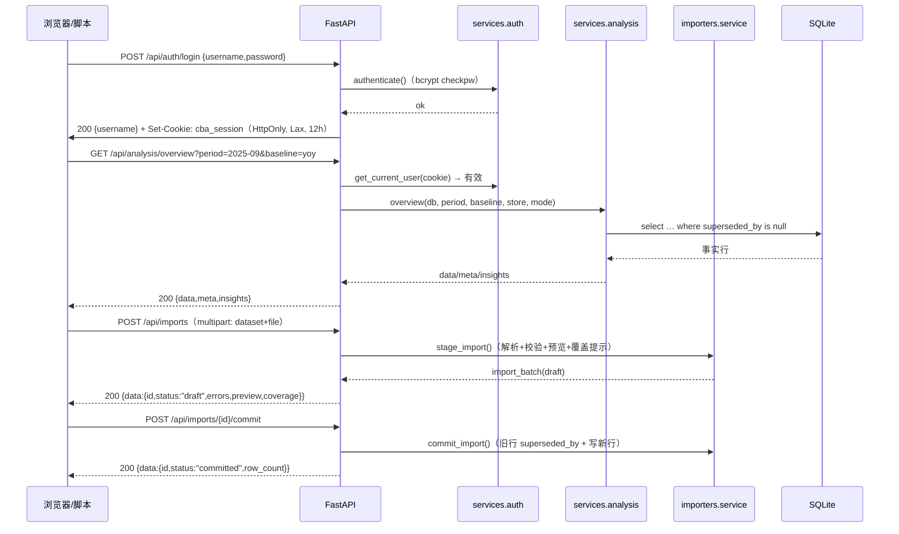

# 接口设计文档

> 文档编号：CBA-API-001 ｜ 版本：v1.1 ｜ 日期：2026-11-08 ｜ 适用基线：git tag **v0.3.4**（2026-11-08，安全补丁版；上一基线 v0.3.3 = `9fbaa93`）
> 关联文档：[README](README.md)、[03-概要设计](03-概要设计.md) §9、[04-详细设计](04-详细设计.md) §5、[05-测试文档](05-测试文档.md)、[10-数据库设计说明书](10-数据库设计说明书.md)、[12-部署与运维手册](12-部署与运维手册.md)、`shared/api-contract.md`
> 关联代码：`backend/app/{main,api,services}/*.py`、`backend/app/importers/*.py`、`frontend/src/api/{client,hooks,types}.ts`

## 1. 文档信息与修订记录

### 1.1 文档信息

| 项 | 内容 |
|---|---|
| 文档编号 / 名称 | CBA-API-001 接口设计文档（Interface Design Document） |
| 版本 / 日期 | v1.0 / 2026-11-08 |
| 适用系统基线 | v0.3.3（提交 `9fbaa93`）｜文档集版本 v2.0 |
| 框架 | FastAPI 0.162.2（自动生成 OpenAPI 3.1：`/openapi.json`、`/docs`；`info.version` 自 v0.3.4 起为 `0.3.4`） |
| 接口规模 | **业务口径 23 paths / 24 operations**（业务 22 + SPA fallback，不含 `/api/{rest}` 兜底）；`/openapi.json` 实测 **24 paths / 29 operations**（再含兜底 5 方法，见 12.2） |
| 质量门（v0.3.4） | **63 pytest**（test_api 34 + engine 17 + importers 11 + health 1）/ 45 vitest / real build / smoke PASS / `openspec validate --strict` 通过 |
| 认证 | 单管理员 + bcrypt(12) + HS256 JWT httpOnly cookie `cba_session` |
| 主要读者 | 前端、后端、第三方对接、测试、维护者 |

### 1.2 修订记录

| 版本 | 日期 | 变更 | 对应基线 |
|---|---|---|---|
| v1.0 | 2026-11-08 | 首次发布：通用约定、23 路径逐接口参数/字段、示例、错误码、v0.3.3 兼容策略、附录索引 | v0.3.3 |
| v1.1 | 2026-11-08 | 同步 v0.3.4：SPA 路径穿越修复（D-19）、导入预览脱敏（D-20）、`meta.baseline=预算`、`info.version=0.3.4`、OpenAPI 双口径（23/24 vs 24/29）、上传错误改为「200 + 行级错误」（A-07）、63 测试 | v0.3.4 |

### 1.3 事实基准与取证方式

本文以**运行中后端的 OpenAPI 与真实响应**为准，不按早期草稿书写。取证命令（只读）：

```bash
cd backend && .venv/bin/python -m uvicorn app.main:app --port 8000   # 未起时先启动
curl -s http://127.0.0.1:8000/openapi.json | python3 -m json.tool | head -300
curl -s -c /tmp/c.jar -X POST http://127.0.0.1:8000/api/auth/login \
  -H 'Content-Type: application/json' -d '{"username":"admin","password":"admin123"}'
curl -s -b /tmp/c.jar "http://127.0.0.1:8000/api/analysis/overview?period=2025-09"
```

实测环境：后端 8000（uvicorn，演示库 `backend/data/cba.db`，2025-09 vs 2024-09），前端 5173（Vite 代理 `/api` → 8000）。

## 2. 通用约定

### 2.1 Base URL 与数据模式

| 场景 | Base URL | 说明 |
|---|---|---|
| 开发（前端 mock） | 不请求后端 | `VITE_API_MODE=mock`（默认），前端内置同形状 mock 数据 |
| 开发（前后端联调） | `http://127.0.0.1:5173`（Vite 代理 `/api` → `http://127.0.0.1:8000`） | `VITE_API_MODE=real npm run dev -- --port 5173` |
| 演示/单机（FastAPI 托管） | `http://127.0.0.1:8000`，接口前缀 `/api` | 先 `VITE_API_MODE=real npm run build`，再起后端 |

前端 `client.ts` 用相对基址 `import.meta.env.VITE_API_BASE ?? '/api'`。

### 2.2 认证与会话

| 项 | 约定 |
|---|---|
| 登录 | `POST /api/auth/login`（JSON `{username,password}`），成功 `200` + `Set-Cookie` |
| Cookie | 名称 `cba_session`；`HttpOnly`；`SameSite=Lax`；`Path=/`；`Max-Age=43200`（12h）；**本地 HTTP 未设 `Secure`** |
| 令牌 | JWT HS256，payload `{sub, iat, exp}`，密钥 `CBA_SESSION_SECRET`（默认开发串，部署必须替换） |
| 校验 | 除 `POST /api/auth/login` 与 `GET /api/health` 外，全部接口要求有效 cookie；缺失/无效/过期 → `401` |
| 前端处理 | `client.ts` 收到 401 统一 `window.location.assign('/login')` |
| 退出 | `POST /api/auth/logout` 删除 cookie（`Set-Cookie: cba_session=""; Max-Age=0`） |

### 2.3 响应包装（三类，必须区分）

| 类别 | 接口 | 响应形状 |
|---|---|---|
| **A. 分析类（权威包装）** | `/api/analysis/*` 中 10 个（不含 thresholds） | `{ "data": {...}, "meta": {brand,store,period,baseline,unit}, "insights": [{level,title,text,evidence}] }` |
| **B. 数据/导入类** | `/api/data-status`、`/api/imports/templates`、`/api/imports`(POST)、commit、rollback、`/api/seeds/load` | `{ "data": ... }`（列表接口另加 `total`） |
| **C. 裸对象** | `/api/auth/login`、`/api/auth/me`、`/api/auth/logout`、`/api/ping`、`/api/health` | `{"username":...}` / `{"ok":true}` / `{"pong":"pong"}` / `{"status":"ok"}` |

`meta` 固定 5 个键：

| 键 | 类型 | 说明 |
|---|---|---|
| `brand` | string | 筛选值，默认 `all` |
| `store` | string | 筛选值；门店下钻接口回填门店名（如 `门店12`） |
| `period` | string | 本期 `YYYY-MM` |
| `baseline` | string | 实际对比标签：`yoy` → `2024-09`；`mom` → `2025-08`；`ytd` → `2024-01~2024-09`；`budget` → `预算`（v0.3.4 起） |
| `unit` | string | 本接口主单位：`万元`（产品接口为 `元`） |

`insights[]`：

| 字段 | 类型 | 可空 | 说明 |
|---|---|---|---|
| `level` | string | 否 | `positive` / `negative` / `info` |
| `title` | string | 否 | 洞察标题（如「收入规模」） |
| `text` | string | 否 | 含数字与口径的句子 |
| `evidence` | string | 否 | 证据定位（如「利润桥·收入规模」） |

> 洞察按 |影响| 排序取前 `CBA_TOP_N`（默认 3）条，规则化生成，**不调用大模型**。

### 2.4 空值、单位与精度

- 无法计算（除零、缺数据、预算不完整）一律返回 `null`，前端显示「—」；**禁止用 0 冒充缺失**。
- 金额：总览/利润/结构/同店/门店/渠道/结论为**万元**；产品接口为**元**（`meta.unit` 相应为 `元`）。比率一律 0–1 小数，展示层转百分比。
- 服务层出口取整：`r2`（2 位）、`r4`（4 位）、`ri`（整数化人数/单量）。中间计算不取整，因此存在「分项和 ≠ 合计」的源表尾差，接口用 `variance_note`/`caliber_note`/`note` 显式说明。
- 日期时间：`import_batch.created_at` 等为 naive UTC 的 ISO 字符串（如 `2026-11-08T02:14:04.630680`）。

### 2.5 错误结构

| 来源 | 形状 | 示例 |
|---|---|---|
| 业务错误（400/401/404，服务层抛出） | `{"detail": "中文说明"}` | `{"detail":"2025-09 没有利润表数据，请先在数据导入页加载数据"}` |
| 参数校验（422，FastAPI/Pydantic 默认） | `{"detail":[{"type","loc","msg","input","ctx"}]}` | `limit=0` → `Input should be greater than or equal to 1` |
| 未匹配 `/api/*`（404 兜底） | `{"detail":"未知接口：/api/xxx"}` | v0.3.3 起不再被 SPA 吞成 200 HTML |

### 2.6 分页、限制与编码

| 项 | 约定 |
|---|---|
| 分页 | 仅 `GET /api/imports`：`limit`（1–200，默认 20）；`total` = **本次返回条数**（非库内总数，见 5.4 注） |
| 上传大小 | ≤ 10MB，超出 400「文件超过 10MB 上限」；空文件 400「文件为空」 |
| 上传格式 | `.xlsx` / `.xlsm` / `.csv` / `.txt`；旧 `.xls` 等不支持类型**不返回 400**，而是 HTTP `200` + 行级 `errors[]`（`column=文件`），draft 不入库（A-07） |
| 编码 | 请求/响应 `UTF-8`；CSV 先按 `utf-8-sig` 解码，失败回退 `GBK`（v0.3.3 新增）；仍失败 → HTTP **`200` + 行级错误**「CSV 编码不支持：请另存为 UTF-8 或 GBK 编码后重试」，不入库（A-07） |
| CORS | 白名单仅 `http://127.0.0.1:5173`、`http://localhost:5173`，`allow_credentials=True` |

## 3. 认证接口（3 个操作）

| # | 方法 | 路径 | 需登录 | 入参 | 成功响应 |
|---|---|---|---|---|---|
| 1 | POST | `/api/auth/login` | 否 | JSON body `{username, password}` | `200 {"username":"admin"}` + `Set-Cookie: cba_session=...` |
| 2 | POST | `/api/auth/logout` | 是 | 无 | `200 {"ok":true}` + 删除 cookie |
| 3 | GET | `/api/auth/me` | 是 | 无 | `200 {"username":"admin"}` |

失败：账号或密码错 → `401 {"detail":"账号或密码错误"}`（用户名不符时仍执行一次 bcrypt 校验，防时间差枚举）；`/me` 未登录 → `401 {"detail":"未登录"}`。

```bash
curl -s -c /tmp/c.jar -X POST http://127.0.0.1:8000/api/auth/login \
  -H 'Content-Type: application/json' -d '{"username":"admin","password":"admin123"}'
# {"username":"admin"}
curl -s -b /tmp/c.jar http://127.0.0.1:8000/api/auth/me
# {"username":"admin"}
```

## 4. 数据状态（1 个操作）

### GET `/api/data-status`

| 参数 | 位置 | 类型 | 默认 | 说明 |
|---|---|---|---|---|
| `period` | query | string | `2025-09` | 本期 `YYYY-MM`；格式非法 → 400 |
| `store` | query | string | `all` | `all` 或门店 id；非法 → 400 |

响应 `{"data": {...}}`：

| 字段 | 类型 | 可空 | 说明 |
|---|---|---|---|
| `period` / `store` / `baseline` | string | 否 | 本期、筛选值、对比期（自动取去年同月） |
| `baseline_ready` | boolean | 否 | 对比期必需数据集是否齐全 |
| `modules` | object | 否 | 5 个模块：`dashboard`/`profit`/`revenue`/`product`/`data`，每项 `{ready: bool, missing: string[]}` |
| `datasets` | array | 否 | 8 个数据集本期就绪：`[{key,name,ready,rows}]` |
| `baseline_datasets` | array | 否 | 同上，对比期版本 |

`datasets[].key` 固定 8 个：`pl_monthly`、`store_revenue`、`channel_revenue`、`product_series`、`product_item`、`funnel`、`daypart`、`budget_target`；`rows` 为**该期间**的生效行数（不是全表行数，例：`store_revenue` 本期 15、全表 30）。

```json
{"data":{"period":"2025-09","store":"all","baseline":"2024-09","baseline_ready":true,
"modules":{"dashboard":{"ready":true,"missing":[]},"profit":{"ready":true,"missing":[]},
"revenue":{"ready":true,"missing":[]},"product":{"ready":true,"missing":[]},"data":{"ready":true,"missing":[]}},
"datasets":[{"key":"pl_monthly","name":"月度利润表","ready":true,"rows":10}],
"baseline_datasets":[{"key":"funnel","name":"线上漏斗","ready":false,"rows":0}]}}
```

## 5. 数据导入（8 个操作）

### 5.1 操作清单

| # | 方法 | 路径 | 入参 | 响应 |
|---|---|---|---|---|
| 1 | GET | `/api/imports/templates` | — | `{"data":[{key,name,description,columns[]}]}`（8 个，**v0.3.3 起包裹 data**） |
| 2 | GET | `/api/imports/templates/{key}.xlsx` | path `key` ∈ 8 个 key | xlsx 二进制；`Content-Disposition: attachment; filename="<key>.xlsx"`；未知 key → 404 |
| 3 | POST | `/api/imports` | multipart：`dataset`(必填)、`file`(必填)、`account_mapping`(JSON 字符串，可选)、`operator`(默认 admin) | `{"data": batch}`，`status=draft` |
| 4 | POST | `/api/imports/{batch_id}/commit` | path id | `{"data": batch}`，`status=committed`，`row_count` 回填 |
| 5 | POST | `/api/imports/{batch_id}/rollback` | path id | `{"data": batch}`，`status=rolled_back` |
| 6 | GET | `/api/imports` | `limit`（1–200，默认 20） | `{"data":[batch], "total": n}` |
| 7 | POST | `/api/seeds/load` | query `force`（默认 false） | `{"data":{dimensions,imports}}` |
| 8 | （同上 #2） | — | — | — |

数据集 key 与模板（8 类，与 `importers/registry.py` 一致）：

| key | 名称 | 列数 | 必填列（导入器视角） |
|---|---|---|---|
| `pl_monthly` | 月度利润表 | 12 | 期间、营业收入、食材成本、优惠及手续费、水电气低值、宣传费用、工资奖金、宿舍房租、店铺房租、其它费用 |
| `store_revenue` | 门店收入 | 9 | 期间、门店、营业收入（万元）、客流（人次） |
| `channel_revenue` | 渠道收入 | 5 | 期间、渠道、收入（万元） |
| `product_series` | 产品系列销售 | 9 | 期间、产品系列、销售数量、销售额（元）、菜品收入（元）、菜品优惠（元） |
| `product_item` | 单品销售 | 8 | 期间、产品名称、销售数量、销售额（元）、菜品收入（元）、菜品优惠（元） |
| `funnel` | 线上漏斗 | 11 | 期间、渠道（其余可选，至少填曝光人数） |
| `daypart` | 时段客流 | 5 | 期间、门店、日类型、时段、客流 |
| `budget_target` | 预算与目标 | 11 | 期间 + （科目+预算值）或（渠道+目标ROI） |

### 5.2 `batch` 对象（上传/确认/回滚/列表共用）

| 字段 | 类型 | 可空 | 说明 |
|---|---|---|---|
| `id` | integer | 否 | 批次号 |
| `dataset` / `dataset_name` | string | 否 | 数据集 key / 中文名 |
| `filename` | string | 否 | 上传文件名 |
| `period_from` / `period_to` | string | **是** | 本批期间范围；解析失败时为 null |
| `row_count` | integer | 否 | 已入库行数；draft 阶段为 0 |
| `operator` | string | 否 | 操作人 |
| `status` | string | 否 | `draft` / `committed` / `rolled_back` |
| `created_at` / `committed_at` / `rolled_back_at` | string | `created_at` 否，其余**是** | naive UTC ISO 时间 |
| `errors` | array | 否 | `[{row,column,message}]`；非空时 commit 拒绝 |
| `warnings` | array | 否 | 同结构，不阻断 |
| `coverage` | array | 否 | 覆盖提示 `[{period,store,rows,message}]` |
| `preview` | array | 否 | 前 50 行预览对象；**v0.3.4（D-20）起已过滤 `_store_id`/`_accounts` 等 `_` 前缀内部键** |

上传阶段服务端做的校验（摘要，逐条规则见 04 §3）：期间格式 `YYYY-MM`；门店/渠道/科目必须存在；同期间同门店同键去重；漏斗逐级递减；时段格式 `9:00-14:00`；预算科目在标准科目表内、目标 ROI > 0；`account_mapping` 用于把未知科目映射到标准科目。

### 5.3 上传示例

```bash
curl -s -b /tmp/c.jar -X POST http://127.0.0.1:8000/api/imports \
  -F "dataset=store_revenue" -F "file=@/tmp/up.csv"
# {"data":{"id":9,"dataset":"store_revenue","dataset_name":"门店收入","filename":"up.csv",
#  "period_from":"2025-09","period_to":"2025-09","row_count":0,"operator":"admin","status":"draft",
#  "created_at":"...","errors":[],"warnings":[],
#  "coverage":[{"period":"2025-09","store":"门店13","rows":1,"message":"将覆盖 门店13 2025-09 的 门店收入 数据"}],
#  "preview":[{"行号":2,"期间":"2025-09","门店":"门店13","营业收入（万元）":10.5,"客流（人次）":100.0,...}]}}
```

确认/回滚：`POST /api/imports/9/commit` → `row_count=1`、`status=committed`；`POST /api/imports/9/rollback` → `status=rolled_back`，事实表恢复上一版本（实测见 10 章 §7.5）。

### 5.4 常见错误（400 与「200 + 行级错误」）

| 场景 | detail |
|---|---|
| 未知数据集（上传 query/form） | `未知数据集：<key>` |
| 未知模板 key | 404 `未知数据集：<key>` |
| 空文件 / 超 10MB | `文件为空` / `文件超过 10MB 上限` |
| `account_mapping` 非 JSON 对象 | `account_mapping 必须是 JSON 对象` |
| commit 时批次非 draft | `批次状态为 <status>，不能重复确认` |
| commit 时存在 errors | `存在校验错误，不能确认入库` |
| rollback 时批次非 committed | `批次状态为 <status>，只有已入库批次可以回滚` |
| `seeds/load` 已加载且未 force | `示例数据已加载；如需重新加载请使用 --force 或 POST /api/seeds/load?force=true` |
| 不支持的文件类型（如 `.xls`） | **不是 400**：HTTP 200 + `data.errors[]`（`column=文件`），draft 不入库（A-07） |
| CSV 编码无法识别 | **不是 400**：HTTP 200 + 行级 errors「CSV 编码不支持…」，draft 不入库（A-07） |

> 只有 **>10MB、空文件、未知数据集** 三类直接返回 4xx（未知模板 key 为 404）；解析/编码/不支持类型一律 200 + 行级 errors，由前端 `message.error` 展示、draft 可留存排查。

> `GET /api/imports` 的 `total` 是**本次返回条数**（`len(items)`），不是库内总数；需要总数时请自行翻页或查库（实测 `?limit=1` 返回 `total=1`，而库内 15 个批次）。

## 6. 分析接口（10 个操作）

公共参数（除特别说明）：`period`（默认 `2025-09`）、`baseline`（`yoy` 默认 / `budget` / `mom`，非法值 → 400）、`brand`（默认 `all`）。`store`/`mode` 仅部分接口支持。所有接口返回 A 类包装。

| # | 路径 | 支持的参数 | 主要 data 字段 |
|---|---|---|---|
| 1 | `/api/analysis/overview` | period, baseline, store, mode, brand | kpis、profit_bridge、percentiles、summary |
| 2 | `/api/analysis/profit` | period, baseline, store, mode, brand | rows、profit、profit_bridge、budget、mode |
| 3 | `/api/analysis/revenue/structure` | dimension, period, baseline, store, mode, brand | dimension、dimension_name、total、rows、notes |
| 4 | `/api/analysis/revenue/same-store` | period, baseline, brand | summary、stores、new_stores、caliber_note |
| 5 | `/api/analysis/revenue/store/{store_id}` | store_id(path), period, baseline, brand | store、summary、dayparts、day_types、dayparts_total、daypart_highlight、notes |
| 6 | `/api/analysis/revenue/channel` | period, baseline, brand | total、rows、categories、notes |
| 7 | `/api/analysis/revenue/channel/{channel_id}` | channel_id(path), period, baseline, brand | channel、funnel、economics、target、notes |
| 8 | `/api/analysis/revenue/product` | scope, period, baseline, brand | scope、total、series、items、sets、same_store_ratio、conclusion、note |
| 9 | `/api/analysis/revenue/conclusion` | period, baseline, brand | summary、conclusions、actions、caliber_note |
| 10 | `/api/analysis/thresholds` | — | 5 个阈值（仅 `{data}`，无 meta/insights） |

### 6.1 `/analysis/overview`（总览）

`/* value/base/diff/rate 均可空（预算基准不完整或数据缺失时为 null） */

| 字段 | 类型 | 可空 | 单位 | 说明 |
|---|---|---|---|---|
| `kpis.revenue` | object | — | 万元 | `{value,base,diff,rate,unit}` |
| `kpis.profit` | object | — | 万元 | 同上；无利润表 → 400 |
| `kpis.gross_margin` | object | — | pp | `{value,base,diff,diff_pp,unit}`；比率为 0–1 |
| `kpis.same_store_growth` | object | 基期是 | % | `{value,base,diff,unit,same_store_revenue,same_store_base,new_store_revenue}` |
| `profit_bridge.start` / `end` | number | 是 | 万元 | 期初=基期营业利润、期末=本期营业利润 |
| `profit_bridge.base_marginal_contribution_rate` | number | 是 | 0–1 | 基期边际贡献率（v0.3.3 新增，明细 4.1871） |
| `profit_bridge.items[]` | array | 是 | 万元 | 9 项（税金非 0 时 10 项）：`{key,name,impact,kind,note}` |
| `percentiles.revenue` | object | 是 | 万元 | `{p25,p50,p75,current,bucket,n}`；无门店利润明细时 profit/gross_margin 为 null |
| `percentiles.revenue_growth` / `same_store_growth` | object | 是 | 0–1 | 同上结构；`current` 为本店/品牌增速 |
| `percentiles.note` / `percentile_hints` | string/object | 否 | — | 分位口径说明与各指标提示 |
| `summary` | string | 否 | — | 一句话结论（含数字） |

`items[].key` 9 项固定：`revenue_scale`、`food_cost`、`discount_fee`、`utilities`、`marketing`、`salary`、`dorm_rent`、`store_rent`、`other`；`kind` 为 `positive`/`negative`。

### 6.2 `/analysis/profit`（利润表对比）

| 字段 | 类型 | 可空 | 单位 | 说明 |
|---|---|---|---|---|
| `rows[].account` | string | 否 | — | 科目名 |
| `rows[].current` / `base` / `diff` | number | 是 | 万元 | 本期/基期金额与差额 |
| `rows[].current_ratio` / `base_ratio` | number | 是 | 0–1 | 占营业收入比 |
| `rows[].rate` | number | 是 | 0–1 | 差额率；基期为 0/缺失 → null |
| `rows[].ratio_pp` | number | 是 | pp | 占比变动（×100 后展示） |
| `rows[].cost_behavior` | string | 否 | — | `variable`/`fixed`/`revenue` |
| `profit` | object | — | 万元 | `{current,base,diff,rate}`；预算不完整 → base/diff/rate 为 null |
| `profit_bridge` | object\|null | 是 | 万元 | 预算不完整 → null；结构同 6.1 |
| `budget` | object\|null | 是 | — | `{revenue:{actual,budget,achievement,reached},profit:{actual,budget,achievement,reached,note}}`；非 budget 基准为 null |
| `mode` | string | 否 | — | `month`/`ytd` |

`mode=ytd`：当期 1..M 月逐月求和，`meta.baseline` 变为 `2024-01~2024-09`；预算基准仅 `month` 有效。

### 6.3 `/analysis/revenue/structure`（6 维结构）

| 参数 | 类型 | 默认 | 取值 |
|---|---|---|---|
| `dimension` | string | `channel` | `business_model` / `store_type` / `region` / `channel` / `channel_category` / `series` |
| `store` | string | `all` | `all` 或门店 id |
| `mode` | string | `month` | 接收但**收入分析只取单月**（`ytd` 等同当月，见 11.2） |

| 字段 | 类型 | 可空 | 说明 |
|---|---|---|---|
| `dimension` / `dimension_name` | string | 否 | 维度 key / 中文名 |
| `total` | object | 否 | `{current,base,diff,rate}`；`rate` 基期为 0 时 null |
| `rows[]` | array | 否 | `{key,name,current,base,diff,current_share,base_share,rate}`；`key` 为维度值（渠道接口为中文名） |
| `dataset_note` | string | 否 | 口径说明（如「渠道口径：…」） |
| `caliber_note` | string | 否 | v0.3.3 新增：口径 + 四套合计说明 |
| `dimension_note` | string | **是** | 仅 `store_type` 维度返回（店型字段未作结构维度） |

`baseline=budget` → 400「收入分析一期暂不支持预算基准，请切换为「同期」基准」；维度非法 → 400（detail 列出可选值）。

### 6.4 `/analysis/revenue/same-store`（同店异动）

| 字段 | 类型 | 可空 | 单位 | 说明 |
|---|---|---|---|---|
| `summary.current` / `base` / `diff` / `rate` | number | 是 | 万元 / 0–1 | 同店收入汇总 |
| `summary.traffic` / `summary.ticket` | object | 是 | 人次 / 元 | `{current,base,diff,rate}` |
| `summary.traffic_impact` / `ticket_impact` | number | 是 | 万元 | 客流/客单影响（因素顺序：客流→客单） |
| `summary.impact_sum` / `variance_note` | number/string | 是/否 | 万元 | 两项影响合计 + 与总额尾差说明 |
| `stores[]` | array | 否 | — | 同店明细：`{store_id,store_name,region,traffic,ticket,revenue,traffic_impact,ticket_impact,diff}` |
| `new_stores[]` | array | 否 | 万元 | 新店：`{store_id,store_name,revenue}` |
| `caliber_note` | string | 否 | — | v0.3.3 新增（同店 13 + 新店 2，尾差说明） |

### 6.5 `/analysis/revenue/store/{store_id}`（门店下钻）

| 字段 | 类型 | 可空 | 说明 |
|---|---|---|---|
| `store` | object | 否 | `{id,name,region,business_model,store_type,category}`；`category` 为同店/新店/闭店 |
| `summary` | object | 否 | `{traffic,ticket,revenue,traffic_impact,ticket_impact,diff}`；前三个各含 `{current,base,diff,rate}` |
| `dayparts[]` | array | 否 | `{day_type,daypart,name,current,base,diff,rate,highlight,is_total}`；无数据为 `[]` |
| `day_types[]` | array | 否 | 日类型小计 `{day_type,current,base,diff,rate}` |
| `dayparts_total` | object\|null | 是 | `{current,base,diff,rate}` |
| `daypart_highlight` | object\|null | 是 | `{day_type,daypart,name,current,base,diff,rate,highlight}`（\|diff\| 最大） |
| `note` / `dayparts_note` | string\|null | 是 | 无时段数据时的说明 |
| `meta.store` | string | 否 | 回填门店名 |

失败：门店不存在 → 400 `门店 <id> 不存在`；本期无该店收入 → 400。

### 6.6 `/analysis/revenue/channel`（渠道结构）

| 字段 | 类型 | 可空 | 单位 | 说明 |
|---|---|---|---|---|
| `total` | object | 否 | 万元 | `{current,base,diff,same_store,new_store}` |
| `rows[]` | array | 否 | 万元 | `{channel_id,name,current,base,same_store,new_store,diff,rate,same_rate,share}`；`same_rate` 为 v0.3.3 新增（同店同比率） |
| `categories[]` | array | 否 | 万元 | 大类汇总 `{name,current,base,diff,rate}` |
| `total_note` | string | 否 | — | 同店/新店分摊口径说明 |
| `caliber_note` | string | 否 | — | 渠道口径 vs 利润表口径差异说明 |

### 6.7 `/analysis/revenue/channel/{channel_id}`（单渠道效率）

| 字段 | 类型 | 可空 | 单位 | 说明 |
|---|---|---|---|---|
| `channel` | object | 否 | — | `{id,name,category}` |
| `funnel` | object\|null | **是** | 次数 / 0–1 | `{exposure,visits,payers,consumers,brand_customers,new_customers,old_customers,exposure_visit,visit_pay,pay_consume,exposure_pay,new_customer_share,mom_change}`；无漏斗数据为 null |
| `funnel.mom_change` | object | 是 | 0–1 | `{exposure_visit,visit_pay,pay_consume,exposure_pay}` 环比变化；无上期时全 null |
| `economics` | object | 否 | 万元/0–1/倍 | `{revenue,platform_fee,fee_rate,gross_margin,gross_profit,gross_roi,sales_roi,thresholds,status,target_roi}` |
| `economics.thresholds` | object | 否 | 0–1/倍 | `{fee_rate:0.15,gross_roi:1.0,sales_roi:4.0}` |
| `economics.status` | object | 否 | — | `{fee_rate,gross_roi,sales_roi}`，取值 `ok`/`warning`/`risk` |
| `target` | object\|null | 是 | 人/元/倍 | `{new_customers,exposure_cvr,avg_ticket,gross_margin,cac,target_roi}`（`target_fact`） |
| `funnel_note` / `note` | string\|null | 是 | — | 无漏斗时的提示；`note` 与 `funnel_note` 同值（v0.3.3 新增别名） |

失败：渠道不存在 → 400 `渠道 <id> 不存在`。

### 6.8 `/analysis/revenue/product`（产品量价）

| 参数 | 类型 | 默认 | 取值 |
|---|---|---|---|
| `scope` | string | `all` | `all`（全部门店）/ `same_store`（同店，乘 `same_ratio`） |

| 字段 | 类型 | 可空 | 单位 | 说明 |
|---|---|---|---|---|
| `scope` | string | 否 | — | 回显 |
| `total` | object | 否 | 万元 | `{current,base,diff,qty_impact,price_impact}` |
| `series[]` | array | 否 | 混合 | `{name,qty:{current,base},price:{current,base},revenue:{current,base},qty_impact,price_impact,diff}`；金额万元、单价元 |
| `items[]` | array | 否 | 混合 | `{product_id,name,is_set,qty:{current,base},amount:{current,base},price:{current,base},qty_impact,price_impact,diff}`；金额元 |
| `sets` | object\|null | **是** | 混合 | `{current:{qty,amount,avg_price,dish_revenue,discount,discount_rate},base:{同},qty_impact,price_impact,diff}`；无套餐数据为 null |
| `same_store_ratio` | number\|null | 是 | 0–1 | `scope=same_store` 时的折算比例（示例 0.857） |
| `conclusion` | string | 否 | — | 规则化结论 |
| `note` | string | 否 | — | 口径说明（量价公式、金额单位混用） |

失败：`scope` 非法 → 400「scope 只能是 all 或 same_store」；无系列数据 → 400。

### 6.9 `/analysis/revenue/conclusion`（异动结论）

| 字段 | 类型 | 可空 | 单位 | 说明 |
|---|---|---|---|---|
| `summary.new_store` / `same_store_traffic` / `same_store_ticket` / `closed_store` / `total_diff` | number | 是 | 万元 | 四项归因 + 收入总变动 |
| `summary.variance_note` | string | 否 | — | 四项合计与总变动的尾差说明 |
| `conclusions[]` | array | 否 | — | 结论句（3 条） |
| `actions[]` | array | 否 | — | `{title,detail,owner}`（3 条建议） |
| `caliber_note` | string | 否 | — | v0.3.3 新增：门店口径与尾差说明 |

### 6.10 `/analysis/thresholds`（洞察阈值）

仅返回 `{data}`（无 meta/insights）：`platform_fee_rate_max`(0.15)、`gross_roi_min`(1.0)、`sales_roi_min`(4.0)、`funnel_cvr_drop`(0.01)、`top_n`(3)，均由环境变量可覆盖（12 章 §5）。

## 7. 系统接口（2 个操作 + 2 个框架路由）

| 方法 | 路径 | 需登录 | 响应 | 说明 |
|---|---|---|---|---|
| GET | `/api/health` | **否** | `{"status":"ok"}` | 公开健康检查，用于巡检与冒烟 |
| GET | `/api/ping` | 是 | `{"pong":"pong"}` | 登录后存活探测；未登录 401 |
| GET | `/{full_path:path}` | 否 | 命中文件返回文件，否则 `index.html` | SPA fallback；**仅当 `frontend/dist` 存在时注册**；v0.3.4（D-19）起经 `_resolve_dist_file` + `is_relative_to(dist)` 校验，`/../` 不再读到仓库文件 |
| GET/POST/PUT/PATCH/DELETE | `/api/{rest:path}` | 否（兜底） | `404 {"detail":"未知接口：/api/<rest>"}` | v0.3.3 新增；保证未知 API 不被 SPA 吞成 200 HTML |

```bash
curl -s http://127.0.0.1:8000/api/health          # {"status":"ok"}
curl -s http://127.0.0.1:8000/api/nope            # {"detail":"未知接口：/api/nope"}（404）
curl -s -o /dev/null -w '%{http_code} %{content_type}\n' http://127.0.0.1:8000/revenue/structure
# 200 text/html; charset=utf-8（dist 已构建时返回 index.html）
```

## 8. 错误码 / HTTP 状态表

| HTTP | 触发场景 | 响应体 | 前端表现 |
|---|---|---|---|
| 200 | 正常 | 见各接口 | — |
| 400 | 业务拒绝：期间格式错、维度/scope 非法、门店/渠道不存在、缺数据、预算基准不支持、批次状态非法、校验错误、上传/编码错误 | `{"detail":"中文说明"}` | `PageError` 空态 + 重试；导入页 `message.error` |
| 401 | 未登录/会话过期（`未登录`、`未登录或会话已过期`）、登录失败（`账号或密码错误`） | `{"detail":"..."}` | 跳 `/login` |
| 404 | 未知模板 key；未知 `/api/*` 兜底 | `{"detail":"..."}` | 下载报错；路由 `*` 回 `/` |
| 422 | Query/Path/Body 类型或范围校验失败（如 `limit=0`、`store_id=abc`、缺 `dataset`/`file`） | FastAPI 默认结构 | 页面错误态（内部链接一般不会触发） |
| 500 | 未捕获异常（应为 0；v0.3.3 已把坏 xlsx/GBK 失败转为 400） | Starlette 默认纯文本 `Internal Server Error`（非 JSON） | 错误态 |

> 404 兜底说明（v0.3.3 起）：`/api/{rest}` 兜底路由在鉴权与 SPA fallback **之前**注册，任何未匹配的 `/api/*`（含未登录请求）都返回 404 JSON，不会被 SPA 吞成 200 HTML；SPA fallback 只处理非 `/api` 路径，且 v0.3.4 起只服务 `frontend/dist` 内文件。

典型 400 detail 速查：`2025-09 没有利润表数据，请先在数据导入页加载数据`、`2025-09 没有门店收入数据，请先在数据导入页导入该期间的门店收入`、`不支持的维度：xx（可选 …）`、`收入分析一期暂不支持预算基准，请切换为「同期」基准`、`门店 999 不存在`、`渠道 999 不存在`、`scope 只能是 all 或 same_store`、`期间格式必须为 YYYY-MM（当前为「…」）`。

## 9. 逐接口示例与字段速查

### 9.1 总览（节选真实响应）

```json
{
  "data": {
    "kpis": {
      "revenue": {"value": 1000.0, "base": 760.0, "diff": 240.0, "rate": 0.3158, "unit": "万元"},
      "profit": {"value": 112.7, "base": 64.6, "diff": 48.1, "rate": 0.7446, "unit": "万元"},
      "gross_margin": {"value": 0.733, "base": 0.7434, "diff": -0.0104, "diff_pp": -1.04, "unit": "pp"},
      "same_store_growth": {"value": 0.128, "base": null, "diff": null, "unit": "%",
                            "same_store_revenue": 857.23, "same_store_base": 759.95, "new_store_revenue": 143.0}
    },
    "profit_bridge": {
      "start": 64.6, "end": 112.7, "base_marginal_contribution_rate": 0.4187,
      "items": [{"key": "revenue_scale", "name": "收入规模", "impact": 100.48, "kind": "positive",
                 "note": "收入增长 240.00 万 × 基期边际贡献率 41.87%"},
                {"key": "food_cost", "name": "食材成本", "impact": -10.42, "kind": "negative",
                 "note": "费率 26.70% ← 25.66%"}]
    },
    "percentiles": {"revenue": {"p25": 54.5, "p50": 62.39, "p75": 77.0, "current": null,
                                "bucket": null, "n": 13},
                    "profit": null, "gross_margin": null,
                    "revenue_growth": {"p25": 0.079, "p50": 0.1018, "p75": 0.1914, "current": 0.128,
                                       "bucket": "P50–P75", "n": 13},
                    "note": "…", "percentile_hints": {"revenue": "…"}},
    "summary": "收入增长 240.00 万元（+31.58%）；营业利润 112.70 万元，同比 +48.10 万元；…"
  },
  "meta": {"brand": "all", "store": "all", "period": "2025-09", "baseline": "2024-09", "unit": "万元"},
  "insights": [{"level": "positive", "title": "收入规模",
                "text": "收入规模影响营业利润 +100.48 万元（收入增长 240.00 万 × 基期边际贡献率 41.87%）",
                "evidence": "利润桥·收入规模"}]
}
```

### 9.2 单渠道（节选真实响应）

```json
{"data": {
  "channel": {"id": 1, "name": "美团大众", "category": "堂食"},
  "funnel": {"exposure": 4367174, "visits": 639025, "payers": 73113, "consumers": 64468,
             "brand_customers": 69298, "new_customers": 59703, "old_customers": 9595,
             "exposure_visit": 0.1463, "visit_pay": 0.1144, "pay_consume": 0.8818,
             "exposure_pay": 0.0167, "new_customer_share": 0.8615,
             "mom_change": {"exposure_visit": null, "visit_pay": null,
                            "pay_consume": null, "exposure_pay": null}},
  "economics": {"revenue": 460.0, "platform_fee": 138.0, "fee_rate": 0.3, "gross_margin": 0.6,
                "gross_profit": 276.0, "gross_roi": 2.0, "sales_roi": 3.3333,
                "thresholds": {"fee_rate": 0.15, "gross_roi": 1.0, "sales_roi": 4.0},
                "status": {"fee_rate": "risk", "gross_roi": "ok", "sales_roi": "warning"},
                "target_roi": 2.0},
  "target": {"new_customers": 820.0, "exposure_cvr": 0.015, "avg_ticket": 100.0,
             "gross_margin": 0.6, "cac": 30.0, "target_roi": 2.0},
  "funnel_note": null, "note": null
},
"meta": {"brand": "all", "store": "all", "period": "2025-09", "baseline": "2024-09", "unit": "万元"},
"insights": [{"level": "negative", "title": "平台费用率超阈值",
              "text": "平台费用率 30.00% 高于阈值 15%，平台费用 138.0 万元需重点谈判",
              "evidence": "线上效率·费用率"}]}
```

### 9.3 字段可空性速查

| 接口/字段 | 何时为 null |
|---|---|
| 任意 `base`/`diff`/`rate` | 预算基准不完整（`baseline=budget`）、基期为 0、基期无数据 |
| `profit_bridge` | 预算基准不完整或基期缺利润表 |
| `kpis.same_store_growth.value` | ytd 且门店收入未覆盖全部月份 |
| `same-store.summary.*_impact` | 无同店门店（全 0 时影响为 null） |
| `store.dayparts`/`day_types`/`dayparts_total`/`daypart_highlight` | 该店无时段数据（`[]`/null + note） |
| `channel/{id}.funnel` | 该渠道无漏斗数据（null + note） |
| `product.sets` | 无套餐明细（null） |
| `product.same_store_ratio` | `scope=all`（null） |
| `percentiles.profit`/`gross_margin` | 无门店级利润明细（固定 null 并给 hints） |
| `import_batch.period_from/to`、`committed_at`/`rolled_back_at` | 解析失败/未发生 |

## 10. 调用示例

### 10.0 典型调用时序（登录 → 取数 → 导入）




### 10.1 curl 全流程（登录 → 取数）

```bash
BASE=http://127.0.0.1:8000
# 1) 登录并保存 cookie
curl -s -c /tmp/c.jar -X POST $BASE/api/auth/login \
  -H 'Content-Type: application/json' -d '{"username":"admin","password":"admin123"}'
# 2) 数据就绪检查
curl -s -b /tmp/c.jar "$BASE/api/data-status?period=2025-09" | head -c 300
# 3) 总览与同店
curl -s -b /tmp/c.jar "$BASE/api/analysis/overview?period=2025-09&baseline=yoy"
curl -s -b /tmp/c.jar "$BASE/api/analysis/revenue/same-store?period=2025-09" | head -c 300
# 4) 门店下钻 / 渠道下钻（1 = 门店1 / 美团大众）
curl -s -b /tmp/c.jar "$BASE/api/analysis/revenue/store/12?period=2025-09" | head -c 300
curl -s -b /tmp/c.jar "$BASE/api/analysis/revenue/channel/1?period=2025-09" | head -c 300
# 5) 退出
curl -s -b /tmp/c.jar -X POST $BASE/api/auth/logout
```

### 10.2 Python requests

```python
import requests

base = "http://127.0.0.1:8000/api"
s = requests.Session()
r = s.post(f"{base}/auth/login", json={"username": "admin", "password": "admin123"}, timeout=5)
r.raise_for_status()

overview = s.get(f"{base}/analysis/overview", params={"period": "2025-09", "baseline": "yoy"}, timeout=5).json()
print(overview["meta"]["period"], overview["data"]["kpis"]["revenue"]["value"])   # 2025-09 1000.0

store = s.get(f"{base}/analysis/revenue/store/12", params={"period": "2025-09"}, timeout=5).json()
print(store["data"]["store"]["name"], store["data"]["summary"]["revenue"]["diff"])  # 门店12 -3.13

# 未登录/会话过期会抛 401，需处理（前端统一跳 /login）
try:
    requests.get(f"{base}/analysis/overview", timeout=5).raise_for_status()
except requests.HTTPError as exc:
    print("401 未登录" if exc.response.status_code == 401 else exc)
```

### 10.3 前端 hooks（`frontend/src/api/hooks.ts`）

| Hook | 调用接口 | 缓存 key | 备注 |
|---|---|---|---|
| `useOverview(filters)` | `/analysis/overview` | `['overview', brand, store, period, mode, baseline]` | `keepPreviousData` |
| `useProfit(filters)` | `/analysis/profit` | `['profit', …]` | — |
| `useStructure(filters, dimension)` | `/analysis/revenue/structure` | `['structure', dimension, …]` | `dimension` 进 key |
| `useSameStore` / `useChannel` / `useConclusion` | 对应接口 | 各自 key | — |
| `useStoreDetail(filters, storeId)` / `useChannelDetail` | `/revenue/store/{id}` 或 `/revenue/channel/{id}` | 含 id | `enabled` 需 id > 0 |
| `useProduct(filters, scope)` | `/analysis/revenue/product` | 含 `scope` | — |
| `useDataStatus(filters)` | `/data-status` | period/store | `staleTime: 10s` |
| `useTemplates` / `useBatches` | `/imports/templates`、`/imports?limit=20` | `['import-templates']`、`['import-batches']` | 模板 `staleTime: 5min` |
| `useUploadImport` / `useCommitImport` / `useRollbackImport` / `useLoadSeeds` | 对应 POST | mutation | 成功后失效 `import-batches`、`data-status` |

全局约束：`staleTime 30s`、`retry 1`、`refetchOnWindowFocus false`（`main.tsx` 的 QueryClient 配置）。

## 11. 版本与兼容策略

### 11.1 v0.3.3 契约变更清单（相对 v0.3.1）

| 变更 | 类型 | 说明 | 兼容处理 |
|---|---|---|---|
| 导入接口统一 `{data}` 包裹 | **破坏性（仅内部前端）** | `GET /imports/templates`、`POST /imports`、commit、rollback 由裸对象/裸 list 改为 `{"data": ...}` | 前端 hooks/mock 同步已改；无第三方调用方。`GET /imports` 仍为 `{data,total}` |
| 未知 `/api/*` 返回 404 JSON | 修复 | 不再被 SPA fallback 吞成 `200 text/html` | 前端 `client.ts` 正确处理 404 |
| CSV GBK 回退 | 增强 | 非 UTF-8 CSV 不再 5xx，返回解析结果或 400 | 兼容 UTF-8 旧文件 |
| 新增字段 | **向后兼容** | `profit_bridge.base_marginal_contribution_rate`、`revenue/channel.rows[].same_rate`、`structure/same-store/conclusion.caliber_note`、`channel/{id}.note` | 前端按可选字段处理；`types.ts` 已加 `?` |
| `pandas` 依赖移除 | 内部 | 不影响接口 | — |
| 测试 | 内部 | 57 → **61 pytest**（+4 回归） | — |

### 11.2 v0.3.4 变更清单（安全补丁轮，相对 v0.3.3）

| 变更 | 类型 | 说明 | 兼容处理 |
|---|---|---|---|
| SPA 路径穿越修复（D-19，S-01 高危） | 修复/加固 | `main.py` 新增 `_resolve_dist_file` + `Path.is_relative_to(dist)`；`GET /../<file>` 返回 `index.html`，不再读取仓库文件；回归 `test_spa_path_traversal_is_blocked` | 正常 SPA 路由不受影响（dist 内文件照常命中） |
| 导入预览脱敏（D-20） | **响应字段收敛** | `batch.preview[]` 不再含 `_store_id`/`_accounts` 等 `_` 前缀内部键；回归 `test_import_preview_hides_internal_keys` | 前端预览只用业务列，无影响；外部脚本若依赖内部键需改造 |
| `meta.baseline` 预算标签 | 兼容性改进 | `baseline=budget` 时 `meta.baseline` 由字符串 `budget` 改为中文「预算」 | 前端可直接展示该值 |
| `info.version` | 修复 | `/openapi.json` 的 `info.version` 由 `0.3.0` 改为 `0.3.4` | 版本核对以 tag 为准，现两者一致 |
| 上传类型提示 | 文案 | 拒绝文案补全 `.xlsx / .xlsm / .csv / .txt`（A-07 同轮确认 200 + 行级错误口径） | 无 |
| 测试 | 内部 | **61 → 63 pytest**（`test_api.py` 32 → 34，新增 2 条安全/脱敏回归） | — |

> v0.3.4 **没有破坏性接口变更**：响应结构、路径、参数均与 v0.3.3 一致；仅 preview 减少内部键、baseline 标签更友好、错误语义（200 + 行级错误）按 A-07 口径确立。

### 11.3 已知契约限制（一期，不是 bug）

1. `baseline` 支持 `yoy`/`budget`/`mom`，但**收入分析类接口只支持同期**：`baseline=budget` → 400；`mom` 在 `structure` 可用（示例产品无上期数据时 `base=0`、`rate=null`）。
2. `mode=ytd` 仅影响 `overview`/`profit`；`revenue/structure` 虽接收 `mode` 但聚合仍用单月（前端显示「累计口径暂不支持收入分析」提示）。
3. `meta.baseline` 在 `budget` 基准下为中文「预算」（v0.3.4 起），不再返回原始 `budget` 字符串。
4. `same_rate` 与 `rate` 在渠道行可能相同（示例数据同上期占比 = 本期占比时）；两者语义不同，勿混用。
5. `GET /imports.total` 语义是「返回条数」，不是总数（5.4 注）。

### 11.4 兼容策略

- 字段只增不删；新增字段一律可选（前端 `?`），删除/改名需升 minor 并在本文 11.1 登记。
- v0.3.4 无破坏性变更；此前的响应包装变更（如 v0.3.3 的导入 `{data}`）视为破坏性变更：必须同步 `shared/api-contract.md`、本文、前端 `types.ts` 与 mock。
- `shared/api-contract.md` 与本文冲突时：**以运行中 OpenAPI + 本文实测为准**，并回改契约文件（README 维护约定第 2 条）。
- 第三方对接需自行处理 401 与 cookie 会话；跨域调用需把来源加入 `main.py` CORS 白名单。

## 12. 附录

### 12.1 23 条路径索引（业务 22 + SPA fallback 1）

| # | 方法 | 路径 | 分组 | 需登录 | 说明 |
|---|---|---|---|---|---|
| 1 | POST | `/api/auth/login` | 认证 | 否 | 登录，Set-Cookie |
| 2 | POST | `/api/auth/logout` | 认证 | 是 | 退出，删 cookie |
| 3 | GET | `/api/auth/me` | 认证 | 是 | 当前用户 |
| 4 | GET | `/api/analysis/overview` | 分析 | 是 | 总览 KPI + 利润桥 + 分位 + 结论 |
| 5 | GET | `/api/analysis/profit` | 分析 | 是 | 利润表对比 + 利润桥 + 预算块 |
| 6 | GET | `/api/analysis/revenue/structure` | 分析 | 是 | 6 维度结构表 |
| 7 | GET | `/api/analysis/revenue/same-store` | 分析 | 是 | 同店汇总 + 13 店拆解 |
| 8 | GET | `/api/analysis/revenue/store/{store_id}` | 分析 | 是 | 单店对比 + 时段下钻 |
| 9 | GET | `/api/analysis/revenue/channel` | 分析 | 是 | 渠道结构 + 同店/新店分摊 |
| 10 | GET | `/api/analysis/revenue/channel/{channel_id}` | 分析 | 是 | 单渠道漏斗 + 费用率/ROI |
| 11 | GET | `/api/analysis/revenue/product` | 分析 | 是 | 系列/单品/套餐量价 |
| 12 | GET | `/api/analysis/revenue/conclusion` | 分析 | 是 | 异动汇总 + 结论 + 建议 |
| 13 | GET | `/api/analysis/thresholds` | 分析 | 是 | 洞察阈值（仅 `{data}`） |
| 14 | GET | `/api/imports/templates` | 导入 | 是 | 8 类模板清单 `{data}` |
| 15 | GET | `/api/imports/templates/{key}.xlsx` | 导入 | 是 | 模板下载（xlsx 二进制） |
| 16 | GET / POST | `/api/imports` | 导入 | 是 | GET 批次列表 `{data,total}`；POST 上传生成 draft `{data}` |
| 17 | POST | `/api/imports/{batch_id}/commit` | 导入 | 是 | 确认入库 `{data}` |
| 18 | POST | `/api/imports/{batch_id}/rollback` | 导入 | 是 | 回滚批次 `{data}` |
| 19 | POST | `/api/seeds/load` | 导入 | 是 | 加载示例数据 `{data}`，`?force=true` |
| 20 | GET | `/api/data-status` | 状态 | 是 | 数据就绪状态 `{data}` |
| 21 | GET | `/api/ping` | 运维 | 是 | 存活探测 `{"pong":"pong"}` |
| 22 | GET | `/api/health` | 运维 | 否 | 公开健康检查 `{"status":"ok"}` |
| 23 | GET | `/{full_path:path}` | 静态 | 否 | SPA fallback（dist 存在时） |

操作数口径：业务 22 路径 + SPA fallback 1 = **23 paths**；`/api/imports` 有 GET+POST → **24 operations**（与 03 §9.2/§9.3 一致）。再加 `/api/{rest}` 兜底 5 方法 → OpenAPI 实测 24 paths / 29 operations（见 12.2）。

### 12.2 OpenAPI 实测与文档口径的差异（必读）

| 口径 | paths | operations | 说明 |
|---|---|---|---|
| 本文/03 业务口径 | **23** | **24** | 业务 22 path + SPA fallback；操作含 imports GET+POST，不含 `/api/{rest}` 兜底 |
| `GET /openapi.json` 实测 | **24** | **29** | 多 1 条 `/api/{rest}` 兜底路由（GET/POST/PUT/PATCH/DELETE 共 5 个操作） |

原因：兜底路由是 v0.3.3 为「未知 API 返回 404 JSON」新增的 `@app.api_route("/api/{rest:path}")`，被 FastAPI 自动写进 OpenAPI；文档口径把它视为框架兜底、不列入业务路径（03 §9.3 同口径）。两者不矛盾，引用计数时需说明口径。另：`/openapi.json` 的 `info.version` 自 **v0.3.4** 起为 `0.3.4`（与 tag 一致，实测）；此前 v0.3.3 冻结时曾为 `0.3.0`，该不一致已修复。

### 12.3 待确认项

| # | 事项 | 现状 | 处置 |
|---|---|---|---|
| A1 | `OpenAPI info.version` 曾为 `0.3.0` vs 代码 tag | **v0.3.4 已修复**（实测 `0.3.4`） | 保持随发布手动更新 `main.py` 的 version |
| A2 | `preview` 暴露内部键 | **v0.3.4 D-20 已修复**（过滤 `_` 前缀键） | 无 |
| A3 | `GET /imports` 的 `total` 语义 | 返回条数 | 待确认是否改为库内总数（改则前端需同步） |
| A4 | 收入分析 `baseline=mom` 的产品/结构数据缺失时 `rate=null` | 现状 | 待确认是否补上期产品数据 |
| A5 | `meta.baseline` 在 budget 下未解析 | **v0.3.4 已修复**（返回「预算」） | 无 |
| A6 | 上传拒绝文案漏 `.xlsm/.txt` | **v0.3.4 已修复**（提示补全四种后缀） | 无 |
