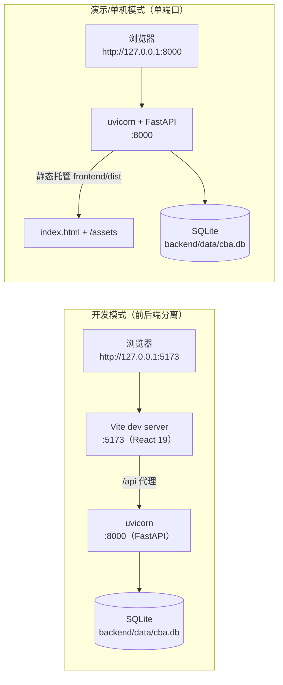
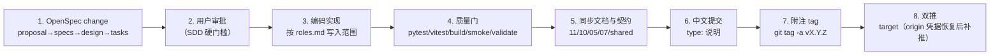

# 部署与运维手册

> 文档编号：CBA-OPS-001 ｜ 版本：v1.1 ｜ 日期：2026-11-08 ｜ 适用基线：git tag **v0.3.4**（2026-11-08，安全补丁版；上一基线 v0.3.3 = `9fbaa93`）
> 关联文档：[README](README.md)、[03-概要设计](03-概要设计.md) §6/§11/§12、[04-详细设计](04-详细设计.md) §9/§10、[07-维护与版本记录](07-维护与版本记录.md)、[10-数据库设计说明书](10-数据库设计说明书.md)、[11-接口设计文档](11-接口设计文档.md)、`CLAUDE.md`
> 关联脚本：`scripts/dev.sh`、`scripts/load_seed.sh`、`scripts/smoke.sh`；配置：`backend/app/config.py`、`frontend/src/api/client.ts`、`frontend/vite.config.ts`

## 1. 文档信息与修订记录

### 1.1 文档信息

| 项 | 内容 |
|---|---|
| 文档编号 / 名称 | CBA-OPS-001 部署与运维手册（Deployment & Operations Manual） |
| 版本 / 日期 | v1.0 / 2026-11-08 |
| 适用系统基线 | **v0.3.4**（安全补丁版）｜文档集版本 v2.0｜质量门 63 pytest / 45 vitest / real build / smoke PASS |
| 部署形态 | **macOS 单机**：后端 uvicorn + 前端构建产物静态托管 + SQLite 单文件；无 Docker / 无 CI / 无云服务 |
| 端口 | 开发 8000（后端）+ 5173（Vite）；演示 8000 单端口；冒烟 8010 |
| 主要读者 | 运维、实施、维护者、接任者、值班 |

### 1.2 修订记录

| 版本 | 日期 | 变更 | 对应基线 |
|---|---|---|---|
| v1.0 | 2026-11-08 | 首次发布：部署架构、环境/安装、配置项、启停、数据管理、发布/回滚、巡检、14 类故障排查、安全与容量、命令速查 | v0.3.3 |
| v1.1 | 2026-11-08 | 同步 v0.3.4：SPA 路径穿越已修（D-19）但明确禁止公网裸奔；导入预览脱敏（D-20）；A-07「200 + 行级错误」；63 测试；巡检/回滚/命令速查加 v0.3.4 | v0.3.4 |

### 1.3 使用约定

- 本手册所有命令均在**仓库根目录** `/Users/apple/Projects/CateringBusinessAnalysis-dshSA` 或标注的子目录执行；已实测（除标注「待确认」项）。
- 「必须执行」的命令不加提示；有风险的操作（删库、覆盖、强推）标注 **⚠️** 并给出备份前置步骤。
- 与 07 手册重叠的部分（版本历史、技术债）只引用不重复；本文聚焦**怎么装、怎么起、怎么备、坏了怎么查**。

## 2. 部署架构

### 2.1 拓扑（单机，两种模式）



### 2.2 端口与路径

| 端口 | 归属 | 用途 | 配置位置 |
|---|---|---|---|
| 8000 | 后端 uvicorn | 接口 `/api/*`、`/docs`、`/openapi.json`；演示模式下兼静态托管 | `--port 8000`、`scripts/dev.sh`、`vite.config.ts` 代理目标 |
| 5173 | Vite dev server | 前端开发热更新；`/api` 代理到 8000 | `frontend/vite.config.ts` `server.port` + `proxy` |
| 8010 | 冒烟脚本临时后端 | `scripts/smoke.sh` 用临时库起一次，跑完即杀 | `smoke.sh` 的 `SMOKE_PORT`（可覆盖） |

### 2.3 关键路径

| 路径 | 说明 | 是否入库 |
|---|---|---|
| `backend/data/cba.db` | 运行数据库（SQLite 单文件） | 否（`.gitignore: backend/data/*.db`） |
| `backend/.venv/` | Python 虚拟环境（Python 3.12） | 否 |
| `backend/seed/*.csv` | 8 类示例数据（与正式导入同一链路） | 是 |
| `frontend/dist/` | 演示用构建产物（real 模式） | 否（`.gitignore: dist/`） |
| `frontend/node_modules/` | 前端依赖 | 否 |
| `backend/.env` | 可选环境变量文件（不在代码里自动加载，见 5.3） | 否（`.gitignore: .env`） |
| `/tmp/cba_smoke.log` | 冒烟脚本后端日志 | 否 |

### 2.4 明确不存在的部署能力（不要照搬其它项目文档）

| 能力 | 现状 |
|---|---|
| Docker / docker-compose | **无**（仓库无 Dockerfile / compose 文件） |
| Kubernetes / Helm / 云部署 | **无** |
| CI/CD（GitHub Actions 等） | **无**，全靠本地脚本与手工步骤 |
| nginx / Caddy 反向代理 | **无**；静态托管由 FastAPI 完成 |
| systemd / launchd 守护进程 | **无**；进程随终端存活（Ctrl+C 退出） |
| 多实例 / 负载均衡 | **无**；SQLite 单文件，单实例才安全 |
| 多租户 / 权限系统 | **无**；单管理员 |

> 任何要求「先用 docker compose 起」的指令都来自其它项目，本仓库不适用。

## 3. 环境要求

### 3.1 版本基线（本机实测）

| 组件 | 要求 | 本机实测 | 说明 |
|---|---|---|---|
| Python | 3.12 | **3.12.13** | `requirements.txt` 已锁版本；3.9 未验证 |
| Node.js | 20+（Vite 8 要求较新） | **v24.22.2** | `npm run build` 需要 |
| npm | 10+ | **11.19.1** | 随 Node 安装 |
| uv（可选） | 任意近期版 | **0.11.3**（Homebrew） | 用于重建 venv / 装依赖 |
| SQLite | 3.x 命令行 | macOS 自带 `sqlite3` | 备份、巡检、排障用 |
| 浏览器 | Chrome（主）、Safari（手工） | — | 目标宽度 ≥ 1440；未做移动端适配 |
| OpenSpec CLI | 1.16.0 | **1.16.0**（`/opt/homebrew/bin/openspec`） | 发布流程校验用 |

### 3.2 磁盘与资源

| 项 | 估算 |
|---|---|
| 仓库 + 依赖（含 `node_modules`、`.venv`） | 约 600 MB–1 GB |
| `frontend/dist` | 约 2.5 MB |
| 数据库（演示） | 约 0.4 MB；1 年数据约 2 MB（见 10 章 §9） |
| 内存 | 后端 < 200 MB，前端构建峰值约 1 GB |
| 网络 | 仅首次 `npm install` / `pip install` 需要；运行时不联外网 |

## 4. 安装步骤

### 4.1 后端（仓库已带 `backend/.venv`，换机时按下述重建）

```bash
cd /Users/apple/Projects/CateringBusinessAnalysis-dshSA/backend
# 方式 A：已有 .venv，直接校验
.venv/bin/python --version            # 期望 Python 3.12.x
.venv/bin/python -c "import fastapi, sqlalchemy, alembic, jwt, bcrypt, openpyxl; print('deps ok')"

# 方式 B：重建（二选一）
uv venv --python 3.12 .venv
uv pip install --python .venv/bin/python -r requirements.txt
# 或
python3.12 -m venv .venv && .venv/bin/pip install -r requirements.txt

# 校验依赖版本（应与 requirements.txt 一致）
.venv/bin/python -c "import fastapi,sqlalchemy,alembic; print(fastapi.__version__, sqlalchemy.__version__, alembic.__version__)"
# 实测期望：0.162.2 2.1.8 1.20.1
```

`requirements.txt`（v0.3.3）：`alembic==1.20.1`、`bcrypt==5.0.0`、`fastapi==0.162.2`、`httpx==0.28.1`、`openpyxl==3.1.5`、`pyjwt==2.15.1`、`pytest==9.2.0`、`python-multipart==0.0.33`、`sqlalchemy==2.1.8`、`uvicorn[standard]==0.54.0`。
> v0.3.3 已**移除 pandas**（代码未引用）。若本机 `.venv` 仍能 `import pandas`，属历史残留，不影响运行，也不应写回 requirements。

### 4.2 前端

```bash
cd /Users/apple/Projects/CateringBusinessAnalysis-dshSA/frontend
npm install                          # 首次或 lock 变更后
npm test                             # 期望 45 passed（实测 2s）
npm run build                        # tsc -b && vite build；期望成功
```

前端关键依赖（`package.json`）：React 19 + TypeScript ~7.0.2 + Vite ^8.3.6 + antd ^6.7.0 + ECharts ^6.1.0 + react-router-dom ^7.18.5 + @tanstack/react-query ^5.107.1 + vitest ^5.1.0。

### 4.3 安装后自检（一次跑完）

```bash
cd /Users/apple/Projects/CateringBusinessAnalysis-dshSA
bash scripts/smoke.sh                # pytest + 构建 + 临时库灌数 + 关键接口数字断言
```

实测输出结尾（2026-11-08）：

```text
OK /api/health 包含 ok
OK /api/analysis/overview 包含 1000
OK /api/analysis/revenue/same-store 包含 857.23
OK /api/analysis/revenue/channel 包含 394.23
OK /api/analysis/revenue/product?scope=all 包含 770933.33
== 前端构建产物存在 ==
SMOKE PASS
```

## 5. 配置项

### 5.1 后端环境变量（`backend/app/config.py`）

| 变量 | 默认值 | 影响 | 部署建议 |
|---|---|---|---|
| `CBA_DATABASE_URL` | `sqlite:///<repo>/backend/data/cba.db` | 数据库地址；冒烟/测试用临时库 | 生产改为绝对路径或 PG DSN |
| `CBA_ADMIN_USERNAME` | `admin` | 单管理员账号 | 可保留 |
| `CBA_ADMIN_PASSWORD` | `admin123` | 启动时 bcrypt 现算哈希 | **必须修改** |
| `CBA_ADMIN_PASSWORD_HASH` | 无（读环境变量，优先于明文） | 直接给 bcrypt 哈希，避免明文入环境 | 推荐生产使用 |
| `CBA_SESSION_SECRET` | `dev-only-change-me-32bytes-minimum-key` | JWT 签名密钥；改动后所有会话失效 | **必须替换为 32 字节以上随机串** |
| `CBA_PLATFORM_FEE_RATE_MAX` | `0.15` | 平台费用率红线（渠道洞察 `status`） | 按业务口径调整 |
| `CBA_GROSS_ROI_MIN` | `1.0` | 毛利 ROI 下限 | 同上 |
| `CBA_SALES_ROI_MIN` | `4.0` | 销售 ROI 下限 | 同上 |
| `CBA_FUNNEL_CVR_DROP` | `0.01` | 漏斗单层转化环比告警阈值（1pp） | 同上 |
| `CBA_TOP_N` | `3` | 洞察返回条数 | 同上 |
| `CBA_PLATFORM_GROSS_MARGIN` | `0.6` | 渠道毛利 ROI 用的平台毛利率（表8 口径） | 同上 |

固定不可配项（写在代码里）：cookie 名 `cba_session`、`Max-Age=43200`（12h）、`HttpOnly`、`SameSite=Lax`、`Path=/`、CORS 白名单、上传上限 10MB。

生成随机密钥的可用命令（实测）：

```bash
python3 -c "import secrets; print(secrets.token_urlsafe(48))"
```

### 5.2 前端环境变量（`frontend/src/api/client.ts`）

| 变量 | 默认 | 影响 | 示例 |
|---|---|---|---|
| `VITE_API_MODE` | `mock` | `mock`=内置同形状数据（断网可演示）；`real`=请求后端 | `VITE_API_MODE=real npm run dev` |
| `VITE_API_BASE` | `/api` | real 模式的接口前缀 | 一般不改；开发走 Vite 代理 |

> **构建期固化**：`VITE_*` 在 `npm run build` 时打入产物。演示构建必须用 `VITE_API_MODE=real npm run build`；构建完再改环境变量无效，需重新构建。

### 5.3 环境变量怎么给

```bash
# 方式 A：命令行前缀（仅本次命令生效）
cd backend && CBA_ADMIN_PASSWORD='改我' CBA_SESSION_SECRET='<随机串>' .venv/bin/python -m uvicorn app.main:app --port 8000

# 方式 B：写 backend/.env（注意：代码不自动加载 .env！）
# 需用 export 或 env 命令注入，例如：
cd backend && set -a && . ./.env && set +a && .venv/bin/python -m uvicorn app.main:app --port 8000
```

> 重要：`config.py` 只读 `os.getenv`，**没有** dotenv 加载逻辑；把变量写进 `.env` 后必须 `set -a; . ./.env; set +a`（bash）或使用 `env $(cat .env | xargs)` 才能生效。直接写文件不会自动加载。

## 6. 启动 / 停止

### 6.1 一键开发（后端 8000 + 前端 5173）

```bash
cd /Users/apple/Projects/CateringBusinessAnalysis-dshSA
bash scripts/dev.sh
# 输出：后端 http://127.0.0.1:8000/docs ｜ 前端 http://127.0.0.1:5173 ｜ Ctrl+C 退出
```

脚本行为（已读代码核实）：先检查 `backend/.venv/bin/python` 存在；后端 `--reload --port 8000`；前端 `VITE_API_MODE="${VITE_API_MODE:-real}" npm run dev -- --port 5173`。
注意：**dev.sh 的前端默认是 real 模式**（与 CLAUDE.md 旧描述「默认 mock」不同，以脚本为准）；要 mock 演示用 `VITE_API_MODE=mock bash scripts/dev.sh`。

### 6.2 分别启动（推荐排障时使用，日志清晰）

```bash
# 终端 1：后端
cd /Users/apple/Projects/CateringBusinessAnalysis-dshSA/backend
.venv/bin/python -m uvicorn app.main:app --port 8000
# 终端 2：前端（real 联调）
cd ../frontend
VITE_API_MODE=real npm run dev -- --port 5173
```

### 6.3 演示/单机模式（单端口 8000，离线可讲）

```bash
# 步骤顺序不能反：FastAPI 在启动时检测 frontend/dist 是否存在
cd /Users/apple/Projects/CateringBusinessAnalysis-dshSA/frontend
VITE_API_MODE=real npm run build
cd ../backend
.venv/bin/python -m uvicorn app.main:app --port 8000
# 浏览器打开 http://127.0.0.1:8000（登录 admin/admin123）
```

> 若先起后端再构建前端：SPA 与静态托管**不会注册**（只在模块 import 时检测一次 dist），需重启后端。构建后仍看不到页面时，先重启后端再排查。
> 安全提示：v0.3.4（D-19）起 SPA fallback 经 `_resolve_dist_file` + `is_relative_to(dist)` 校验，只服务 `frontend/dist` 内文件，`GET /../backend/...` 不再读到仓库源码（`curl --path-as-is` 实测返回 `index.html`）。

### 6.4 停止

```bash
# 前台：Ctrl+C
# 后台/残留进程：
lsof -nP -iTCP:8000 -sTCP:LISTEN        # 查 PID
kill <PID>                              # 温和停止
kill -9 <PID>                           # 仅当无响应（可能丢未提交事务）
lsof -nP -iTCP:5173 -sTCP:LISTEN
```

### 6.5 后台运行与日志（长时间演示）

```bash
cd /Users/apple/Projects/CateringBusinessAnalysis-dshSA/backend
nohup .venv/bin/python -m uvicorn app.main:app --port 8000 > /tmp/cba_backend.log 2>&1 &
echo $! > /tmp/cba_backend.pid
tail -f /tmp/cba_backend.log            # 观察启动与访问日志
kill "$(cat /tmp/cba_backend.pid)"      # 停止
```

启动成功标志：日志出现 `Uvicorn running on http://127.0.0.1:8000`；`curl -s localhost:8000/api/health` 返回 `{"status":"ok"}`。

## 7. 初始化 / 重置 / 备份 / 恢复

### 7.1 首次初始化（空库灌示例数据）

```bash
cd /Users/apple/Projects/CateringBusinessAnalysis-dshSA/backend
.venv/bin/python -m app.seeds.load_seed
# 输出示例：
#   维度：{'brand': 1, 'store': 15, 'account': 10, 'channel': 10, 'series': 8, 'period': 24}
#   - 月度利润表 01_月度利润表.csv 批次 1 写入 240 行 …（8 类）
```

幂等规则：已有 `committed` 的 `pl_monthly` 批次时拒绝，提示改用 `--force` 或接口。

### 7.2 重置（**⚠️ 会清空全部数据**）

```bash
cd /Users/apple/Projects/CateringBusinessAnalysis-dshSA
# 先备份！
cp backend/data/cba.db "backend/data/cba.db.bak.$(date +%Y%m%d-%H%M)"
bash scripts/load_seed.sh               # 删库后重新灌数（脚本内部 rm -f data/cba.db）
# 等价的显式命令：
cd backend && rm -f data/cba.db && .venv/bin/python -m app.seeds.load_seed
```

### 7.3 覆盖重载（保留库，重灌示例数据）

```bash
cd /Users/apple/Projects/CateringBusinessAnalysis-dshSA
bash scripts/load_seed.sh --force
# 或接口：curl -s -b /tmp/c.jar -X POST "localhost:8000/api/seeds/load?force=true"
```

> 覆盖重载会让旧事实行变为历史行（`superseded_by` 非空）但不删除，`pl_fact` 行数会从 240 涨到 480（生效仍 240），属正常设计（见 10 章 §7.6）。

### 7.4 备份

```bash
cd /Users/apple/Projects/CateringBusinessAnalysis-dshSA
# 冷备（推荐）：先停后端
cp backend/data/cba.db "backend/data/cba.db.bak.$(date +%Y%m%d-%H%M)"
sqlite3 "backend/data/cba.db.bak.$(date +%Y%m%d-%H%M)" 'pragma integrity_check;'   # 期望 ok

# 在线备份（服务不停机）
sqlite3 backend/data/cba.db ".backup 'backend/data/cba.db.online.$(date +%Y%m%d-%H%M)'"
sqlite3 "backend/data/cba.db.online.$(date +%Y%m%d-%H%M)" 'pragma integrity_check;'
```

### 7.5 恢复

```bash
cd /Users/apple/Projects/CateringBusinessAnalysis-dshSA
# 1) 停后端；2) 保留故障库
cp backend/data/cba.db backend/data/cba.db.broken
# 3) 覆盖
cp backend/data/cba.db.bak.20261108-1100 backend/data/cba.db
# 4) 校验并起服务
sqlite3 backend/data/cba.db 'pragma integrity_check;'                                   # ok
sqlite3 backend/data/cba.db "select count(*) from pl_fact where superseded_by is null;"  # 期望 240
cd backend && .venv/bin/python -m uvicorn app.main:app --port 8000
# 5) 登录后核对总览收入 = 1000（curl 见 10 章）
```

### 7.6 数据文件位置与权限

- 库文件：`backend/data/cba.db`（`config.py` 的 `DATA_DIR` 为 `backend/data`，启动时自动创建目录）。
- 换盘/换机迁移：停库 → 拷贝 `cba.db` 到新机同一路径 → 起服务；无需其它文件。
- 权限建议（含经营数据）：

```bash
chmod 600 backend/data/cba.db
chmod 700 backend/data
ls -l backend/data/cba.db     # 期望 -rw------- 
```

## 8. 发布流程

### 8.1 流程（OpenSpec → 测试 → tag → 双推）



### 8.2 质量门命令（必须全绿）

```bash
cd /Users/apple/Projects/CateringBusinessAnalysis-dshSA
(cd backend && .venv/bin/python -m pytest)                     # 期望 63 passed
(cd frontend && npm test)                                      # 期望 45 passed
(cd frontend && VITE_API_MODE=real npm run build)              # 期望构建成功
bash scripts/smoke.sh                                          # 期望 SMOKE PASS
openspec validate build-catering-analysis-platform --strict     # 期望通过（1.16.0 实测）
```

### 8.3 提交与打 tag

```bash
cd /Users/apple/Projects/CateringBusinessAnalysis-dshSA
git status                                   # 只 add 本次改动，禁止 git add -A
git add docs/engineering/10-数据库设计说明书.md docs/engineering/11-接口设计文档.md docs/engineering/12-部署与运维手册.md
git commit -m "fix: v0.3.4 安全补丁（SPA 路径穿越/导入预览脱敏）并同步文档集 v2.0"
git tag -a v0.3.4 -m "v0.3.4：安全补丁（D-19/D-20）+ 文档集 v2.0（63 pytest / 45 vitest / smoke PASS）"
git push target main && git push target --tags
git push origin main && git push origin --tags   # origin 无权限时会 403，见 11.13
```

### 8.4 发布后核对

```bash
git tag -n | tail -3                                   # 新 tag 有说明
git show v0.3.4 --stat | head -20                      # 变更文件符合预期（后端代码/测试 + 文档集）
curl -s localhost:8000/api/health                      # {"status":"ok"}（服务需重启加载新代码）
```

## 9. 回滚

### 9.1 代码回滚（按 tag）

```bash
cd /Users/apple/Projects/CateringBusinessAnalysis-dshSA
git tag -l                                       # v0.3.0 … v0.3.4（v0.3.4 = 安全补丁 + 文档集 v2.0）
git log --oneline -5
# 方式 A：回到旧 tag 验证（临时）
git checkout v0.3.3
# 方式 B：用新提交反向修复（推荐，保留历史）
git revert <坏提交sha>                            # 生成反向提交
# 方式 C：硬回退（⚠️ 会改写分支，仅本地/已协调时用）
git reset --hard v0.3.3     # 回退到上一基线（v0.3.4 之前）
```

回滚后必须重跑质量门（8.2）并重启后端。

### 9.2 数据库回滚（按备份）

见 7.5。要点：先停服务、先备份故障库、恢复后跑 `integrity_check` 与关键字核对（`pl_fact` 生效 240 行、总览收入 1000）。

### 9.3 前端产物回滚

```bash
cd /Users/apple/Projects/CateringBusinessAnalysis-dshSA/frontend
rm -rf dist                                       # 删除错误产物
git checkout v0.3.3 -- .                          # 如代码已回滚则跳过
VITE_API_MODE=real npm run build
# 重启后端（静态托管在启动时检测 dist）
```

## 10. 监控与巡检

### 10.1 巡检清单（每次演示/交付前跑一遍）

| # | 检查 | 命令 | 期望 |
|---|---|---|---|
| 1 | 后端存活 | `curl -s localhost:8000/api/health` | `{"status":"ok"}` |
| 2 | 登录 | `curl -s -c /tmp/c.jar -X POST localhost:8000/api/auth/login -H 'Content-Type: application/json' -d '{"username":"admin","password":"admin123"}'` | `{"username":"admin"}` |
| 3 | 数据就绪 | `curl -s -b /tmp/c.jar "localhost:8000/api/data-status?period=2025-09"` | `baseline_ready=true`，8 个数据集 `ready=true` |
| 4 | 关键数字 | `curl -s -b /tmp/c.jar localhost:8000/api/analysis/overview` | 含 `1000`、`112.7` |
| 5 | 同店/渠道 | `curl -s -b /tmp/c.jar localhost:8000/api/analysis/revenue/same-store` | 含 `857.23` |
| 6 | 批次健康 | `curl -s -b /tmp/c.jar "localhost:8000/api/imports?limit=20"` | 无异常 `status`；draft 不堆积 |
| 7 | 库完整性 | `sqlite3 backend/data/cba.db 'pragma integrity_check;'` | `ok` |
| 8 | 页面冒烟 | 浏览器走 `docs/demo/演示脚本.md` 动线 | 无白屏、无 console error |
| 9 | 预算空态 | 顶栏切「预算」 | 显示「预算未导入」，不白屏 |
| 10 | 一键冒烟 | `bash scripts/smoke.sh` | `SMOKE PASS` |
| 11 | 安全回归 | `cd backend && .venv/bin/python -m pytest -k "path_traversal or preview_hides_internal"` | 2 passed（D-19/D-20） |
| 12 | 版本一致 | `curl -s localhost:8000/openapi.json` 后用 `python3 -m json.tool` 查看 `info.version` | `"version": "0.3.4"` |

### 10.2 日志与可观测性现状

| 项 | 现状 |
|---|---|
| 访问日志 | uvicorn 标准输出（前台终端或 `nohup ... > log`） |
| 异常日志 | 同上，含堆栈；无结构化 JSON、无请求 ID |
| 指标/告警/链路追踪 | **无** |
| 数据变更审计 | `import_batch` 表（批次、操作人、时间、行数、错误）可作为雏形 |
| 建议 | 演示期用 `tail -f`；转生产后补结构化日志与告警（二期） |

### 10.3 日常巡检频率建议（待确认）

演示前必跑 10.1 全量；连续运行期间每日 1 次第 1–7 项；每次导入数据后核对第 6 项与 `/api/data-status`。

## 11. 故障排查

> 按「现象 → 定位 → 处理」组织。所有命令可复制执行；带 ⚠️ 的操作先备份。

| # | 现象 | 可能原因 | 处理 |
|---|---|---|---|
| 11.1 | 启动报 `Address already in use` | 8000/5173 被旧进程占用 | `lsof -nP -iTCP:8000 -sTCP:LISTEN` → `kill <PID>`；或换端口 `--port 8001` |
| 11.2 | 页面 401 / 反复跳登录 | cookie 丢失；后端重启后 `CBA_SESSION_SECRET` 变化；跨端口访问导致 cookie 不发送 | 重新登录；确认 secret 未变；统一用 `127.0.0.1` 访问（避免 `localhost`/`127.0.0.1` 混用） |
| 11.3 | 登录报 `账号或密码错误` | 改过 `CBA_ADMIN_PASSWORD` 或残留旧进程 | 确认启动命令带了正确变量；`lsof` 杀掉旧进程重启 |
| 11.4 | 页面整页空白 | 前端渲染异常；接口 4xx/5xx；dist 与后端版本不匹配 | 看浏览器 console 与 Network；`curl` 对应接口；重新 `VITE_API_MODE=real npm run build` 并重启后端 |
| 11.5 | 访问 `http://127.0.0.1:8000` 是 404/JSON 而非页面 | 启动早于构建（dist 检测只发生一次）或 dist 不存在 | 先构建再**重启**后端（6.3） |
| 11.6 | 未知接口返回 200 HTML（旧版本） | v0.3.3 前 SPA fallback 吞掉 `/api/*` | 升级到 v0.3.3+（`/api/{rest}` 404 兜底）；v0.3.4 当前行为：404 JSON，SPA 只处理非 `/api` 路径 |
| 11.7 | 顶栏切「预算/上期」无数据 | 一期收入分析只支持同期；预算仅导入营业收入 | 属**预期**：显示「预算未导入」空态；演示动线保持「同期」 |
| 11.8 | 累计口径同店显示「—」 | 门店收入未覆盖当年全部月份 | 属预期：不拿单月冒充累计；导入月度门店收入后自动恢复 |
| 11.9 | 导入报缺列/未知科目 | 表头与模板不一致 | 下载模板（导入页按钮或 `GET /api/imports/templates/<key>.xlsx`）；未知科目用 `account_mapping` 映射 |
| 11.10 | 导入报「不是有效的 xlsx」 | 扩展名被改 / 文件损坏 / 旧 `.xls` | 用 Excel 另存为 `.xlsx`；仅支持 `.xlsx/.xlsm/.csv/.txt`、≤10MB |
| 11.11 | CSV 中文乱码或解析失败 | 文件既不是 UTF-8 也不是 GBK | Excel 另存为「CSV UTF-8」；v0.3.3 起支持 UTF-8(含 BOM) → GBK 回退。A-07 口径：编码失败**不是 400**，而是 HTTP 200 + 行级错误「CSV 编码不支持」（draft 不入库） |
| 11.12 | `npm run build` 报 TS 找不到刚加的导出 | `node_modules/.tmp` 下的 tsbuildinfo 陈旧 | `rm -rf frontend/node_modules/.tmp` 后重跑 `npm run build` |
| 11.13 | `git push origin` 403 | 本机 GitHub 身份为 `c4thmy`，对 `cfmypian/…-dshSA` 无写权限 | 换 `cfmypian` 凭据，或先只推 `target` 并记录待补推（见 07 §2） |
| 11.14 | `database is locked` | 多个 uvicorn/进程指向同一 db；长事务；并发写 | 只跑一个后端实例；`lsof backend/data/cba.db` 查占用；重启后端；必要时启用 WAL（10 章 §11.3） |
| 11.15 | 数据导入成功但页面数字没变 | 批次仍是 `draft` 未 commit；或看的是另一期间 | 导入页确认入库；`GET /api/imports` 看 `status`；核对 `period` 筛选 |
| 11.16 | 前端接口 404 | 后端未起 / 少 `/analysis` 前缀 / 构建为非 real 模式 | `curl localhost:8000/api/health`；按 11 接口文档核对路径；用 `VITE_API_MODE=real` 重新构建 |
| 11.17 | `npm install` 提示 fsevents install scripts 被拦 | npm 安全策略 | 不影响构建，可忽略或按提示 approve |
| 11.18 | 后端启动后 `/docs` 打不开 | 端口/路径错误（`/docs` 在 8000 根路径，不是 `/api/docs`） | 打开 `http://127.0.0.1:8000/docs` |
| 11.19 | 担心 SPA 静态托管读到仓库文件 | v0.3.3 及以前 `_dist / full_path` 未做 resolve 约束（S-01） | v0.3.4 已修（D-19）：`curl --path-as-is "localhost:8000/../backend/app/config.py"` 返回 `index.html` 而非源码；回归 `test_spa_path_traversal_is_blocked` |

### 11.1 端口占用排查（展开）

```bash
lsof -nP -iTCP:8000 -sTCP:LISTEN
# 输出示例：python 12345 apple 7u IPv4 ... TCP 127.0.0.1:8000 (LISTEN)
kill 12345
```

### 11.2 快速判定「是前端还是后端问题」

```bash
curl -s -o /dev/null -w "%{http_code}\n" http://127.0.0.1:8000/api/health   # 200 → 后端正常
curl -s -o /dev/null -w "%{http_code} %{content_type}\n" http://127.0.0.1:8000/   # 200 text/html → dist 已托管
```

## 12. 安全加固

### 12.1 部署前必改（硬性）

| 项 | 操作 | 验证 |
|---|---|---|
| 管理员密码 | `export CBA_ADMIN_PASSWORD='强密码'`（或提供 `CBA_ADMIN_PASSWORD_HASH`） | 旧密码登录应 401 |
| 会话密钥 | `export CBA_SESSION_SECRET="$(python3 -c 'import secrets;print(secrets.token_urlsafe(48))')"` | 改后旧 cookie 失效（需重新登录） |
| 库文件权限 | `chmod 600 backend/data/cba.db && chmod 700 backend/data` | `ls -l` 为 `-rw-------` |
| `.env` 权限 | `chmod 600 backend/.env`（如使用） | 同上 |
| 不入库 | 确认 `.gitignore` 含 `.env`、`backend/data/*.db`、`dist/` | `git status` 无敏感文件 |
| 路径穿越（已修） | v0.3.4 已修 SPA 路径穿越（D-19），**但仍不得公网裸奔** | 见 12.2；外网必须 HTTPS + 反代 + 网关限制 |

### 12.2 公网部署（当前未实现，属二期/待确认）

| 项 | 现状 | 上线前必须做 |
|---|---|---|
| HTTPS | 无；本地 HTTP | 加反向代理（nginx/Caddy）或云 LB 证书；**禁止公网裸跑 8000** |
| Cookie `Secure` | 代码未设（`main.py` 的 `set_cookie` 无 `secure=True`） | **改代码**加 `secure=True` 并全站 HTTPS |
| CORS | 白名单仅 `127.0.0.1:5173`、`localhost:5173` | 把生产域名加入 `main.py` 白名单 |
| CSRF | 无 token；靠 `SameSite=Lax` 缓解 | 跨站场景需评估补 token |
| 访问面 | 默认监听全部网卡（`--host` 未限制） | **必须**绑定 `--host 127.0.0.1` 或加网关白名单/鉴权，禁止公网裸奔 |
| 速率限制/防爆破 | 无 | 网关层加限流 |
| 日志脱敏/审计 | 无 | 二期补结构化日志 |
| 备份加密 | 无 | 按客户要求对备份加密存放 |

> v0.3.4 安全补丁摘要：**已修** D-19（SPA 路径穿越，`_resolve_dist_file` + `is_relative_to`）与 D-20（导入预览脱敏，`preview[]` 不再含 `_store_id`/`_accounts`）。**未修**：默认凭据/密钥、无 TLS、Cookie 无 Secure、无登录限流、无安全响应头、`/docs` 公开。因此**禁止公网裸奔**：必须 HTTPS + `Secure` + 改密钥/密码 + 限制访问（127.0.0.1 绑定或网关白名单）；按 17 的 S-02~S-10 逐项加固后再评估。

### 12.3 数据安全

- 库内含真实经营数据（收入、成本、费率），禁止提交 Git、禁止外发；系统无大模型、无遥测、不向第三方发送数据。
- 如需给外部演示，使用示例库（`load_seed`）而非生产库。
- 导入上传的原始文件不落盘（只存解析结果与批次元数据），但仍建议不要在公用机器上留原始 Excel。
- 导入预览已脱敏（v0.3.4 D-20）：`preview[]` 只回业务列，不再带 `_store_id`/`_accounts` 等内部键。

## 13. 性能与容量

### 13.1 前端构建产物体积（v0.3.4 实测，与 v0.3.3 一致）

| 产物 | 体积 | gzip | 说明 |
|---|---|---|---|
| `esm-*.js`（ECharts） | **1,134,207 B** | 372,951 B | 最大 chunk，已知技术债 |
| `chunk-*.js`（公共依赖 chunk） | 450,521 B | — | UI/工具类公共依赖 |
| `index-*.js`（主入口） | 270,292 B | — | 路由级 `React.lazy` 已拆分 |
| `DataTable-*.js` | 200,018 B | — | 表格组件 |
| `frontend/dist` 总计 | 约 2.5 MB | — | 演示可接受；弱网偏大 |

优化方向（二期）：按需引入 ECharts 图表类型、手动 `manualChunks`、开启 gzip/brotli 预压缩。构建时若出现 `chunks larger than 500 kB` 警告属预期。

### 13.2 后端与数据库

| 项 | 现状 | 建议 |
|---|---|---|
| 进程模型 | 单 uvicorn 进程（`--reload` 仅开发） | **不要** `--workers > 1` 指向 SQLite（写锁冲突） |
| 查询 | 服务层多次 `select` + Python 内存聚合 | 数据量小够用；上万行后下推聚合/补索引 |
| 数据库 | SQLite `journal_mode=delete`，无 WAL/busy_timeout | 演示不改；转生产见 10 章 §11.3 |
| 导入耗时 | 8 类示例全量 < 5s；240 行利润表秒级 | — |
| 分析接口 | 毫秒级（`smoke.sh` 断言路径 < 1s） | — |
| 缓存 | react-query `staleTime 30s`、`retry 1`、`refetchOnWindowFocus false`；`data-status` 10s | 切筛选取数平滑，无需额外缓存 |

### 13.3 容量估算（摘要，详见 10 章 §9）

当前演示库 477 行 / 约 0.4 MB；1 年正常导入约 2 024 行 / 2 MB；每月重导 1 次约翻倍（历史行保留）。SQLite 单文件 1 GB 内、读多写少场景足够；超百万行或需并发写时迁移 PostgreSQL。

## 14. 附录：命令速查

### 14.1 一页命令表

```bash
# ===== 目录 =====
cd /Users/apple/Projects/CateringBusinessAnalysis-dshSA

# ===== 安装 =====
cd backend && uv venv --python 3.12 .venv && uv pip install --python .venv/bin/python -r requirements.txt && cd ..
cd frontend && npm install && cd ..

# ===== 启动 =====
bash scripts/dev.sh                                              # 8000 + 5173（前端 real）
cd backend && .venv/bin/python -m uvicorn app.main:app --port 8000
cd frontend && VITE_API_MODE=real npm run dev -- --port 5173
cd frontend && VITE_API_MODE=real npm run build && cd ../backend && .venv/bin/python -m uvicorn app.main:app --port 8000   # 演示单端口

# ===== 停止 =====
lsof -nP -iTCP:8000 -sTCP:LISTEN
kill <PID>

# ===== 后端后台运行 =====
cd backend && nohup .venv/bin/python -m uvicorn app.main:app --port 8000 > /tmp/cba_backend.log 2>&1 &
tail -f /tmp/cba_backend.log

# ===== 数据 =====
cd backend && .venv/bin/python -m app.seeds.load_seed             # 空库灌数
cd .. && bash scripts/load_seed.sh --force                        # 覆盖重载
cd backend && rm -f data/cba.db && .venv/bin/python -m app.seeds.load_seed   # ⚠️ 重置

# ===== 备份 / 恢复 =====
cp backend/data/cba.db "backend/data/cba.db.bak.$(date +%Y%m%d-%H%M)"
sqlite3 backend/data/cba.db ".backup 'backend/data/cba.db.online'"
sqlite3 backend/data/cba.db 'pragma integrity_check;'
cp backend/data/cba.db.bak.20261108-1100 backend/data/cba.db      # 恢复

# ===== 测试 / 质量门 =====
cd backend && .venv/bin/python -m pytest                          # 63 passed
cd frontend && npm test                                           # 45 passed
cd frontend && VITE_API_MODE=real npm run build
bash scripts/smoke.sh                                             # SMOKE PASS
openspec validate build-catering-analysis-platform --strict

# ===== 接口自检 =====
curl -s localhost:8000/api/health
curl -s -c /tmp/c.jar -X POST localhost:8000/api/auth/login -H 'Content-Type: application/json' -d '{"username":"admin","password":"admin123"}'
curl -s -b /tmp/c.jar "localhost:8000/api/data-status?period=2025-09"
curl -s -b /tmp/c.jar "localhost:8000/api/analysis/overview?period=2025-09"

# ===== 发布 / 回滚 =====
git status && git add <本次文件> && git commit -m "docs: 说明"
git tag -a v0.3.4 -m "v0.3.4：安全补丁（D-19/D-20）+ 文档集 v2.0" && git push target main && git push target --tags
git checkout v0.3.3            # 临时回到旧版本
git revert <sha>               # 反向修复
```

### 14.2 值班速查卡

| 问题 | 第一条命令 |
|---|---|
| 服务没起来 | `lsof -nP -iTCP:8000 -sTCP:LISTEN` |
| 接口 401 | `curl -s -c /tmp/c.jar -X POST localhost:8000/api/auth/login -H 'Content-Type: application/json' -d '{"username":"admin","password":"admin123"}'` |
| 页面空白 | 浏览器 console + `curl -s localhost:8000/api/health` |
| 数据不对 | `curl -s -b /tmp/c.jar localhost:8000/api/data-status?period=2025-09` |
| 库坏了 | `sqlite3 backend/data/cba.db 'pragma integrity_check;'` |
| 怀疑版本不对 | `git describe --tags --always && git log --oneline -1` |
| 怀疑路径穿越/安全 | `curl -s --path-as-is -o /dev/null -w "%{http_code}\n" "localhost:8000/../backend/app/config.py"`（期望 200 且为 HTML，不是源码） |
| 全面体检 | `bash scripts/smoke.sh` |

### 14.3 待确认项

| # | 事项 | 现状 | 处置建议 |
|---|---|---|---|
| O1 | 公网部署方案（HTTPS/Secure/CORS/限流） | 未实现；D-19 路径穿越已在 v0.3.4 修复，其余安全项仍缺 | 二期立项，见 12.2 / 17 |
| O2 | 守护进程（launchd/systemd） | 无 | 演示期 nohup 足够；生产需补 |
| O3 | 日志轮转与保留 | 无（写 `/tmp` 或终端） | 生产前补 logrotate/结构化日志 |
| O4 | SQLite WAL 与 `busy_timeout` | 未启用 | 演示不改；并发需求出现再评估 |
| O5 | 备份异地与加密 | 无 | 按客户合规要求确定 |
| O6 | `origin` 远程推送权限 | 403（本机身份 c4thmy） | 换凭据或调整远程（07 §2 已登记） |
