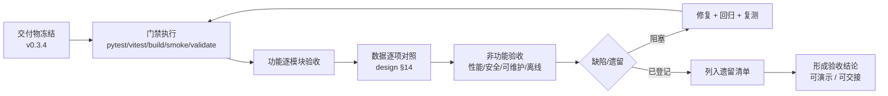

# 项目验收与总结报告 · 餐饮经营分析系统（一期）

> 文档编号：**CBA-ACC-001** ｜ 版本：**v1.1** ｜ 日期：**2026-11-08** ｜ 适用基线：**v0.3.4**（2026-11-08；`main.py` version 0.3.4，tag 随本次统稿发布）
> 所属文档集：软件工程过程文档集 **v2.0**（01–18）｜ 验收对象：一期 Demo（2026-11-15 培训课演示范围）
> 关联文档：[01-需求分析](01-需求分析.md)、[03-概要设计](03-概要设计.md)、[05-测试文档](05-测试文档.md)、[07-维护与版本记录](07-维护与版本记录.md)、[08-可行性研究报告](08-可行性研究报告.md)、[09-项目开发计划](09-项目开发计划.md)、`openspec/changes/build-catering-analysis-platform/{proposal,design,tasks}.md`、`shared/fixtures/`、`docQA/20261108_0615_*.md`

## 1. 文档信息

### 1.1 文档信息

| 项 | 内容 |
|---|---|
| 文档编号 / 名称 | CBA-ACC-001 / 项目验收与总结报告 |
| 当前版本 / 状态 | v1.0 / 已评审（验收结论：通过，附条件） |
| 编写日期 | 2026-11-08 |
| 适用基线 | `v0.3.4`（一期 Demo 完成 + 安全修复；63 pytest / 45 vitest / real build / smoke PASS） |
| 验收对象 | 一期：登录、框架、筛选、8 类导入、总览、利润、收入全链路、6 骨架页 |
| 验收方式 | 自动化测试 + 接口数字断言 + 真实后端走查 + 截图留档 + 设计/规格对照 |
| 主要读者 | 决策人、业务方、PM、架构、测试、实施、接任维护者 |
| 结论语气 | 只写有证据的结论；未验证项写「有条件通过 / 未验证」，不夸大 |

### 1.2 修订记录

| 版本 | 日期 | 修订人 | 变更摘要 | 对应基线 |
|---|---|---|---|---|
| v1.0 | 2026-11-08 | 项目组（测试主笔，PM/架构会签） | 首次编写：交付物、验收依据、功能/数据/非功能验收、测试与评审结论、遗留问题、偏差、结论与经验教训 | `v0.3.3` |
| v1.1 | 2026-11-08 | 项目组 | 同步 `v0.3.4`：63 pytest（test_api 34）、任务 49/66、缺陷扩为 D-01~D-20（14+4+2）、补公网部署安全条件 | `v0.3.4` |

### 1.3 验收组织与职责

| 角色 | 验收职责 | 本次执行 |
|---|---|---|
| 项目负责人（Lead） | 组织验收、合并结论、关闭项目 | 主持 |
| 产品 / PM | 范围与验收标准符合性 | 会签 |
| 架构 | 技术约束、数据模型、接口契约 | 会签 |
| 数据 | 数字复现、接口断言、导入链路 | 执行 |
| 前端 | 页面可用性、空态、断网模式 | 执行 |
| 评审官（独立） | 逐条对 specs、提阻塞意见 | 已出具 14 项 |
| 测试 | 测试证据、缺陷闭环、本报告 | 主笔 |
| 文档 / 演示 | 演示动线、截图、话术 | 执行 |
| 业务方 / 用户 | 演示验收（2026-11-15） | **待执行** |

### 1.4 术语

| 术语 | 含义 |
|---|---|
| 验收数字 | design §14 的 2025-09 vs 2024-09 系列数字，前后端与冒烟三方共用 |
| 口径 | 数据取数范围与取整方式；四套收入合计见 `data-caliber-notes.md` |
| 有条件通过 | 范围内功能达标，但存在已知限制或未验证项，需按条件使用 |
| 骨架页 | 二期模块占位页：可见、可导航、标注「二期开放」、不可计算 |
| 尾差 | 展示值相加与合计不一致，由源表取整导致，不强行对齐 |

## 2. 项目概况与目标

### 2.1 项目概况

| 项 | 内容 |
|---|---|
| 项目名称 | 餐饮经营分析系统（Catering Business Analysis） |
| 建设方式 | 一人指挥 + 多角色 Agent（PM/架构/数据/前端/评审/文档），OpenSpec 留痕 |
| 一期周期 | 计划 D0 2026-11-08 → D7 2026-11-15（演示日）；实际 D1–D6 于 11-08 完成 |
| 当前基线 | `v0.3.4`（2026-11-08）；文档集 v2.0 |
| 技术栈 | 后端 Python 3.12 + FastAPI 0.162 + SQLAlchemy 2.1 + Alembic + SQLite；前端 React 19 + TS 7 + Vite 8 + antd 6 + ECharts 6 |
| 规模 | 16 张业务表（8 维 + 8 事实）、23 条业务路径 / 24 个操作、17 条前端路由、8 类导入 |
| 质量现状 | 63 pytest（test_api 34）、45 vitest、real 构建通过、`scripts/smoke.sh` PASS、`openspec validate --strict` 通过 |

### 2.2 项目目标与达成

| 编号 | 目标 | 验收口径 | 达成情况 |
|---|---|---|---|
| O-1 | 2026-11-15 前交付可演示系统 | 演示动线可走完 | 已交付，待现场演示 |
| O-2 | 数字与 Excel 一致 | design §14 全部复现 | 达成 |
| O-3 | 15 分钟能讲完、断网可讲 | 6 段动线 + mock | 达成 |
| O-4 | 为二期留骨架 | 6 骨架页 + 17 项任务 | 达成 |

### 2.3 验收范围

| 范围内（本次验收） | 范围外（不适用/二期） |
|---|---|
| 登录、应用框架、全局筛选 | 多账号、角色权限、多租户 |
| 8 类数据导入、批次、覆盖、回滚、模板下载 | POS/外卖平台 API 直连 |
| 经营总览（4 KPI + 利润桥 + 结论） | 预算达成、经营评分、板块汇总（占位） |
| 营业利润对比（利润表 + 利润桥） | 完整预算/上期基准链路 |
| 收入分析 5 页 + 门店/渠道 2 个下钻页 | 毛利、费用、顾客 & 竞争、总结 & 计划 |
| 6 个骨架页（可见/可导航/标注二期） | 沙盘推演、报告导出、移动端 |

## 3. 交付物清单

### 3.1 代码与数据

| 类别 | 交付物 | 位置 | 验收证据 |
|---|---|---|---|
| 后端 | 模型/引擎/导入/服务/API/种子/迁移 | `backend/app/`、`backend/alembic/` | 63 pytest；OpenAPI 24 路径 |
| 后端 | 8 类导入器 + 模板生成 | `backend/app/importers/` | 导入器 11 项用例；模板自解析 |
| 前端 | 17 路由 + 组件/主题/mock/筛选/鉴权 | `frontend/src/` | 45 vitest；real build |
| 数据 | 8 类示例 CSV（147 行）+ 来源与口径说明 | `backend/seed/` | 冒烟灌数断言 |
| 数据 | 前后端共用验收 fixtures（8 组 + 索引） | `shared/fixtures/` | pytest/vitest 共用 |
| 脚本 | 开发/灌数/冒烟 | `scripts/{dev,load_seed,smoke}.sh` | smoke PASS |
| 契约 | 接口契约（v0.3.3 已同步导入包裹） | `shared/api-contract.md` | 契约与实现交叉核对 |

### 3.2 文档

| 类别 | 交付物 | 位置 | 状态 |
|---|---|---|---|
| 工程文档 | 01 需求 / 02 产品 / 03 概要 / 04 详细 / 05 测试 / 06 用户 / 07 维护 | `docs/engineering/` | v2.0（统一到 `v0.3.4` 基线；v1.0 曾随 `v0.3.2` 发布） |
| 工程文档 | 08 可行性 / 09 开发计划 / 15 验收总结 | `docs/engineering/` | v1.0（本次，文档集 v2.0） |
| 工程文档 | 10 数据库 / 11 接口 / 12 部署运维 / 13 测试计划 / 14 测试报告 / 16 评审与配置 / 17 安全合规 / 18 开发规范 | `docs/engineering/` | 同批交付（文档集 v2.0） |
| 规格 | proposal / 10 个 specs / design / tasks（66 项） | `openspec/changes/build-catering-analysis-platform/` | 生效中 |
| 过程 | 生产方式、角色、7 天冲刺 | `docs/architecture.md`、`docs/agents/roles.md`、`docs/sprint-7d.md` | 已交付 |
| 口径 | 差异与默认取数规则、示例数据来源 | `docs/domain/data-caliber-notes.md`、`backend/seed/README.md` | 已交付 |
| 演示 | 演示脚本、答疑清单、截图 | `docs/demo/` | 已交付 |
| 过程记录 | 决策与缺陷闭环 | `docQA/20261108_0615_*.md` | 已交付 |

### 3.3 标签与版本

| 标签 | 提交 | 内容 | 验收证据 |
|---|---|---|---|
| `v0.1.0` | `3f4e93c` | 初始基线（业务资料 + 脚手架） | 可克隆 |
| `v0.2.0` | `dbb6c23` | OpenSpec 规划（10 规格 + design + tasks） | validate 通过 |
| `v0.3.0` | `e30eb1d` | 一期 Demo（57 pytest / 45 vitest） | 冒烟通过 |
| `v0.3.1` | `25717b1` | 演示收口（命令与标签修正） | 环境复现 |
| `v0.3.2` | `dcfeeff` | 工程文档集 v1.0（01–07） | 文档评审 |
| `v0.3.3` | `9fbaa93` | 维护修复（契约/导入/编码/404/字段），61 pytest | 全门禁通过 |
| `v0.3.4` | 本次统稿 | 安全修复（D-19 路径穿越/D-20 预览脱敏）+ version 0.3.4 + 预算 meta + 文件类型提示；63 pytest | 全门禁通过 |

## 4. 验收依据与判定规则

### 4.1 验收依据

| 依据 | 内容 | 本次使用方式 |
|---|---|---|
| `proposal.md` | 一期目标、范围、明确不做项 | 范围符合性核对 |
| `design.md` §13 | 页面矩阵（可用/半可用/骨架） | 逐页状态核对 |
| `design.md` §14 | 验收数字（2025-09 vs 2024-09） | 数据验收基准 |
| `specs/*/spec.md` | 10 个能力规格与场景 | 功能验收映射 |
| `tasks.md` | 66 项任务与验收方式 | 完成度与遗留核对 |
| [05-测试文档](05-测试文档.md) | 测试用例、缺陷、回归清单 | 测试验收 |
| `docs/demo/演示脚本.md` | 15 分钟动线 | 演示验收 |

### 4.2 判定规则

| 结论 | 判定条件 |
|---|---|
| 通过 | 验收项有可复现证据，且与 specs/design 一致 |
| 有条件通过 | 主体达标，但存在已知限制、占位或未验证项，已登记归属 |
| 不通过 | 存在阻塞缺陷、数字不一致或功能缺失且无登记 |
| 不适用 | 属于二期范围，本次不验收 |

### 4.3 验收流程

## 5. 功能验收

### 5.1 验收总览

| # | 模块 | 一期状态 | 验收结论 | 主要证据 |
|---|---|---|---|---|
| 1 | 登录与访问控制 | 可用 | **通过** | 401/200、httpOnly cookie、登出失效 |
| 2 | 应用框架与导航 | 可用 | **通过** | 17 路由、导航顺序、数据就绪状态 |
| 3 | 全局筛选 | 可用（同期） | **通过**（预算/上期为已知空态） | URL 参数、刷新保留 |
| 4 | 数据导入（8 类） | 可用 | **通过** | 校验/预览/提交/覆盖/回滚/模板下载 |
| 5 | 经营总览 | 可用 | **通过** | 4 KPI + 9 项利润桥 + 结论 |
| 6 | 营业利润对比 | 半可用 | **有条件通过**（预算/评分/板块为二期占位） | 利润表 + 利润桥 |
| 7 | 收入分析 5 页 | 可用 | **通过** | 结构/同店/渠道/产品/结论 |
| 8 | 收入下钻 2 页 | 可用 | **通过** | 门店详情（时段）、渠道详情（漏斗/ROI） |
| 9 | 6 个骨架页 | 骨架 | **通过**（按骨架标准） | 可见/可导航/标注二期/无伪造数字 |

### 5.2 登录与访问控制

| 验收项 | 验收标准 | 结果 | 证据 |
|---|---|---|---|
| 未登录拦截 | 接口 401、页面跳 `/login` | 通过 | `test_api.py` A01/A03；`RequireAuth.tsx` |
| 登录成功 | `/auth/me` 返回用户名 | 通过 | A01 |
| 会话安全 | `Set-Cookie` 含 httpOnly | 通过 | A02 |
| 登出 | 登出后 401 | 通过 | A01 |
| 账号来源 | 环境变量注入，不写死 | 通过 | `config.py` |

### 5.3 应用框架与导航

| 验收项 | 验收标准 | 结果 | 证据 |
|---|---|---|---|
| 导航顺序 | 看板 → 利润 → 收入 5 项 → 毛利 → 费用 → 顾客 → 总结 → 沙盘 → 报告 → 导入 | 通过 | `AppLayout.tsx` |
| 路由 | 17 条（含登录与 `*` 重定向） | 通过 | `App.tsx` |
| 数据就绪 | 底部显示 `x/8 类数据集就绪` 或「数据不完整」 | 通过 | `/api/data-status` |
| 异常兜底 | 渲染异常不整页白屏 | 通过 | `ErrorBoundary`（D-10 修复） |
| 主题一致性 | 深色 Sider + 顶栏筛选 + 浅灰内容区 | 通过 | 截图 `real-dashboard.png` |

### 5.4 全局筛选

| 验收项 | 验收标准 | 结果 | 证据 |
|---|---|---|---|
| 筛选项 | 品牌/门店/期间/当月·累计/对比基准 | 通过 | `FilterBar.tsx` |
| 状态保留 | 刷新后筛选保留（URL） | 通过 | `FilterContext.tsx` |
| 同期基准 | 2025-09 vs 2024-09 | 通过 | 各接口默认 |
| 预算/上期 | 显示「未导入」空态，不伪造 0 | 通过（按一期范围） | `test_budget_baseline_incomplete_is_null_not_zero` |
| 累计口径 | 门店仅单月时同店返回「—」 | 通过（按一期范围） | `test_api.py` A12 |

### 5.5 数据导入

| 验收项 | 验收标准 | 结果 | 证据 |
|---|---|---|---|
| 8 类数据集 | 模板清单与后端一致 | 通过 | `templates` 接口；A06 |
| 行级校验 | 行号 + 列名 + 原因 | 通过 | 导入器 11 项 |
| 两阶段提交 | draft 不写事实表，commit 才写 | 通过 | I01 |
| 覆盖不累加 | 同期间同门店覆盖 | 通过 | I02、A07 |
| 回滚 | 恢复旧数据 | 通过 | I01/I02 |
| 坏文件 | 不 500，返回行级错误 | 通过 | I12、A09 |
| 模板下载 | 前端已接线（`v0.3.3`） | 通过 | `DataPage.tsx`、`test_templates_response_is_data_envelope` |
| 编码容错 | GBK CSV 可导入（`v0.3.3`） | 通过 | `test_gbk_encoded_csv_is_accepted` |
| 编码失败/不支持类型 | HTTP 200 + 行级错误（A-07 口径，不是 400/5xx） | 通过 | I12、A-07 |
| SPA 路径穿越 | `GET /../backend/...` 不得读取 `dist` 外文件 | 通过（`v0.3.4`） | `test_spa_path_traversal_is_blocked` |
| 预览内部键 | 预览不得返回 `_row`/`_accounts` 等内部键 | 通过（`v0.3.4`） | `test_import_preview_hides_internal_keys` |

### 5.6 经营总览

| 验收项 | 验收标准 | 结果 | 证据 |
|---|---|---|---|
| 4 KPI | 收入/利润/毛利率/同店增速 | 通过 | A10 |
| KPI 规范 | 对比值 + 差异 + 语义色 + 箭头 + 分位 | 通过 | `KpiCard.test.tsx` |
| 利润桥 | 9 项，起点 64.60 → 终点 112.70 | 通过 | E05、`profit_bridge_2509.json` |
| 结论 | 一句话结论 + 洞察 ≤3 | 通过 | A10 |
| 分位 | revenue/同店增速非空；利润/毛利率 null + hints | 通过（按一期数据） | A28 |

### 5.7 营业利润对比

| 验收项 | 验收标准 | 结果 | 证据 |
|---|---|---|---|
| 利润表对比 | 10 科目本期/基期/占比/pp | 通过 | A11 |
| 累计口径 | 2025-01~09 vs 2024-01~09 | 通过 | A12（收入 7,990/4,060） |
| 利润桥 | 与总览同引擎 | 通过 | A11/E05 |
| 预算达成/评分/板块 | 标注「二期」占位 | 有条件通过 | `ProfitPage.tsx`；design §13「半可用」 |

### 5.8 收入分析（5 页 + 2 下钻）

| 页面 | 验收项 | 结果 | 证据 |
|---|---|---|---|
| 收入结构 | 6 维度切换、分项和=合计 | 通过 | A15；6 维度遍历 |
| 同店异动 | 857.23/759.95、客流×客单拆解、13 店明细 | 通过 | A17/A18 |
| 门店详情 | 三项对比 + 时段下钻 + 主因标记 | 通过 | A19、A27 |
| 渠道下钻 | 渠道结构 + 同店/新店分摊 + 洞察 | 通过 | A20 |
| 单渠道详情 | 漏斗 + 转化率 + 费用率/ROI + 阈值 | 通过 | A21 |
| 产品下钻 | 系列量价 + 单品排行 + 套餐量价 | 通过 | A22–A24 |
| 结论与计划 | 异动汇总 + 3 条建议动作 | 通过 | A25 |

### 5.9 骨架页

| 验收项 | 验收标准 | 结果 | 证据 |
|---|---|---|---|
| 6 页可见可导航 | 毛利/费用/顾客/总结/沙盘/报告 | 通过 | `pages.smoke.test.tsx` |
| 标注二期 | 「一期为框架展示，二期开放」 | 通过 | `SkeletonPage.tsx` |
| 规划能力清单 | 每页列出已规划分析项 | 通过 | design §13 |
| 无伪造数字 | 骨架页不显示业务数字 | 通过 | 页面冒烟断言 |
| 返回入口 | 「回到收入分析」 | 通过 | 同上 |

## 6. 数据验收

### 6.1 关键数字对照（2025-09 vs 2024-09）

| 指标 | 本期 | 对比 | 差异 | 与 design §14 | 证据 |
|---|---|---|---|---|---|
| 营业收入（利润表） | 1000.00 | 760.00 | +240.00（+31.58%） | 一致 | A10、mock |
| 营业利润 | 112.70 | 64.60 | +48.10（+74.46%） | 一致 | A10/A11 |
| 综合毛利率 | 73.30% | 74.34% | −1.04pp | 一致 | A10 |
| 同店收入 | 857.23 | 759.95 | +97.28（+12.80%） | 一致 | A18 |
| 新店收入 | 143.00 | 0 | +143.00 | 一致 | A17 |
| 同店客流 | 66,566.29 | 59,344.75 | +7,221.54（+12.17%） | 一致 | A18 |
| 同店客单 | 128.78 | 128.08 | +0.70（+0.55%） | 一致 | A18 |
| 客流影响 / 客单影响 | +92.07 / +5.08 | — | 合计 97.16（尾差 0.12） | 一致 | A18、E10 |
| 美团大众渠道 | 460.00 | 336.00 | +124.00（+36.9%） | 一致 | A16/A20 |
| 堂食 / 外卖 | 906.58 / 93.42 | 685.00 / 74.56 | +221.58 / +18.86 | 一致 | A20 |
| 同店渠道·美团大众 | 394.23 | 336.00 | +58.24（+17.3%）；新店 65.77 | 一致 | A20、E12 |
| 系列量价（同店） | 销量 +91.50 / 单价 +5.67 | — | 合计 97.17 | 一致 | A22、E13 |
| 套餐量价 | 5,472 单 / 444,217.54 元 / 81.18 元 | 432 / 66,080 / 152.96 | 量差 +770,933.33、价差 −392,795.79 | 一致 | A23、E14 |
| 漏斗 | 4,367,174 → 639,025（14.63%）→ 73,113（11.44%）→ 64,468（88.18%） | — | 曝光-支付 1.67% | 一致 | A21、E15 |
| 平台效率 | 费用率 30%、毛利 ROI 2.00、销售 ROI 3.33 | 目标 ROI 2 | 毛利达标；销售 ROI < 4 | 一致 | A21、E17 |
| 门店 12 时段 | −280（工作日 −465 / 节假日 +185） | — | 午餐段 794 vs 950（−156） | 一致 | A19 |

利润桥 9 项：收入规模 **+100.48**、食材成本率 **−10.42**、优惠及手续费 **+12.93**、水电气低值 **+2.17**、宣传费用 **+7.39**、工资奖金 **−12.03**、宿舍房租 **−1.66**、店铺房租 **−13.76**、其它费用 **−37.00**，合计 **+48.10**（A10/E05，fixtures 断言）。

### 6.2 与 Excel 的一致性

| 检查项 | 结论 | 说明 |
|---|---|---|
| 利润桥 9 项与合计 | 一致 | 以 Excel 缓存值复现，fixtures 固化 |
| 收入/利润/毛利率 | 一致 | 利润表口径 1000/760 |
| 同店/新店拆分 | 一致 | 门店口径 1000.23/759.95 |
| 渠道与漏斗 | 一致 | 渠道口径 1000.00/759.56；美团结算 4,367,174 等 |
| 产品/套餐 | 一致（按表 4 汇总行） | 单品明细与表 4 非同一快照，页面已注明 |
| PPT 冲突项 | 以 Excel 为准 | 6 条差异登记在 [01-需求分析](01-需求分析.md) §9.5 |
| 尾差 | 显式说明，不强行对齐 | 97.16 vs 97.28（0.12）、58.23 vs 58.24（0.01）、240.15 vs 240.28（0.13） |

### 6.3 四套收入合计

| 口径 | 2024-09 | 2025-09 | 使用页面 | 页面标注 |
|---|---|---|---|---|
| 利润表 | 760.00 | 1000.00 | 总览、利润桥、毛利率 | 有 |
| 渠道 | 759.56 | 1000.00 | 收入结构（渠道维度）、渠道下钻 | 有 |
| 门店 | 759.95 | 1000.23 | 同店、门店排行、经营模式/区域维度 | 有 |
| 品类 | 760.00 | 1000.16 | 产品量价、套餐 | 有 |

差异 0.05–0.23 万来自源表取整与汇总范围；验收按「分别标注、不改写」判定为通过（来源：[01-需求分析](01-需求分析.md) §9.3）。

### 6.4 数据验收结论

**通过。** design §14 全部关键数字在 backend pytest、frontend mock、接口实测三方一致；四套口径与尾差均有页面标注；未发现伪造数字或未说明的取整。已知例外：单品明细与 Excel 表 4 非同一快照（页面已注明，不参与验收数字）。

## 7. 非功能验收

| 编号 | 验收项 | 标准 | 结果 | 证据/限制 |
|---|---|---|---|---|
| NFR-01 | 性能 | 一期页面加载目标 ≤1s；沙盘 <1s（二期） | **有条件通过**（无正式压测基线） | 未做量化压测；演示环境页面可用；沙盘未实现 |
| NFR-02 | 接口聚合 | 一次返回 `data+meta+insights` | 通过 | `shared/api-contract.md` |
| NFR-03 | 离线可用 | 断网可讲 | 通过 | `VITE_API_MODE=mock` |
| NFR-04 | 缺失值 | 不用 0 冒充，空态/「—」 | 通过 | 预算 null、累计「—」 |
| NFR-05 | 认证安全 | bcrypt + httpOnly JWT，全部接口要求登录 | 通过 | A01/A02/A03 |
| NFR-06 | CORS | 白名单仅本机 5173 | 通过 | `main.py` |
| NFR-07 | 密钥 | 环境变量，不写死 | 通过 | `config.py`、`.gitignore` |
| NFR-08 | 兼容 | Chrome/Safari，1440 宽 | 通过（仅桌面） | 走查截图；移动端未适配 |
| NFR-09 | 可维护 | 计算只实现一份（engine 纯函数） | 通过 | `backend/app/engine/` |
| NFR-10 | 回归资产 | 前后端共用 fixtures | 通过 | 8 组用例 |
| NFR-11 | 可移植 | 不依赖 SQLite 专有语法 | 通过（未实际迁移 PG） | SQLAlchemy 写法 |
| NFR-12 | 可回滚 | 导入批次可回滚 | 通过 | I01/I02 |
| NFR-13 | 可观测 | 批次记录操作人/时间；错误含行列 | 通过 | `import_batch` 表 |
| NFR-14 | 依赖边界 | 无大模型/第三方 API | 通过 | 代码审查 |
| NFR-15 | 静态托管安全 | SPA 回退不得越出 `frontend/dist`；上传预览不得暴露内部键 | 通过（`v0.3.4`） | D-19/D-20 回归用例 |

非功能验收结论：**通过（两项受限）**——NFR-01 缺性能基线、NFR-08 仅桌面端；两项均属一期范围外/未测量，已登记遗留。

## 8. 测试与评审结论

### 8.1 自动化与门禁结果（`v0.3.4`）

| 门禁 | 结果 | 明细 |
|---|---|---|
| 后端 pytest | **63 passed** | test_api 34 + test_engine 17 + test_importers 11 + test_health 1 |
| 前端 vitest | **45 passed / 6 files** | format 7 + metrics 6 + waterfall 5 + KpiCard 5 + mock 9 + 页面冒烟 13 |
| 前端构建 | **通过** | `VITE_API_MODE=real npm run build`，`dist/index.html` 生成 |
| 端到端冒烟 | **SMOKE PASS** | pytest → 构建 → 临时库灌 8 类数据 → 登录 → 5 个接口数字断言 |
| 规格校验 | **通过** | `openspec validate build-catering-analysis-platform --strict` |
| 人工走查 | **通过** | 17 路由无白屏、无 console error；截图留档 |

> 口径衔接：`v0.3.1` 为 57 pytest；`v0.3.3` 维护轮新增 4 项回归（D-15~D-18）→ 61；`v0.3.4` 安全修复轮再新增 2 项（D-19/D-20）→ **63**（test_api 由 32 增至 34）。05 v2.0 记录 `v0.3.3` 的 61、14 为 `v0.3.3` 增量；本报告按 `v0.3.4` 最新口径验收，用例明细以 [13-测试计划](13-测试计划.md)、[14-测试报告](14-测试报告.md) 与 `backend/tests/` 为准。验收数字（design §14）在 `v0.3.1` → `v0.3.4` 之间**未变化**。

### 8.2 缺陷闭环（20 项：14 + 4 + 2）

**第一轮：独立评审 14 项（`v0.3.0`，全部闭环）**

| 编号 | 级别 | 问题 | 修复要点 | 回归证据 |
|---|---|---|---|---|
| D-01 | 阻塞 | 预算基准白屏且伪造利润 | 预算不完整时桥/利润/毛利率返回 null + 空态 | `test_budget_baseline_incomplete_is_null_not_zero` |
| D-02 | 阻塞 | 坏 xlsx 后端 500 | 捕获 `BadZipFile/OSError`，返回行级错误 | `test_invalid_xlsx_returns_row_error_not_500` |
| D-03 | 高 | 门店 12 未标「主因时段」 | 明细补 `highlight`，响应补 `daypart_highlight` | `test_store_daypart_highlight_and_rates` |
| D-04 | 高 | 门店洞察出现「同比 — / —」 | 门店行补收入/客流 `rate` | 同上 |
| D-05 | 高 | 看板分位/同店收入前端硬编码 | 后端统一 `percentiles` + hints | `test_overview_percentile_keys_for_frontend` |
| D-06 | 高 | 冒烟脚本使用演示库 | 改临时库 + 独立端口 + 退出清理 | 冒烟复跑数字不变 |
| D-07 | 中 | 缺失期间返回 0 的假读数 | 缺数据抛业务错误 + 空态 | 手工切未导入期间 |
| D-08 | 中 | 门店排名文案写死 | 按 `stores.length` 动态生成 | 页面冒烟 |
| D-09 | 中 | 利润桥/分位契约漂移 | 统一 key，契约补全 | mock 9 例、A10、A28 |
| D-10 | 中 | 渲染异常整页白屏 | 新增 `ErrorBoundary` | 页面冒烟 |
| D-11 | 中 | `.env` 未忽略 | 补 `.gitignore` | `git status` 复核 |
| D-12 | 低 | `dev.sh` 默认 mock | 默认改 real | 手工验证 |
| D-13 | 低 | 构建陈旧缓存 | 构建前清 `node_modules/.tmp` | 维护文档记录 |
| D-14 | 低 | 累计用单月冒充 | 覆盖不足返回 null | 手工 + 页面冒烟 |

**第二轮：维护修复 4 项（D-15~D-18，`v0.3.3`，以 4 项回归测试固化）**

| 编号 | 问题 | 修复要点 | 回归测试 |
|---|---|---|---|
| D-15 | 导入接口返回裸对象，与「统一响应」契约不一致，前端联调易错 | 模板/上传/commit/rollback 统一包 `{data}`；hooks/mock/测试对齐；同步 `shared/api-contract.md` | `test_templates_response_is_data_envelope` |
| D-16 | 数据导入页默认数据集写死 mock 短名 key（real 模式首项不匹配）；「模板下载」仍为占位；上传接受 `.xls` 而后端仅支持 `.xlsx/.xlsm/.csv/.txt` | 默认取接口首个 key；接 `fetch+blob`（带登录 cookie）下载；accept 收敛为后端支持的类型 | 页面冒烟「下载模板」断言 + real 模式手工复核（`real-data.png`） |
| D-17 | GBK 编码 CSV 解析 5xx；未知 `/api/*` 被 SPA 回退吞成 200 HTML | UTF-8 失败回退 GBK，仍失败返回行级错误（HTTP 200，A-07 口径）；新增 `/api/{rest}` 统一 404 JSON | `test_gbk_encoded_csv_is_accepted`、`test_unknown_api_returns_404_json` |
| D-18 | 渠道行缺 `same_rate`；结构/同店/结论缺口径说明；渠道详情缺 `note` 别名；利润桥缺基期边际贡献率导致 41.87% 写死；套餐 `sets` 空值会崩；时段主因标题/13 店/857.03/142.97 写死；收入页累计无提示 | 后端补字段与 `base_marginal_contribution_rate`；前端动态渲染、`sets` 空态、累计「二期开放」提示 | `test_revenue_notes_and_channel_same_rate` + 页面冒烟 + 手工截图 |

> 编号与 [14-测试报告](14-测试报告.md) §5 一致（D-01~D-18）。第二轮级别按修复影响评估（14 统记为中）；05 与 14 对 D-15 的级别登记分别为「高/中」，属登记口径差异，不影响闭环结论。

**第三轮：安全修复 2 项（D-19~D-20，`v0.3.4`）**

| 编号 | 级别 | 问题 | 修复要点 | 回归测试 |
|---|---|---|---|---|
| D-19 | 高（原 S-01 高危） | SPA 静态回退未校验 `dist` 路径，`GET /../backend/...` 可读取仓库文件（实测可读 `config.py`） | `_resolve_dist_file` 用 `resolve()` + `is_relative_to(dist)` 限定，越界/非文件走 SPA 回退，不暴露仓库文件 | `test_spa_path_traversal_is_blocked` |
| D-20 | 中 | 导入预览返回 `_row`/`_accounts` 等内部键 | `_preview` 过滤 `_` 前缀内部键，只回传业务列与行号 | `test_import_preview_hides_internal_keys` |

> D-19/D-20 为 `v0.3.4` 新增，[14-测试报告](14-测试报告.md) 当前覆盖到 D-18；本轮以本节与 `backend/tests/test_api.py` 为准。

### 8.3 评审结论

- 三轮合计 **20 项缺陷全部闭环**（14 评审 + 4 维护 + 2 安全），无未关闭的阻塞/高风险项。
- 自动化回归随缺陷同步新增；`v0.3.4` 门禁全绿（63 pytest / 45 vitest / build / smoke / validate），未发现新阻塞缺陷。
- **测试与评审结论：满足一期演示条件，建议放行演示；公网部署前须完成 §11.2 条件 5 的安全加固。**

## 9. 遗留问题与二期范围

### 9.1 遗留问题（一期范围内可接受）

| # | 问题 | 影响 | 处理计划 | 责任 | 目标 |
|---|---|---|---|---|---|
| L-01 | 预算/上期基准仅空态 | 无法做预算达成 | 二期补预算数据与链路 | 数据 | 二期 W1 |
| L-02 | 累计口径门店仅单月数据，同店显示「—」 | 累计视图不完整 | 导入月度门店收入后放开 | 数据 | 客户数据就绪后 |
| L-03 | 单品明细与 Excel 表 4 非同一快照 | 单品排行与套餐量价口径差异 | 取得统一明细后替换 | 数据 | 二期 |
| L-04 | 漏斗仅美团大众 2025-09；时段仅门店 12 | 不能外推 | 页面提示「暂缺」 | 数据 | 客户数据就绪后 |
| L-05 | ECharts chunk 1.13MB（gzip 372,951B） | 弱网首屏偏大 | 按需引入图表 / 拆包 | 前端 | 二期 |
| L-06 | 无 Docker / CI / 监控 / 结构化日志 | 发布与排障靠手工 | 二期补流水线与日志 | 架构 | 二期 W4 |
| L-07 | `origin` 远程未同步 | 备份单点 | 凭据恢复后补推（含 tag） | Lead | **演示前** |
| L-08 | 移动端未适配 | 手机体验差 | 明确桌面端定位或二期响应式 | 产品 | 二期评估 |
| L-09 | 多租户/权限未实现 | 多人协作受限 | 二期权限模型 | 架构 | 二期 W4 |
| L-10 | 10 项口径待确认 | 数字可能与客户认知不同 | 演示时收集，逐项确认 | PM | 演示后 |
| L-11 | mock/real 残留命名差异（数据集短名等） | 联调需人工重选 | 二期统一 mock 生成 | 前端 | 二期 |
| L-12 | 公网部署未加固：无 HTTPS、默认密钥未改、无限流与操作审计 | 仅可本地演示；公网暴露风险 | 公网前完成 TLS/密钥/限流/审计（[17-安全与合规说明](17-安全与合规说明.md)） | Lead/运维 | 公网部署前 |
| L-13 | 无性能基线/真实大数据量验证 | 规模外推无依据 | 客户真实数据到位后压测 | 架构 | 二期 |
| L-14 | 毛利/费用/顾客/总结/沙盘/报告未实现 | 二期范围 | 按 `tasks.md` §10–§15 | 全组 | 二期 |

### 9.2 二期范围（未实现，不承诺日期）

| 模块 | 任务数 | 主要能力 | 前置条件 |
|---|---|---|---|
| 毛利分析 | 3 | 毛利率拆分、三因素、理论成本损益、折扣率 | 实际/理论成本数据 |
| 费用分析 | 2 | 费用对比、效率指标、模型值对比、门店排行 | 面积/人数等基础数据 |
| 顾客 & 竞争 | 2 | 加权满意度、词频原文、会员储值、竞对监测 | 满意度/竞对数据、分词依赖 |
| 总结 & 计划 | 3 | 总结草稿、下月目标、待办 CRUD、时段预估、xlsx 导出 | 各模块 insights 稳定 |
| 沙盘与结果方案 | 4 | 方案 CRUD、双端引擎、目标反推、建议规则库、转计划 | 前端 TS 引擎 + fixtures |
| 报告导出与部署 | 3 | HTML/PDF/PPT、Docker 化、多租户预留 | 模板与部署形态确定 |

## 10. 进度与范围偏差

### 10.1 计划 vs 实际

| 维度 | 计划 | 实际 | 偏差性质 |
|---|---|---|---|
| 周期 | D0 11-08 → D7 11-15（7 天） | D1–D6 于 11-08 当日完成；D7 演示仍在 11-15 | **排期压缩约 6 天** |
| 演示日 | 2026-11-15 | 未变 | 无偏差 |
| 一期范围 | 登录+框架+导入+总览+利润+收入全链路+6 骨架 | 全部交付 | 无缩水 |
| 计划外增项 | — | `v0.3.2` 文档集（01–07）；`v0.3.3` 维护修复（14+4 缺陷）；`v0.3.4` 安全修复（D-19/D-20） | **正向增项** |
| 评审安排 | 每日下午验收 | 集中一轮独立评审 + 维护轮 + 安全修复轮 | 验收点合并 |
| 任务勾选 | 每日勾选 | 阶段一 49/49（4.6 于 `v0.3.4` 统稿勾选）；阶段二 0/17；合计 49/66 | 过程债已闭环 |
| 测试数量 | 57 pytest（`v0.3.1`） | 63 pytest（`v0.3.3` +4、`v0.3.4` +2 项回归） | 验证面扩大 |
| 远程同步 | 双远程推送 | `target` 已推；`origin` 待凭据 | 未闭合 |
| 文档基线 | 01–07 基于 `v0.3.1` | 代码已到 `v0.3.4`；08/09/15 基于 `v0.3.4`，文档集升 v2.0 | 基线滞后已补齐 |

### 10.2 偏差说明（如实）

1. **最大偏差是排期口径，不是范围。** 7 天计划在约 11 小时内完成（00:10 规划 → 10:17 维护修复），说明计划对「多 Agent 并行产能」估计偏保守；代价是评审、文档、修复集中到同一天，出现任务勾选滞后与 `origin` 未推两项过程债。
2. **范围没有缩水，反而增加。** 原 sprint 未包含工程文档集；实际在 `v0.3.2` 补齐 01–07，`v0.3.3` 修复文档核对发现的 4 类缺陷，`v0.3.4` 又补了 2 项安全修复（D-19/D-20）。增加项均未扩大产品范围（骨架页仍为骨架）。
3. **4.6 已完成并在 `v0.3.4` 统稿勾选。** 前端导入页在 `v0.3.3` 补做（模板下载接线、real 默认 key），任务单此前未勾选；本轮统稿已勾选，阶段一 49/49，完成率 **49/66**，未完成仅阶段二 17 项。
4. **`origin` 未推是明确未闭合项。** 不因「target 已推」而视为完成；项目关闭条件 5 未满足（见 [09-项目开发计划](09-项目开发计划.md) §11.2）。
5. **未发生范围蔓延。** 演示前新增需求一律进 OpenSpec backlog，未在冲刺内插队（与 `sprint-7d.md` 预案一致）。
6. **安全修复为计划外增项。** D-19/D-20 由文档核对时的安全走查发现，`v0.3.4` 补修并加回归；不改变一期功能范围，但推迟了文档发布时间。

## 11. 验收结论

### 11.1 结论

> **一期验收结论：通过（可演示、可交接），附 5 项条件。**
>
> 一期范围内的功能、数据、测试与非功能验收均有可复现证据；design §14 验收数字与 Excel 一致（尾差已说明）；63 pytest / 45 vitest / real 构建 / smoke / validate 全绿；三轮 20 项缺陷全部闭环。系统可支撑 2026-11-15 培训课演示，并可在演示后移交维护；公网部署前须完成条件 5 的安全加固。

### 11.2 附条件（必须同时满足）

| # | 条件 | 验证方式 | 责任 |
|---|---|---|---|
| 1 | 演示前执行 10 步回归，全部门禁通过 | pytest 63 / vitest 45 / smoke PASS | Lead |
| 2 | 演示使用 `VITE_API_MODE=real` + 真实后端 + 已灌示例数据 | 首屏 2025-09；KPI 1000.00/112.70 | 前端/数据 |
| 3 | 演示动线固定「当月 + 同期」，不切预算/上期 | 走查演示脚本 | 文档 |
| 4 | `origin` 推送补齐（含 tag） | `git push origin main --tags` 成功 | Lead |
| 5 | 公网部署须 HTTPS + 替换默认密钥 + 限制访问/补审计；仅本地演示则保持单机 | 部署检查表 | 实施/Lead |

> 附条件 4 为项目关闭的前置；若演示前无法恢复凭据，须由决策人书面接受「单远程备份」风险，否则不满足关闭条件。

### 11.3 可交付状态

| 维度 | 状态 | 说明 |
|---|---|---|
| 可演示 | 是 | 17 路由可用/骨架分明；15 分钟动线可走完 |
| 可交接 | 是 | 工程文档集 01–18；过程文档；口径清单；回归清单 |
| 可维护 | 是（附技术债清单） | [07-维护与版本记录](07-维护与版本记录.md) §12 |
| 可扩展 | 是（骨架 + 规格） | 二期 17 项任务已列 |
| 可商用 | **否** | 单管理员、本地单机、无多租户/权限/审计/HTTPS/限流 |

## 12. 经验教训

### 12.1 有效做法（建议保留）

| # | 做法 | 效果 |
|---|---|---|
| 1 | 先写 `shared/fixtures` 验收用例，再写引擎 | 数字可测、前后端不漂移 |
| 2 | 计算逻辑收敛到 `engine/` 纯函数 | 公式一份，页面不写公式 |
| 3 | 以 Excel 为唯一准绳 + 差异清单 | 争议可追溯，不靠记忆 |
| 4 | 缺数据返回 null/「—」，不补 0 | 避免伪造读数（D-01/D-07 的根因正是补 0） |
| 5 | mock/real 双模式 | 断网可演示，前后端可并行 |
| 6 | 独立评审 + 缺陷补回归 | 20 项闭环，修复可验证 |
| 7 | OpenSpec + 文档集留痕 | 需求、方案、任务、验收可回溯 |

### 12.2 需要改进（下期动作）

| # | 问题 | 教训 | 下期动作 |
|---|---|---|---|
| 1 | 排期估算未考虑并行产能 | 计划失真，评审集中 | 二期按「任务项 + 验收标准」估算，不按天数承诺 |
| 2 | 任务勾选滞后（4.6） | 完成率口径失真 | 合并前必须同步勾选，纳入门禁 |
| 3 | 前端硬编码（41.87%、13 店、857.03） | 换数即错，靠维护轮才清理 | 新页面禁止写死业务数字，评审加检查项 |
| 4 | mock/real 契约无自动校验 | 字段漂移靠人工发现 | 二期用契约生成 mock 或加契约测试 |
| 5 | 文档基线滞后于代码 | 读者看到旧数字（57 vs 63） | 每次打 tag 同步文档基线；本次统一 v0.3.4 |
| 6 | 凭据/环境未纳入启动清单 | `origin` 未推成过程债 | 把「双远程可推」列为项目启动检查项 |
| 7 | 缺性能与大数据量基线 | 规模外推无依据 | 客户真实数据到位后补压测 |
| 8 | 评审集中而非持续 | 缺陷堆积到收口日 | 二期按波次评审，每波次出口即验收 |
| 9 | 评审未覆盖静态托管路径校验与预览内部字段 | 出现 D-19 高危、D-20 中危 | 评审清单加入安全基线项（路径穿越/越权/内部字段），见 17 §15 |

## 13. 签字页

### 13.1 验收结论签署

| 角色 | 姓名 / 岗位 | 验收意见 | 签字 | 日期 |
|---|---|---|---|---|
| 项目负责人（Lead） |  |  |  |  |
| 产品 / PM |  |  |  |  |
| 架构师 |  |  |  |  |
| 数据工程师 |  |  |  |  |
| 前端工程师 |  |  |  |  |
| 评审官（独立） |  |  |  |  |
| 测试负责人 |  |  |  |  |
| 文档 / 演示 |  |  |  |  |
| 业务方 / 用户 |  |  |  |  |

### 13.2 演示验收记录（2026-11-15，待填写）

| 项 | 记录 |
|---|---|
| 演示时间 / 地点 |  |
| 演示版本 / 环境 | `v0.3.4`；real 模式单端口 8000 / 待填写 |
| 到场人员 |  |
| 动线完成情况 | 6 段是否全部走完 / 待填写 |
| 现场问题 |  |
| 反馈要点 |  |
| 后续动作 |  |

### 13.3 项目关闭确认

| 项 | 状态 | 确认人 | 日期 |
|---|---|---|---|
| 门禁全绿 | 已达成 |  |  |
| 演示完成 | 待 2026-11-15 |  |  |
| 遗留问题已分派 | 已列（§9.1） |  |  |
| 代码/文档同标签 | `v0.3.4` |  |  |
| 双远程推送 | `target` 完成；`origin` 待凭据 |  |  |
| 交接材料移交 | 已具备（01–18 文档集 + 过程文档） |  |  |
