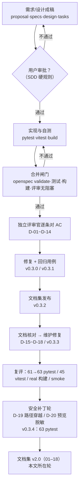
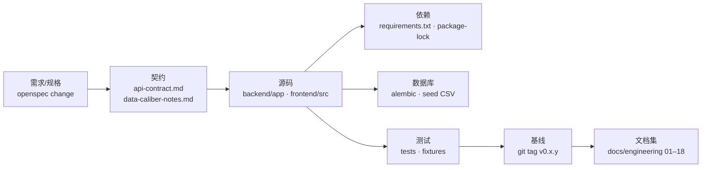
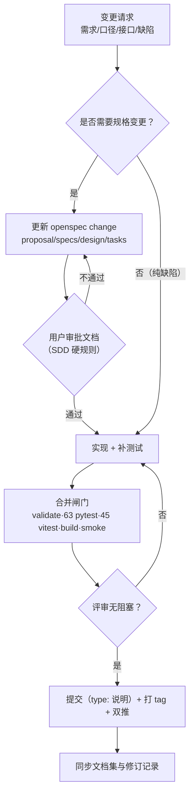

# 评审记录与配置管理

> 文档编号：**CBA-REV-001** ｜ 版本：**v1.1** ｜ 日期：**2026-11-08** ｜ 适用基线：git tag **v0.3.4**（2026-11-08，安全补丁 + 文档集 v2.0；上一基线 v0.3.3 = `9fbaa93`）
> 所属文档集：软件工程过程文档集 **v2.0**（01–18）｜ 文档发布标签：**v0.3.4**（代码与文档同基线：安全补丁 D-19/D-20 + 文档集 v2.0）｜ 关联文档集 01–15 同基线 v0.3.4
> 关联：[README（文档集索引）](README.md)、[05-测试文档](05-测试文档.md)（缺陷明细与用例矩阵）、[07-维护与版本记录](07-维护与版本记录.md)（版本历史）、[14-测试报告](14-测试报告.md)（v0.3.3 执行结果）、[15-项目验收与总结报告](15-项目验收与总结报告.md)、[17-安全与合规说明](17-安全与合规说明.md)、[18-开发规范与代码指南](18-开发规范与代码指南.md)、`openspec/changes/build-catering-analysis-platform/`、`docs/agents/roles.md`、`docs/architecture.md`、`docQA/20261108_0615_一期收入分析Demo实现与多Agent协作.md`

## 1. 文档信息与修订记录

### 1.1 文档信息

| 项 | 内容 |
|---|---|
| 文档编号 / 名称 | CBA-REV-001 / 评审记录与配置管理 |
| 当前版本 / 状态 | v1.1 / 已评审（回溯记录 v0.3.0–v0.3.4 的评审与配置管理事实） |
| 编写日期 | 2026-11-08 |
| 适用基线 | **`v0.3.4`**：**63 pytest**（test_api 34 + engine 17 + importers 11 + health 1）/ 45 vitest / real 构建通过 / `scripts/smoke.sh` PASS / `openspec validate --strict` 通过 |
| 主要读者 | 质量负责人、项目经理、Lead、独立评审、审计、后续接任者 |
| 事实来源 | git 提交与 tag、`docQA/` 会话记录、`05` 缺陷表（D-01~D-14）、`14` 测试报告（D-15~D-18）、`16` 本轮安全补丁（D-19/D-20）、`tasks.md` 勾选状态（**49/66**）、仓库实际文件 |
| 写作边界 | 已发生的评审/缺陷/基线用仓库证据；未做的评审（如安全专项评审、性能评审）明确标「未开展」，不虚构记录 |
| 与 05/14 的分工 | 05 是测试总集（用例矩阵、验收数字）；14 是 v0.3.3 执行报告；本文回答「谁评审、评审什么、缺陷如何闭环、配置与基线怎么管」 |

### 1.2 修订记录

| 版本 | 日期 | 修订人 | 变更摘要 | 对应基线 |
|---|---|---|---|---|
| v1.0 | 2026-11-08 | 质量负责人（项目组） | 首次建立：评审组织与四类评审记录、D-01~D-18 缺陷台账、配置项清单、v0.1.0~v0.3.3 基线、变更控制与发布记录、审计追溯 | `v0.3.3` |
| v1.1 | 2026-11-08 | 质量负责人（项目组） | 同步 v0.3.4 安全补丁轮：新增 D-19（SPA 路径穿越，S-01）/D-20（导入预览内部键）并闭环；D-01~D-20 共 20 项；质量门 61→63 pytest；tasks 48/66→**49/66**；基线清单/发布记录/审计缺口更新 | `v0.3.4` |

### 1.3 范围与证据说明

- **评审对象**：一期 change `build-catering-analysis-platform` 的 proposal/specs/design/tasks，以及 `backend/`、`frontend/`、`shared/`、`docs/` 的交付物。
- **评审轮次**：规划评审（v0.2.0）→ 首轮独立评审（v0.3.0/v0.3.1，14 项缺陷）→ 文档集评审（v0.3.2）→ 维护修复轮评审（v0.3.3，4 项缺陷 D-15~D-18）→ **安全补丁轮（v0.3.4，2 项 D-19/D-20）** → 文档集 v2.0 评审（本文所在轮）。
- **证据优先级**：代码与测试输出 > git 提交记录 > `docQA` 会话记录 > 文档描述。冲突时以代码与测试为准，并在本文登记。
- **已知记录缺口**：评审意见原文只存在于 `tasks.md` 与 `docQA` 摘要，没有独立的评审意见单（见 §12.3）。

## 2. 评审组织与流程

### 2.1 角色与职责

| 角色 | 评审中的职责 | 证据 |
|---|---|---|
| 用户（决策人） | 审批 proposal/specs/design/tasks；拍板范围、口径、演示口径 | `docs/agents/roles.md`「用户审批点」；`docQA/20261108_0615_*.md` §一 |
| Lead（主会话） | 组织评审、合并结论、勾选 tasks、打 tag、双推；不亲自写大段业务代码 | `docs/architecture.md` §5 |
| PM | 需求评审主责：场景是否可测、数字是否可验证、范围是否收敛 | `docs/agents/roles.md`「产品经理」 |
| 架构师 | 设计评审主责：数据模型、接口契约、页面矩阵、技术取舍 | `docs/agents/roles.md`「架构师」 |
| 数据/前端工程师 | 提供实现证据、修复缺陷、补回归用例 | `docs/agents/roles.md`「数据/前端工程师」 |
| 评审官（Reviewer） | 只读逐条对 AC、跑构建与测试、核对 Excel 数字与口径、给阻塞/非阻塞意见 | `docs/agents/roles.md`「评审官」；`docQA` §四 |
| Docs | 演示脚本、用户手册、文档同步 | `docs/agents/roles.md`「文档/演示」 |

### 2.2 四类评审

| 评审 | 输入 | 输出 | 通过标准 | 记录位置 |
|---|---|---|---|---|
| 需求评审 | `proposal.md`、10 个 `specs/*/spec.md` | 范围/场景/验收标准定稿，遗留问题清单 | 每个场景有 WHEN/THEN 与可核对数字；范围与二期边界清楚 | `docQA` §一 决策表；`tasks.md` |
| 设计评审 | `design.md`（§10 模型、§11 模板、§12 接口、§13 页面、§14 数字、§15 洞察） | 数据模型、接口契约、页面矩阵、验收数字基线 | 每张表/接口/页面有明确归属；验收数字可被测试断言 | `design.md` 定稿；`shared/api-contract.md` |
| 代码评审 | 代码 diff、`backend/tests`、`frontend/src/**/*.test.*` | 缺陷清单（阻塞/高/中/低）与修复记录 | 无阻塞意见；`pytest`/`vitest`/`build` 全绿；关键数字一致 | `05` §8、`14` §5、本文 §6 |
| 测试评审 | `scripts/smoke.sh` 结果、手工走查截图、验收数字对照 | 放行建议、残余风险与行动项 | 验收数字逐项一致；缺陷有回归用例；残余风险已登记 | `14` §7/§8、`05` §9 |

### 2.3 评审官职责与原则

1. **只认标准**：逐条对照 `specs/*/spec.md` 的 Scenario 与 `design.md` §14 的数字，不接受「差不多」。
2. **独立上下文**：评审官以独立 Agent 运行，避免与实现者共享同一批假设（`docQA` §四）。
3. **数字优先**：任何口径漂移必须点名；不一致处给出可复现的核对方式（接口/页面/测试）。
4. **证据留痕**：每个结论落到「文件/接口/测试名」，而不是口头「已确认」。
5. **分级**：阻塞（不修不能放行）/ 高（影响主流程或数字可信）/ 中 / 低（体验或文档）。
6. **结论回 Lead**：不横向私聊，由 Lead 合并与决策（`docs/agents/roles.md` 三条铁律）。

### 2.4 评审流程



### 2.5 评审证据与记录载体

| 载体 | 记录内容 | 位置 |
|---|---|---|
| `tests` 用例名 | 每个缺陷的回归断言 | `backend/tests/test_api.py`、`test_engine.py`、`test_importers.py`；`frontend/src/**/*.test.*` |
| `tasks.md` 勾选 | 任务完成度与验收依据 | `openspec/changes/build-catering-analysis-platform/tasks.md`（**49/66** 已勾选；任务 4.6 于 v0.3.4 完成） |
| `docQA/` 会话记录 | 决策、评审发现、修复列表、已知缺口 | `docQA/20261108_0615_一期收入分析Demo实现与多Agent协作.md` |
| git 提交与 tag | 变更范围、时间、基线 | `git log --oneline`、`git tag -n` |
| 文档修订记录 | 文档版本与基线对齐 | 本目录 01–18 各文档 §1.2 |
| 截图 | 页面验收证据 | `docs/demo/screenshots/real-*.png`（13 张）、`real-data.png`（v0.3.3 刷新） |

## 3. 需求评审

### 3.1 评审对象与检查项

| 检查项 | 判定要求 | 结果 |
|---|---|---|
| 背景与问题可举证 | 每个痛点能指到 Excel/PPT 或 proposal 原文 | 通过（`docs/domain/data-caliber-notes.md` §9） |
| 场景可测 | 每个 Requirement 有 WHEN/THEN，且 THEN 含数字或可观察行为 | 通过（10 个 spec，`openspec validate --strict` 通过） |
| 验收数字一致 | design §14 与 spec 场景数字一致 | 通过（18 组关键数字） |
| 范围收敛 | 一期/二期/明确不做三段清楚 | 通过（`tasks.md` 阶段一 49 项全勾、阶段二 17 项未开始，合计 **49/66**） |
| 不做项有替代 | 大模型/多租户/Docker/CI 等有不做的理由 | 通过（`design.md` Non-Goals） |
| 口径显式 | 四套收入合计、尾差、待确认项有落点 | 通过（`data-caliber-notes.md` §2/§10） |

### 3.2 用户决策（需求评审结论）

| # | 决策 | 结论 | 记录 |
|---|---|---|---|
| 1 | 前端基准 | 按本 change `design.md` + `docs/webUI.md`，参考 canyin-ops 页面结构不复用代码 | `docQA` §一-1 |
| 2 | 双远程 | 保留 `origin`，新增 `target`，里程碑双推 | `docQA` §一-2；`docs/architecture.md` §9 |
| 3 | 一期范围 | 6 模块导航/骨架 + 收入完整 + 总览利润桥 + 8 类导入 | `proposal.md` §交付节奏 |
| 4 | 飞书/微信 | 本期只写设计与演示脚本，不接通 | `proposal.md` 一期决策 4 |
| 5 | 示例数据 | 以 Excel 为准，PPT 只作讲解 | `proposal.md` 一期决策 3 |
| 6 | 口径默认 | `data-caliber-notes.md` §10 十条默认全部接受（四套合计、本期渠道占比、折扣率=优惠/收入、边际贡献率 41.87%、客流按导入值、会员储值原样计入、同店按对比期收入判定） | `docQA` §一-6 |
| 7 | 技术栈 | Python 3.12 + FastAPI + SQLAlchemy 2.1 + SQLite；React 19 + TS 7 + Vite 8 + antd 6 + ECharts 6；AI 洞察规则化 | `docQA` §一-7 |

### 3.3 需求评审遗留

| # | 遗留 | 处理 | 现状 |
|---|---|---|---|
| 1 | 预算 1500 万为占位示例，非真实预算 | 标「示例预算」；追加费用预算后再开放达成率 | 一期空态（`backend/seed/README.md` §3-9） |
| 2 | 客流「人次」定义、同店判定门槛、折扣率定义 | 记入待确认，按默认实现并页面注明 | 未确认（`data-caliber-notes.md` §10） |
| 3 | 门店经营模式/店型/面积/座位为演示设定 | 标「演示设定」 | 未确认（`backend/seed/README.md` §3-8） |
| 4 | 单品明细与 Excel 表 4 非同一快照 | 页面分别标注，套餐量价只用表 4 | 已标注（D-18 范围外） |

## 4. 设计评审

### 4.1 评审对象与检查项

| 检查项 | 判定要求 | 结果 |
|---|---|---|
| 数据模型 | 维度/事实表、单位、覆盖回滚机制完整 | 通过（16 表：8 维 + 8 事实；`superseded_by`） |
| 导入模板 | 8 类数据集必填/可选列、校验点、中文表头 | 通过（`design.md` §11；`importers/registry.py`） |
| 接口契约 | 路径、入参、统一包装、错误码、空值规则 | 通过（`design.md` §12；`shared/api-contract.md`） |
| 页面矩阵 | 17 条路由的状态（可用/半可用/骨架）与核心内容 | 通过（`design.md` §13；`App.tsx`） |
| 验收数字 | design §14 与 fixture、pytest 一致 | 通过（`shared/fixtures/*.json` 8 组 + `test_engine.py`） |
| 洞察规则 | 8 组规则可落地、阈值可配置 | 通过（`design.md` §15；`engine/insights.py`；`config.py`） |
| 风险与取舍 | SQLite、两阶段导入、双引擎 fixture、无大模型等有理由 | 通过（`design.md` Risks；`04` §11） |

### 4.2 关键设计定案

| 定案 | 内容 | 实现证据 |
|---|---|---|
| 长表 + 维度 | 宽表改为事实/维度表，按筛选聚合 | `backend/app/models/{dimensions,facts}.py` |
| 两阶段导入 | draft（校验/预览）→ commit（写入）→ rollback | `api/imports.py`、`importers/service.py` |
| 覆盖不物理删除 | 旧行置 `superseded_by`，回滚恢复 | 同上；`test_importers.py` |
| 计算在后端 | engine 纯函数 + 服务层聚合 | `engine/`、`services/analysis.py` |
| 双引擎共用用例 | 前后端同读 `shared/fixtures` | `pytest`、`vitest` |
| 四套口径不强行对齐 | 各页标注合计口径与尾差 | `data-caliber-notes.md` §2 |
| 规则化洞察 | `insights[]`，按影响绝对值前 3，不接大模型 | `engine/insights.py` |
| 单管理员认证 | bcrypt + HS256 JWT + httpOnly cookie | `services/auth.py`、`api/auth.py` |

### 4.3 设计评审发现（已闭环）

| # | 发现 | 处理 |
|---|---|---|
| 1 | `design.md` §13 导航未列「结果方案报告」 | 实现保留该菜单；02/14 文档以代码为准（待回填 design） |
| 2 | `tasks.md` 6.1 写「1000 / 759.56」，实际总览口径为 760 | `14` §1.3 登记；tasks 文案待更新 |
| 3 | 单渠道详情含「趋势」区块，但一期未实现趋势图 | 列残余风险（`14` §8.1「单渠道趋势」） |
| 4 | 利润桥「点击收入规模下钻」场景未接线 | 列待确认（02 §15） |
| 5 | `data-caliber-notes.md` §8 与 `seed/README` 差异条数口径 | 两处并存，文档引用各自原文 |

## 5. 代码与测试评审

### 5.1 评审方法

| 手段 | 内容 | 证据 |
|---|---|---|
| 逐条对 AC | 按 `specs/*/spec.md` 的 Scenario 与 01 的 AC 清单核对行为 | `05` §2 用例矩阵 |
| 数字核对 | design §14 全部数字与接口/pytest/页面三处对照 | `05` §7、`14` §7 |
| 构建与测试 | `pytest`、`npm test`、`npm run build`、`scripts/smoke.sh` | `14` §3 |
| 页面走查 | 17 路由真实后端走查 + 截图 | `docs/demo/screenshots/` |
| 口径审查 | 四套合计、尾差、缺失「—」、预算空态 | `05` §5、`14` §6 |

### 5.2 首轮独立评审统计（2026-11-08 06:15）

| 级别 | 数量 | 编号 | 处置 |
|---|---|---|---|
| 阻塞 | 2 | D-01、D-02 | 修复 + 回归用例 |
| 高 | 4 | D-03、D-04、D-05、D-06 | 修复 + 回归用例/复核 |
| 中 | 6 | D-07、D-08、D-09、D-10、D-11、D-12 | 修复 + 复核 |
| 低 | 2 | D-13、D-14 | 修复 + 记录 |
| 合计 | 14 | D-01~D-14 | 全部关闭；新增 4 个回归用例（`test_api.py` 24→28） |

### 5.3 首轮缺陷修复要点（摘要，全表见 05 §8）

| 编号 | 摘要 | 修复要点 | 回归 |
|---|---|---|---|
| D-01 | 选「预算」基准白屏且按 0 伪造对比 | 预算不完整时 `profit_bridge`/`profit.base`/`gross_margin.base` 返回 `null` + 前端空态 | `test_budget_baseline_incomplete_is_null_not_zero` |
| D-02 | 坏 xlsx 上传返回 500 | 捕获 `BadZipFile/OSError/KeyError` → 行级错误 | `test_invalid_xlsx_returns_row_error_not_500` |
| D-03 | 门店 12 时段未标主因 | engine 下发 `highlight`/`daypart_highlight` | `test_store_daypart_highlight_and_rates` |
| D-04 | 门店洞察「同比分别 — / —」 | 门店行补 `rate` | 同上 |
| D-05 | 看板分位/同店收入前端硬编码 | 后端统一 `percentiles` + `percentile_hints`；增速按去年同期 | `test_overview_percentile_keys_for_frontend` |
| D-06 | 冒烟脚本使用演示库清空数据 | 改 `mktemp` 临时库 + 独立端口 + EXIT 清理 | 手工复核 |
| D-07 | 缺失期间返回 0 假读数 | 缺数据抛业务错误 4xx + 前端空态 | 手工切「2025-08」 |
| D-08 | 门店排名文案写死「13 家」 | 按 `data.stores.length` 动态生成 | 页面冒烟 |
| D-09 | 利润桥/分位契约漂移 | 统一 key、补全契约、类型放宽 nullable | mock 9 例 |
| D-10 | 渲染异常整页白屏 | 全局 `ErrorBoundary` | 页面冒烟 13 例 |
| D-11 | `.env` 未忽略 | `.gitignore` 补 `.env`/`.env.local`/`*.env` | `git status` 复核 |
| D-12 | `dev.sh` 默认 mock 易混淆 | `VITE_API_MODE` 默认 `real` | 手工启动 |
| D-13 | 构建偶发陈旧缓存 | 构建前清 `node_modules/.tmp`/`dist` | 手工复验 |
| D-14 | 累计口径用单月冒充 | 覆盖期数不足时返回 `null`（「—」） | 手工 + 页面冒烟 |

### 5.4 维护修复轮（v0.3.3）与安全补丁轮（v0.3.4）

触发：文档集（v0.3.2）核对时发现「契约与实现、文档与页面」不一致；按 `14` 记为 D-15~D-18，修复后新增 4 个回归用例（57→61 pytest）。

| 编号 | 级别 | 摘要 | 修复要点 | 回归 |
|---|---|---|---|---|
| D-15 | 高 | real 模式导入页无法解析接口响应 | 四个导入接口统一 `{data: ...}` 包裹；前端 hooks/mock 对齐 | `test_templates_response_is_data_envelope` |
| D-16 | 高 | real 模式默认上传 400「未知数据集」；模板下载只弹提示 | 默认数据集取接口首个 key；模板下载 `fetch` + `blob`（带 cookie）；accept 收敛为 `.xlsx/.xlsm/.csv/.txt` | 页面冒烟 + 手工 real 走查 |
| D-17 | 中 | GBK CSV 5xx；未知 `/api/*` 被 SPA 吞成 200 HTML | UTF-8 失败回退 GBK；仍失败返回行级错误（HTTP 200 + `errors[]`，不是 400）；未匹配 `/api/*` 统一 404 JSON | `test_gbk_encoded_csv_is_accepted`、`test_unknown_api_returns_404_json` |
| D-18 | 中 | 渠道无 `same_rate`、缺口径字段、`sets` 空值崩溃、演示值写死、累计无提示 | 后端补 `same_rate`/`caliber_note`/`note`/`base_marginal_contribution_rate`；前端空态与动态文案 | `test_revenue_notes_and_channel_same_rate` + 页面冒烟 |

**安全补丁轮（v0.3.4，2026-11-08）**：评审文档集时发现 1 个高危安全问题（S-01 路径穿越）与 1 个数据脱敏问题；修复后新增 2 个回归用例（61→**63 pytest**，`test_api.py` 32→34），并把 `FastAPI(version)` 同步为 `0.3.4`、`meta.baseline` 预算标签改为「预算」、上传类型提示补全 `.xlsm/.txt`。

| 编号 | 级别 | 摘要 | 修复要点 | 回归 |
|---|---|---|---|---|
| D-19 | **高（S-01）** | SPA 静态托管路径穿越：`GET /../<file>` 可读取 `frontend/dist` 之外的仓库文件（实测读到 `backend/app/config.py` 源码） | `main.py` 新增 `_resolve_dist_file` + `Path.is_relative_to(dist)`，越界/非文件回落 `index.html` | `test_spa_path_traversal_is_blocked` |
| D-20 | 中 | 导入批次 `preview[]` 泄漏内部键 `_store_id`/`_accounts`（接口契约外的实现细节） | `_preview` 过滤全部 `_` 前缀内部键，只回业务列 | `test_import_preview_hides_internal_keys` |

### 5.5 评审结论与未覆盖

- **结论**：**v0.3.4 可演示/可交付**；D-01~D-20 全部关闭且有回归/复核记录（63 pytest / 45 vitest / real build / smoke PASS / validate 通过）；无遗留阻塞或高风险代码缺陷。
- **未开展的评审**（诚实登记）：
  | 未覆盖 | 影响 | 建议 |
  |---|---|---|
  | 安全专项评审 | v0.3.4 已修 S-01（=D-19）与 D-20；17 的 S-02~S-10（默认凭据/TLS/Secure/限流/响应头/依赖扫描等）仍未做 | 演示后做一次完整安全加固轮 |
  | 性能/压测评审 | 无量化并发与响应基线（`14` §8.1） | 客户数据到位后补 |
  | 可访问性（a11y）评审 | 未做屏幕阅读器/键盘导航核查 | 二期补 |
  | 代码静态分析（Python） | 仅前端 `oxlint`（0 error / 4 warning），后端无 lint/type gate | 二期引入 ruff/mypy |
  | 依赖漏洞扫描 | 无 CI、无扫描（见 17 §10） | 二期引入 |

## 6. 缺陷清单（D-01~D-20）

> 级别口径：阻塞=不能放行；高=主流程/数字可信受影响；中=局部体验/契约/文档；低=体验或维护细节。状态均为「已关闭」，回归列仅列主要断言。

| 编号 | 级别 | 标题 | 根因 | 修复 | 回归 | 状态 |
|---|---|---|---|---|---|---|
| D-01 | 阻塞 | 预算基准白屏且利润被按 0 计算 | 预算数据集不完整仍按 0 组装 | 预算不完整→相关字段 `null` + 空态 + ErrorBoundary | `test_budget_baseline_incomplete_is_null_not_zero` | 关闭 |
| D-02 | 阻塞 | 非 xlsx/损坏文件上传 500 | `openpyxl` 异常未捕获 | 捕获 `BadZipFile/OSError/KeyError`，返回行级错误 | `test_invalid_xlsx_returns_row_error_not_500` | 关闭 |
| D-03 | 高 | 门店 12 时段未标「主因时段」 | engine 未下发 highlight | 明细 `highlight` + 响应 `daypart_highlight` | `test_store_daypart_highlight_and_rates` | 关闭 |
| D-04 | 高 | 门店洞察出现「同比分别 — / —」 | 门店行缺 `rate` | 补收入/客流 `rate` | 同上 | 关闭 |
| D-05 | 高 | 看板分位与同店收入为前端硬编码 | 页面写死分位与 857.23 | 后端 `percentiles` + `percentile_hints`，前端按接口渲染 | `test_overview_percentile_keys_for_frontend` | 关闭 |
| D-06 | 高 | 冒烟脚本使用演示库并清空数据 | 未隔离数据库 | `mktemp` 临时库 + 独立端口 + 清理 | 手工复核 | 关闭 |
| D-07 | 中 | 缺失期间返回 0 假读数 | 服务层默认值 0 | 缺数据抛 4xx + 空态 | 手工切 2025-08 | 关闭 |
| D-08 | 中 | 门店排名文案写死「13 家」 | 文案硬编码 | 按 `data.stores.length` | 页面冒烟 | 关闭 |
| D-09 | 中 | 利润桥/分位契约漂移 | 契约与实现未同步 | 统一 key、补契约、类型 nullable | mock 9 例 | 关闭 |
| D-10 | 中 | 渲染异常整页白屏 | 缺 ErrorBoundary | 全局 ErrorBoundary | 页面冒烟 13 例 | 关闭 |
| D-11 | 中 | `.env` 未忽略 | `.gitignore` 缺项 | 补 `.env`/`.env.local`/`*.env` | `git status` | 关闭 |
| D-12 | 中 | `dev.sh` 默认 mock 易混淆 | 启动脚本默认 mock | 默认 `VITE_API_MODE=real` | 手工启动 | 关闭 |
| D-13 | 低 | 前端构建偶发陈旧缓存 | `tsc -b` 增量缓存残留 | 清 `node_modules/.tmp`/`dist` | 手工复验 | 关闭 |
| D-14 | 低 | 累计口径用单月冒充 | 无覆盖期数校验 | 覆盖不足返回 `null`（「—」） | 手工 + 冒烟 | 关闭 |
| D-15 | 高 | real 模式导入页响应解析失败 | 后端导入接口返回裸对象/裸 list，前端/mock 按 `{data}` 解包 | 四个导入接口统一 `{data}`；hooks/mock 对齐 | `test_templates_response_is_data_envelope` | 关闭 |
| D-16 | 高 | real 模式默认上传 400「未知数据集」；模板下载占位 | 默认 key 写死 mock 短名 `pl`；下载未接线 | 默认取接口首个 key；`fetch`+`blob` 下载；accept 收敛 | 页面冒烟 + 手工 real | 关闭 |
| D-17 | 中 | GBK CSV 5xx；未知 `/api/*` 返回 200 HTML | CSV 仅 UTF-8；SPA fallback 吞 `/api` | GBK 回退；仍失败转行级错误（HTTP 200 + `errors[]`，非 400，见 §12.3 A-07）；`/api/*` 404 JSON | `test_gbk_encoded_csv_is_accepted`、`test_unknown_api_returns_404_json` | 关闭 |
| D-18 | 中 | 渠道 `same_rate` 缺失、口径字段缺失、`sets` 空值崩溃、演示值写死、累计无提示 | 后端字段缺失 + 前端演示硬编码 | 补 `same_rate`/`caliber_note`/`note`/`base_marginal_contribution_rate`；空态与动态文案；累计提示 | `test_revenue_notes_and_channel_same_rate` + 页面冒烟 | 关闭 |
| D-19 | 高（S-01） | SPA 静态托管路径穿越可读仓库文件 | `main.py` SPA fallback 直接 `_dist / full_path`，未 `resolve()` 约束 | `_resolve_dist_file` + `is_relative_to(dist)`；越界回落 `index.html` | `test_spa_path_traversal_is_blocked` | 关闭（v0.3.4） |
| D-20 | 中 | 导入预览泄漏内部键 `_store_id`/`_accounts` | `_preview` 只剔除 `_row`，未过滤其他 `_` 前缀键 | `_preview` 过滤全部 `_` 前缀内部键 | `test_import_preview_hides_internal_keys` | 关闭（v0.3.4） |

**编号口径说明**

- **D-19 / D-20 编号归属（v0.3.4 定稿）**：`D-19` = S-01「SPA 路径穿越」（高危，安全视角编号 S-01，缺陷台账编号 D-19）；`D-20` = 导入预览内部键脱敏。二者均在 v0.3.4 修复并加回归，缺陷台账 D-01~D-20 共 20 项全部关闭。
- 与其他文档的对应：[05-测试文档](05-测试文档.md) §8 与 [15-项目验收与总结报告](15-项目验收与总结报告.md) 均记 **D-19 = 静态托管路径穿越**；[17-安全与合规说明](17-安全与合规说明.md) 以安全编号 **S-01** 记录路径穿越（§6.5，v0.3.4 已修复）并以 **D-20** 记录预览脱敏（§6.2）；[18-开发规范与代码指南](18-开发规范与代码指南.md) 第 19 条同步「已修复」并有回归名。S-02~S-10 仍未修复，见 17 与 §5.5。
- 历史说明：v0.3.3 冻结前曾把「文档同步行动项」暂记 D-19，该行动项已并入 §12.3 的 A-06（审计缺口），不再占用缺陷编号。

## 7. 配置项识别

### 7.1 识别原则

1. **影响功能或口径**的源码、依赖、数据、契约必须纳管。
2. **影响部署或验收**的运行配置、构建产物、脚本必须纳管（产物与运行库不纳入 git，但纳入配置项清单与备份策略）。
3. **影响追溯**的文档、基线、标签必须纳管。
4. 每个配置项必须有**唯一责任人角色**与**变更触发条件**；同一文件范围只允许一个写入者（`docs/agents/roles.md`）。

### 7.2 配置项分类与命名

| 类别 | 前缀 | 示例 | 纳管方式 |
|---|---|---|---|
| 源码 | CI-SRC | `backend/app`、`frontend/src` | git |
| 依赖 | CI-DEP | `requirements.txt`、`package.json` + `package-lock.json` | git（版本锁定） |
| 数据基线 | CI-DATA | `backend/seed/*.csv`、`shared/fixtures/*.json` | git |
| 契约 | CI-CTR | `shared/api-contract.md`、`docs/domain/data-caliber-notes.md` | git |
| 数据库 | CI-DB | Alembic 迁移、`backend/data/cba.db` | git（迁移）；运行库不入库 |
| 运行配置 | CI-CFG | 环境变量、`VITE_API_MODE` | 环境变量（不入库） |
| 构建产物 | CI-BLD | `frontend/dist` | 不入库；发布时构建 |
| 脚本 | CI-SCR | `scripts/*.sh` | git |
| 文档 | CI-DOC | `docs/engineering/*`、`openspec/*` | git |
| 基线 | CI-BASE | git tag `v0.1.0`~`v0.3.4` | git tag（附注） |

### 7.3 配置项与代码/文档的对应关系



## 8. 配置项清单（当前基线 v0.3.4）

| 编号 | 配置项 | 路径 / 标识 | 当前版本或状态 | 责任角色 | 变更触发 |
|---|---|---|---|---|---|
| CI-SRC-01 | 后端源码 | `backend/app/` | 随 `v0.3.4`（含 `_resolve_dist_file` 安全修复） | 数据/后端工程师 | 功能/修复 |
| CI-SRC-02 | 后端测试 | `backend/tests/`（4 文件 / **63 项**：api 34 + engine 17 + importers 11 + health 1） | 63 pytest 通过 | 数据/后端 + 测试 | 任何行为变更 |
| CI-SRC-03 | 前端源码 | `frontend/src/`（17 路由、19 组件） | 随 `v0.3.4` | 前端工程师 | 功能/修复 |
| CI-SRC-04 | 前端测试 | `frontend/src/**/*.test.*`（6 文件 / 45 项） | 45 vitest 通过 | 前端 + 测试 | 组件/页面变更 |
| CI-DEP-01 | 后端依赖 | `backend/requirements.txt`（10 项锁定，已移除 pandas） | 锁定版本 | 架构/后端 | 升级需评审 |
| CI-DEP-02 | 前端依赖 | `frontend/package.json` + `package-lock.json` | React 19.3.1 / antd 6.7.0 / ECharts 6.1.0 / Vite 8.3.6 / TS 7.0.2 / vitest 5.1.0 / oxlint 1.92.0 | 前端 | 升级需评审 |
| CI-DATA-01 | 示例数据 | `backend/seed/01–08_*.csv` + `README.md` | 8 文件；来源与 16 条差异已记录 | 数据工程师 | 源表/口径变化 |
| CI-DATA-02 | 验收用例 | `shared/fixtures/*.json` | 8 组用例 + `index.json` | 数据 + 前端 | 验收数字变化 |
| CI-CTR-01 | 接口契约 | `shared/api-contract.md` | v0.3.4（导入 `{data}`；预览脱敏；`meta.baseline=预算`） | 架构师 | 接口增删改 |
| CI-CTR-02 | 口径规则 | `docs/domain/data-caliber-notes.md` | 四套合计 + 10 条待确认 | PM/架构 | 口径决策 |
| CI-DB-01 | 数据库迁移 | `backend/alembic/versions/7ff48b1131c0_initial_schema.py` | 1 个初始修订 | 数据工程师 | 表结构变更 |
| CI-DB-02 | 运行数据库 | `backend/data/cba.db`（8 维 + 8 事实，16 表） | 本地运行库，git 忽略；权限 644 | 实施/维护 | 灌数/导入 |
| CI-CFG-01 | 运行配置（后端） | 环境变量 `CBA_*`（见 §8.1） | 默认值可跑通 Demo | 运维/维护 | 部署环境 |
| CI-CFG-02 | 运行配置（前端） | `VITE_API_MODE=mock\|real` | 演示用 `real` | 前端/实施 | 构建模式 |
| CI-SCR-01 | 脚本 | `scripts/{dev,load_seed,smoke}.sh` | 3 个 | 数据/Lead | 流程变化 |
| CI-BLD-01 | 前端构建产物 | `frontend/dist`（real 模式；体积见 18 §2） | 不入库，启动前构建 | 实施 | 发布 |
| CI-DOC-01 | 软件工程文档集 | `docs/engineering/01–18` | v2.0（文档标签 v0.3.4） | Docs/各作者 | 功能/契约/口径变化 |
| CI-DOC-02 | OpenSpec change | `openspec/changes/build-catering-analysis-platform/` | 66 任务（**49 已完成 / 17 二期未开始**） | PM/架构 | 需求变化 |
| CI-DOC-03 | 业务原始资料 | `docs/*.xlsx`、`docs/*.pptx`、`docs/research/` | 只读 | PM | 不改写 |
| CI-BASE-01 | 版本基线 | git tag `v0.1.0`~`v0.3.4` | 见 §9 | Lead | 里程碑 |

### 8.1 运行配置项（环境变量）

| 变量 | 默认值 | 作用 | 变更影响 |
|---|---|---|---|
| `CBA_DATABASE_URL` | `sqlite:///backend/data/cba.db` | 数据库地址 | 换库/换路径需重灌或迁移 |
| `CBA_ADMIN_USERNAME` | `admin` | 管理员账号 | 登录凭据 |
| `CBA_ADMIN_PASSWORD` | `admin123` | 管理员密码（启动时哈希） | **上线必须改**（见 17） |
| `CBA_ADMIN_PASSWORD_HASH` | 无 | 直接提供 bcrypt 哈希（可选） | 免明文配置 |
| `CBA_SESSION_SECRET` | `dev-only-change-me-…` | JWT 签名密钥 | **上线必须改**；改后旧 cookie 全失效 |
| `CBA_PLATFORM_FEE_RATE_MAX` | `0.15` | 平台费用率阈值 | 洞察结论变化 |
| `CBA_GROSS_ROI_MIN` | `1.0` | 毛利 ROI 阈值 | 同上 |
| `CBA_SALES_ROI_MIN` | `4.0` | 销售 ROI 阈值 | 同上 |
| `CBA_FUNNEL_CVR_DROP` | `0.01` | 漏斗转化环比告警 | 同上 |
| `CBA_TOP_N` | `3` | 洞察取前 N | 同上 |
| `CBA_PLATFORM_GROSS_MARGIN` | `0.6` | 平台毛利率（ROI 计算） | 渠道 ROI 变化 |
| `VITE_API_MODE` | `mock`（`npm run dev`）/`real`（`dev.sh`） | 前端数据模式 | 构建时内嵌，改了要重构建 |
| `VITE_API_BASE` | `/api` | 前端请求基址（跨域直连时覆盖） | 构建时内嵌；指向需受控 |

## 9. 基线管理

### 9.1 基线定义

| 基线类型 | 内容 | 冻结条件 |
|---|---|---|
| 需求基线 | proposal + 10 specs | 用户审批通过 |
| 设计基线 | design + 接口契约 + 页面矩阵 + 验收数字 | 用户审批通过、`shared/fixtures` 落盘 |
| 实现基线 | 代码 + 测试 + 示例数据 | 合并闸门全绿（validate/测试/构建/评审无阻塞） |
| 文档基线 | `docs/engineering/01–18` | 文档评审通过、与实现基线对齐 |
| 运行基线 | seed 灌数后的本地库 + real 构建产物 | 演示前冻结（改代码必须重跑门禁并重截图） |

### 9.2 基线清单（v0.1.0~v0.3.4）

| 基线 | 提交 | 日期 | 内容 | 质量门 | 文档集 |
|---|---|---|---|---|---|
| `v0.1.0` | `3f4e93c` | 2026-11-07 | 初始基线：业务资料（Excel/PPT）+ OpenSpec 脚手架 + `CLAUDE.md`，无源代码 | — | — |
| `v0.2.0` | `dbb6c23` | 2026-11-08 | OpenSpec 规划：change `build-catering-analysis-platform`（10 能力规格 + design + tasks 66 项） | `openspec validate --strict` | — |
| `v0.3.0` | `e30eb1d` | 2026-11-08 | 一期 Demo：后端引擎/导入/接口 + 前端全页面 + 示例数据；评审 14 项修复 | 57 pytest / 45 vitest / build / smoke | — |
| `v0.3.1` | `25717b1` | 2026-11-08 | 演示收口：标签清单与实测命令修正，演示环境验证通过 | 57 pytest / 45 vitest / smoke | — |
| `v0.3.2` | `dcfeeff` | 2026-11-08 | 文档集发布：需求/产品/概要/详细/测试/用户/维护（基于 v0.3.1，代码不变） | 文档评审 | 01–07 |
| `v0.3.3` | `9fbaa93` | 2026-11-08 10:17 | 维护修复：导入契约/模板下载/编码/API 404/字段补齐（D-15~D-18） | **61 pytest** / 45 vitest / real build / smoke / validate | 01–07（v1.0） |
| `v0.3.4` | 本次发布提交 | 2026-11-08 | **安全补丁**：D-19（SPA 路径穿越，S-01）/D-20（预览脱敏）；`FastAPI(version)=0.3.4`；`meta.baseline=预算`；上传提示补 `.xlsm/.txt`；任务 4.6 完成（49/66）；文档集 01–18 v2.0 | **63 pytest** / 45 vitest / real build / smoke / validate | 01–18（v2.0） |

> 说明：`v0.1.0`/`v0.2.0` 两个附注标签在 `target` 远程存在（`v0.1.0^{}=3f4e93c`、`v0.2.0^{}=dbb6c23`），本地工作副本只保留 `v0.3.0`~`v0.3.3` 四个标签；提交对象仍可从历史访问。

### 9.3 冻结与对齐规则

1. 打 tag 前必须：`git status` 干净、门禁全绿、文档与代码基线一致。
2. 打 tag 后不改代码；如需修复，升 `v0.3.x` 并重跑门禁（v0.3.1→v0.3.3 即此路径）。
3. 演示前冻结 `v0.3.4`；临时改代码 = 证据过期（`14` R-11），必须重跑 `pytest`/`vitest`/`build`/`smoke` 并刷新截图。
4. 文档集与代码的打标签关系：v0.3.2 只含文档；**v0.3.4 同时含安全补丁与文档集 v2.0**（代码/文档同基线），此后版本说明需区分「代码变更」与「仅文档」。

## 10. 变更控制

### 10.1 变更流程（OpenSpec）



### 10.2 审批点

| 事项 | 是否需要用户审批 | 依据 |
|---|---|---|
| proposal / specs / design / tasks 首次成稿 | **必须** | `CLAUDE.md`、`docs/agents/roles.md` |
| 范围变更、二期范围调整 | **必须** | 同上 |
| 对外演示口径（数字、话术） | **必须** | `docs/agents/roles.md` |
| 实现细节、测试补充、文案/样式微调 | 不需要 | 同上 |
| 口径默认值调整 | 需登记待确认并同步 `data-caliber-notes.md` | `CLAUDE.md` 开发约定 |
| 依赖升级 / 表结构变更 | 需架构评审 | 本文 §7/§8 |

### 10.3 影响分析矩阵（改什么必须同步什么）

| 变更类型 | 必须同步 | 必须重跑 |
|---|---|---|
| 分析指标/公式 | `shared/fixtures`、`engine`、`services`、04/05/14、`shared/api-contract.md` | `test_engine.py`、相关接口测试、页面冒烟 |
| 接口字段/响应结构 | `shared/api-contract.md`、11、`api/types.ts`、`hooks.ts`、mock、04、05、14 | `pytest`、`vitest`、`smoke` |
| 表结构/事实粒度 | `alembic` 迁移、10、`models`、导入器、`seed`、覆盖/回滚逻辑 | `pytest`、重灌示例数据、验收数字 |
| 口径规则 | `data-caliber-notes.md`、`backend/seed/README.md`、01/05/06/14、页面脚注 | 数字断言与页面走查 |
| 页面/交互 | 02、06、07、页面冒烟、截图 | `vitest` 页面冒烟、手工走查 |
| 运行配置 | 07、12、17、`config.py` | 启动/登录/接口冒烟 |
| 文档 | README 索引、相关文档修订记录 | 文档评审 |

### 10.4 变更落库规则

1. 提交信息中文 `type: 说明`（feat/fix/docs/chore/test/refactor），一次提交只做一类事。
2. 只 `git add` 本次改动文件，禁止 `git add -A`（避免卷入其他 Agent 改动）。
3. 每次功能/修复提交后更新 `tasks.md` 勾选与 `docQA` 记录。
4. 里程碑打附注标签（`git tag -a vX.Y.Z -m "范围与要点"`），双推 `origin` 与 `target`。
5. 破坏性变更（登录契约/响应包装/表结构）必须在 01 §12 与本文件 §10.3 留痕。

## 11. 版本发布记录

| 标签 | 日期 | 内容 | 质量门 | target 推送 | origin 推送 |
|---|---|---|---|---|---|
| `v0.1.0` | 2026-11-07（提交） | 初始基线：资料 + OpenSpec 脚手架 + CLAUDE.md | — | ✅ | ✅（当年） |
| `v0.2.0` | 2026-11-08 | OpenSpec 规划完成 | validate | ✅ | ✅ |
| `v0.3.0` | 2026-11-08 | 一期 Demo 完成 + 14 项评审修复 | 57 pytest / 45 vitest / build / smoke | ✅ | ❌ 未推 |
| `v0.3.1` | 2026-11-08 | 演示收口（代码同 v0.3.0） | 同上 | ✅ | ❌ 未推 |
| `v0.3.2` | 2026-11-08 | 文档集发布（仅文档） | 文档评审 | ✅ | ❌ 未推 |
| `v0.3.3` | 2026-11-08 | 维护修复（D-15~D-18） | 61 pytest / 45 vitest / real build / smoke / validate | ✅ | ❌ 未推 |
| `v0.3.4` | 2026-11-08 | **安全补丁**（D-19 路径穿越 / D-20 预览脱敏）+ 文档集 v2.0（01–18）；任务 4.6 完成（49/66） | **63 pytest** / 45 vitest / real build / smoke / validate | ✅ 已推（target） | ❌ 待推（origin 凭据） |

**远程现状（2026-11-08 实测）**

- `target`（c4thmy/CateringBusinessAnalysis）：`main` 已到 v0.3.4；v0.1.0~v0.3.4 标签已推。
- `origin`（cfmypian/CateringBusinessAnalysis-dshSA）：`main` 停留在 `dbb6c23`（v0.2.0 规划提交），**无任何 v0.3.x 标签**；原因是本机 GitHub 身份为 c4thmy，无 cfmypian 仓库写权限（`README.md` 标签清单、`14` §1.3）。
- 处置：拿到 cfmypian 凭据后执行 `git push origin main && git push origin --tags`；在此之前 **target 为唯一同步备份**，需在维护记录中保留该单点风险（`07` 第 10 节、`14` R-01）。

**发布检查清单**

- [ ] `git status` 干净、无未跟踪的业务文件
- [ ] `cd backend && .venv/bin/python -m pytest` → 63 passed
- [ ] `cd frontend && npm test` → 45 passed
- [ ] `cd frontend && VITE_API_MODE=real npm run build` 通过
- [ ] `bash scripts/smoke.sh` → SMOKE PASS
- [ ] `openspec validate build-catering-analysis-platform --strict` → valid
- [ ] 安全回归：`cd backend && .venv/bin/python -m pytest -k "path_traversal or preview_hides_internal"` → 2 passed（D-19/D-20）
- [ ] 关键数字与 design §14 一致（总览/利润桥/同店/渠道/产品）
- [ ] 文档修订记录与当前基线一致
- [ ] 打附注标签并双推

## 12. 审计与追溯

### 12.1 可追溯链


示例（同店客流影响 92.07 万）：`specs/revenue-analysis` 场景 → `tasks.md` 2.5/7.2 → `backend/app/engine/revenue.py::same_store` + `services/analysis.py` → `backend/tests/test_api.py` 与 `shared/fixtures/same_store_2509.json` → design §14 → 01 §10.2 / 04 §5 / 05 §7 / 14 §7 → `v0.3.0`~`v0.3.4` 基线。

### 12.2 记录载体

| 需要追溯的内容 | 载体 | 命令/路径 |
|---|---|---|
| 代码变更与责任人 | git 提交 | `git log --oneline -- <path>`、`git blame <file>` |
| 版本范围 | 附注标签 | `git tag -n`、`git show v0.3.4`、`git diff v0.3.3 v0.3.4 --stat` |
| 需求与任务 | OpenSpec change | `openspec show build-catering-analysis-platform`、`tasks.md` |
| 评审与缺陷 | 05 §8、14 §5 | 文档内表格（编号/级别/根因/修复/回归） |
| 会话决策 | `docQA/` | `docQA/20261108_0615_*.md` §一/§四 |
| 业务导入 | `import_batch` 表 | `GET /api/imports`（数据集/文件/期间/行数/操作人/时间/状态） |
| 验收数字 | fixtures + 测试 | `shared/fixtures/*.json`、`pytest -k <name>` |

### 12.3 审计缺口（诚实登记）

| # | 缺口 | 影响 | 建议 |
|---|---|---|---|
| A-01 | 无结构化审计日志（登录、导入、回滚、配置变更无统一落盘） | 事后追责困难 | 见 17 §9，二期补审计表/日志 |
| A-02 | `import_batch.operator` 来自请求表单（默认 `admin`），可被改写 | 业务操作人不可信 | 二期改为取当前会话用户 |
| A-03 | `commit`/`rollback` 不记录操作人，只记时间 | 覆盖/回滚责任人缺失 | 补 `operator` 字段与接口 |
| A-04 | 评审意见原文未独立归档（只有摘要） | 复盘细节缺失 | 下轮评审起用评审单模板归档 |
| A-05 | `origin` 未同步导致外部无可查备份 | 单点风险 | 拿到凭据后补推 |
| A-06 | 文档与代码版本曾错位（原「文档同步行动项」，已并入本行） | 引用错误数字 | 文档集 v2.0 统一到 **v0.3.4**；发布前按 §11 清单核对 |
| A-07 | 编码失败/不支持类型究竟返回 400 还是 200，曾口径不一（05 §8 / 11 §2.6 / 14 §5 / 提交信息 vs 实测） | 验收断言与排障预期偏差 | **已裁定（v0.3.4）：采用「HTTP 200 + 行级 errors」为权威口径**——只有 >10MB / 空文件 / 未知数据集是 400；解析/编码/不支持类型返回 200 + `errors[]`、draft 不入库。11 §2.6/§5.4/§11.2 已按此改写；05/14 由对应 owner 下轮同步文案（代码不改） |

## 13. 附录

### 13.1 常用提交与标签命令

```bash
# 状态与变更范围（只 add 自己改的文件）
git status
git diff --stat
git add backend/app/engine/revenue.py backend/tests/test_engine.py
git commit -m "fix: 修正同店客流影响尾差说明"

# 附注标签（里程碑）
git tag -a v0.3.4 -m "v0.3.4：安全补丁（D-19 路径穿越 / D-20 预览脱敏）+ 文档集 v2.0（63 pytest / 45 vitest / smoke PASS）"
git tag -n
git show v0.3.3 --stat

# 双远程推送（含标签）
git push target main && git push target --tags
git push origin main && git push origin --tags   # 需 cfmypian 凭据，当前未完成

# 基线对比与回溯
git log --oneline v0.3.1..v0.3.4
git diff v0.3.3 v0.3.4 --stat
git checkout v0.3.1        # 临时查看，看完 git checkout main
```

### 13.2 评审/门禁命令清单

| 用途 | 命令 | 期望 |
|---|---|---|
| 后端测试 | `cd backend && .venv/bin/python -m pytest` | 63 passed |
| 前端测试 | `cd frontend && npm test` | 6 files / 45 tests passed |
| 前端静态检查 | `cd frontend && npm run lint` | 0 error（当前 4 warning，见 18 §2） |
| 前端构建（演示） | `cd frontend && VITE_API_MODE=real npm run build` | 构建成功；ECharts chunk >500kB 提示非失败 |
| 冒烟 | `bash scripts/smoke.sh` | SMOKE PASS |
| 规格校验 | `openspec validate build-catering-analysis-platform --strict` | valid |
| 数字抽查 | `pytest -k "same_store or profit_bridge"` | 指定数字断言通过 |
| 接口抽查 | `curl -s -b cookie http://127.0.0.1:8000/api/analysis/overview` | 含 `"value": 1000` |

### 13.3 相关文件索引

- 角色/闸门：`docs/agents/roles.md`、`docs/architecture.md` §5/§8/§9
- 缺陷与用例：`docs/engineering/05-测试文档.md` §8、`14-测试报告.md` §5/§8
- 版本与维护：`docs/engineering/07-维护与版本记录.md`、根 `README.md` 标签清单
- 契约与口径：`shared/api-contract.md`、`docs/domain/data-caliber-notes.md`、`backend/seed/README.md`
- 安全与开发规范：`docs/engineering/17-安全与合规说明.md`、`18-开发规范与代码指南.md`
