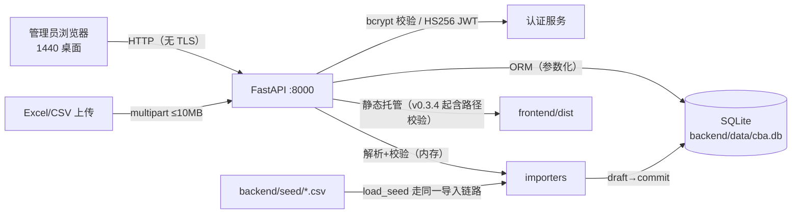
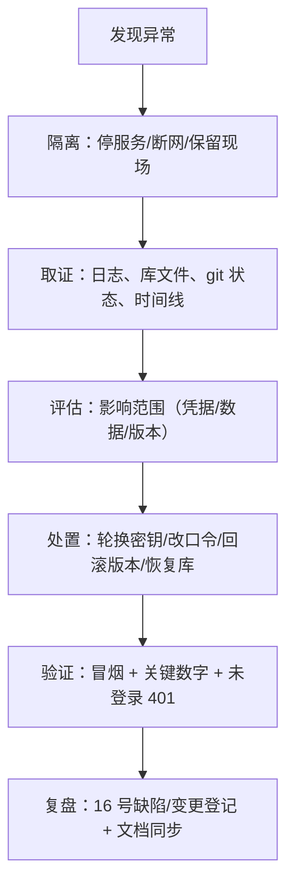

# 安全与合规说明

> 文档编号：**CBA-SEC-001** ｜ 版本：**v1.1** ｜ 日期：**2026-11-08** ｜ 适用基线：git tag **v0.3.4**（2026-11-08；在 v0.3.3 `9fbaa93` 基础上修复 S-01/D-20）
> 所属文档集：软件工程过程文档集 **v2.0**（01–18）｜ 随系统 tag **v0.3.4** 发布｜ 关联文档集 01–15 同基线 v0.3.4
> 关联：[03-概要设计](03-概要设计.md)（部署与认证）、[04-详细设计](04-详细设计.md)（接口/边界）、[05-测试文档](05-测试文档.md)、[12-部署与运维手册](12-部署与运维手册.md)、[14-测试报告](14-测试报告.md)（残余风险）、[16-评审记录与配置管理](16-评审记录与配置管理.md)（S-01 登记流程）、[18-开发规范与代码指南](18-开发规范与代码指南.md)、`backend/app/**`、`frontend/src/**`、`docs/domain/data-caliber-notes.md`

## 1. 文档信息与修订记录

### 1.1 文档信息

| 项 | 内容 |
|---|---|
| 文档编号 / 名称 | CBA-SEC-001 / 安全与合规说明 |
| 当前版本 / 状态 | v1.1 / 已评审（v0.3.4 复核：S-01 路径穿越已修复；其余缺口如实保留） |
| 编写日期 | 2026-11-08 |
| 适用基线 | `v0.3.4`（2026-11-08）：63 pytest / 45 vitest / real 构建 / smoke PASS / validate 通过；单机 Demo、单管理员、SQLite、本地 HTTP，无 Docker/CI/大模型/多租户 |
| 主要读者 | 安全负责人、运维/实施、商务、项目经理、后续接任者 |
| 评估方法 | 代码审查（`backend/app/**`、`frontend/src/**`、配置与脚本）+ 运行时探测（登录响应头、未登录 401、`/api/*` 404、静态托管路径）+ 依赖清单核对；v0.3.4 对 S-01 做回归复测 |
| 写作边界 / 与 14 的关系 | **只描述已实现的安全能力**，未实现的加密、审计、权限、TLS 一律标「未实现/缺口」；14 §8.2 已登记测试侧残余风险（R-01~R-13），本文聚焦安全/合规视角缺口（S-01~S-10，S-01 已随 v0.3.4 修复），两处编号不冲突 |

### 1.2 修订记录

| 版本 | 日期 | 修订人 | 变更摘要 | 对应基线 |
|---|---|---|---|---|
| v1.0 | 2026-11-08 | 安全/架构（项目组） | 首次建立：资产分类、认证与授权、输入/传输/浏览器安全、密钥、日志、供应链、部署加固、隐私、事件响应、检查清单与改进路线；新发现 S-01（SPA 路径穿越）并如实标注未修复 | `v0.3.3` |
| v1.1 | 2026-11-08 | 安全/架构（项目组） | 同步 v0.3.4：S-01 路径穿越已修复（`_resolve_dist_file` + 回归）、D-20 导入预览内部键过滤；测试 61→63；保留 S-02~S-10 缺口与加固建议 | `v0.3.4` |

## 2. 目标与范围

### 2.1 安全目标

| 目标 | 含义 | 一期是否达成 |
|---|---|---|
| 只允许合法管理员访问经营数据 | 未登录不得读接口/页面 | 达成（除 `/docs`、`/api/health` 等公开面，见 §5.2） |
| 经营数据不被非预期读取/篡改 | 数据只在本机 SQLite 与 API 内流转 | 达成（S-01 静态路径穿越已随 v0.3.4 修复）；仍无传输/静态加密（S-02/S-10） |
| 上传文件不破坏服务或数据库 | 非法文件返回错误而非 5xx/脏写 | 达成（D-02/D-17/D-20 修复，63 pytest 覆盖） |
| 凭证不进入代码库 | 账号/密钥走环境变量，`.env` 忽略 | 达成（D-11 修复） |
| 生产部署可加固 | 有明确的 TLS/密钥/权限加固清单 | **清单已给（§11），但 Secure cookie / TLS 需代码或代理改造，未实现** |
| 满足最小必要与私有化要求 | 不接大模型/第三方、数据不出内网 | 达成（无外部调用，见 §12.3） |

### 2.2 范围内

- 认证与会话（登录、JWT cookie、登出、401）。
- 授权与账号模型（单管理员、受保护路由）。
- 输入与导入安全（文件上传、8 类 importer、覆盖/回滚）。
- 传输与浏览器安全（HTTP、CORS、Cookie 属性、XSS、CSRF、安全响应头）。
- 密钥与配置（环境变量、默认值、忽略规则、轮换）。
- 日志与审计现状。
- 依赖与供应链、部署加固、隐私合规、备份恢复。

### 2.3 范围外（明确不做）

| 项 | 状态 | 说明 |
|---|---|---|
| 多租户与 RBAC | **未实现** | 一期单管理员（`design.md` Non-Goals）；数据模型无 company/tenant 字段 |
| 数据加密（传输 TLS / 静态加密） | **未实现** | 应用内无 TLS；SQLite 明文；依赖部署侧反向代理与磁盘加密 |
| 结构化审计日志 | **未实现** | 只有业务侧 `import_batch` 与 uvicorn 访问日志 |
| 第三方平台 API 对接 | **未实现** | 数据只来自 Excel/CSV 手工导入 |
| 大模型/外部 AI 调用 | **未实现** | 洞察为规则生成 |
| 安全设备/CI 扫描 | **未实现** | 无 Docker、无 CI、无 SCA/SAST |

## 3. 资产与数据分类

### 3.1 资产清单

| 编号 | 资产 | 形态/位置 | 机密性 | 完整性 | 可用性 |
|---|---|---|---|---|---|
| A1 | 经营数据（利润表、门店、渠道、产品、漏斗、时段、预算目标） | SQLite `backend/data/cba.db` + 上传解析后的 `import_batch.payload_json` | 高 | 高 | 中 |
| A2 | 演示/客户原始数据文件（8 类 CSV） | `backend/seed/*.csv`（仓库） | 中 | 高 | 低 |
| A3 | 管理员凭据 | 环境变量 `CBA_ADMIN_USERNAME/PASSWORD(_HASH)` | 极高 | 高 | 高 |
| A4 | 会话凭证（JWT） | 浏览器 cookie `cba_session` | 高 | 高 | 中 |
| A5 | 签名密钥 | 环境变量 `CBA_SESSION_SECRET` | 极高 | 高 | 高 |
| A6 | 源码、契约、示例数据、文档 | 仓库 `backend/`、`frontend/`、`shared/`、`docs/` | 中 | 高 | 中 |
| A7 | 构建产物与运行环境 | `frontend/dist`、`backend/.venv`、`node_modules` | 低 | 中 | 中 |

### 3.2 数据分类

| 级别 | 定义 | 本系统对应 | 保护要求 |
|---|---|---|---|
| L3 敏感 | 泄露会直接损害客户经营或导致账号失陷 | A1 真实经营数据、A3 凭据、A5 密钥、A4 会话 | 不进入代码库/截图；不跨环境复用；最小暴露 |
| L2 内部 | 泄露带来竞争或维护风险 | A2 示例数据（源自 Excel 真实结构）、A6 规格与代码 | 仓库访问控制；对外分享需脱敏 |
| L1 公开 | 可对外 | 文档中已公开的技术说明、演示脚本 | 无特殊要求 |

> 一期用于**培训演示**的示例数据来自 `docs/利润桥及毛利率分析-高维第二期261003.xlsx`（真实业务结构、金额已按源表取整）。对外演示只使用该示例数据，不使用客户生产库。

### 3.3 数据流



**数据边界**：应用进程不发起任何外部网络请求（代码中无出站 HTTP 客户端；`httpx` 仅测试依赖），数据不出本机。

### 3.4 存放与生命周期

| 数据 | 存放 | 保留 | 清理方式 |
|---|---|---|---|
| 运行库 | `backend/data/cba.db`（git 忽略，权限 644） | 持续使用 | 删库重灌（`rm -f data/cba.db && python -m app.seeds.load_seed`） |
| 上传解析中间态 | 同上 `import_batch.payload_json/preview_json` | 随批次保留 | 回滚仅影响事实表；批次记录保留 |
| 日志 | uvicorn stdout（`/tmp/cba_smoke.log` 等） | 无策略 | 手工删除 |
| 构建产物 | `frontend/dist`（git 忽略） | 演示期间 | 重新构建覆盖 |
| 示例数据 | `backend/seed/`（仓库） | 永久 | 版本管理 |

> 缺口：无自动保留期与清理策略；SQLite 文件权限依赖系统 umask（实测 644）。

## 4. 认证

### 4.1 机制

| 环节 | 实现 | 证据 |
|---|---|---|
| 密码存储 | bcrypt 哈希（`gensalt(rounds=12)`）；支持直接注入 `CBA_ADMIN_PASSWORD_HASH` | `backend/app/services/auth.py` |
| 密码校验 | `bcrypt.checkpw`；用户名不匹配时仍执行一次校验（避免时间差枚举账号） | 同上 `authenticate()` |
| 会话凭证 | JWT，算法 **HS256**，`sub` + `iat` + `exp`，有效期 **12h**（`session_max_age=43200`） | `create_token()`、`config.py` |
| Cookie | `cba_session`；`HttpOnly`；`SameSite=Lax`；`Path=/`；`Max-Age=43200`；**未设置 `Secure`** | `api/auth.py`；实测 Set-Cookie 头 |
| 接口保护 | `protected_router` 统一依赖 `get_current_user`，cookie 缺失/失效返回 401 | `api/__init__.py`、`services/auth.py` |
| 登出 | 删除 cookie（`delete_cookie`），前端跳 `/login` | `api/auth.py`、`AuthContext.tsx` |

### 4.2 登录与会话流程

```mermaid
sequenceDiagram
  participant B as 浏览器
  participant A as FastAPI
  participant S as Auth 服务
  B->>A: POST /api/auth/login {username,password}
  A->>S: authenticate()（bcrypt 校验，失败也跑一次）
  alt 凭据正确
    S-->>A: 通过
    A-->>B: 200 + Set-Cookie cba_session（HttpOnly; SameSite=Lax; 12h）
    B->>A: GET /api/analysis/overview（带 cookie）
    A->>S: decode_token（HS256 验签 + exp）
    A-->>B: 200 数据
  else 凭据错误
    A-->>B: 401 {detail:"账号或密码错误"}
  end
  B->>A: GET /api/analysis/overview（不带 cookie）
  A-->>B: 401 {detail:"未登录"}
```

### 4.3 实测证据（2026-11-08）

| 项 | 结果 |
|---|---|
| 未登录访问 `GET /api/analysis/overview` | **401**（`backend/tests/test_api.py` 覆盖） |
| 登录响应头 | `set-cookie: cba_session=…; HttpOnly; Max-Age=43200; Path=/; SameSite=lax`（**无 Secure**） |
| 错误密码 | 401，文案统一「账号或密码错误」 |
| 登出 | 清 cookie；JWT 本身未进入服务端撤销名单 |

### 4.4 强度评估与缺口

| # | 缺口 | 风险 | 现状/建议 |
|---|---|---|---|
| S-04 | 默认账号 `admin/admin123` 与默认会话密钥可直接启动 | 高（若原样部署到网络） | 部署前必须改（§11）；文档已多处标注「演示账号」 |
| S-05 | 无登录失败次数限制/锁定/延时 | 中 | bcrypt cost 12 有一定暴力破解成本；建议加限流或失败计数（二期） |
| — | 无 MFA | 低（单管理员 Demo） | 二期按客户要求评估 |
| — | JWT 无服务端撤销（改密钥才能全失效） | 中 | 改 `CBA_SESSION_SECRET` 或缩短有效期；二期加黑名单/版本号 |
| — | 无密码复杂度策略（无注册/改密界面，账号来自环境变量） | 低 | 运维侧自行保证强度 |
| — | cookie 无 `Secure`（本地 HTTP） | 中 | 一级缺口 S-02 的组成部分；上 TLS 后需改代码加 `secure=True` |

## 5. 授权与账号

### 5.1 账号模型

- **唯一账号**：管理员（`CBA_ADMIN_USERNAME`，默认 `admin`），无角色、无权限矩阵、无用户表。
- **认证即授权**：任何已登录会话都拥有全部权限（含导入、覆盖、回滚、加载示例数据）。
- **二期规划（未实现）**：多租户（brand/company 字段）、角色权限、审批流（`tasks.md` 15.3）。

### 5.2 接口保护矩阵

| 接口/资源 | 认证要求 | 实测 | 说明 |
|---|---|---|---|
| `POST /api/auth/login` | 公开 | 200/401 | 唯一公开业务接口 |
| `GET /api/health` | 公开 | 200 `{"status":"ok"}` | 健康检查，信息量极小 |
| `GET /docs`、`GET /openapi.json` | **公开（FastAPI 默认）** | 200 | **S-08**：接口清单与模型对外可见 |
| `/api/analysis/*`（10 条） | 登录 | 401 未登录 | `protected_router` |
| `/api/imports*`、`/api/seeds/load` | 登录 | 401 未登录 | 破坏性操作见 §5.3 |
| `/api/data-status` | 登录 | 401 未登录 | 含期间/门店维度信息 |
| `/api/ping` | 登录 | 401 未登录 | 调试用 |
| `/{full_path}` SPA 静态 | 公开 | 200 | 前端静态资源；路径穿越防护见 §6.5（v0.3.4 已修复） |

### 5.3 高危操作（单管理员下均可执行）

| 操作 | 风险 | 缓解现状 |
|---|---|---|
| `POST /api/seeds/load?force=true` | 再导一轮示例数据（旧行 supersede，批次增长） | 仅登录可用；`--force` 语义明确 |
| `POST /api/imports/{id}/commit` | 覆盖同期间同门店数据 | 两阶段预览 + 覆盖提示 + 可回滚 |
| `POST /api/imports/{id}/rollback` | 删除批次新行、恢复旧行 | 仅对 committed 批次生效 |
| 导入任意 8 类数据 | 数据被替换/污染 | 校验 + 预览 + 批次追溯 |

> 一期没有「操作审批」与「二次确认」的强制链，属于单管理员 Demo 的合理简化；多用户场景必须补权限（未实现）。

## 6. 输入与导入安全

### 6.1 上传面控制

| 控制点 | 实现 | 证据 |
|---|---|---|
| 数据集白名单 | `dataset` 必须在 `DATASET_ORDER`（8 个 key）内，否则 400 | `api/imports.py` |
| 文件大小上限 | `MAX_FILE_SIZE = 10MB`，超限 400 | 同上 |
| 空文件 | 400「文件为空」 | 同上 |
| 科目映射 | `account_mapping` 必须是 JSON 对象，否则 400 | 同上 |
| 文件类型 | 按**扩展名**分流：`.xlsx/.xlsm` 走 openpyxl；`.csv/.txt` 走 csv；其它类型返回行级错误「不支持的文件类型」（HTTP 200 + `errors[]`，不入库；v0.3.4 起提示文案列出 `.xlsx/.xlsm/.csv/.txt`）；前端 `accept` 收敛为 `.xlsx/.xlsm/.csv/.txt` | `importers/base.py`、`DataPage.tsx` |
| 解析异常 | 坏 xlsx / 不支持类型 / CSV 编码失败（非 UTF-8 且非 GBK）→ **行级错误**（HTTP 200 + `errors[]`，`row=1/column=文件`），不入库、不产生 5xx | D-02/D-17；`test_invalid_xlsx_returns_row_error_not_500`、`test_gbk_encoded_csv_is_accepted`；2026-11-08 实测（见 §14 第 6 项） |
| 内存解析 | 上传内容只在内存解析，**不落临时文件**；draft 解析结果存 `import_batch.payload_json` | `importers/service.py`、`models/dimensions.py` |
| 公式处理 | xlsx 以 `read_only=True, data_only=True` 读取**缓存值**，不执行公式 | `importers/base.py` |

### 6.2 校验与数据完整性

| 校验 | 说明 |
|---|---|
| 行级错误 | `{row, column, message}`，行号为文件真实行号，前端错误表展示、确认按钮禁用；预览前 50 行过滤所有 `_` 前缀内部键（v0.3.4/D-20，回归 `test_import_preview_hides_internal_keys`） |
| 类型/范围 | 数字、整数、期间 `YYYY-MM`、非负、枚举（经营模式/店型/日类型等） |
| 业务校验 | 门店存在、科目在标准表内、渠道在清单内、逐级递减（漏斗）、系列已存在（单品） |
| 覆盖机制 | 旧行 `superseded_by` 指向新批次，不物理删除；回滚恢复旧行、删新行，避免重复累加 |
| 批次追溯 | `import_batch` 记录数据集/文件/期间/行数/操作人/时间/状态（审计价值见 §9） |

### 6.3 注入面评估

| 类型 | 现状 | 结论 |
|---|---|---|
| SQL 注入 | 全部查询走 SQLAlchemy ORM/表达式，无 `text()` 裸 SQL、无字符串拼接 SQL | 低风险（代码审查） |
| XSS（存储型/反射型） | 后端只返回 JSON；前端 React 自动转义；无 `dangerouslySetInnerHTML`、`innerHTML`、`eval` | 低风险（grep 核实为空） |
| 公式注入（CSV/Excel） | 一期**无导出**功能（报告/Excel 导出为二期）；导入只读缓存值 | 当前无面；二期导出必须加公式前缀防护 |
| 路径穿越（上传/模板） | 模板下载 `key` 先校验 `DATASET_ORDER` 白名单 | 低风险 |
| 路径穿越（静态托管） | v0.3.4 起 `_resolve_dist_file()` 做 `resolve()` + `is_relative_to(dist)` + `is_file()` 校验，越界回落 `index.html` | **S-01（v0.3.4 已修复，见 §6.5）** |
| 反序列化 | 无 pickle/yaml/eval 加载外部数据；`json.loads` 仅用于科目映射 | 低风险 |
| 模板注入 | 模板由 openpyxl 静态生成，用户输入不进模板内容 | 低风险 |

### 6.4 覆盖与回滚的误操作风险

- 同一「数据集 + 门店 + 期间」再导入 = 整体覆盖（不累加），用户若上传错文件，可通过**批次回滚**恢复。
- 覆盖的粒度：利润表按期间+门店+scenario 整段覆盖；单品按本批 product_id 集合覆盖；预算/目标分别按期间/渠道覆盖（`04` §11-12）。
- 风险：回滚只针对 `committed` 批次（`rollback_import` 校验状态）；回滚后的新导入无法再回滚到更早以外的状态。属设计取舍。

### 6.5 S-01：SPA 静态托管路径穿越（v0.3.4 已修复）

| 项 | 内容 |
|---|---|
| 编号 | S-01（安全编号；`D-20` 已用于「导入预览内部键过滤」，见 §6.2） |
| 严重级别 | **高**（v0.3.3 及以前；在本机/内网暴露且 `frontend/dist` 存在时） |
| 位置 | `backend/app/main.py`：v0.3.4 起抽出 `_resolve_dist_file()`，供 `@app.get("/{full_path:path}")` 使用 |
| 问题（历史） | v0.3.3 及以前 `full_path` 直接拼 `_dist / full_path`，未归一化、未校验「必须位于 dist 之下」，可读取仓库其它文件 |
| 复现（v0.3.3 实测） | `curl --path-as-is "http://127.0.0.1:8000/../../backend/app/config.py"` → 曾返回 **200 text/x-python** 与 `config.py` 源码；v0.3.4 起应回落 `index.html`，并由回归用例固化 |
| 影响 | 若服务绑定 `0.0.0.0`/内网可访问，未登录者可读取仓库可读文件（源码、`.env`、`backend/seed/*.csv` 等）；本机演示（127.0.0.1）风险受限于本机用户 |
| 修复方式（v0.3.4） | `_resolve_dist_file()`：`root = dist.resolve()`；`target = (root / full_path).resolve()`；校验 `target.is_relative_to(root)` 且 `is_file()`，否则返回 `None` → 回落 `index.html`；`OSError/ValueError` 亦返回 `None` |
| 状态 / 回归 | **v0.3.4 已修复**；回归 `backend/tests/test_api.py::test_spa_path_traversal_is_blocked`（断言 `../../backend/app/config.py` → `None`、`index.html` → 文件；`frontend/dist` 未构建时 skip） |
| 纵深防御（仍建议） | 公网/内网部署仍在反向代理拦截含 `..` 的路径并只绑受控地址；不要裸奔（defense in depth） |

## 7. 传输与浏览器安全

### 7.1 传输层（S-02）

- 应用与前端均为 **HTTP**：uvicorn 8000 / Vite 5173；无 TLS 配置、无 HSTS。
- 影响：同网段嗅探可获取 JWT cookie 与经营数据；公网部署不可接受。
- 现状定位：本机单机演示（`README.md` 快速开始），不是生产部署形态。
- 缓解/修正：部署侧加反向代理 TLS（§11.2）；代码侧把 cookie 改为 `secure=True` 需配合 HTTPS（**未实现**）。

### 7.2 CORS

| 项 | 值 | 评价 |
|---|---|---|
| `allow_origins` | `http://127.0.0.1:5173`、`http://localhost:5173` | 白名单，无通配符；符合最小暴露 |
| `allow_credentials` | `true` | 与白名单组合可接受；生产需改为实际前端域名 |
| `allow_methods/headers` | `*` | 与白名单组合风险可控 |
| 证据 | `backend/app/main.py`；`14` R-09（仅代码审查，无自动化断言） | 建议加一条 CORS 回归测试 |

### 7.3 Cookie 与会话

| 属性 | 当前 | 风险/说明 |
|---|---|---|
| `HttpOnly` | ✅ | JS 不可读，降低 XSS 窃取会话风险 |
| `SameSite=Lax` | ✅ | 跨站 POST 默认不带 cookie，降低 CSRF |
| `Path=/` | ✅ | 全站生效 |
| `Max-Age` | 43200（12h） | 固定有效期，无滑动续期 |
| `Secure` | ❌ 未设置 | HTTP 下无法设置；上 TLS 后必须加（**未实现**） |
| `Domain` | 未设置（host-only） | 合理 |

### 7.4 XSS 与前端安全

| 项 | 现状 | 评价 |
|---|---|---|
| 输出编码 | React JSX 自动转义；无 `dangerouslySetInnerHTML`/`innerHTML` | 低风险 |
| 外部脚本/字体 | `index.html` 无第三方 CDN、无外链脚本 | 低风险（断网可用） |
| 富文本/HTML 注入 | 洞察文本按纯文本渲染；无 HTML 编辑器 | 低风险 |
| 前端路由守卫 | `RequireAuth` + 401 兜底跳转 `/login` | 仅体验层，安全依赖后端 401 |

### 7.5 CSRF 评估

- 会话为 cookie 自动携带；但 `SameSite=Lax` 使跨站 `POST/PUT/DELETE` 默认不携带 cookie，主要 CSRF 面被阻断。
- **未实现** CSRF token 或 `Origin/Referer` 校验；对「同站子域/浏览器兼容性差」场景仍有残余风险（低）。
- 建议：多用户/公网部署前补 CSRF token 或双提交 cookie。

### 7.6 安全响应头（S-06）

| 头 | 当前 | 建议 |
|---|---|---|
| `Content-Security-Policy` | 无 | 加 `default-src 'self'`（注意 ECharts 需 `style-src 'unsafe-inline'` 或用 nonce） |
| `X-Content-Type-Options` | 无 | `nosniff` |
| `X-Frame-Options` / `frame-ancestors` | 无 | `DENY`（防点击劫持） |
| `Referrer-Policy` | 无 | `no-referrer` |
| `Strict-Transport-Security` | 无（无 TLS） | 上 TLS 后加 |
| 证据 | `curl -I /api/health` 实测只返回 `server: uvicorn` 等默认头 | 可在中间件统一加 |

## 8. 密钥与配置

### 8.1 配置项与风险

| 配置 | 默认值 | 泄露/误用风险 | 处置 |
|---|---|---|---|
| `CBA_ADMIN_PASSWORD` | `admin123` | 高（默认口令） | 部署前改；或用 `CBA_ADMIN_PASSWORD_HASH` |
| `CBA_SESSION_SECRET` | `dev-only-change-me-32bytes-minimum-key` | 高（默认签名密钥，可伪造 JWT） | 部署前用 `secrets.token_urlsafe(32)` 生成 |
| `CBA_DATABASE_URL` | `sqlite:///backend/data/cba.db` | 中（路径即数据位置） | 部署时指定受控目录 + 文件权限 600 |
| 洞察阈值 `CBA_*` | 15%/1/4/1pp/3/60% | 低 | 按客户口径调整 |
| `VITE_API_MODE` | `mock`（dev）/`real`（dev.sh） | 中（演示错用 mock 会得到假数据） | 演示构建固定 `real` |
| `VITE_API_BASE` | `/api` | 低 | 仅在需要跨域直连时设置；构建期注入 |

### 8.2 密钥管理现状（S-03）

- 密钥全部走环境变量，**不写入代码**；`.env`/`*.env` 已被 `.gitignore` 忽略（D-11），仓库历史未见 `.env` 提交（`git log --all -- .env` 为空）。
- **缺口**：`config.py` 内置开发默认值，若运维直接 `uvicorn` 启动且不设环境变量，会使用默认密钥与默认口令。
- 无密钥托管（Vault/KMS）、无轮换计划、无密钥使用审计。

### 8.3 轮换流程（手工，已验证可行）

```bash
# 1) 生成新会话密钥（32 bytes，URL-safe）
python3 -c "import secrets; print(secrets.token_urlsafe(32))"

# 2) 以新密钥与新口令启动（推荐写入受控 env 文件，权限 600）
export CBA_SESSION_SECRET='<新密钥>'
export CBA_ADMIN_PASSWORD='<强口令>'
cd backend && .venv/bin/python -m uvicorn app.main:app --host 127.0.0.1 --port 8000

# 3) 影响：旧 cookie 全部失效（所有会话需重新登录）；管理员工号不变
```

- 数据库如需迁移目录：改 `CBA_DATABASE_URL` 后重启，旧库文件保留备份（§13.4）。
- 轮换后必须重跑 `bash scripts/smoke.sh`（冒烟用临时库，不影响演示库）。

## 9. 日志与审计

### 9.1 现状

| 记录 | 内容 | 位置 | 可用于审计？ |
|---|---|---|---|
| uvicorn 访问日志 | 方法/路径/状态码 | stdout（重定向到 `/tmp/*.log`） | 部分（无用户身份、无请求体） |
| `import_batch` | 数据集/文件/期间/行数/操作人/created_at/committed_at/rolled_back_at/status | SQLite | **是**（业务侧最完整） |
| 认证事件 | 无（登录成功/失败不落库） | — | 否 |
| 配置变更/启动 | 无应用日志 | — | 否 |
| 数据导出 | 一期无导出功能 | — | — |

### 9.2 缺口（S-07）

| # | 缺口 | 说明 |
|---|---|---|
| 1 | 无认证审计 | 登录成功/失败、登出、会话过期均无记录，无法发现暴力破解 |
| 2 | `operator` 可伪造 | `POST /api/imports` 的 `operator` 来自请求表单（默认 `admin`），调用方可任意填写；`commit`/`rollback` 不记录操作人 |
| 3 | 无结构化日志 | 无 `logging` 配置、无 JSON 日志、无级别与保留策略 |
| 4 | 日志含路径参数 | 访问日志含 `period/store/channel_id`，不含凭据；但落盘位置 `/tmp` 无权限收紧 |
| 5 | 无审计保留/防篡改 | 批次记录可被管理员直接改库（SQLite 单文件） |

### 9.3 建议的审计最小集（二期，未实现）

| 事件 | 字段 |
|---|---|
| 登录成功/失败 | 时间、用户名、来源 IP、结果、UA |
| 导入提交/回滚 | 时间、会话用户、批次、数据集、期间、门店、行数 |
| 示例数据加载/覆盖 | 时间、会话用户、force 标志 |
| 配置启动 | 时间、版本、关键配置是否使用默认值（仅布尔，不记录密钥） |

## 10. 依赖与供应链

### 10.1 后端依赖（`backend/requirements.txt`，10 项锁定）

| 包 | 版本 | 用途 |
|---|---|---|
| fastapi | 0.162.2 | Web 框架 |
| uvicorn[standard] | 0.54.0 | ASGI 服务器 |
| sqlalchemy | 2.1.8 | ORM |
| alembic | 1.20.1 | 迁移 |
| bcrypt | 5.0.0 | 口令哈希 |
| pyjwt | 2.15.1 | JWT |
| openpyxl | 3.1.5 | xlsx 解析/模板 |
| python-multipart | 0.0.33 | 上传表单 |
| httpx | 0.28.1 | 测试客户端依赖 |
| pytest | 9.2.0 | 测试 |

> v0.3.3 已移除未使用的 `pandas`（D-15~D-18 同批），减少依赖面。

### 10.2 前端依赖（`frontend/package.json` + `package-lock.json`）

| 包 | 声明 | 实测安装 |
|---|---|---|
| react / react-dom | ^19.3.1 | 19.3.1 |
| antd | ^6.7.0 | 6.7.0 |
| echarts / echarts-for-react | ^6.1.0 / ^3.0.6 | 6.1.0 / 3.0.6 |
| react-router-dom | ^7.18.5 | 7.18.5 |
| @tanstack/react-query | ^5.107.1 | 5.107.1 |
| vite / typescript / vitest | ^8.3.6 / ~7.0.2 / ^5.1.0 | 8.3.6 / 7.0.2 / 5.1.0 |
| oxlint / jsdom / testing-library | — | 1.92.0 / 31.0.0 / 16.3.3 |

### 10.3 供应链控制现状与缺口（S-09）

| 控制 | 现状 | 评价 |
|---|---|---|
| 版本锁定 | 后端 `==` 精确锁定；前端 `package-lock.json` 提交 | 良好（可复现构建） |
| 依赖来源 | 官方 npm / PyPI | 未配置镜像/私有源校验 |
| 漏洞扫描 | **无**（无 CI、无 Dependabot、未跑 `npm audit`/`pip-audit`） | 缺口 |
| 许可证审计 | **无** | 缺口（商用前需补） |
| 弃用告警 | pytest 报 `StarletteDeprecationWarning`（httpx→httpx2） | 低（`14` R-05） |

### 10.4 建议

1. 引入 `pip-audit` / `npm audit` 作为发布前手工步骤（无 CI 时的最低成本方案）。
2. 升级 httpx/starlette 消掉 deprecation 告警。
3. 二期接 CI 后加依赖扫描与许可证清单。

## 11. 部署加固清单

### 11.1 本机演示标准动作（当前推荐形态）

```bash
# 后端（127.0.0.1，示例数据）
cd backend && .venv/bin/python -m uvicorn app.main:app --host 127.0.0.1 --port 8000

# 前端（real 构建，由 FastAPI 托管）
cd frontend && VITE_API_MODE=real npm run build
# 浏览器访问 http://127.0.0.1:8000（演示账号 admin/admin123）

# 冒烟（隔离库，不碰演示库）
bash scripts/smoke.sh
```

### 11.2 面向内网/客户环境的加固步骤

| # | 步骤 | 命令/说明 | 现状支持 |
|---|---|---|---|
| 1 | 改管理员口令 | `export CBA_ADMIN_PASSWORD='<强口令>'`（或 `CBA_ADMIN_PASSWORD_HASH`） | ✅ 支持 |
| 2 | 换会话密钥 | `python3 -c "import secrets;print(secrets.token_urlsafe(32))"` → `CBA_SESSION_SECRET` | ✅ 支持 |
| 3 | 只绑本机/内网 | `--host 127.0.0.1` 或内网 IP + 防火墙白名单 | ✅ 支持 |
| 4 | 库文件权限 | `chmod 600 backend/data/cba.db` | ✅ 支持（当前默认 644） |
| 5 | 反向代理 + TLS | Nginx/Caddy 终止 TLS，转发 127.0.0.1:8000 | ⚠️ 应用无 TLS 配置，需代理 |
| 6 | Cookie `Secure` | 需代码改 `set_cookie(..., secure=True)` | ❌ **未实现**（需补丁） |
| 7 | 关闭 API 文档 | 反向代理屏蔽 `/docs`、`/openapi.json`，或代码设 `docs_url=None` | ❌ 当前公开（S-08） |
| 8 | 拦截路径穿越 | 应用层已校验 dist 内文件（v0.3.4）；代理层仍建议拒绝含 `..` 的路径 | ✅ 应用已修复（S-01）；代理加固仍建议 |
| 9 | 加安全响应头 | 代理或中间件加 CSP/nosniff/frame-ancestors | ❌ 未实现（S-06） |
| 10 | 登录限流 | 代理层 `limit_req` 或应用层 | ❌ 未实现（S-05） |
| 11 | 备份 | 每日 `cp backend/data/cba.db` 到受控目录 | ⚠️ 手工（§13.4） |
| 12 | 日志保留 | 访问日志落盘 + 轮转 | ⚠️ 手工 |
| 13 | 依赖扫描 | `pip-audit`、`npm audit` | ❌ 未实现（S-09） |

### 11.3 反向代理示例（Nginx，供实施参考）

```nginx
server {
  listen 443 ssl;
  server_name cba.example.internal;
  ssl_certificate     /etc/ssl/cba.crt;
  ssl_certificate_key /etc/ssl/cba.key;

  # 关闭接口文档外露
  location = /docs        { return 404; }
  location = /openapi.json { return 404; }

  # 纵深防御：路径穿越已在应用层修复（S-01），代理再拦一层
  if ($request_uri ~ "\.\.") { return 400; }

  add_header X-Content-Type-Options nosniff;
  add_header X-Frame-Options DENY;
  add_header Referrer-Policy no-referrer;
  # CSP 需按前端资源实际调整后启用
  # add_header Content-Security-Policy "default-src 'self'";

  location / {
    proxy_pass http://127.0.0.1:8000;
    proxy_set_header Host $host;
    proxy_set_header X-Forwarded-Proto https;
  }
}
```

> 说明：即使上了代理，cookie 仍需要应用侧 `secure=True` 才不会被浏览器降级发送；该代码改动未实现，属上线前必做补丁（见 §15 P0/P1）。

### 11.4 加固后验收命令

```bash
# 1) 未登录必须 401
curl -s -o /dev/null -w "%{http_code}\n" http://127.0.0.1:8000/api/analysis/overview
# 2) 未知接口必须是 404 JSON（不是 HTML）
curl -s http://127.0.0.1:8000/api/nope | head -c 80
# 3) 路径穿越必须被拦截（v0.3.4 起应回落 index.html/404，而非返回源码）
curl -s --path-as-is -o /dev/null -w "%{http_code} %{content_type}\n" "http://127.0.0.1:8000/../../backend/app/config.py"
# 4) cookie 属性（TLS 后应含 Secure）
curl -si -X POST http://127.0.0.1:8000/api/auth/login -H 'Content-Type: application/json' \
  -d '{"username":"admin","password":"<口令>"}' | grep -i set-cookie
# 5) 安全响应头
curl -sI http://127.0.0.1:8000/ | sed -n 1,15p
```

## 12. 隐私合规

### 12.1 数据性质

- 一期数据为**企业经营数据**（收入、成本、费用、客流、渠道、产品、漏斗、预算/目标），来源于客户 Excel/CSV，不包含消费者个人身份信息。
- 16 张表中**无顾客/会员/评价文本表**（`brand, store, account, channel, product_series, product, period, import_batch` + 8 张事实表）；漏斗/客流为聚合人数。
- 批次表保留文件名、操作人（可伪造）、时间等运维信息。

### 12.2 合规原则映射（诚实评估）

| 原则 | 当前实现 | 评价 |
|---|---|---|
| 最小必要 | 只采集经营分析所需 8 类数据，无消费者 PII | 基本满足 |
| 目的限定 | 数据仅用于经营分析展示，未用于其他用途 | 满足 |
| 存储限制 | 无保留期策略；数据随部署长期保留 | **缺口** |
| 安全措施 | 认证 + 文件权限 + 私有化部署；无加密/审计 | 部分满足 |
| 告知与同意 | 系统无隐私声明/用户协议（面向员工/管理员，不面向消费者） | 商用前需补 |
| 数据跨境 | 无外部传输、不接第三方服务 | 满足（本地部署） |
| 数据主体权利 | 一期不含个人信息，暂无查询/删除流程 | 二期评估 |

### 12.3 私有化与第三方

- 应用无出站网络调用（代码审查）；前端无外部 CDN/字体；洞察为规则生成，**不调用大模型**。
- 部署形态为单机/内网；数据默认不出本机。
- 二期若接 AI 或第三方平台，必须重新做数据出境/委托处理评估（未实现）。

### 12.4 合规缺口

| # | 缺口 | 建议 |
|---|---|---|
| C-01 | 无隐私声明/数据处理说明 | 商用前提供一页说明（数据范围、存放、保留、联系人） |
| C-02 | 无保留期与删除机制 | 提供库备份/清理脚本与制度 |
| C-03 | 数据库与备份未加密 | 依赖磁盘加密（FileVault/LUKS）或补应用层加密（未实现） |
| C-04 | 无操作审计，难以证明合规 | 见 §9 建议最小审计集 |
| C-05 | 无数据处理协议（DPA）模板 | 商务侧准备 |

## 13. 事件响应与备份恢复

### 13.1 事件分级

| 级别 | 示例 | 响应时限（演示期） |
|---|---|---|
| P1 | 数据泄露/凭据外泄/库文件被拷走 | 立即停止对外服务、保留证据、通报 Lead/用户 |
| P2 | 服务不可用/接口 5xx/登录异常 | 1 小时内恢复或切换 mock 演示 |
| P3 | 单页报错/导入失败 | 当日修复并补回归 |

### 13.2 响应流程



### 13.3 场景处置

| 场景 | 处置步骤 |
|---|---|
| 账号口令泄露 | 改 `CBA_ADMIN_PASSWORD`/`CBA_ADMIN_PASSWORD_HASH` → 重启 → 告知使用方；如怀疑 JWT 泄露，同时轮换 `CBA_SESSION_SECRET` |
| 会话密钥泄露 | 轮换 `CBA_SESSION_SECRET`（旧 cookie 全失效）→ 检查访问日志异常 |
| 数据被误覆盖/误删 | 用批次回滚恢复；无批次可回滚时从备份库恢复（§13.4） |
| 库文件损坏 | 停服务 → 保留损坏文件 → 恢复备份 → `pytest`/抽查数字 |
| 服务不可用 | 检查 uvicorn 日志 → 重启；演示兜底切 `VITE_API_MODE=mock`（`14` R-12） |
| 依赖漏洞披露 | 评估影响 → 升级锁定版本 → 重跑 63 pytest / 45 vitest / build / smoke |

### 13.4 备份与恢复（当前手工，无自动备份）

| 项 | 现状 | 建议 |
|---|---|---|
| 备份对象 | `backend/data/cba.db` + `backend/seed/*.csv` + git 仓库 | 每日/每次导入后备份库文件 |
| 备份方式 | 手工 `cp`（无脚本、无加密、无异地） | 补 `scripts/backup.sh`（未实现） |
| 恢复 | 覆盖库文件后重启；或用 `load_seed` 重建示例数据 | 演练步骤见下 |
| RPO/RTO | **未测量**（诚实标注） | 演示期可接受「小时级」；商用需定义 |

```bash
# 备份（示例）
mkdir -p ~/cba-backup && cp backend/data/cba.db ~/cba-backup/cba-$(date +%Y%m%d-%H%M).db
# 恢复
cp ~/cba-backup/cba-<时间>.db backend/data/cba.db
bash scripts/smoke.sh   # 隔离库冒烟，验证代码与环境
```

## 14. 安全检查清单

| # | 检查项 | 方法 | 期望 | v0.3.4 实测 |
|---|---|---|---|---|
| 1 | 未登录访问分析接口 | `curl /api/analysis/overview` | 401 | ✅ 401 |
| 2 | 登录成功签发会话 | `curl -i -X POST /api/auth/login` | Set-Cookie HttpOnly | ✅（无 Secure） |
| 3 | 错误口令拒绝 | 错误密码登录 | 401 | ✅ |
| 4 | 受保护路由全覆盖 | 审查 `protected_router` | 除登录/健康检查外均需登录 | ✅（`/docs` 例外，S-08） |
| 5 | 上传大小限制 | 上传 >10MB | 400 | ✅ 代码校验 |
| 6 | 非法文件类型 | 上传 `.exe` | 不 5xx、不入库（返回 `errors[]`） | ✅ HTTP 200 + 行级错误（`row=1`、`column=文件`；提示文案含 `.xlsx/.xlsm/.csv/.txt`）；A-07：不是 400 |
| 7 | 上传数据集白名单 | 伪造 dataset key | 400 | ✅ |
| 8 | SQL 注入面 | 代码审查 + 参数化查询 | 无裸 SQL | ✅ |
| 9 | XSS 面 | grep `dangerouslySetInnerHTML`/`innerHTML`/`eval` | 无 | ✅ |
| 10 | CORS 白名单 | 审查 `main.py` | 仅本机 5173 | ✅（无自动化断言） |
| 11 | 路径穿越（模板） | 下载不存在 key | 404 | ✅ |
| 12 | 路径穿越（静态） | `curl --path-as-is /../../backend/app/config.py` | 不返回仓库文件（回 index.html/404） | ✅ 通过（v0.3.4；回归 `test_spa_path_traversal_is_blocked`） |
| 13 | 未知 `/api/*` | `curl /api/nope` | 404 JSON | ✅（D-17） |
| 14 | 默认凭据 | 审查 `config.py` | 部署应已覆盖 | ❌ 默认值存在（S-03/S-04） |
| 15 | 密钥入库 | `git log --all -- .env`、grep 仓库密钥 | 无 | ✅（.env 已忽略） |
| 16 | 安全响应头 | `curl -I` | CSP/nosniff/frame 等 | ❌ 无（S-06） |
| 17 | 接口文档外露 | `curl /docs` | 内网可接受、公网应关 | ❌ 公开 200（S-08） |
| 18 | 依赖锁定 | 审查锁文件 | 锁定 | ✅（前端 lock + 后端 `==`） |
| 19 | 依赖漏洞扫描 | `pip-audit` / `npm audit` | 无高危 | ⚠️ 未执行（S-09） |
| 20 | 数据外发 | 代码审查出站调用 | 无 | ✅ 无外部调用 |
| 21 | 导入预览内部键 | 上传合法文件看 `preview` 字段 | 无 `_store_id`/`_accounts`/`_row` 等内部键 | ✅ 通过（v0.3.4；`test_import_preview_hides_internal_keys`） |

## 15. 结论与改进

### 15.1 结论

- **一期安全形态与定位匹配**：单机、本地 HTTP、单管理员、无外部依赖，用于 2026-11-15 培训演示；认证、上传校验、数据覆盖/回滚、私有化边界（不接大模型/第三方、数据不出本机）已具备。
- **v0.3.4 已修复 S-01（静态路径穿越）**；仍不具备生产安全条件：默认凭据/密钥、无 TLS、无 Secure cookie、无安全响应头、无登录限流、无审计日志、`/docs` 公开、无依赖扫描、SQLite 明文与备份未加密。
- **未实现的能力不宣称**：多租户/RBAC、加密（传输/静态）、结构化审计、双因素、CI 安全门均**未实现**。

### 15.2 缺口汇总与优先级

| 编号 | 缺口 | 级别 | 优先级 | 建议处置 | 建议责任 |
|---|---|---|---|---|---|
| S-01 | SPA 静态托管路径穿越（可读仓库文件） | 高 | **已修复（v0.3.4）** | `_resolve_dist_file()`：`resolve()` + `is_relative_to(dist)` + `is_file()`，越界回落 `index.html`；回归 `test_spa_path_traversal_is_blocked`；代理拦截作纵深防御 | 后端 |
| S-02 | 无 TLS、cookie 无 Secure | 高 | P1（上内网/客户环境前） | 反向代理 TLS + 代码 `secure=True` + HSTS | 运维/后端 |
| S-03 | `CBA_SESSION_SECRET` 有开发默认值 | 高 | P0（部署前） | 强制环境变量；启动时若为默认值打印警告或拒绝启动（建议） | 后端/运维 |
| S-04 | 默认口令 `admin123` | 高 | P0（部署前） | 强制改口令；首次启动提示 | 运维 |
| S-05 | 无登录限流/锁定 | 中 | P1 | 代理层 `limit_req` 或应用层失败计数 | 后端/运维 |
| S-06 | 无安全响应头 | 中 | P1 | 中间件或代理加 CSP/nosniff/frame-ancestors/Referrer-Policy | 后端/运维 |
| S-07 | 无审计日志；operator 可伪造 | 中 | P1 | 登录/导入审计表；operator 取会话用户 | 后端 |
| S-08 | `/docs`、`/openapi.json` 公开 | 中 | P1（内网可宽限） | 生产关闭或代理拦截 | 运维 |
| S-09 | 无依赖漏洞/许可证扫描 | 中 | P2 | 发布前 `pip-audit`/`npm audit`；二期接 CI | 测试/后端 |
| S-10 | 库/备份明文、file 644 | 中 | P2 | `chmod 600` + 磁盘加密 + 备份加密 | 运维 |

### 15.3 改进路线

1. **演示前（P0）**：S-01 已随 v0.3.4 修复（含回归）；其余动作——只绑 `127.0.0.1`、显式设置 `CBA_SESSION_SECRET` 与 `CBA_ADMIN_PASSWORD`、在 `14` 放行条件中记录「默认值不得用于对外环境」。
2. **演示后一个补丁（P1）**：启动时校验默认密钥/口令、Cookie `Secure` 开关、安全响应头、关闭 `/docs`、登录限流、结构化审计日志。
3. **二期（P2）**：审计日志与操作人改造、依赖扫描与 CI 安全门、多租户/RBAC、加密与保留期策略、DPA/隐私声明。

> 与 14 的交叉引用：14 §8.2 的 R-01~R-13 是测试视角残余风险；本文 S-01~S-10 是安全/合规视角缺口，二者共同构成上线前的风险清单。任何「已修复」表述以代码与回归测试为准。
