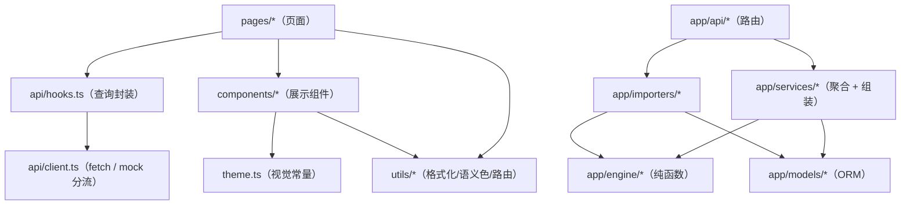

# 开发规范与代码指南

> 文档编号：**CBA-DEV-001** ｜ 版本：**v1.1** ｜ 日期：**2026-11-08** ｜ 适用基线：git tag **v0.3.4**（2026-11-08；在 v0.3.3 `9fbaa93` 基础上修复 S-01/D-20）
> 所属文档集：软件工程过程文档集 **v2.0**（01–18）｜ 随系统 tag **v0.3.4** 发布｜ 关联文档集 01–15 同基线 v0.3.4
> 关联：[03-概要设计](03-概要设计.md)（分层）、[04-详细设计](04-详细设计.md)（接口/公式/边界）、[05-测试文档](05-测试文档.md)、[10-数据库设计说明书](10-数据库设计说明书.md)、[11-接口设计文档](11-接口设计文档.md)、[16-评审记录与配置管理](16-评审记录与配置管理.md)（变更/门禁）、[17-安全与合规说明](17-安全与合规说明.md)（安全红线）、`CLAUDE.md`、`shared/api-contract.md`、`docs/agents/roles.md`、`docs/domain/data-caliber-notes.md`

## 1. 文档信息与修订记录

### 1.1 文档信息

| 项 | 内容 |
|---|---|
| 文档编号 / 名称 | CBA-DEV-001 / 开发规范与代码指南 |
| 当前版本 / 状态 | v1.1 / 已评审（对齐 v0.3.4 代码现状：路径穿越修复、预览内部键过滤，含已知技术债） |
| 编写日期 | 2026-11-08 |
| 适用基线 | `v0.3.4`：后端 **63 pytest**（test_api 34）/ 前端 45 vitest / real 构建通过 / smoke PASS / `openspec validate --strict` 通过 |
| 主要读者 | 开发、接任维护者、AI Agent（多 Agent 协作时作为写入与验收依据） |
| 事实来源 | `backend/`、`frontend/` 实际代码与配置；命令输出（§2.2 为 2026-11-08 本机实测） |
| 写作边界 | 规范分两类：**已执行**（有代码证据）与**建议/技术债**（当前未做，明确标注）。不把「建议」写成「已实现」 |

### 1.2 修订记录

| 版本 | 日期 | 修订人 | 变更摘要 | 对应基线 |
|---|---|---|---|---|
| v1.0 | 2026-11-08 | 架构/开发（项目组） | 首次建立：环境与实测命令、目录分层、Python/TS 规范、数据口径、测试规范、扩展 checklist、Git/OpenSpec、评审清单、常见坑 | `v0.3.3` |
| v1.1 | 2026-11-08 | 架构/开发（项目组） | 同步 v0.3.4：63 pytest（test_api 34）、SPA 路径穿越修复（`_resolve_dist_file`，回归 `test_spa_path_traversal_is_blocked`）、导入预览内部键过滤（D-20）；任务 49/66；更新常见坑与门禁数字 | `v0.3.4` |

## 2. 环境与命令

### 2.1 环境基线

| 组件 | 版本/位置 | 证据 |
|---|---|---|
| 操作系统 | macOS（Apple Silicon），中文环境 | 本机 |
| 后端 Python | **3.12.13**，venv 在 `backend/.venv` | `backend/.venv/bin/python -V` |
| 后端依赖 | `backend/requirements.txt`：10 项精确锁定（无 pandas） | 见 17 §10.1 |
| 前端 Node | **24.22.2**（npm 11.19.1） | `node -v`、`npm -v` |
| 前端依赖 | `frontend/package.json` + `package-lock.json`（React 19 / antd 6 / ECharts 6 / Vite 8 / TS 7 / vitest 5） | `npm ls --depth=0` |
| 数据库 | SQLite `backend/data/cba.db`（git 忽略，开发库权限 644） | `ls -la backend/data` |
| 测试配置 | 后端 `backend/pytest.ini`（`testpaths=tests`、`pythonpath=.`、`-q`）；前端 `vite.config.ts` 的 `test` 段（jsdom + setupFiles） | 两文件 |

### 2.2 常用命令（2026-11-08 实测）

| 用途 | 命令 | 实测结果 |
|---|---|---|
| 起后端 | `cd backend && .venv/bin/python -m uvicorn app.main:app --port 8000` | 启动成功；`/docs` 可开；`/api/health` 200 |
| 灌示例数据（空库） | `cd backend && .venv/bin/python -m app.seeds.load_seed` | 8 数据集 + 维度写入（走 draft→commit 链路） |
| 重新灌数 | `cd backend && rm -f data/cba.db && .venv/bin/python -m app.seeds.load_seed` | 重建库并复现 design §14 数字 |
| 后端测试 | `cd backend && .venv/bin/python -m pytest` | **63 passed, 1 warning, 8.90s** |
| v0.3.4 回归用例 | `cd backend && .venv/bin/python -m pytest tests/test_api.py -k "spa_path or hides_internal"` | 2 passed（路径穿越拦截、导入预览内部键过滤） |
| 前端依赖 | `cd frontend && npm install` | lock 安装 |
| 前端 dev（mock） | `cd frontend && npm run dev -- --port 5173` | mock 数据，可离线 |
| 前端 dev（real） | `cd frontend && VITE_API_MODE=real npm run dev -- --port 5173` | `/api` 代理到 8000 |
| 前端测试 | `cd frontend && npm test` | **6 files / 45 tests passed, 1.82s** |
| 前端静态检查 | `cd frontend && npm run lint` | **0 error / 4 warning**（oxlint，58 文件 116 规则） |
| 前端类型检查 | `cd frontend && npm run typecheck` | `tsc -b` 通过（注意 §12 陈旧缓存） |
| 前端构建（演示） | `cd frontend && VITE_API_MODE=real npm run build` | 构建成功（319ms）；ECharts chunk 1,134.20 kB（gzip 376.78 kB），有 `>500kB` 提示（非失败） |
| 一键起服务 | `bash scripts/dev.sh` | 后端 8000 + 前端 5173（**默认 real**，D-12 后） |
| 一键加载示例 | `bash scripts/load_seed.sh` | 默认删库重灌；`--force` 不删库覆盖 |
| 冒烟 | `bash scripts/smoke.sh` | pytest + 构建 + 临时库灌数 + 登录 + 5 个接口数字断言 → **SMOKE PASS** |
| 规格校验 | `openspec validate build-catering-analysis-platform --strict` | **valid** |

> 演示环境固定「`real` 构建 + FastAPI 托管 8000」；`mock` 只作断网兜底。`VITE_API_MODE` 在**构建时**内嵌，改了必须重新构建（见 §12）。

### 2.3 账号与默认配置

- 演示账号 `admin / admin123`（`CBA_ADMIN_USERNAME`/`CBA_ADMIN_PASSWORD` 可覆盖；也支持 `CBA_ADMIN_PASSWORD_HASH`）。
- 默认期间 `2025-09` vs `2024-09`；默认对比基准 `yoy`；默认门店/品牌 `all`。
- 安全相关默认值（`CBA_SESSION_SECRET` 等）**只能用于本机演示**，部署前必须覆盖（见 17 §8/§11）。

## 3. 目录与分层

### 3.1 目录结构

```text
CateringBusinessAnalysis-dshSA/
├── backend/
│   ├── app/
│   │   ├── main.py            FastAPI 入口：CORS、路由挂载、/api/* 404、SPA 静态托管（`_resolve_dist_file` 路径校验）
│   │   ├── config.py          环境变量与阈值（唯一配置入口）
│   │   ├── db.py              Engine/Session/Base、get_db、init_db
│   │   ├── api/               auth / imports / analysis / data_status + __init__ 路由装载
│   │   ├── models/            dimensions（8 维）/ facts（8 事实）
│   │   ├── services/          analysis（聚合→engine→响应）、auth（bcrypt/JWT）
│   │   ├── engine/            纯函数：compare / chain_substitution / profit_bridge /
│   │   │                      mix_rate_split / percentiles / revenue / insights
│   │   ├── importers/         registry（8 类列定义）/ base（解析校验）/ service（批次）
│   │   └── seeds/             dimensions.py + load_seed.py（CLI/接口共用）
│   ├── tests/                 conftest + test_api / test_engine / test_importers / test_health
│   ├── alembic/               迁移（初始版本 7ff48b1131c0）
│   ├── seed/                  8 个示例 CSV + README + build_seed_csv.py
│   ├── data/                  SQLite（git 忽略）
│   ├── requirements.txt / pytest.ini
├── frontend/
│   ├── src/
│   │   ├── main.tsx           ConfigProvider + QueryClient + ErrorBoundary + Router
│   │   ├── App.tsx            17 条懒加载路由 + 守卫
│   │   ├── layouts/AppLayout.tsx   Sider/Header/Content + 菜单 + 数据就绪
│   │   ├── pages/             dashboard / profit / revenue(7) / data / login / skeleton
│   │   ├── components/        19 个源文件：KpiCard/ChartCard/Waterfall/DataTable/...
│   │   ├── api/               client.ts（mock/real）/ hooks.ts / types.ts / errors.ts / mock/
│   │   ├── filters/           FilterContext（URL 同步）
│   │   ├── config/            filters.ts（选项与默认值）
│   │   ├── utils/             format / metrics / routes / waterfall（+ 单测）
│   │   ├── theme.ts           颜色/字号/间距/圆角唯一来源
│   │   └── test/setup.ts      jsdom 的 matchMedia/ResizeObserver 等 mock
│   ├── vite.config.ts / tsconfig*.json / package.json / package-lock.json
├── shared/                     api-contract.md + fixtures（8 组验收用例 + index）
├── scripts/                    dev.sh / load_seed.sh / smoke.sh
├── openspec/changes/build-catering-analysis-platform/   唯一需求与验收来源
└── docs/                       领域、研究、演示、engineering（01–18）
```

### 3.2 分层与依赖方向



**硬约束**

1. `engine/` **不得** import `app.models`/`app.db`/`app.services`/FastAPI；入参是已聚合的 dict/list（当前代码已满足：只依赖标准库）。
2. `api/` 只做参数校验与 HTTP 映射；业务聚合在 `services/`，不要写进路由函数。
3. `pages/` 不直接 `fetch`；统一走 `api/hooks.ts`（模板下载的 `fetch` 属例外，见 `DataPage.tsx`）。
4. 颜色、字号、间距只从 `theme.ts` 取；指标好坏方向只从 `utils/metrics.ts` 取。
5. 单位与口径以 `shared/api-contract.md` + `docs/domain/data-caliber-notes.md` 为准，代码里不得自造单位。

## 4. Python 规范

### 4.1 已执行约定（有代码证据）

| 规范 | 要求 | 例子/证据 |
|---|---|---|
| 模块头 | `from __future__ import annotations`（空 `__init__.py` 除外） | `engine/*.py`、`services/analysis.py` |
| 类型标注 | 公开函数写参数与返回类型；可空用 `X \| None` | `def r2(value: float \| None) -> float \| None` |
| 模块 docstring | 中文说明职责与**单位/口径** | `engine/revenue.py` 头部单位说明 |
| 函数 docstring | 一句话说明「算什么」 | `def same_store(...)`、`def profit_bridge(...)` |
| 纯函数优先 | 计算不碰 DB/IO/时间 | `engine/compare.py`、`chain_substitution.py` |
| 舍入集中 | 只服务层出口舍入：`r2`（2 位）、`r4`（4 位）、`ri`（整数或浮点） | `services/analysis.py` 顶部 |
| 业务异常 | 服务层抛 `AnalysisError`，路由映射为 4xx | `services/analysis.py`、`api/analysis.py` |
| 导入器异常 | `ImportError_`（避免与内建冲突）；解析错误走行级 `errors[]` | `importers/service.py`、`importers/base.py` |
| 命名 | 模块/函数 snake_case，常量 UPPER，类 PascalCase | `mix_rate_split.py`、`MAX_FILE_SIZE`、`ImportBatch` |
| 注释 | 解释「为什么/口径来源」，不复述代码 | `services/analysis.py` 的覆盖/累计注释 |
| 无 pandas | 解析用标准库 `csv` + `openpyxl` | `requirements.txt`（v0.3.3 移除 pandas） |
| 出站调用 | 应用代码不发外部请求 | 代码审查：无 `requests`/`httpx` 客户端 |
| 日志 | 应用内暂无 `logging`；CLI（`seeds/load_seed.py`）用 `print` 输出到终端 | `load_seed.py` |

### 4.2 新增函数写法模板

```python
"""一句话职责；单位与口径（万元/元、先量后价等）。"""

from __future__ import annotations

from collections.abc import Mapping, Sequence

TOLERANCE = 0.02  # 影响之和与总变动的允许误差


def my_metric(rows: Sequence[Mapping], *, base_label: str = "同期") -> dict:
    """计算 X；分项之和必须等于合计（误差 ≤ TOLERANCE）。"""
    total = 0.0
    out: list[dict] = []
    for row in rows:
        current = float(row.get("current") or 0.0)
        total += current
        out.append({"key": row.get("key"), "current": current})
    return {"rows": out, "total": total}
```

### 4.3 建议/技术债（当前未做）

| 建议 | 原因 | 优先级 |
|---|---|---|
| 引入 `ruff`（lint + format）与 `mypy`（类型检查） | 后端无静态门禁，仅靠评审与测试 | P1 |
| 应用内加 `logging`（结构化、级别、请求 ID） | 目前只有 uvicorn 访问日志（见 17 §9） | P1 |
| 服务层异常分级（业务 4xx 与系统 5xx 分离） | 目前统一 `AnalysisError → 400`，极端情况可能把内部错误当业务错误 | P2 |
| 统一事务边界 | 导入 commit/rollback 较长，建议显式 transaction 封装 | P2 |

## 5. TypeScript / React 规范

### 5.1 已执行约定

| 规范 | 要求 | 证据 |
|---|---|---|
| 组件 | PascalCase 文件与函数组件，一个文件一个主组件 | `components/KpiCard.tsx`、`pages/revenue/*.tsx` |
| 类型 | 接口/类型集中在 `api/types.ts`（API 形状唯一来源） | `api/types.ts` 40+ 类型 |
| 数据获取 | `api/hooks.ts` 中 `useXxx(filters)` + `@tanstack/react-query`，queryKey 含筛选 | `hooks.ts` |
| 请求分流 | `api/client.ts` 按 `VITE_API_MODE` 走 mock 或 fetch；401 统一跳登录 | `client.ts` |
| 无 `any` | 全仓 `grep ": any"` 为空（v0.3.3） | 代码审查 |
| 视觉常量 | 颜色/字号/圆角从 `theme.ts`；语义色从 `utils/metrics.ts` | `theme.ts`、`metrics.ts` |
| 格式化 | 金额/百分比/pp/缺失「—」统一走 `utils/format.ts`（15 个格式化函数 + 缺失值常量 `DASH`） | `format.ts` |
| 路由 | 页面 `React.lazy` + `Suspense`；菜单/标题映射在 `utils/routes.ts` | `App.tsx`、`routes.ts` |
| 兜底 | 全局 `ErrorBoundary`；页面加载/错误用 `PageState` | `main.tsx`、`components/PageState.tsx` |
| 测试 | 组件行为 + 页面冒烟（每页断言关键数字/文案） | `*.test.tsx` |
| 无外部资源 | `index.html` 不引 CDN/外链脚本/字体 | `index.html` |

### 5.2 组件与页面写法要点

1. **卡片组合**：分析页统一「`ChartCard`/`Card` + `KpiCard` + `DataTable` + `Footnotes`」结构，标题/口径/来源三段交代清楚。
2. **数字渲染**：一律经 `format.ts`；禁止在 JSX 里手写 `toFixed`（会造成四套口径不一致）。
3. **空态优先**：接口 `null` → 「—」或 `EmptyState`；禁止 `?? 0`（0 与缺失必须区分）。
4. **不写演示值**：D-18 的教训——「13 家」「857.03/142.97」「41.87%」「下降主因标题」都必须来自接口字段（`data.stores.length`、`caliber_note`、`base_marginal_contribution_rate`、`daypart_highlight`）。
5. **mock 与 real 同形状**：新增/修改接口时同步 `api/mock/`（`{data}` 包裹、字段名、空值），否则 mock 模式看不出问题。
6. **筛选联动**：页面只读 `useFilters()`，写 URL 由 `FilterContext` 负责；不要自建 URL 参数。

### 5.3 类型与 strict（技术债）

- 当前 `frontend/tsconfig.app.json` **未开启 `"strict": true`**（只有 `noUnusedLocals/noUnusedParameters/noFallthroughCasesInSwitch`）。
- 建议：二期开启 strict 并补 `strictNullChecks` 相关修正；新增代码按 strict 语义写（显式 `| null`、避免隐式 any）。
- 已知残留：少数组件内仍直接写十六进制色值（如 `#9CA3AF`、`#6B7280`），与「theme 唯一来源」约定不符；新增代码必须使用 `theme.ts` token，存量逐步清理。

### 5.4 新增页面模板

```tsx
import { useXxx } from '../../api/hooks'
import { ChartCard } from '../../components/ChartCard'
import { PageError, PageLoading } from '../../components/PageState'
import { Footnote } from '../../components/Notes'
import { useFilters } from '../../filters/FilterContext'

export function XxxPage() {
  const { filters } = useFilters()
  const query = useXxx(filters)
  if (query.isLoading) return <PageLoading />
  if (query.isError || !query.data) return <PageError error={query.error} onRetry={() => void query.refetch()} />
  const { data, insights } = query.data
  return (
    <div className="page-stack">
      <ChartCard title="…" insights={insights}>
        {/* 图表/表格：数字全部走 utils/format */}
      </ChartCard>
      <Footnote title="数据来源与口径">…</Footnote>
    </div>
  )
}
```

## 6. 数据与口径规范

| 规则 | 要求 | 证据 |
|---|---|---|
| 单位 | 总览/利润/结构/渠道=万元；产品/套餐=元；客流=人次；客单=元 | `shared/api-contract.md` |
| 精度 | 中间不取整；展示金额 2 位、比率 1 位、pp 2 位 | `04` §4、`format.ts` |
| 空值 | 无法计算一律 `null` → 前端「—」，**禁止 0 冒充** | `api-contract.md` §通用约定；`test_budget_baseline_incomplete…` |
| 尾差 | 展示值相加 ≠ 合计时，页面注明「尾差由四舍五入导致」并给差额 | 同店 0.12、结论 0.13、同店渠道 0.01 |
| 四套合计 | 利润表 1000/760、渠道 1000.00/759.56、门店 1000.23/759.95、品类 1000.16/760；**不得互相「修正」** | `data-caliber-notes.md` §2；各页脚注 |
| 口径变更顺序 | 先改 `docs/domain/data-caliber-notes.md` 与 `backend/seed/README.md` → 再改代码 → 再改验收数字与文档 | `docs/engineering/README.md` §5 |
| 数字来源 | 新增/修改指标必须能定位到 Excel 工作表/单元格 | `shared/fixtures/*.json`、`seed/README.md` §1 |
| 计算顺序 | 连环替代顺序固定（先量后价；销量→单价→单位成本），界面标明 | `design.md` §5；`engine/chain_substitution.py` |
| 同店/新店 | 按开业日期与对比期推算，导入标识优先；累计口径覆盖不足返回「—」 | `services/analysis.py`；D-14 |

## 7. 测试规范

### 7.1 现状结构

| 层 | 文件 | 数量 | 关注点 |
|---|---|---|---|
| 后端 API | `backend/tests/test_api.py` | 34 | 登录/401、总览、利润、结构 6 维、同店、门店、渠道、产品、结论、导入 envelope、404、GBK、字段、SPA 路径穿越、预览内部键 |
| 后端引擎 | `backend/tests/test_engine.py` | 17 | 对比/连环替代/利润桥/结构拆分/分位/revenue 各函数/漏斗/ROI |
| 后端导入器 | `backend/tests/test_importers.py` | 11 | 8 类合法/非法、覆盖、回滚、就绪、坏文件 |
| 后端健康 | `backend/tests/test_health.py` | 1 | `/api/health` |
| 前端工具 | `format/metrics/waterfall.test.ts` | 18 | 格式化、语义色、瀑布计算 |
| 前端组件 | `KpiCard.test.tsx` | 5 | 分位/不足提示/负向色 |
| 前端 mock | `mock.test.ts` | 9 | mock 路由与数字 |
| 前端页面 | `pages.smoke.test.tsx` | 13 | 13 个页面冒烟（关键数字/文案/禁用态） |
| 端到端 | `scripts/smoke.sh` | 1 套 | 起后端 + 构建 + 临时库灌数 + 登录 + 5 个接口断言 |

> 合计 **63 项**（test_api 34 + test_engine 17 + test_importers 11 + test_health 1）；v0.3.4 新增 2 项回归（路径穿越、预览内部键）。

### 7.2 约定

1. **测试先于修复**：每个缺陷必须有回归用例（D-01~D-20 均如此）；用例名描述行为，不写实现细节。v0.3.4 的 SPA 路径穿越用例在 `frontend/dist` 未构建时 skip，属预期。
2. **数字断言**：用 `pytest.approx(…, abs=…)` 或紧容差；验收数字必须与 design §14 一致。
3. **隔离环境**：`backend/tests/conftest.py` 在导入 `app.*` **之前**设置 `CBA_DATABASE_URL` 到临时目录（配置在 import 时读取）；测试不得读写 `backend/data/cba.db`。
4. **共用 fixtures**：`shared/fixtures/*.json` 是前后端共同期望值，改数字必须两边同步。
5. **前端测试**：jsdom 缺 `matchMedia`/`ResizeObserver`，由 `src/test/setup.ts` mock；页面冒烟断言可见文本而非快照。
6. **新增页面必须加入页面冒烟**（`pages.smoke.test.tsx` 的 13 例模式）。
7. **禁止**在测试中依赖执行顺序或外部网络。

### 7.3 常用断言命令

```bash
cd backend && .venv/bin/python -m pytest -k "same_store or profit_bridge"
cd backend && .venv/bin/python -m pytest tests/test_api.py -q
cd frontend && npm test -- src/pages/pages.smoke.test.tsx
```

## 8. 扩展步骤（Checklist）

### 8.1 新增一个导入数据集

| 步骤 | 文件 | 要点 |
|---|---|---|
| 1 | `backend/app/importers/registry.py` | 新增 `DatasetSpec`：key/name/columns（中文表头+aliases）/example/校验规则；加入 `DATASETS` |
| 2 | `backend/app/importers/service.py` | 按数据集补充专用校验（`_validate_xxx`）、覆盖键与 `_commit_rows` 写入分支 |
| 3 | `backend/app/models/facts.py`（若新事实表） | 表字段、单位注释、`import_batch_id`/`superseded_by`；补 Alembic 迁移（10 号文档同步） |
| 4 | `backend/app/services/analysis.py` | `DATASET_LABELS`/`MODULE_REQUIREMENTS` 就绪判断与聚合取数 |
| 5 | `backend/tests/test_importers.py` | 合法/非法文件、行号/列名/原因、覆盖/回滚 |
| 6 | `frontend/src/pages/data/DataPage.tsx` | 无需改 key（接口驱动）；确认模板列展示正常 |
| 7 | 文档 | 10（表字段）、11（接口/数据集）、05（用例）、13/14（测试）、06（用户操作） |

### 8.2 新增一个分析指标

| 步骤 | 文件 | 要点 |
|---|---|---|
| 1 | `shared/fixtures/<name>.json` + `index.json` | 先写 expected，来源定位到 Excel 单元格 |
| 2 | `backend/app/engine/<module>.py` | 纯函数、类型标注、中文 docstring、单位说明 |
| 3 | `backend/app/services/analysis.py` | 聚合 + 调 engine + `r2/r4/ri` + `insights`（如需） |
| 4 | `shared/api-contract.md` + `backend/tests/test_engine.py`/`test_api.py` | 契约与测试同步 |
| 5 | `frontend/src/api/{types,hooks}.ts` + `api/mock/` | 类型、hook、mock 同形状 |
| 6 | 页面/组件 + `utils/metrics.ts`（好坏方向）+ `format.ts` | 数字展示与语义色 |
| 7 | 文档 01（FR/AC）、04（公式）、05/14（测试）、02（页面） | 保持可追溯 |

### 8.3 新增一个 API

| 步骤 | 文件 | 要点 |
|---|---|---|
| 1 | `backend/app/api/analysis.py`（或新模块） | 路由 + 参数校验 + `AnalysisError → HTTPException` |
| 2 | `backend/app/api/__init__.py` | 新模块 include 到 `protected_router`（除非确需公开） |
| 3 | `backend/app/services/analysis.py` | 聚合逻辑；响应统一 `data/meta/insights` |
| 4 | `shared/api-contract.md` | 路径、入参、出参、空值、错误码 |
| 5 | `backend/tests/test_api.py` | 401 + 正常 + 边界（缺数据/预算空态） |
| 6 | `frontend/src/api/{types,hooks}.ts` + `api/mock/index.ts` | 类型/查询/mock 路由 |
| 7 | 文档 11（接口）、04（实现）、17（若涉及新输入面需安全评估） | — |

> 注意：`main.py` 里 `/api/{rest:path}` 404 兜底在路由挂载**之后**注册；新增路由只要正常 `include_router` 即可命中，不会被兜底吞掉。不要把手写路由注册在兜底之后。静态回退路由的 `_resolve_dist_file()` 路径校验不可删（见 §12-19）。

### 8.4 新增一个页面

| 步骤 | 文件 | 要点 |
|---|---|---|
| 1 | `frontend/src/pages/<模块>/XxxPage.tsx` | 复用 KpiCard/ChartCard/DataTable/PageState/Footnote |
| 2 | `frontend/src/App.tsx` | `React.lazy` + 新 `<Route>`（放在布局子路由内） |
| 3 | `frontend/src/layouts/AppLayout.tsx` + `utils/routes.ts` | 菜单项、标题映射、选中态 |
| 4 | `frontend/src/pages/pages.smoke.test.tsx` | 加冒烟用例（关键数字/文案/空态） |
| 5 | 文档 02（页面清单/交互）、06（操作步骤）、01（若新增 FR） | 页面矩阵与验收标准同步 |

## 9. Git 规范

### 9.1 提交信息

| 项 | 规则 |
|---|---|
| 语言 | 中文 |
| 格式 | `type: 说明`（类型：`feat` / `fix` / `docs` / `chore` / `test` / `refactor`） |
| 粒度 | 一次提交只做一类事；说明写「做了什么 + 为什么」 |
| 示例 | `fix: 修复文档核对出的契约、导入与字段缺失问题`（v0.3.3） |

### 9.2 提交与推送

```bash
git status                                   # 先看工作区
git diff --stat
git add backend/app/engine/revenue.py backend/tests/test_engine.py   # 只 add 自己改的文件，禁止 git add -A
git commit -m "fix: 修正同店渠道差额取整尾差说明"
git push target main                         # 演示/商用主仓库
git push origin main                         # 需 cfmypian 凭据（当前未完成，见 16 §11）
```

| 规则 | 说明 |
|---|---|
| 只 add 自己文件 | 多 Agent 并行时避免卷入他人改动（`CLAUDE.md`） |
| 不提交产物 | `frontend/dist`、`node_modules`、`backend/.venv`、`backend/data/*.db`、`.env` 均已 gitignore |
| 不提交密钥 | `.env`/`*.env` 忽略（D-11）；仓库中不得出现口令/密钥字面量 |
| 标签 | 里程碑用附注标签：`git tag -a v0.3.3 -m "…"`，双推含 `--tags` |
| 冲突处理 | 推送前 `git pull --rebase`；冲突在本地解决后再推 |
| 分支 | 一期直接在 `main`；并行开发建议 Worktree Space 一任务一空间（`docs/architecture.md` §7） |

### 9.3 双远程

- `origin`：cfmypian/CateringBusinessAnalysis-dshSA（历史/实验）；当前 `main` 停在 `dbb6c23`，**未同步 v0.3.x**。
- `target`：c4thmy/CateringBusinessAnalysis（演示/商用主仓库）；已同步 `main` 与 v0.1.0~v0.3.3 标签；v0.3.4 在打标后补推。
- 拿到 `origin` 凭据前，`target` 是唯一远端备份（风险见 16 §11）。

## 10. OpenSpec 流程

| 场景 | 做法 | 命令 |
|---|---|---|
| 新功能 | 新建 change：proposal → specs → design → tasks → **用户审批** → 实现 | `openspec new change <id>`（流程见 `docs/architecture.md` §8） |
| 已有 change 小改 | 在 `tasks.md` 追加一条并勾选，不新开 change | 编辑 `tasks.md` |
| 需求变更 | 改 proposal「What Changes」并说明原因；已归档规格用新 change 修改 | — |
| 校验 | 合并/发布前必须通过 | `openspec validate <change> --strict` |
| 查看 | 查看当前 change 与规格 | `openspec list`、`openspec show <change>` |
| 归档 | 全部完成后归档，规格进入 `openspec/specs/` | `openspec archive <change>` |

**硬规则**：所有 SDD 类开发在**代码实现前**暂停等用户审批文档（`CLAUDE.md`）。一期 change 当前 66 任务：49 已完成、17 项（阶段二）未开始，**未归档**。

## 11. 代码评审清单

提交/合并前逐项自查（与 16 的合并门禁、§11 发布检查清单一致）：

| # | 检查项 | 判定 |
|---|---|---|
| 1 | 变更是否只动了任务范围内的文件（无顺手重构/格式化噪音） | 是/否 |
| 2 | 是否新增/修改了测试并覆盖新行为与边界 | 是/否 |
| 3 | `pytest` 63 项、`npm test` 45 项是否全绿 | 是/否 |
| 4 | `VITE_API_MODE=real npm run build` 是否通过 | 是/否 |
| 5 | `bash scripts/smoke.sh` 是否 PASS | 是/否 |
| 6 | 是否改动了接口/契约：`shared/api-contract.md` + `api/types.ts` + mock 是否同步 | 是/否/N/A |
| 7 | 是否改动了单位/口径/验收数字：`data-caliber-notes.md`、`seed/README.md`、fixtures 是否同步 | 是/否/N/A |
| 8 | 是否引入写死的演示数字/颜色/文案（D-18 教训） | 无 |
| 9 | 空值是否「—」而非 0；缺失数据是否有空态 | 是/否 |
| 10 | 是否触碰安全红线（认证/上传/密钥/静态托管/日志）并登记到 17 | 是/否/N/A |
| 11 | 文档是否需要同步（01/02/04/05/10/11/13/14/17/18） | 是/否 |
| 12 | 提交信息与 add 范围是否合规（中文 `type: 说明`、只 add 自己文件） | 是/否 |

## 12. 常见坑（v0.3.4 现状）

| # | 现象 | 原因 | 处理 |
|---|---|---|---|
| 1 | 改了 `frontend/src` 但构建报「找不到导出」 | `tsc -b` 使用 `node_modules/.tmp/tsconfig.*.tsbuildinfo` 增量缓存 | `rm -rf frontend/node_modules/.tmp && VITE_API_MODE=real npm run build`（D-13） |
| 2 | 后端已启动但 `/` 打不开 | `main.py` 在**导入时**判断 `frontend/dist` 是否存在 | 先 `npm run build` 再启动后端（或重启） |
| 3 | mock 构建连不上真后端 | `VITE_API_MODE` 在 **build 时**内嵌 | 演示构建固定 `VITE_API_MODE=real`；改了必须重构建 |
| 4 | 切「预算/上期」页面显示空态/提示 | 预算与上期数据集未完整导入（预期行为，不是 bug） | 演示动线固定「同期 + 当月」 |
| 5 | 累计口径同店增速显示「—」 | 门店收入只有单月数据，覆盖期数不足 | 预期行为（D-14）；补多月数据后自然恢复 |
| 6 | 未知接口返回 404 JSON 而不是 HTML | v0.3.3 起 `/api/*` 兜底改 404 JSON（D-17） | 若仍返回 HTML，检查路由是否注册在兜底之后 |
| 7 | 上传坏文件/不支持类型时返回 200 但「确认导入」禁用 | 解析错误以**行级错误**返回（`errors[]`），HTTP 200；**不是 400**（A-07；05/11/14 的「400」表述以实测/代码为准） | 看 `errors[]` 的 `row/column/message`；前端禁用 commit；v0.3.4 起提示文案列出 `.xlsx/.xlsm/.csv/.txt` |
| 8 | GBK 编码 CSV 上传失败/乱码 | 仅支持 UTF-8（含 BOM）与 GBK 回退 | 另存为 UTF-8 或 GBK；其它编码返回编码错误行 |
| 9 | 前端默认数据集为空/上传 400「未知数据集」 | 旧版写死 mock 短 key `pl`（v0.3.3 前） | v0.3.3 已改为取接口首个 key（D-16）；自建页面不要写死 key |
| 10 | 渠道同店增减率显示「—」 | 旧版后端缺 `same_rate` | v0.3.3 已补（D-18）；新接口字段缺失时对照 11 号文档 |
| 11 | 套餐数据为空时页面崩 | `product.sets` 可为 null | 前端必须有空态（D-18）；类型已允许 null |
| 12 | 「13 家」「857.03/142.97」「41.87%」「下降主因」写死 | v0.3.3 前演示值硬编码 | 一律读接口字段（`stores.length`/`caliber_note`/`base_marginal_contribution_rate`/`daypart_highlight`） |
| 13 | 多个 uvicorn 指向同一 SQLite 报锁/写冲突 | SQLite 单写者、`check_same_thread=False`、无 WAL/busy_timeout | 单进程演示；不要并行起多个后端指向同一库 |
| 14 | `load_seed` 重复执行批次变多 | `already_seeded` 以「存在 committed 的 pl_monthly 批次」判断；`--force` 再导一轮（旧行 supersede） | 需要干净库：`rm -f data/cba.db` 再灌 |
| 15 | 覆盖后数据「看起来没变」 | 覆盖粒度：利润表按期间+门店+scenario 整段；单品按本批 product_id 集合 | 对照 `04` §11-12；必要时回滚批次 |
| 16 | 时段页其它门店没有数据 | 示例数据只导入门店 12 的时段 | 预期行为；页面有说明 |
| 17 | 四套收入合计对不上 | 利润表 760/1000、渠道 759.56/1000.00、门店 759.95/1000.23、品类 760/1000.16 | **禁止强行对齐**；页面分别标注（01 §9.3、04 §11-14） |
| 18 | 首屏/构建提示 chunk >500kB | ECharts 全量引入（esm 1,134 kB / gzip 377 kB） | 演示本机可接受；优化方向：按需引入图表类型/拆包（二期） |
| 19 | 生产托管下 `GET /../…` 读到仓库文件（历史 S-01） | v0.3.3 及以前 `main.py` SPA fallback 直接拼接 `_dist / full_path` | **v0.3.4 已修复**：`_resolve_dist_file()` 校验 `resolve()`/`is_relative_to`/`is_file()`，越界回落 `index.html`；回归 `test_spa_path_traversal_is_blocked`。**改回退路由/静态托管时必须保留该校验**；公网仍建议代理拦截 `..`（17 §6.5） |
| 20 | `npm run lint` 有 4 条 warning | oxlint 提示 hooks 依赖/可记忆化（非 error） | 新增代码避免新增 warning；演示不阻塞 |
| 21 | 导入预览出现 `_store_id`/`_accounts`/`_row` 等内部键 | v0.3.3 及以前 `_preview()` 只过滤 `_row`，其它下划线键被直接输出 | **v0.3.4 已修复（D-20）**：预览过滤所有 `_` 前缀键，回归 `test_import_preview_hides_internal_keys`；新增预览列不要以 `_` 开头 |

## 13. 参考

| 资料 | 用途 |
|---|---|
| `CLAUDE.md` | 语言、现状、构建测试命令、开发约定、OpenSpec 流程 |
| `docs/architecture.md` | 多角色 Agent 生产方式、写入门禁、Worktree、OpenSpec、双远程 |
| `docs/agents/roles.md` | 角色职责、写入范围、验收闸门、用户审批点 |
| `docs/engineering/03-概要设计.md` | 分层、模块、数据流、部署拓扑 |
| `docs/engineering/04-详细设计.md` | 表/字段、公式、接口、组件、边界、扩展点 |
| `docs/engineering/10-数据库设计说明书.md` | 16 表字段/索引/ER/迁移 |
| `docs/engineering/11-接口设计文档.md` | 24 个 path / 29 个 operation 的入参出参与示例 |
| `docs/engineering/05-测试文档.md`、`13-测试计划.md`、`14-测试报告.md` | 用例矩阵、计划、执行结果与残余风险 |
| `docs/engineering/16-评审记录与配置管理.md` | 缺陷台账、基线、变更控制、发布记录 |
| `docs/engineering/17-安全与合规说明.md` | 安全边界、S-01~S-10 缺口与加固清单（S-01 已随 v0.3.4 修复） |
| `shared/api-contract.md` | 前后端契约（单位/空值/错误码/envelope） |
| `docs/domain/data-caliber-notes.md` | 口径差异与默认取数规则（做数之前必读） |
| `backend/seed/README.md` | 示例数据来源、单位、16 条口径差异 |
| `openspec/changes/build-catering-analysis-platform/` | 需求与验收的唯一真相 |
| `frontend/src/theme.ts`、`utils/format.ts`、`utils/metrics.ts` | 视觉常量、格式化、语义色唯一来源 |
